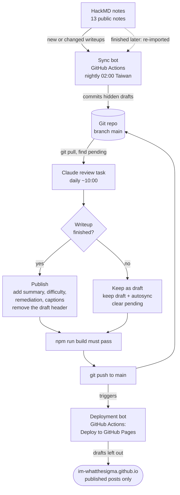

# blog

Personal site with box writeups under `/writeups/`. Built with Astro, deployed to GitHub Pages.

## Run it

```bash
npm install
npm run dev
```

## Make it yours

Edit `src/site.ts`: handle, intro line, GitHub URL.

## Add a writeup

From HackMD (the note must be readable by "Everyone", or published):

```bash
npm run import -- https://hackmd.io/@you/note --platform HTB --os Linux --difficulty Easy --date 2026-03-01
```

From a private note: HackMD menu → Download → Markdown, then

```bash
npm run import -- ./note.md --platform HTB --os Linux --difficulty Easy
```

Each import creates `src/content/writeups/<slug>/index.md` with its images beside it.
Other flags: `--slug`, `--title`, `--summary "one line"`, `--draft true`, `--force`.

Or write one by hand: any `.md` file in `src/content/writeups/` with this front matter:

```yaml
---
title: "Box name"
date: 2026-03-01
platform: "HTB"      # optional
os: "Linux"          # optional
difficulty: "Easy"   # optional
tags: ["smb", "suid"]
summary: "One line shown on the card."   # optional
draft: false         # true = visible in dev only
---
```

## Deploy

1. Create a GitHub repo. Name it `<username>.github.io` for `https://<username>.github.io/`,
   or anything else for `https://<username>.github.io/<repo>/`. Both work without config changes.
2. Push to `main`.
3. Repo → Settings → Pages → Source: **GitHub Actions**.

`.github/workflows/deploy.yml` builds and publishes on every push.

## Automatic sync from HackMD

The blog syncs from the HackMD notes listed in `scripts/sources.json`.



- **Finished** means: machines have both user and root, sherlocks have their tasks answered, challenges reach the flag.
- The sync bot's own commit never starts a deploy: GitHub doesn't let a workflow's commit trigger other workflows. Only a push from the review task (or from you) does.
- Even when a deploy runs, posts with `draft: true` get no page, card or count on the live site. They stay visible in this public repo's files, though.
- Published posts are never re-imported, so hand-added remediation and captions are safe.

1. **Every night at 02:00 (Taiwan)** the *Sync from HackMD* workflow runs `npm run sync`.
   New writeups arrive as hidden drafts marked `pending: true`. Published posts are never touched.
   Drafts marked `autosync: true` are re-imported when their HackMD section changes.
   Run it any time from the repo's **Actions → Sync from HackMD → Run workflow**.
2. **Every day at about 10:00** a scheduled Claude task (in the Claude desktop app) pulls the repo,
   reviews each pending draft, adds summary, difficulty, remediation and captions, publishes the
   finished ones, and pushes. Unfinished writeups stay hidden until you finish them in HackMD.
   It runs only while the app is open; if it was closed at 10:00 it runs on next launch.

By hand, the same flow is:

```bash
npm run sync                       # import new writeups as drafts
node scripts/review/weak-images.mjs machines/<box>       # screenshots needing captions
node scripts/review/add-captions.mjs captions.json      # add captions
node scripts/review/apply-review.mjs scripts/review/enrich-batch-<date>.json  # enrich + publish
```

To add a new HackMD note, add an entry to `scripts/sources.json` (its `level` is the heading depth each writeup starts at). Notes must be readable by Everyone.
