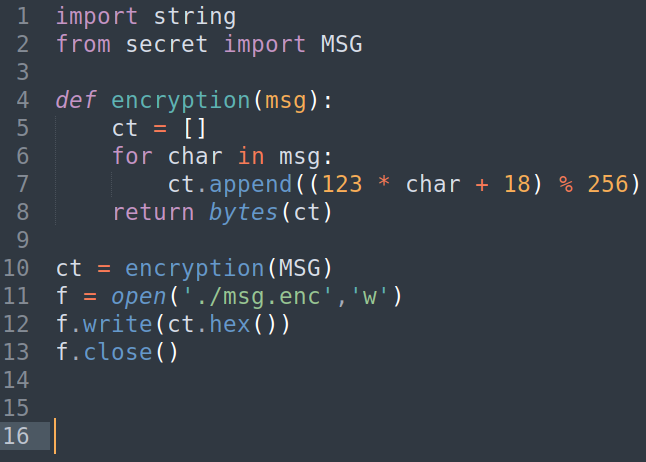
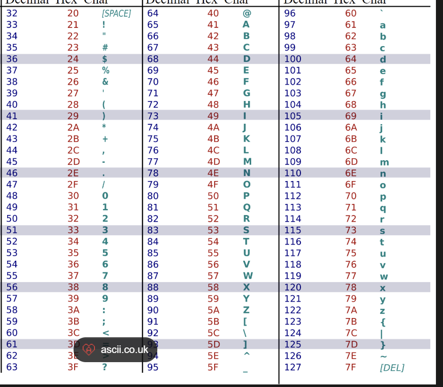

- We are provided with the encryption script, so we can just reverse what they did
    - 
- 
- 
- Okay, so we want to brute force from [33-126], read in bytes by bytes from ./msg.enc and see if `(123 * brute_value + 18) mod 256` equals to the bytes inside ./msg.enc, if it is true then we have found the original value for that char
```python
fd = open("./msg.enc","r")

sec = fd.read()
bytestr = bytes.fromhex(sec)

dec = ''

for char in bytestr:
	for brute_value in range(33,127):
		if((123 * brute_value + 18) % 256) == char:
			dec += chr(brute_value)

print(dec)
```
