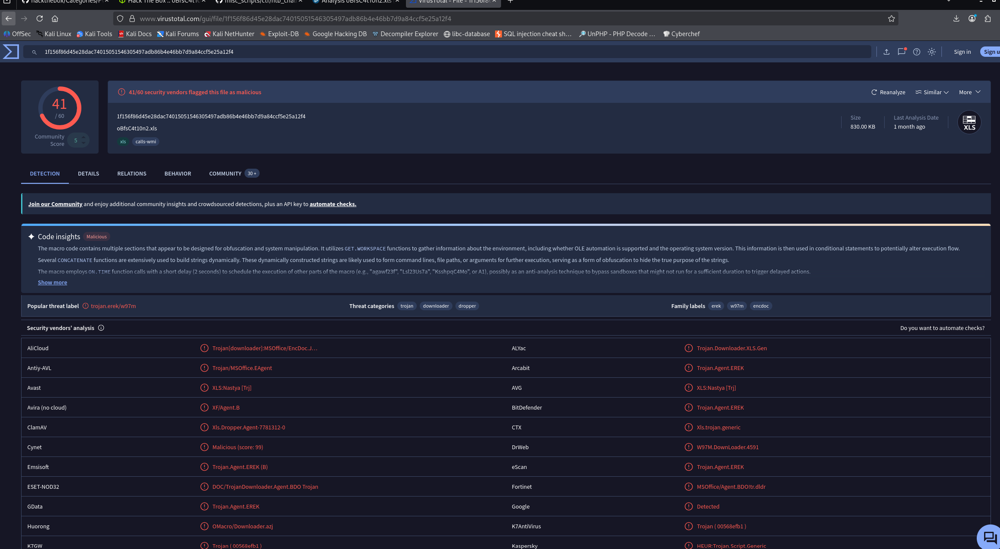
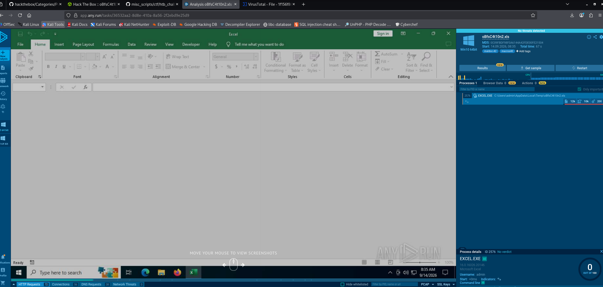
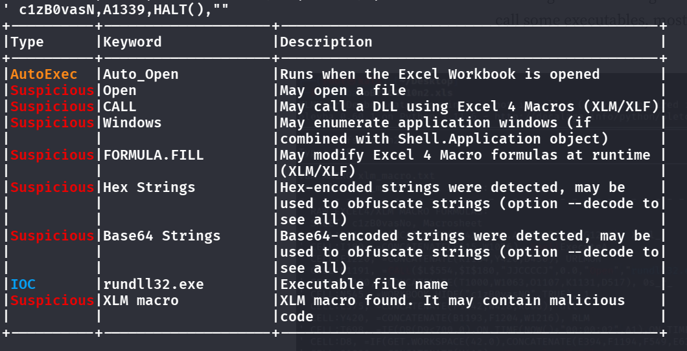
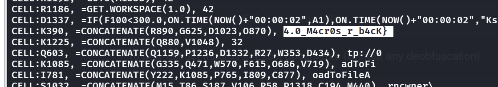
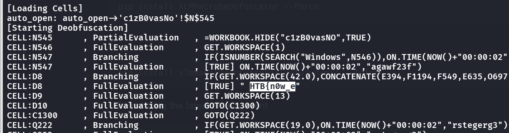
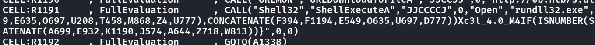

- Hmm, i got an excel file, which VT shows malicious
    - 
- So let's run it in any.run
    - 
- but nothing malicious shows...
- I found a tool called `olevba` for static analysis of Microsoft OLE2 files
    - 
- But it seems useless, and also running the excel file straightly shows nothing but some scatter chars.
- Thus i found another deobfuscator tool: running `xlmdeobfuscator --file oBfsC4t10n2.xls -x -o 0`
    - 
    - We see a part of the flag?
- If we simply do `xlmdeobfuscator -f oBfusC4t10n2.xls`
    - 
- We see another part of the flag, now it seems its missing the middle part
- hmm, wait if we look even more closer:
    - 
- Do you see that `Xc3l_4.0_...`? if we concatenate our findings:
    - `HTB{n0w_eXc3l_4.0_M4cr0s_r_b4cK}`

> Conclusion: I guess it's hard due to there are very difficult ways to piece the flag, but there are also easy ways like running a deobfuscator to piece the flag, thats why the ratings are so normal..?
