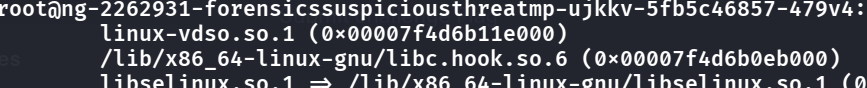

- First ssh into the station
- Then, due to the problem statement "Investigate the anomalies in the **library loading process** and filesystem. Look for hidden manipulations that could indicate a userland **rootkit.**", we know that we want to look using the cmd `ldd /bin/ls`
- We find something sus:
    - 
- .hook looks some kind of hooker to other malicious prog, maybe a rootkit, let us remove it my just simply `mv /lib... /tmp`
- then we see that we can indeed read the flag.txt??
