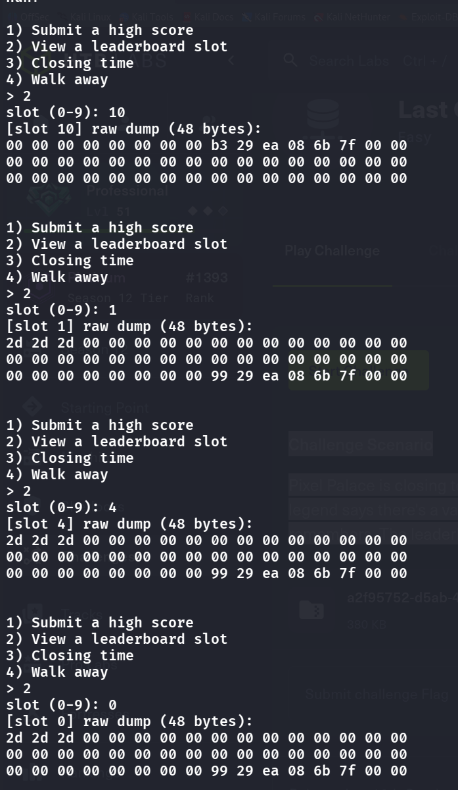
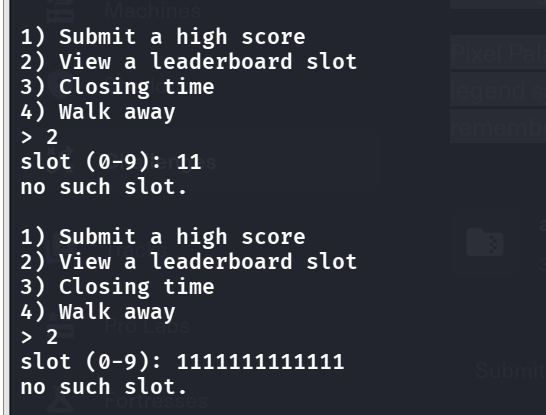
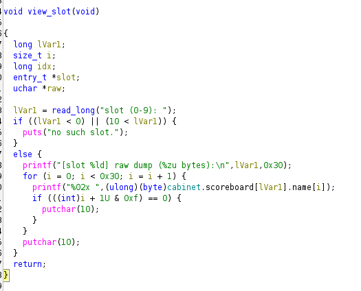

> **Challenge Scenario**
Pixel Palace is closing tonight, for good. The marquee is half-dead, the owner already left, and the only thing still running is the high-score cabinet in the back corner. Local legend says there's a vault behind it that only opens for the one true eternal champion -- not whoever's sitting at the top of the leaderboard, something the cabinet itself remembers. The leaderboard only has 10 slots, and the firmware is ancient enough that nobody ever double-checked where slot 10 actually points.
- Let's first just run this binary and see what the scenario means:
    - 
    - 
- We can see that for 0-9, the hex dumps are all the same, but 10 seems to leak some info, and other than these all show no slot. Let's check the file and the protections:
- 
- Upon first inspection: It seems very secure, with all protections enabled...
- Let's decompile it and see if the code allows us to wrap around of these defenses immediately
    - 
- In the `view_slot` code we can spot the former error
