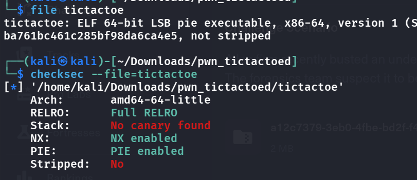

- Some basic checks
    - 
- `Full RELRO -> No overwriting the GOT table`
- `NX + PIE -> ret2libc by somehow leaking the absolute addresss at libc`
- Let's open this up in ghidra and see what's up -> the main player in play here is this `check_winne()` function
```rust
fn check_winner(board: &[[i32;5];5], current: i32, moves: &Vec<(usize, usize, i32)>) -> bool {
    let pattern = obfuscate_pattern();        // builds a regex *string* (into local_278)

    // serialize the whole move history into one string
    let mut s = String::new();
    for &(row, col, player) in moves {
        s.push_str(&format!("<fmt @ DAT_004a5110>", player, row, col));  // note arg order!
    }

    let re = Regex::new(&pattern).unwrap();    // compile the obfuscated pattern

    if re.is_match(&s) {
        println!("--- Pattern Recognized! ---");
        if validate_access_code() {
            ask_for_credentials();             // <<< the actual payload / goal
            return true;
        } else {
            println!("[DEBUG] Incorrect Access Code! ...");
            return false;
        }
    }

    // ---- otherwise: ordinary 5x5 win detection ----
    for i in 0..5 {
        if (0..5).all(|j| board[i][j] == current) { return true; }  // row i
        if (0..5).all(|j| board[j][i] == current) { return true; }  // col i
    }
    if (0..5).all(|i| board[i][i]     == current) { return true; }  // main diagonal
    if (0..5).all(|i| board[i][4 - i] == current) { return true; }  // anti-diagonal
    false
}
```

> TOO DIFFICULT, WORK ON THIS LATER
