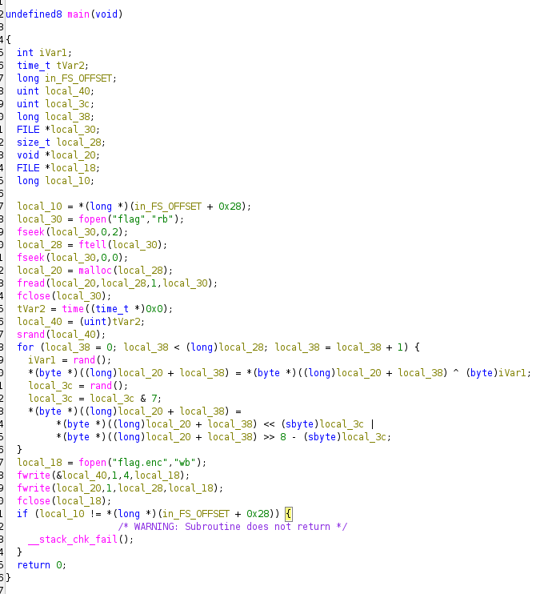
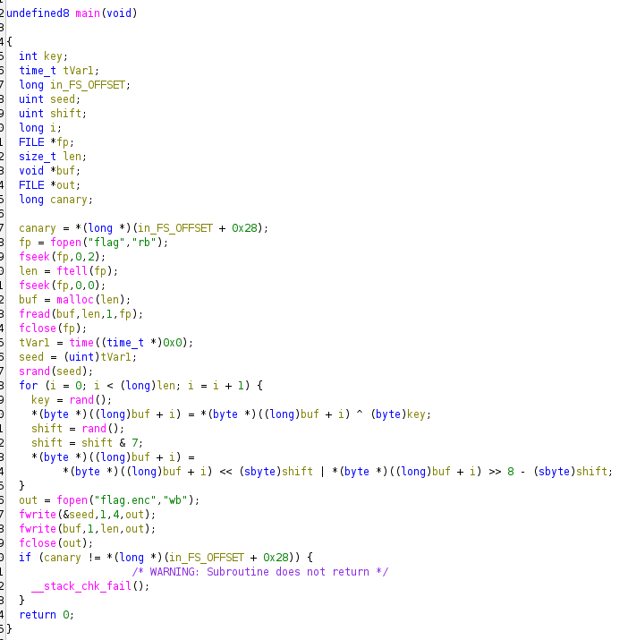
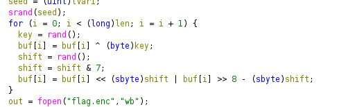

- 
- We can rename some variables and get this
    - 
- Looks way more understandable! However we can do more, see that the whole pointer stuff going in the middle `for` loop? Ghidra doesn't know that our `buf` actually points to `byte`, so we can do `Ctrl + L` and change the type to `byte *`
    - 
- Great! Now we can see that it does this in order:
    - byte for byte `xor`
    - picks a random `shift` in [0,7] (but if we can get the seed it won't be random anymore)
    - rotate it left by `shift`
- So we can write our decryption script:
```python
import ctypes, struct

libc = ctypes.CDLL("libc.so.6")   # must be glibc to match the binary's rand()

data = open("flag.enc", "rb").read()
seed = struct.unpack("<I", data[:4])[0] #due to [seed: 4 bytes][ciphertext: len bytes]
enc = data[4:]

libc.srand(seed)
flag = bytearray()
for c in enc:
    k = libc.rand() & 0xff          # 1st rand(): XOR key, only 8 bits, ANDing with 0xff keeps the last 8 bits to use
    s = libc.rand() & 7             # 2nd rand(): rotate amount
    c = ((c >> s) | (c << (8 - s))) & 0xff   # rotate right by s (undo rotl)
    flag.append(c ^ k)              # undo XOR

print(flag.decode(errors="replace"))
```
