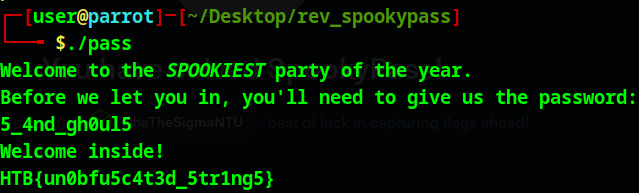

- Simple and straightforward, I believe there are multiple ways to solve this but what I did is go to dogbolt.org and placed the compiled pass file init, we see that there is a check for the secret (or you can just use the `strings` command and check the secret), then run it in any linux environment and put in the secret to get the flag
- 

---
