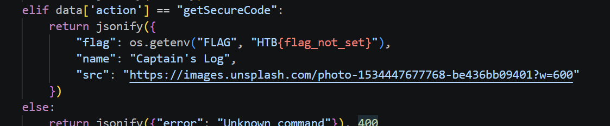
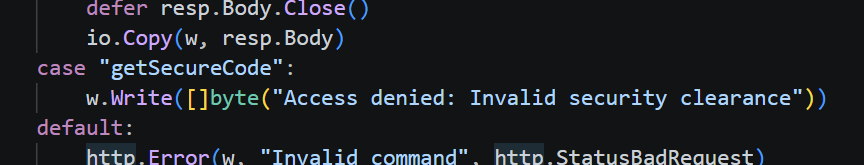

- First, the challenge actually presented its server files to us, and we see that there is a Go server on port 8080, and a Python server on port 8081. If we want to straight up getSecretCode:
    - 
    - It fails because Go blocks it:
        - 
- Thus, what we want to do is to try to bypass the Go server and send the `getSecureCode` to the python server. 
- Note that Go parses input case-insensitively, so it means if we send `{"action": "getSecureCode", "Action": "getcosmic"}`, the last one will be parsed and it will pass, for the Python server, it looks just like `getSecureCode`, and the flag will drop out.
