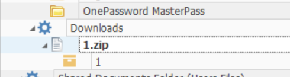
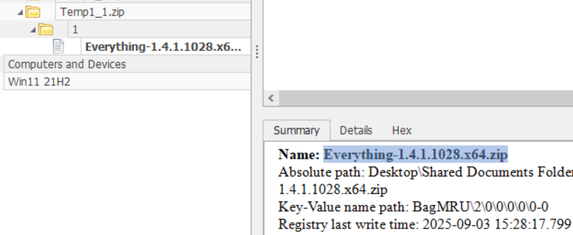
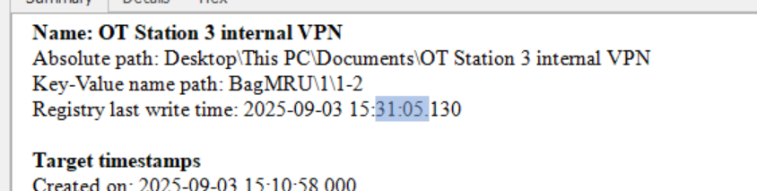
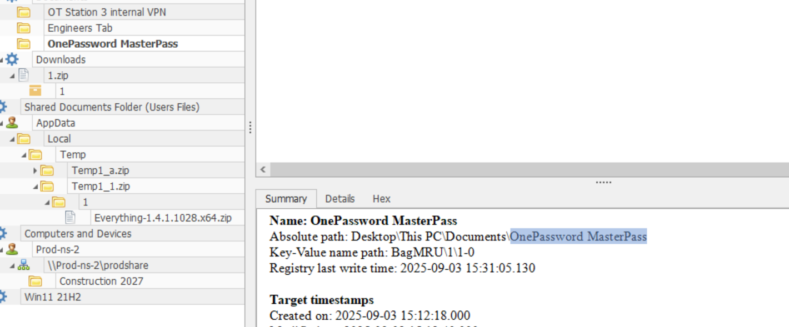
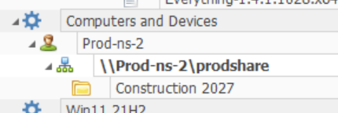
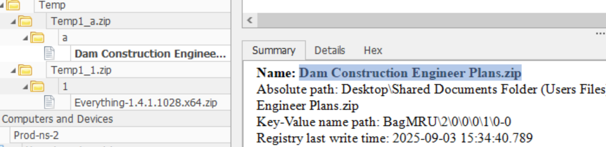
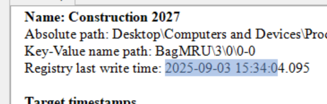
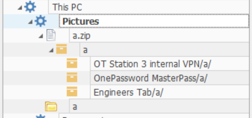
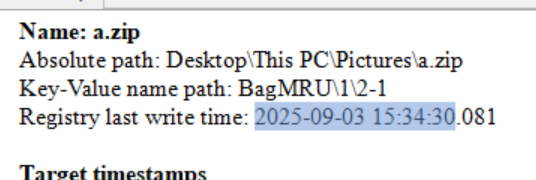

> **What Are Shellbags?**\
Shellbags are Windows registry artifacts that record a user's folder navigation history in Windows Explorer. Every time a user opens a folder - whether local, on a network share, or inside a zip archive - Windows stores metadata about that interaction in the registry.
## T1: What was the name of the archive file downloaded by the compromised account?
- Using Eric Zimmerman's shellbag explorer, we can open the .dat file of steve and see that 
    - 

## T2: What was the name of the utility brought in by the attacker to search for sensitive data?
- 
  Inside the downloaded `Temp1_1.zip`, the shellbags record `Everything-1.4.1.1028.x64.zip`, the installer for Everything, a fast filename-search tool for Windows.

## T3: The attacker navigated the filesystem and found sensitive files used by the victim in their day-to-day work. When was the VPN folder accessed by the attacker?
- 
  The shellbag entry for the `OT Station 3 internal VPN` folder. The highlighted registry last-write time is when that folder was last browsed, which is the access time the question wants.
- Remember to minus 8 hours

## T4: What was the name of the directory containing the victim's passwords?
- 
  Under Documents are the three folders the attacker opened; the one holding the passwords is `OnePassword MasterPass`. The same tree shows the network share `\\Prod-ns-2\prodshare` and its `Construction 2027` folder, which answers T6.

## T5: The attacker also accessed a network share to pillage network data. What is the UNC path?
- `UNC 是 \\Server Name\path 而 FQDN 是 協定://域名/子路徑`
    - 

## T6: When is the dam construction planned?
- Shows above
## T7: What was the name of the archive file present on the network share?
- 
  Opening `Temp1_a.zip`, the network-share archive copied to Temp, shows `Dam Construction Engineer Plans.zip` inside it.

## T8: When was the archive file from the network share accessed?
- 
  The `Construction 2027` folder on the share. Its registry last-write time marks when the archive inside it was opened.

## T9: The attacker created a staging folder to prepare for collection and exfiltration. What is the full path of the staging folder?
- Attacker hid it under `Pictures`
    - 
      `Pictures\a.zip` holds copies of the VPN, OnePassword and Engineers Tab folders: the attacker staged the loot in `Pictures` before zipping it.

## T10: The attacker compressed the staging folder to prepare the data for exfiltration. When was the exfiltration archive file accessed?

- 
  The registry last-write time of `a.zip` is when the exfiltration archive was opened. As the lesson below says, use the last-write time here, not last access.

>Lessons learnt: always look at the "last write" time instead of the last access time

## Detection & mitigation

- **Shellbags show folders, not files.** They prove the attacker *browsed* the VPN and password folders, but not which files were opened. Pair them with LNK files, Jump Lists, prefetch and object-access auditing (Event 4663) to see what was actually read.
- **Staging in a user folder is a pattern to hunt.** Copying loot into `Pictures` and zipping it is local data staging (T1074.001) followed by archive creation (T1560). New archives appearing in profile folders shortly before large outbound transfers are worth alerting on.
- **Don't keep passwords in a folder.** The victim had a directory of passwords for the attacker to find; a password manager with MFA removes that whole step.

### References

- [MITRE ATT&CK — T1074.001 Local Data Staging](https://attack.mitre.org/techniques/T1074/001/)
- [MITRE ATT&CK — T1560 Archive Collected Data](https://attack.mitre.org/techniques/T1560/)
- [Eric Zimmerman's tools (ShellBags Explorer, MFTECmd …)](https://ericzimmerman.github.io/)
