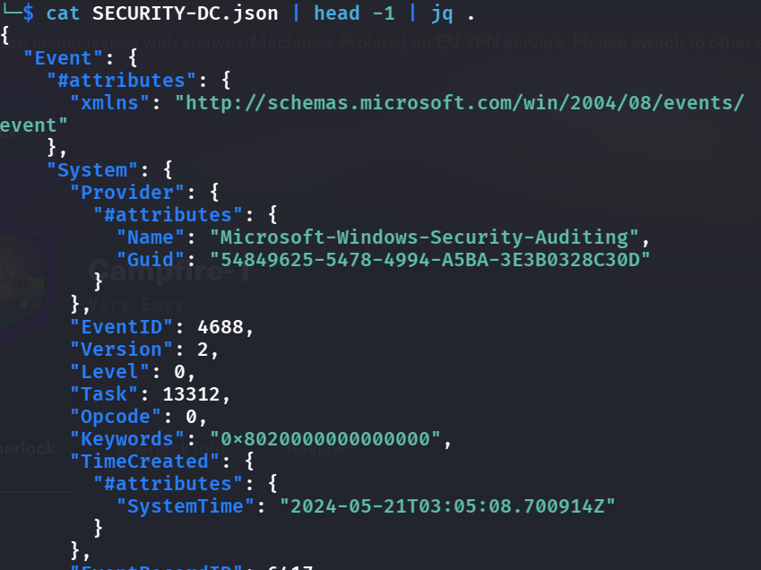
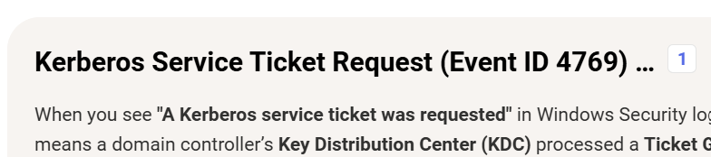
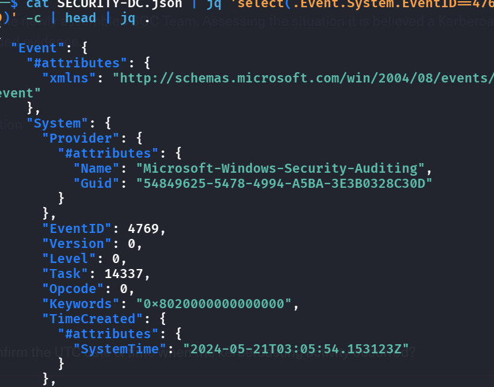
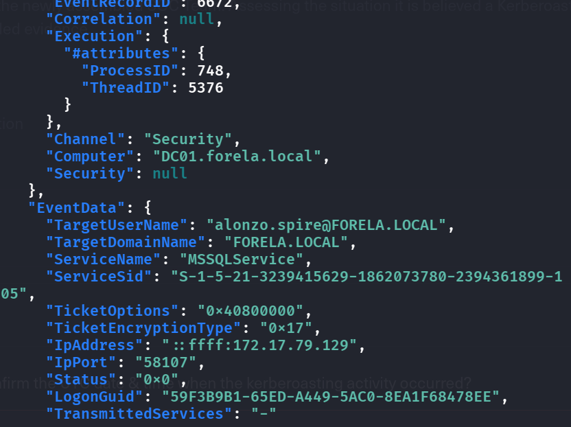
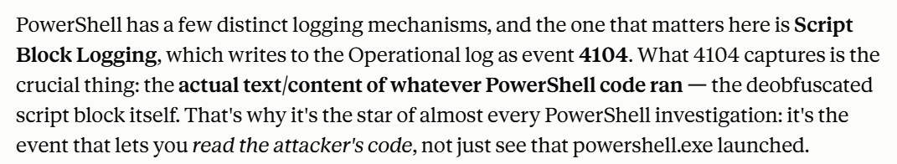
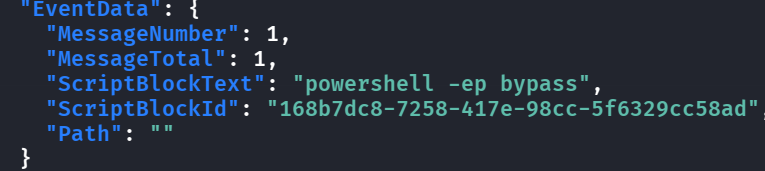
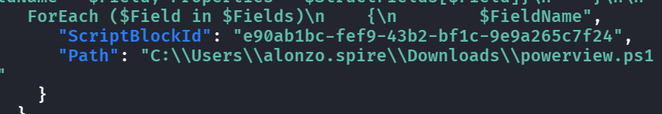
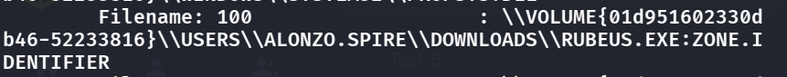

*(抱怨一下 這個誰第一次知道怎麼 command line parse？？ htb 的 Very Easy 真的有些都是詐騙)*

## Pre tasks:
- First let us get some tools:
    - https://github.com/omerbenamram/evtx for .evtx file to json, `cargo install evtx` to easily get it
    - Then we need to add this to $PATH s.t. computer knows where the binary is
    - `echo 'export PATH="$HOME/.cargo/bin:$PATH"' >> ~/.zshrc`
    - `source ~/.zshrc`
    - `sudo apt install libscca-utils` for prefetch files parsing
- What is "Kerberosting"?
    - https://www.crowdstrike.com/en-us/cybersecurity-101/cyberattacks/kerberoasting/
## T1: Analyzing Domain Controller Security Logs, can you confirm the date & time when the kerberoasting activity occurred?
## T2: What is the Service Name that was targeted?
## T3: It is really important to identify the Workstation from which this activity occurred. What is the IP Address of the workstation?
(T1 T2 T3 share the same logic of solving)
- Let's use the evtx tool to turn it into jsonl files:
    - `evtx_dump -o jsonl -t 1 -f SECURITY-DC.json SECURITY-DC.evtx`
    - `cat SECURITY-DC.json | head -1 | jq .
`- 
- We then see something like this, note that it is in lines because of `jsonl` and `jq` highlighting the colors
- If we understood Kerberosting, we know that the attacker would want to ask Kerberos for the TGS (service ticket) then brute force it, and if we google the event id for it it is
    - 
- At the same time, we also see the structure of this file, where what we want is `Event.System.EventID==4769`, so what we can do is filter for this
- `cat SECURITY-DC.json | jq 'select(.Event.System.EventID==4769)' -c | head -1 | jq .`
    - 
- Because we did `head -1` so it only showed one, we have to know that if we don't use `head` we can see all the tickets granted NO MATTER benign or malicious, so how do we find the malicious Kerberosting attack?
- See that most of the `TicketEncryptionType: 0x12`, which is the modern robust `AES256-CTS-HMAC-SHA1-96`, so this should be benign, after researching we see that attacker would try to degrade to `0x17`, which is `RC4`, so we can try to filter for this
- `cat SECURITY-DC.json | jq 'select(.Event.System.EventID==4769 and .Event.EventData.TicketEncryptionType=="0x17")' -c | head | jq .`
    - 
- I am almost certain that this is the Kerberosting attack that happened due to the username matching the problem, and also with `0x17` , a huge indicator. Thus, we can just fill in the answers to the problems

## T4: Now that we have identified the workstation, a triage including PowerShell logs and Prefetch files are provided to you for some deeper insights so we can understand how this activity occurred on the endpoint. What is the name of the file used to Enumerate Active directory objects and possibly find Kerberoastable accounts in the network?
## T5: When was this script executed?
- Now we head to the PS logs, do the same thing to convert it into json file, and I asked Claude how to filter
    - 
- So i'll note that when I want to know what the attacker ran ill just filter for event 4104:
    - `cat PS-Op.json | jq 'select(.Event.System.EventID==4104)' -c | head -1 | jq .`
    - 
- This seems pretty weird, let's keep diving in other events
    - 
- We see that the `ScriptBlockText` is super long, which is already suspicious at the start, and also they all share the same `Path` to `powerview.ps1`
    - 
- Which is a malicious tool from `powerSploit`, so we can just take the 2nd json packet and fill in T4 and T5

## T6: What is the full path of the tool used to perform the actual kerberoasting attack?
## T7: When was the tool executed to dump credentials?
- Note that it is not `powerview.ps1`, because this is to enumerate available users with SPN
- Also in the prefetch files there is a weird one
    - 
- Know that the Rubeus one is already known malicious, so we will run the parser on that file
- 
- It is straightforward to translate this path into windows path, so we are done with this kinda irratating but fun sherlock!

## Detection & mitigation

- **4769 with encryption type 0x17 is the signature.** An RC4 service-ticket request for a service account, in a domain that otherwise uses AES (0x12), is exactly what `jq` surfaced here. Alert on it.
- **Make the tickets worthless to crack.** Use [Group Managed Service Accounts](https://learn.microsoft.com/en-us/windows-server/security/group-managed-service-accounts/group-managed-service-accounts-overview) or long random passwords for anything with an SPN, and disable RC4 for Kerberos.
- **Keep PowerShell script block logging on.** Event 4104 is what exposed PowerView; without it the enumeration step would have been invisible.
- **Prefetch catches the tooling.** A `RUBEUS.EXE` prefetch entry is a free IOC; application control (AppLocker / WDAC) would have stopped it running.

### References

- [MITRE ATT&CK — T1558.003 Kerberoasting](https://attack.mitre.org/techniques/T1558/003/)
- [Microsoft — Group Managed Service Accounts](https://learn.microsoft.com/en-us/windows-server/security/group-managed-service-accounts/group-managed-service-accounts-overview)
- [evtx — fast EVTX parser (evtx_dump)](https://github.com/omerbenamram/evtx)
