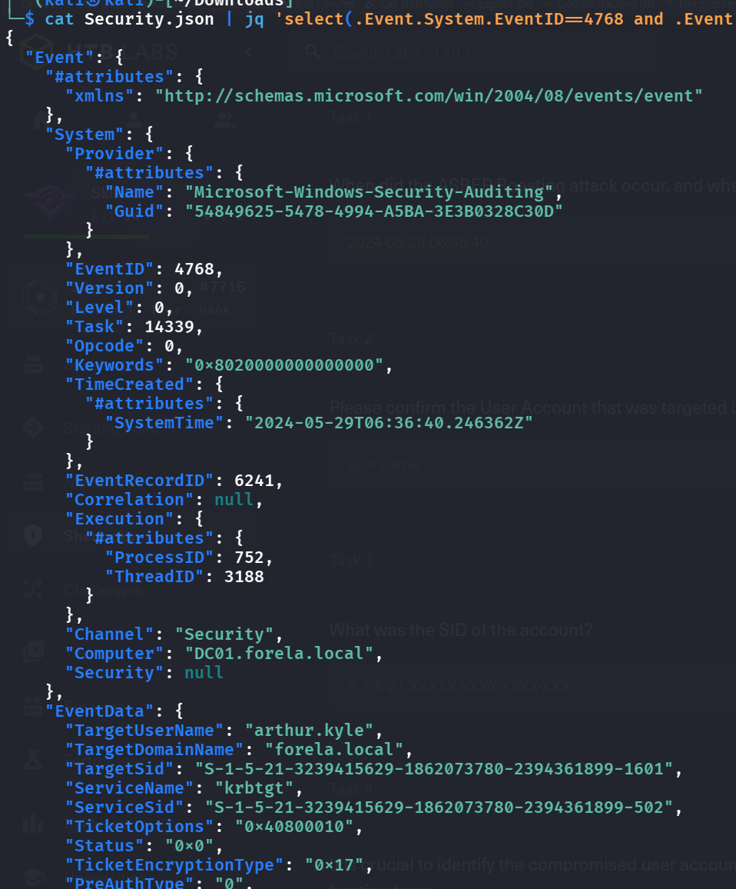
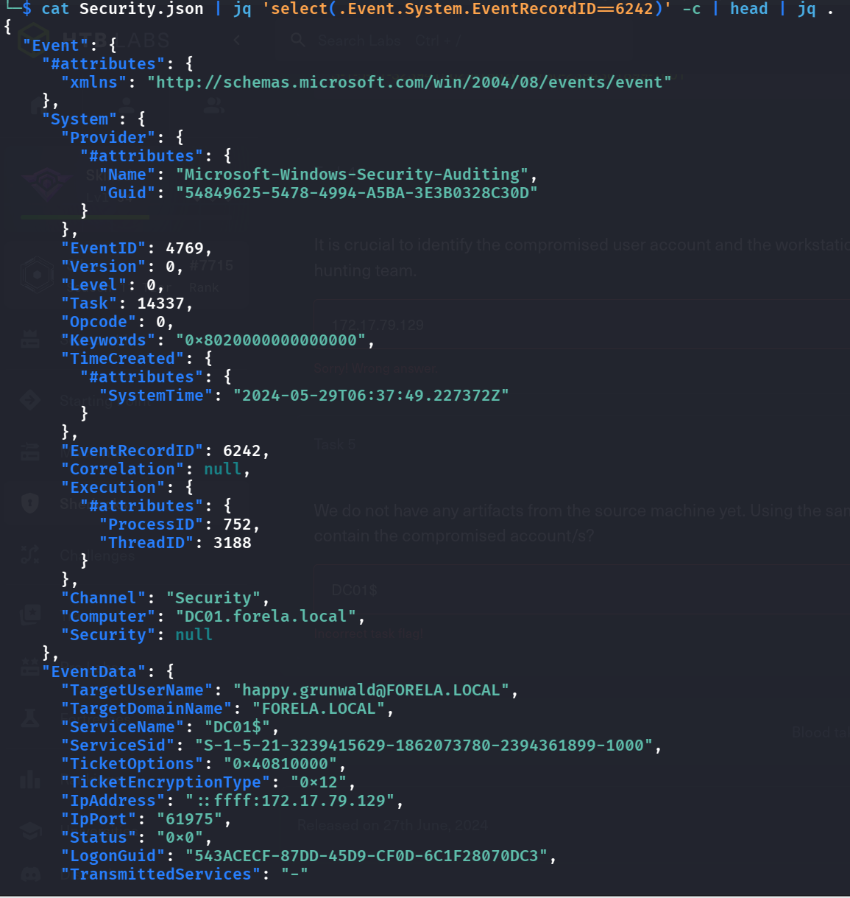

## Pre-Tasks:
- What is AS-REP Roasting:
    - https://pentestlab.blog/2024/02/20/as-rep-roasting/
    - To be frank, it is similar to Kerberosting, however it happens in the very first step when the client requires a TGT, only when a misconfiguration such as `DONT_REQ_PREAUTH` is set that this attack will work. 
## T1: When did the ASREP Roasting attack occur, and when did the attacker request the Kerberos ticket for the vulnerable user?
## T2: Please confirm the User Account that was targeted by the attacker.
## T3: What was the SID of the account? 
- After extracting the ZIP we only see a `SECURITY.evtx` file, so we first turn it into jsonl like the previous sherlock:
    - `evtx_dump -o jsonl -t 1 -f Security.json Security.evtx`
    - We can filter for `eventID=4768` because it is the previous step of Kerberosting, also we know that there is a downgrade of encryption type so we set that to `0x17`.
    -  `cat Security.json | jq 'select(.Event.System.EventID==4768 and .Event.EventData.TicketEncryptionType=="0x17")' -c | head | jq .`
        - 

## T4: It is crucial to identify the compromised user account and the workstation responsible for this attack. Please list the internal IP address of the compromised asset to assist our threat-hunting team.
## T5: We do not have any artifacts from the source machine yet. Using the same DC Security logs, can you confirm the user account used to perform the ASREP Roasting attack so we can contain the compromised account/s?
- Let us select the very next event after the malicious request
    - `cat Security.json | jq 'select(.Event.System.EventRecordID==6242)' -c | head | jq .`
    - 

## Detection & mitigation

- **Find and fix accounts without pre-auth.** The attack only works on accounts with "Do not require Kerberos preauthentication" set. List them with `Get-ADUser -Filter 'DoesNotRequirePreAuth -eq $true'` and turn the flag off.
- **Alert on 4768 with pre-auth type 0 and RC4 (0x17).** That combination is the AS-REP roasting request.
- **Any account that must keep the flag needs a long, random password**, so the roasted hash can't be cracked offline.

### References

- [MITRE ATT&CK — T1558.004 AS-REP Roasting](https://attack.mitre.org/techniques/T1558/004/)
- [Microsoft — Event 4768: a Kerberos authentication ticket (TGT) was requested](https://learn.microsoft.com/en-us/previous-versions/windows/it-pro/windows-10/security/threat-protection/auditing/event-4768)
