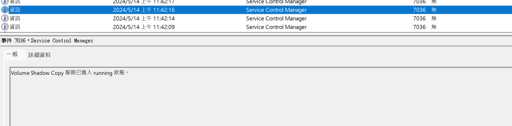
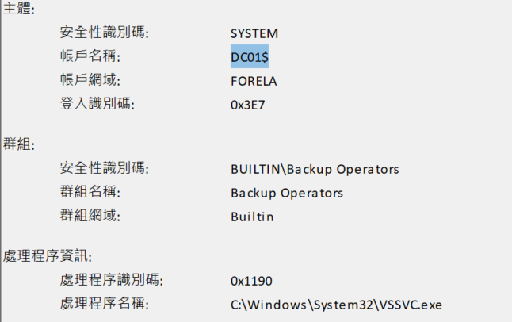
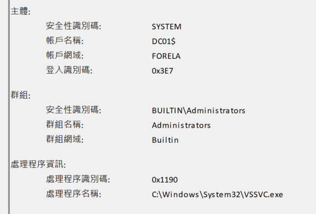
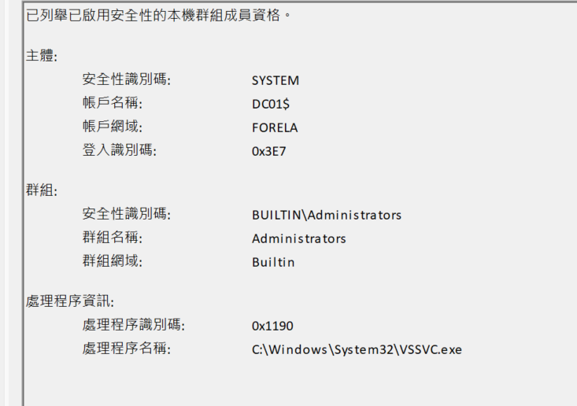
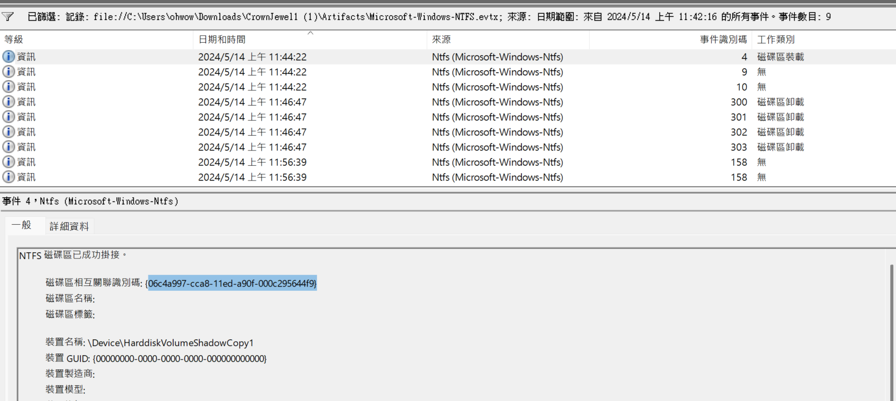
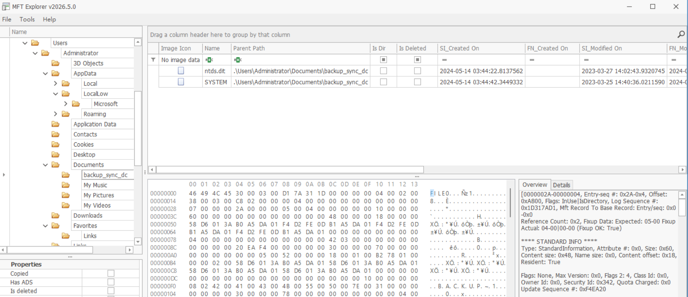
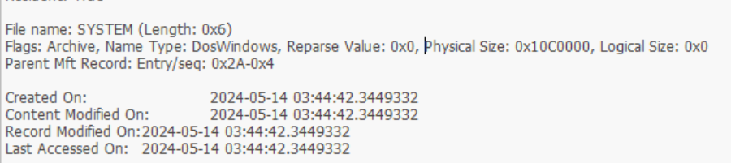

## T1: Attackers can abuse the vssadmin utility to create volume shadow snapshots and then extract sensitive files like NTDS.dit to bypass security mechanisms. Identify the time when the Volume Shadow Copy service entered a running state.
- Using windows' built-in event viewer (dumped linux cause it is not convenient), we can filter for EventID == 7036 on the SYSTEM events, cause it shows what the "Service Control Manager" does, and it starts different services
- 
    - NOTE: BECAUSE WE ARE UTC+8, SO WE HAVE TO -8 hours TO THE SHOWN TIME

## T2: When a volume shadow snapshot is created, the Volume shadow copy service validates the privileges using the Machine account and enumerates User groups. Find the two user groups the volume shadow copy process queries and the machine account that did it.

- Let's go to the SECURITY logs and filter for logs that appear AFTER the previous problem's time, which is 2024/5/14 11:42:16, we then immediately see 2 groups being enumerated by DC01$, so that is the answer
    - 
    - 

## T3: Identify the Process ID (in Decimal) of the volume shadow copy service process.
- Let us stay on the SECURITY logs, and we filter for EventID == 4799 because it shows the PID of different processes in hex
    - 
- Lets just turn `0x1190` into decimal: (0 x 1) + (9 x 16) + (1 x 16 x 16) + (1 x 16 x 16 x 16) = 4496

## T4: Find the assigned Volume ID/GUID value to the Shadow copy snapshot when it was mounted.
- Let's head to the NTFS logs (which is windows' file system), we can also filter for the time AFTER VSS, so we only have 9 events left, then just sort from oldest to newest and the first one is very obvious due to device name being `\Device\HarddiskVolumeShadowCopy1`
- 

## T5: Identify the full path of the dumped NTDS database on disk.
## T6: When was newly dumped ntds.dit created on disk?
- Let us use a tool from Zimermman again, called the MFT viewer
- We see under `Administrator` and if we go to `Documents` there are the backup files, inside:
    - 

## T7: A registry hive was also dumped alongside the NTDS database. Which registry hive was dumped and what is its file size?

- On the same page:
    - 
- We also see it is called SYSTEM and there is a physical size of 0x10C0000, this is equal to 17563648

## Detection & mitigation

- **Alert on shadow copies on DCs.** The Volume Shadow Copy service starting (System 7036) and `vssadmin create shadow` on a domain controller should be rare and reviewed every time.
- **The 4799 burst is a fingerprint.** The DC's machine account enumerating Administrators and Backup Operators right after VSS starts is how this one was dated — it makes a good correlation rule.
- **Watch for copies of `ntds.dit` and the SYSTEM hive** anywhere outside `%SystemRoot%\NTDS` and the registry, such as `Documents`. Together they are everything needed to extract every domain hash (T1003.003).
- **Limit who can touch tier 0.** This needs admin on the DC; keep that group small, monitored, and only used from privileged workstations.

### References

- [MITRE ATT&CK — T1003.003 NTDS](https://attack.mitre.org/techniques/T1003/003/)
- [Microsoft — Event 4799: security-enabled local group membership enumerated](https://learn.microsoft.com/en-us/previous-versions/windows/it-pro/windows-10/security/threat-protection/auditing/event-4799)
