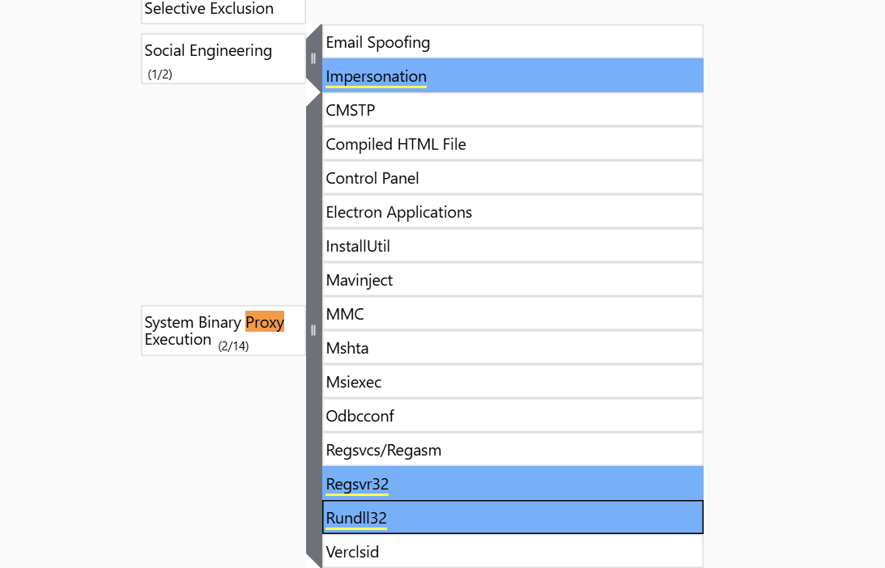
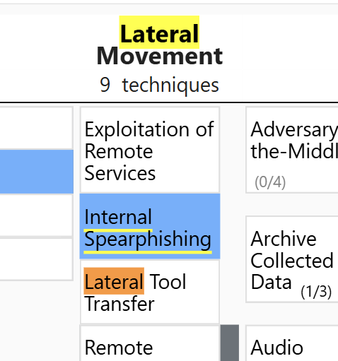
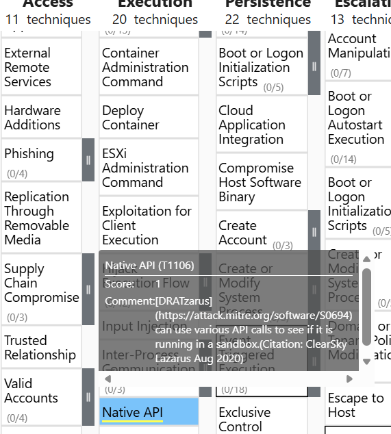
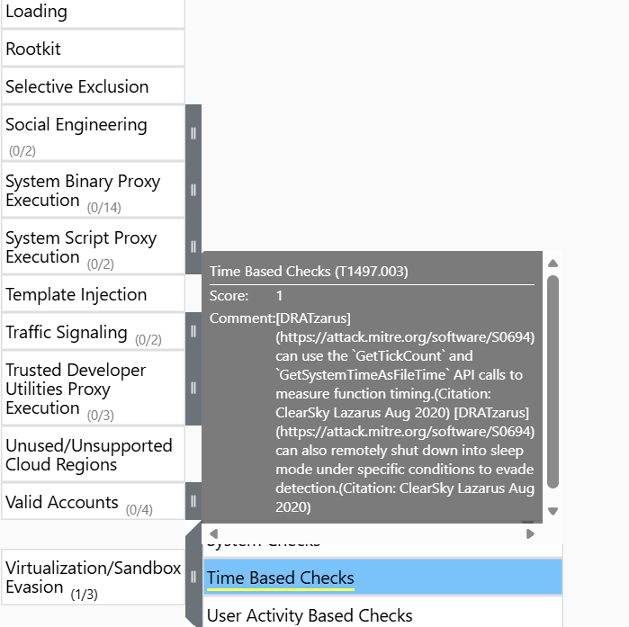

## T1: Who conducted Operation Dream Job?

- Let's use the MITRE ATT&CK data for threat intelligence at https://attack.mitre.org/campaigns/C0022/ and search for it

## T2: When was this operation first observed?
- On that same page we see the answer

## T3: There are 2 campaigns associated with Operation Dream Job. One is Operation North Star, what is the other?
- On that same page we see the answer

## T4: During Operation Dream Job, there were the two system binaries used for proxy execution. One was Regsvr32, what was the other?
- Navigate to `Navigation layers` and view in browser, then search for proxy
    - 

## T5: What lateral movement technique did the adversary use?
- Let's stay on this page and search for `lateral movement`
    - 

## T6: What is the technique ID for the previous answer?
- Just hover that and it shows

## T7: What Remote Access Trojan did the Lazarus Group use in Operation Dream Job?

- Scroll down to the bottom for the answer
## T8: What technique did the malware use for execution?

- Click on [RAT NAME] and go to its navigation layer
    - 

## T9: What technique did the malware use to avoid detection in a sandbox?

- In the same layer, go to `Stealth` and find the ans
    - 

## T10: To answer the remaining questions, utilize VirusTotal and refer to the IOCs.txt file. What is the name associated with the first hash provided in the IOC file?

- Go to `Virustotal` and just paste it in

## T11: When was the file associated with the second hash in the IOC first created?

- Paste in the same place and go to `Details` bottom

## T12: What is the name of the parent execution file associated with the second hash in the IOC?

- Because it asks for parent right, so we go to `Relation` tabl and find the answer there

## T13: Examine the third hash provided. What is the file name likely used in the campaign that aligns with the adversary's known tactics?

- We will find this answer in the Details tab under the Names section. As we know, the 
victims of this operation were job seekers so the most appropriate answer would be

## T14: Which malicious URL in the contacted URLs is used to fetch a secondary .docx file?
- Also in the relations tab

## Sources

- [MITRE ATT&CK — Operation Dream Job (C0022)](https://attack.mitre.org/campaigns/C0022/)
- [MITRE ATT&CK — Lazarus Group (G0032)](https://attack.mitre.org/groups/G0032/)
- [MITRE ATT&CK Navigator](https://mitre-attack.github.io/attack-navigator/)
- [VirusTotal](https://www.virustotal.com/)
