## T1: Its suspected by the security team that there was a rogue device in Forela's internal network running responder tool to perform an LLMNR Poisoning attack. Please find the malicious IP Address of the machine.
- Google for the port of LLMNR and we can set a filter of `udp.port == 5355`
- 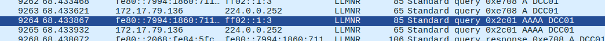

## T2: What is the hostname of the rogue machine?

- We now know the IP of the rogue machine, so we can set a filter of `ip.src == [IP]` and find:
    - Know that DHCP is to give out local IP addresses, so it might need the host name, so we find this protocol and bingo
    - 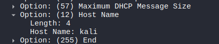


## T3: Now we need to confirm whether the attacker captured the user's hash and it is crackable!! What is the username whose hash was captured?

- Scroll down and see that:
    - 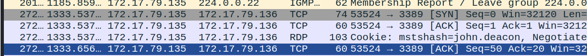


## T4: In NTLM traffic we can see that the victim credentials were relayed multiple times to the attacker's machine. When were the hashes captured the First time?
- This sequence is partically useful to us:
    - 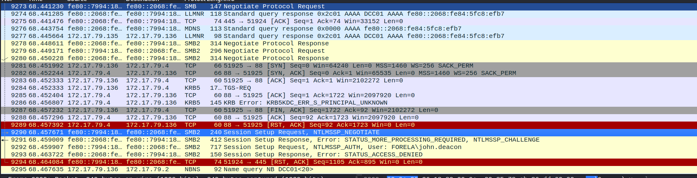
- Which indicates that the attacker successfully done LLMNR poisoning then initiated SMB2, then the attacker tried to auth using Kerberos i believe but he/she failed. -> Falls back to NTLM auth, so we want the first packet of this:
    - 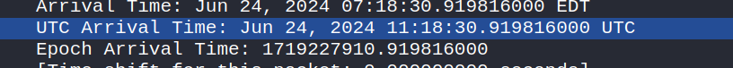


## T5: What was the typo made by the victim when navigating to the file share that caused his credentials to be leaked?
- We see that after this NTLM traffic he tries to query something
    - 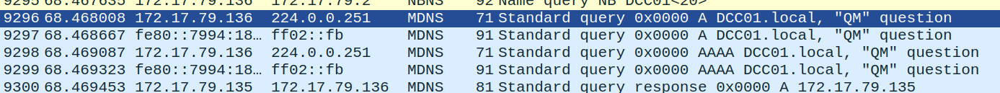
- Lets give DCC01 a guess cause DCC stands for "Document Control", seems matching to the problem

## T6: To get the actual credentials of the victim user we need to stitch together multiple values from the ntlm negotiation packets. What is the NTLM server challenge value?

- We can find this in packet 9291
    - 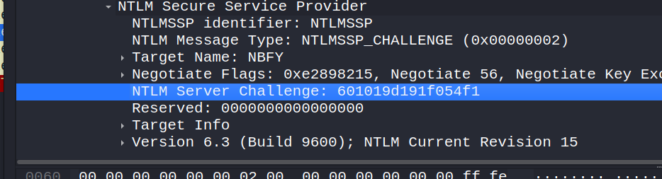


## T7: Now doing something similar find the NTProofStr value.
- Let us google what is NTProofStr
    - 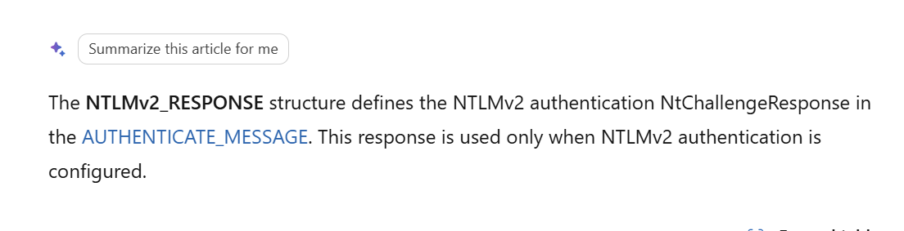
- Has something to do with "auth". So we inspect the NTLMSSP_AUTH packet and find that
    - 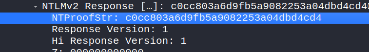


## T8: To test the password complexity, try recovering the password from the information found from packet capture. This is a crucial step as this way we can find whether the attacker was able to crack this and how quickly.
- This is pretty complicated, I first went to the blog post of this LLMNR poisoning and found out that
    - 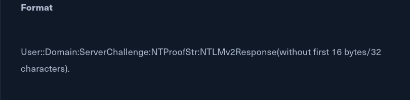
    - The NetNTLMv2 format hashcat expects (mode 5600) is built from four fields in the NTLMSSP packets:

    ```
    username::DOMAIN:ServerChallenge:NTProofStr:NTLMv2Response-without-the-NTProofStr
    ```

    - `ServerChallenge` comes from the NTLMSSP_CHALLENGE packet; `NTProofStr` is the first 16 bytes of the NTLMv2 response in NTLMSSP_AUTH, and the last field is the rest of that response.
    - Let's combine all of this together to get:
```
john.deacon::FORELA:601019d191f054f1:c0cc803a6d9fb5a9082253a04dbd4cd4:010100000000000080e4d59406c6da01cc3dcfc0de9b5f2600000000020008004e0042004600590001001e00570049004e002d00360036004100530035004c003100470052005700540004003400570049004e002d00360036004100530035004c00310047005200570054002e004e004200460059002e004c004f00430041004c00030014004e004200460059002e004c004f00430041004c00050014004e004200460059002e004c004f00430041004c000700080080e4d59406c6da0106000400020000000800300030000000000000000000000000200000eb2ecbc5200a40b89ad5831abf821f4f20a2c7f352283a35600377e1f294f1c90a001000000000000000000000000000000000000900140063006900660073002f00440043004300300031000000000000000000
```
- Let's use this cmd `hashcat -m 5600 hash.txt /usr/share/wordlists/rockyou.txt.gz`
- And we have
    - 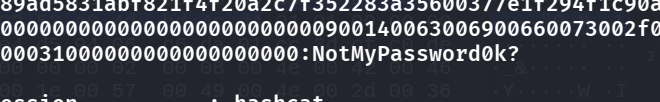


## T9: Just to get more context surrounding the incident, what is the actual file share that the victim was trying to navigate to?
- 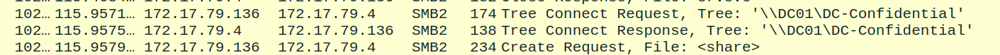

## Detection & mitigation

- **Turn off LLMNR and NBT-NS.** Set the "Turn off multicast name resolution" Group Policy and disable NetBIOS over TCP/IP; then a typo like `DCC01` fails instead of being answered by Responder.
- **Require SMB signing** so captured authentication can't be relayed, only cracked.
- **Passwords that survive rockyou.** The hash cracked from a public wordlist; enforce length and block known-breached passwords.
- **Detect the rogue responder.** LLMNR (UDP 5355) responses from a host that isn't a DNS server, or one machine answering for many different names, is the Responder fingerprint.

### References

- [MITRE ATT&CK — T1557.001 LLMNR/NBT-NS Poisoning and SMB Relay](https://attack.mitre.org/techniques/T1557/001/)
- [hashcat — example hashes (mode 5600, NetNTLMv2)](https://hashcat.net/wiki/doku.php?id=example_hashes)
