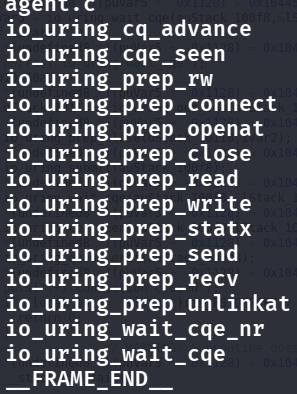
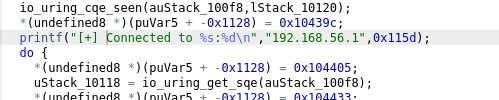
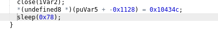
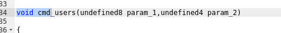
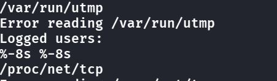
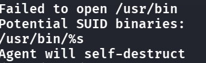
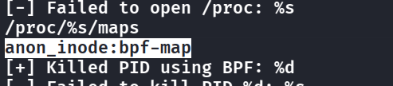
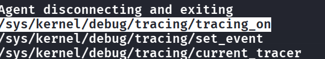
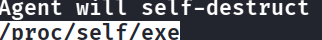
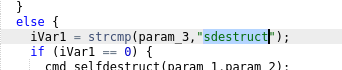

## T1: What is the SHA256 hash of the malicious binary?
- `sha256sum agent` to get the hash

## T2: What is the IP address hardcoded in the binary for C2 communication?

- Try using `strings agent` and find the answer

## T3: What port does the agent connect to on the C2 server?

- Using `strings` would not work here, because the port is obfuscated behind something, so we do `objdump -d agent > agent.asm` to decompile it into assembly code for us to read (though I am really bad at reading assembly)
- Though in the strings, we still see some hints:
    - 
- The malicious file uses `io_uring`, this is the modern, high-performance asynchronous interface introduced to the Linux kernel relatively recently, which is stealthier than the normal sockets such as `connect()`...
- Let's throw this whole binary into Ghidra and search for `connect`, we find something useful:
    - 
- This `0x115d` seems like a hex of an integer, let's find out and it is port 4445.

## T4: How many seconds does the agent wait before attempting to reconnect after a failed connection?
- This feels hard at first, but we can think of some keywords like `sleep` and see that
    - 
- Same, convert this hex into integer we get 120

## T5: How many different commands does the agent support? (excluding invalid commands)
- This is a pretty difficult guess, where we want to search for function blocks in ghidra starting with `void cmd`, we know that void can indicate a start of a function, and `cmd` here kinda just means the commands the agent supports
    - 
- There are 11.

## T6: What Linux kernel interface does this malware abuse to evade EDR syscall monitoring?

- A bit easier, where in the above problems we already know that this malware uses `io_uring` to try to conceal itself from detection instead of using the traditional sockets

## T7: What file does the agent read to enumerate logged-in users?
- We can head back to the `strings` output, where we can see:
    - 

## T8: What directory does the agent scan when searching for SUID binaries for privilege escalation?
- It is an easy guess, but we can go to `strings` output for double check
    - 

## T9: What string does the agent search for in /proc/[pid]/maps to identify security tools using eBPF?
- A simple search in `strings` again
    - 

## T10: What is the full path of the first tracing file the agent attempts to disable?
- Another simple search
    - 

## T11: What procfs path does the agent read to find its own executable location before self-destruction?
- See that under `self destruct` there is a path
    - 

## T12: What command string is compared by the agent to trigger deletion of its own binary?
- I just searched in ghidra for `destruct`
    - 

## Detection & mitigation

- **io_uring is a blind spot for syscall-based monitoring.** Network and file I/O submitted through io_uring never goes through `connect()`/`read()`, so auditd and seccomp rules on those syscalls see nothing. On hosts that don't need it, disable it with `sysctl kernel.io_uring_disabled=2` (Linux 6.6+).
- **Tampering with tracing is itself a signal.** Writes to `/sys/kernel/tracing` (or `/sys/kernel/debug/tracing`) and processes probing `/proc/*/maps` for eBPF tools are defense-evasion behaviour (T1562.001) — alert on them.
- **Catch the self-delete.** The agent read `/proc/self/exe` and unlinked its binary (T1070.004). A running process whose executable shows as `(deleted)` is a classic hunt query.

### References

- [Linux kernel docs — io_uring_disabled sysctl](https://docs.kernel.org/admin-guide/sysctl/kernel.html#io-uring-disabled)
- [MITRE ATT&CK — T1562.001 Disable or Modify Tools](https://attack.mitre.org/techniques/T1562/001/)
- [MITRE ATT&CK — T1070.004 File Deletion](https://attack.mitre.org/techniques/T1070/004/)
