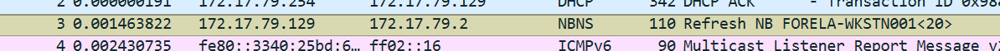
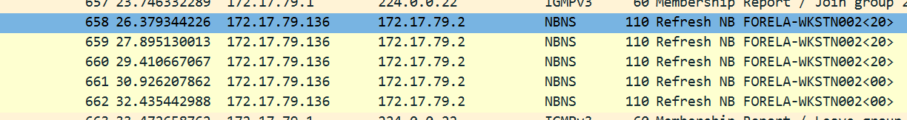
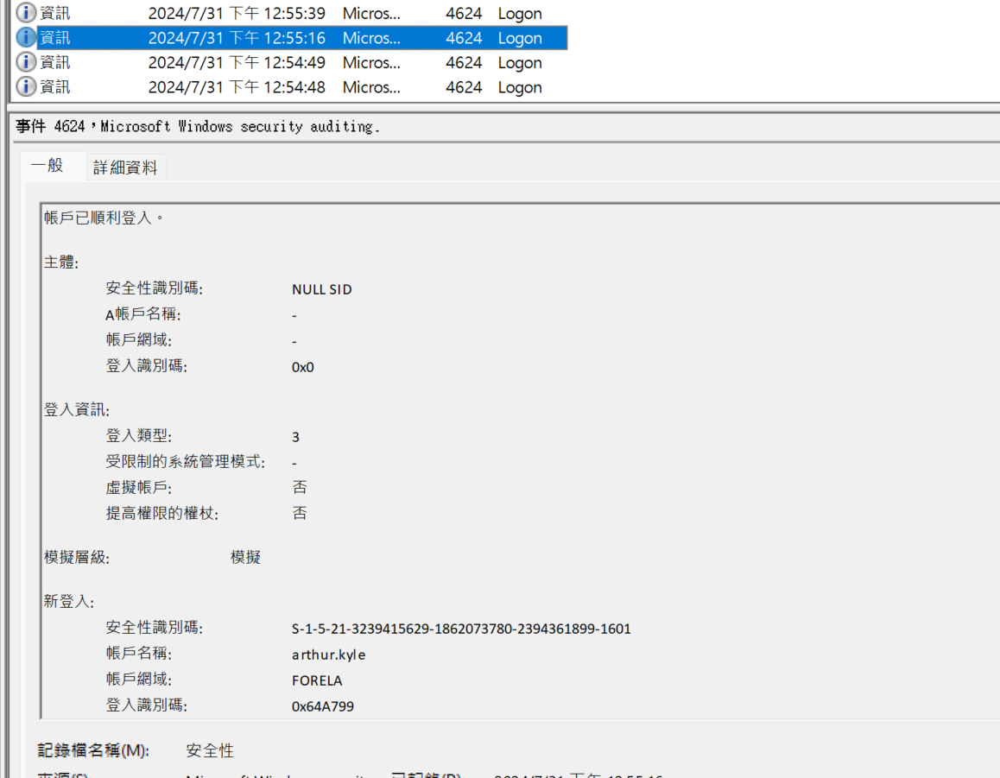
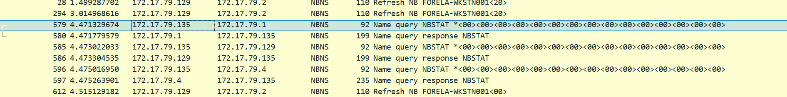
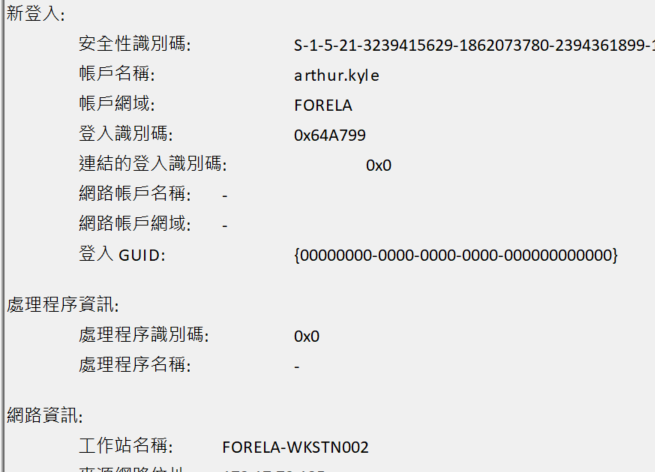
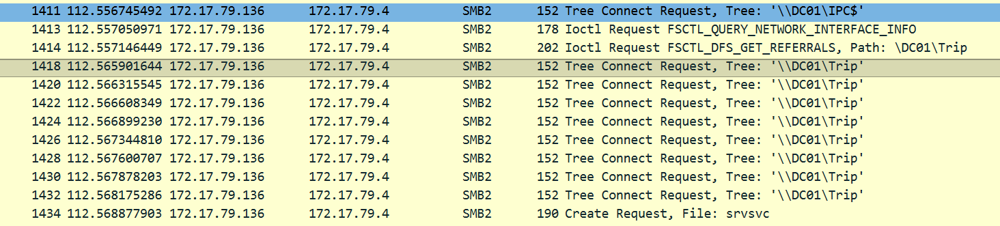
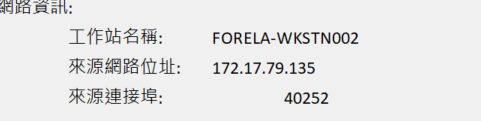
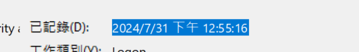
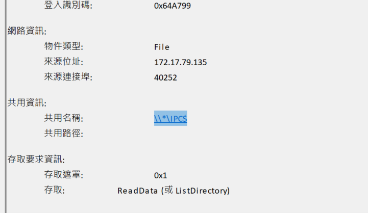

## T1: What is the IP Address for Forela-Wkstn001?
- 
    - This is the source asking via NBNS for a refresh 
## T2: What is the IP Address for Forela-Wkstn002?
- 
    - Same of the prev prob
## T3: What is the username of the account whose hash was stolen by attacker?
- 
    - We see that all other logon events all have logon type 5, which are services, only this has 3 which means via internet logon, so this might be an attack
## T4: What is the IP Address of Unknown Device used by the attacker to intercept credentials?
- 
    - Look at the .135 source, there is literally no hostname, it might be a machine set up by an attacker to eardrop on the credentials
## T5: What was the fileshare navigated by the victim user account?
- See fileshare -> filter for smb2
- 
- We know that arthur.kyle, the victim logged onto FORELA-WKSTN002, and the ip is .136, so we can also filter for this as the source
    - 

## T6: What is the source port used to logon to target workstation using the compromised account?
- This is just in the previous event file too
    - 

## T7: What is the Logon ID for the malicious session?
- This is obvious too
    - It's the `TargetLogonId` field of that same Event ID 4624.

## T8: The detection was based on the mismatch of hostname and the assigned IP Address.What is the workstation name and the source IP Address from which the malicious logon occur?
- Just in the same exact event file as above
    - Read the `WorkstationName` and `IpAddress` fields together: the name claims to be one workstation, but the IP belongs to another — that mismatch is what tripped the detection.

## T9: At what UTC time did the the malicious logon happen?
- 
    - Remember to -8 hours cause we are in UTC+8
## T10: What is the share Name accessed as part of the authentication process by the malicious tool used by the attacker?
- 

## Detection & mitigation

- **The detection itself is the lesson.** It fired on a 4624 logon whose `WorkstationName` didn't match the host that owns the source IP. That hostname/IP mismatch on network logons (type 3) is a cheap, high-signal rule for relayed authentication.
- **Make relaying fail.** Require SMB signing on clients and servers — a relayed NTLM session can't sign, so the relay breaks. See [Microsoft — SMB signing overview](https://learn.microsoft.com/en-us/troubleshoot/windows-server/networking/overview-server-message-block-signing).
- **Remove the poisoning opportunity.** The attacker got the credentials by answering NBNS name queries; disable NBT-NS and LLMNR so a typo'd name never goes out as a broadcast.
- **Shrink NTLM.** Audit and reduce NTLM use, and enable Extended Protection for Authentication where services support it.

### References

- [MITRE ATT&CK — T1557.001 LLMNR/NBT-NS Poisoning and SMB Relay](https://attack.mitre.org/techniques/T1557/001/)
- [Microsoft — Event 4624: an account was successfully logged on](https://learn.microsoft.com/en-us/previous-versions/windows/it-pro/windows-10/security/threat-protection/auditing/event-4624)
- [Microsoft — SMB signing overview](https://learn.microsoft.com/en-us/troubleshoot/windows-server/networking/overview-server-message-block-signing)
