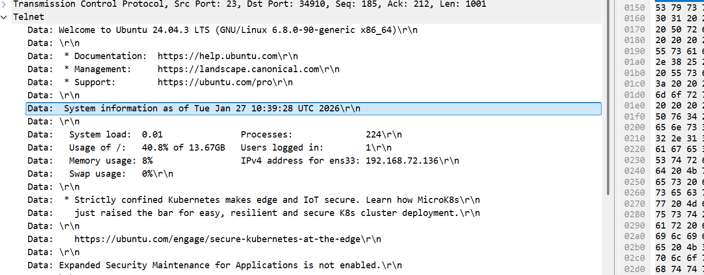

## T1: What CVE is associated with the vulnerability exploited in the Telnet protocol?
- Google for the telnetd CVE this year, or if you have been following recent news might be obvious

## T2: When was the Telnet vulnerability successfully exploited, granting the attacker remote root access on the target machine?
- We can open the pcap file with Wireshark, and filter for `telnet`. We then can see that there is a packet where 1001 bytes of data has been transmitted, so we click on it for more info. We then see that it shows the successful login of the system machine, maybe indicating the remote root access. To double check, let's see then next packet following this, we see that there is root in it, so this 1001 bytes packet must be the one that granted root access.
    - 

## T3: What is the hostname of the targeted server?
- Let's keep exploring the telnet packets below the login packet, and we see that there is the hostname

## T4: The attacker created a backdoor account to maintain future access. What username and password were set for that account?
- We can keep scrolling down the packets, or we can follow the TCP stream of the first packet, and see that there is the `useradd` command, there contains the answer

## T5: What was the full command the attacker used to download the persistence script?
- See below that the attacker sent a request to `https://raw.githubusercontent.com/montysecurity/linper/refs/heads/main/linper.sh`, so we can just guess whether the tool is `curl` or `wget`. Turns out it is `wget`

## T6: The attacker installed remote access persistence using the persistence script. What is the C2 IP address?
- It's kind of a guess, answer is still in the TCP stream

## T7: The attacker exfiltrated a sensitive database file. At what time was this file exfiltrated?

- We see in the TCP stream there is a `blackfriday.db` file that is HTTP GETed, just record the time

## T8: Analyze the exfiltrated database. To follow compliance requirements, the breached organization needs to notify its customers. For data validation purposes, find the credit card number for a customer named Quinn Harris.

- We want to filter for `http`, and lets do `file -> export objects -> http` and export the .db file out. Now we go to vscode with sqlite viewer to find the answer

## Detection & mitigation

- **Remove telnetd.** The root login came from the telnetd authentication bypass. Patch it, or better, uninstall telnet and use SSH.
- **Telnet is cleartext.** That's why the whole session — commands, the backdoor password, the download — could be read straight out of the TCP stream.
- **Alert on new local accounts and odd downloads.** `useradd` on a server (T1136.001) and a server fetching scripts from `raw.githubusercontent.com` are both worth an alert.
- **Encrypt cardholder data at rest.** The exfiltrated database held card numbers in plaintext; PCI DSS requires them to be rendered unreadable.

### References

- [CVE-2026-24061 — telnetd authentication bypass](https://github.com/Chocapikk/CVE-2026-24061)
- [MITRE ATT&CK — T1136.001 Create Account: Local Account](https://attack.mitre.org/techniques/T1136/001/)
- [PCI Security Standards Council](https://www.pcisecuritystandards.org/)
